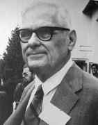

## Generalização

- [Generalização]{.azul} é uma das técnicas fundamentais que nos permitem [reutilizar soluções]{.azul} em outros contextos.

<br>

- Construímos [soluções genéricas]{.azul} que se tornarão [específicas]{.vermelho} na hora do uso.

## Meta-Programação

- [Meta-programação]{.azul} é o uso de [funções de alta-ordem]{.azul}.
  - A ideia é brilhante e simples, mas muito poderosa.

<br>

- Esse conceito provê o fundamento para [computadores de propósito geral]{.azul}.
  - Um sistema operacional é um programa que manipula outros programas.

<br>

- Meta-programação também fundamenta o estudo dos [limites da Computação]{.azul}.
  - Surgem a partir de paradoxos gerados por um programa analisar ele próprio...

# Expressões Lambda

:::: {.columns style="display: flex; align-items: center;"}
::: {.column width="30%" .center}
[λ]{.lambda-grande}
:::
::: {.column width="30%"}
{width=55%}
:::
::::

## Um pouco de Cálculo...

Em Cálculo I, você provavelmente aprendeu que:

$$\frac{d}{dx}\, x^2 = 2x$$

Seja $f(x) = x^2$ e $f'(x) = 2x$. Podemos expressar essas funções em Pyret:

```pyret
fun f(x :: Number) -> Number: x * x end

fun f-linha(x :: Number) -> Number: 2 * x end
```

## Um pouco de Cálculo...

- Nesse caso, $\frac{d}{dx} f(x) = f'(x)$. Mas qual é o **tipo** do operador $\frac{d}{dx}$?

. . .

- $\frac{d}{dx}$ é, na verdade, uma [função de *funções* para *funções*]{.azul}!

```pyret
d-dx :: ((Number -> Number) -> (Number -> Number))
```

. . .

- Se quisermos aproximar a derivada numericamente em um ponto $x$, podemos computar:

$$\frac{d}{dx} f(x) \approx \frac{f(x + \epsilon) - f(x)}{\epsilon}$$

para $\epsilon$ suficientemente pequeno.

## Um pouco de Cálculo...

Podemos escrever isso em Pyret:

::: {.pyret-live data-height="430"}
```pyret
fun g(x :: Number) -> Number: x * x end

fun g-linha(x :: Number) -> Number: 2 * x end

fun d-dx-no-ponto(f :: (Number -> Number), x :: Number) -> Number:
  epsilon = 0.00001
  (f(x + epsilon) - f(x)) / epsilon
where:
  d-dx-no-ponto(g, 10) is-roughly g-linha(10)
end
```
:::

. . .

Porém, esta função [não]{.alert} tem o contrato que queríamos anteriormente:

```pyret
d-dx :: ((Number -> Number) -> (Number -> Number))
```

## Um pouco de Cálculo...

E se tentássemos algo como:

```pyret
fun d-dx(f):
  (f(x + epsilon) - f(x)) / epsilon
end
```

Porém, esse código não funciona... ([`x` não é definido!]{.alert})

Queremos retornar uma **função** `(Number -> Number)`{.pyret}, e não um número!

. . .

[**Solução:**]{.verde}

```pyret
fun d-dx(f :: (Number -> Number)) -> (Number -> Number):
  epsilon = 0.00001
  lam(x :: Number) -> Number:
    (f(x + epsilon) - f(x)) / epsilon
  end
end
```

## Um pouco de Cálculo...

::: {.pyret-live data-height="470"}
```pyret
fun d-dx(f :: (Number -> Number)) -> (Number -> Number):
  epsilon = 0.00001
  lam(x :: Number) -> Number:
    (f(x + epsilon) - f(x)) / epsilon
  end
end
```

- Acima, `d-dx` cria uma [**função lambda**]{.azul} (anônima, sem nome) nova, em tempo de execução.
- Podemos agora gerar a derivada (numérica) de qualquer função `(Number -> Number)`{.pyret}:

```pyret
fun g(x): x * x end
g-linha = d-dx(g)

check:
  g-linha(10) is-roughly 20
end
```
:::

## Expressões Lambda

- São funções [anônimas]{.azul} (sem nome).

```pyret
lam(x1, ..., xn): e end
```

- [x1]{.azul}, ..., [xn]{.azul} são variáveis
- [e]{.verde} é uma expressão válida

<br>

- **Definição** de função: `lam(x): x + 1 end`{.pyret}

<br>

- **Aplicação** de função: `lam(x): x + 1 end(2)`{.pyret} $\;\longrightarrow\;$ devolve `3`{.pyret}

## Filtrando Tabelas {visibility="hidden"}

Em Pyret, podemos [filtrar linhas de uma tabela]{.azul} usando a função [filter-with]{.azul}:

```pyret
filter-with(shuttle, is-summer)
```

:::: {.columns style="display: flex; align-items: center;"}
::: {.column width="22%" .small}
| month | riders |
|-------|-------:|
| "Jan" | 1123   |
| "Feb" | 1045   |
| "Mar" | 1087   |
| "Apr" | 999    |
:::
::: {.column width="8%" .center}
[⟹]{style="font-size: 2em; color: #2e75b6;"}
:::
::: {.column width="22%" .small}
| month | riders |
|-------|-------:|
| "Jan" | 1123   |
| "Feb" | 1045   |
| "Mar" | 1087   |
:::
::: {.column width="45%"}
```pyret
is-summer :: (r :: Row) -> Boolean
```

[É retornada uma tabela apenas com as linhas cuja aplicação da função [is-summer]{.roxo} retorna [true]{.verde}.]{.azul}
:::
::::

## Filtrando Tabelas {visibility="hidden"}

Em Pyret, podemos [filtrar linhas de uma tabela]{.azul} usando a função `filter-with`:

```pyret
filter-with :: (t :: Table, f :: (Row -> Boolean)) -> Table
```

- Note que o segundo argumento da função [filter-with]{.azul} é uma [função]{.roxo}!
- Por que essa função tem que ser do tipo [`(Row -> Boolean)`]{.roxo}?
- O que acontece se passarmos uma função com outro contrato?

. . .

<br>

Isto é uma [Função de Alta-Ordem]{.alert}!

## Expressões Lambda {visibility="hidden"}

No exemplo anterior, podemos passar uma expressão lambda para o segundo argumento de `filter-with`:

```pyret
filter-with(shuttle, lam(r): r["riders"] < 1000 end)
```

- [lam]{.vermelho}`(r)` significa [“crie uma função temporária que recebe `r` como entrada”]{.azul}.
- Em geral, usamos expressões lambda para criar funções simples que não necessariamente serão reutilizadas futuramente.

## Expressões Lambda

:::: {.columns style="display: flex; align-items: center;"}
::: {.column width="72%"}
- “[lam]{.azul}” vem de “[lambda]{.azul}”, uma forma de definir funções que existe em diversas linguagens de programação.

<br>

- Origem:
  - [Cálculo Lambda (λ)]{.vermelho}, de [Alonzo Church]{.azul} (década de 1930)
  - [Church]{.azul} foi o orientador do [Alan Turing]{.azul}
  - Modelo de [computação universal]{.azul}
  - Teve papel fundamental na teoria de linguagens de programação, sistemas de tipos, programação funcional, entre outros temas
:::
::: {.column width="24%"}
{width=90%}
:::
::::

## Funções de Alta Ordem

- Linguagens de programação modernas (e.g., Python, Java, C++, Go, ...) adotam vários elementos do [paradigma funcional]{.azul}, como [funções lambda]{.azul} e [funções de alta-ordem]{.azul}.

<br>

- Há 3 funções de alta-ordem, em especial, que são frequentemente utilizadas e implementadas na maioria das linguagens de programação:
  - [**Filter:**]{.azul} filtra elementos de listas
  - [**Map:**]{.azul} aplica uma função a todos elementos de uma lista
  - [**Fold:**]{.azul} aplica uma função “juntando” todos elementos de uma lista

## Exemplo: Modelando formas geométricas

:::: {.columns style="display: flex; align-items: center;"}
::: {.column width="58%"}
::: {style="font-size: 0.7em;"}
```pyret
data Forma:
  | retangulo(
      base :: Number,    # tamanho da base do retângulo
      altura :: Number,  # tamanho da altura do retângulo
      cor :: String,     # cor do retângulo
      nome :: String)    # identificador do retângulo
  | triangulo(
      lado :: Number,    # tamanho do lado do triângulo
      cor :: String,     # cor do triângulo
      nome :: String)    # identificador do triângulo
  | elipse(
      largura :: Number, # tamanho da largura da elipse
      altura :: Number,  # tamanho da altura da elipse
      cor :: String,     # cor da elipse
      nome :: String)    # identificador da elipse
  | estrela(
      lado :: Number,    # tamanho do lado da estrela
      cor :: String,     # cor da estrela
      nome :: String)    # identificador da estrela
end
```
:::
:::
::: {.column width="40%"}
::: {style="font-size: 0.75em;"}
```pyret
# Tipo Lista de Formas:
type ListaForma = List<Forma>
```
:::
:::
::::

## Exercícios



## Filter

```pyret
filter :: (A -> Boolean), List<A> -> List<A>
```

Dados um [critério]{.vermelho} (função que recebe um elemento de [A]{.azul} e retorna um `Boolean`) e uma [lista do tipo A]{.azul}, retorna uma lista apenas com os elementos cujo critério devolve `true`.

<br>

[**Exemplos:**]{.label-exmp}

::: {.pyret-live data-height="300" style="font-size: 0.78em;"}
```pyret
check:
  filter(num-is-positive, [list: 1, -2, 3, -4]) is [list: 1, 3]
  filter(lam(s): string-length(s) > 3 end, [list: "hi", "hello", "hey"]) is [list: "hello"]
end
```
:::

## Map

```pyret
map :: (A -> B), List<A> -> List<B>
```

Dados uma [função unária]{.roxo} (que recebe um elemento do tipo [A]{.azul} e devolve um elemento do tipo [B]{.azul}) e uma [lista do tipo A]{.azul}, aplica esta função a todos elementos da lista, devolvendo uma [lista do tipo B]{.azul}.

<br>

[**Exemplos:**]{.label-exmp}

::: {.pyret-live data-height="300" style="font-size: 0.78em;"}
```pyret
check:
  map(num-sqr, [list: 2, 4, -5, 10]) is [list: 4, 16, 25, 100]
  map(lam(s): s + "!" end, [list: "hi", "hello", "hey"]) is [list: "hi!", "hello!", "hey!"]
end
```
:::

## Fold

```pyret
fold :: (A, A -> A), A, List<A> -> A
```

Dada uma [função binária]{.roxo}, um [elemento inicial]{.azul} e uma [lista de elementos de um tipo A]{.azul}, combina os valores da lista de acordo com a função e o elemento inicial:

- Aplica a função ao primeiro elemento da lista e o valor inicial, depois ao próximo da lista e o resultado da primeira aplicação, e assim sucessivamente.

[**Exemplos:**]{.label-exmp}

::: {.pyret-live data-height="300" style="font-size: 0.78em;"}
```pyret
check:
  fold(lam(x, y): x + y end, 0, [list: 1, 2, 3, 4]) is 10
  fold(num-max, 0, [list: 2, 1, 10, -4]) is 10
  fold(string-append, "", [list: "hi", " ", "there"]) is "hi there"
end
```
:::

## Fold

:::: {.columns style="display: flex; align-items: center;"}
::: {.column width="40%" .center}
`[list: 1, 2, 3]`{.pyret}
:::
::: {.column width="10%" .center}
[⟹]{style="font-size: 2em; color: #2e75b6;"}
:::
::: {.column width="40%"}
```{=html}
<svg viewBox="0 0 363 220" style="display:block; margin:0 auto; width:15.1em; max-width:100%; height:auto;" xmlns="http://www.w3.org/2000/svg" role="img" aria-label="Lista 1, 2, 3 como encadeamento de link terminando em empty">
<text x="85" y="26" font-size="21" text-anchor="middle" dominant-baseline="central" fill="#23373b" font-family="'Source Code Pro', Consolas, monospace" font-weight="bold">link</text>
<line x1="80" y1="40" x2="35" y2="68" stroke="#555555" stroke-width="2"/>
<line x1="90" y1="40" x2="138" y2="68" stroke="#555555" stroke-width="2"/>
<text x="30" y="82" font-size="24" text-anchor="middle" dominant-baseline="central" fill="#0070c0" font-family="'Source Code Pro', Consolas, monospace" font-weight="normal">1</text>
<text x="143" y="82" font-size="21" text-anchor="middle" dominant-baseline="central" fill="#23373b" font-family="'Source Code Pro', Consolas, monospace" font-weight="bold">link</text>
<line x1="138" y1="96" x2="93" y2="124" stroke="#555555" stroke-width="2"/>
<line x1="148" y1="96" x2="196" y2="124" stroke="#555555" stroke-width="2"/>
<text x="88" y="138" font-size="24" text-anchor="middle" dominant-baseline="central" fill="#0070c0" font-family="'Source Code Pro', Consolas, monospace" font-weight="normal">2</text>
<text x="201" y="138" font-size="21" text-anchor="middle" dominant-baseline="central" fill="#23373b" font-family="'Source Code Pro', Consolas, monospace" font-weight="bold">link</text>
<line x1="196" y1="152" x2="151" y2="180" stroke="#555555" stroke-width="2"/>
<line x1="206" y1="152" x2="254" y2="180" stroke="#555555" stroke-width="2"/>
<text x="146" y="194" font-size="24" text-anchor="middle" dominant-baseline="central" fill="#0070c0" font-family="'Source Code Pro', Consolas, monospace" font-weight="normal">3</text>
<text x="259" y="194" font-size="21" text-anchor="middle" dominant-baseline="central" fill="#23373b" font-family="'Source Code Pro', Consolas, monospace" font-weight="bold">empty</text>
</svg>
```
:::
::::

. . .

:::: {.columns style="display: flex; align-items: center;"}
::: {.column width="42%"}
::: {style="font-size: 0.85em;"}
```pyret
fun soma(x, y): x + y end

fold(soma, 0, [list: 1, 2, 3])
```
:::
:::
::: {.column width="6%" .center}
[⟹]{style="font-size: 2em; color: #2e75b6;"}
:::
::: {.column width="32%"}
```{=html}
<svg viewBox="0 0 299 220" style="display:block; margin:0 auto; width:12.5em; max-width:100%; height:auto;" xmlns="http://www.w3.org/2000/svg" role="img" aria-label="soma(1, soma(2, soma(3, 0)))">
<text x="85" y="26" font-size="21" text-anchor="middle" dominant-baseline="central" fill="#23373b" font-family="'Source Code Pro', Consolas, monospace" font-weight="bold">soma</text>
<line x1="80" y1="40" x2="35" y2="68" stroke="#555555" stroke-width="2"/>
<line x1="90" y1="40" x2="138" y2="68" stroke="#555555" stroke-width="2"/>
<text x="30" y="82" font-size="24" text-anchor="middle" dominant-baseline="central" fill="#0070c0" font-family="'Source Code Pro', Consolas, monospace" font-weight="normal">1</text>
<text x="143" y="82" font-size="21" text-anchor="middle" dominant-baseline="central" fill="#23373b" font-family="'Source Code Pro', Consolas, monospace" font-weight="bold">soma</text>
<line x1="138" y1="96" x2="93" y2="124" stroke="#555555" stroke-width="2"/>
<line x1="148" y1="96" x2="196" y2="124" stroke="#555555" stroke-width="2"/>
<text x="88" y="138" font-size="24" text-anchor="middle" dominant-baseline="central" fill="#0070c0" font-family="'Source Code Pro', Consolas, monospace" font-weight="normal">2</text>
<text x="201" y="138" font-size="21" text-anchor="middle" dominant-baseline="central" fill="#23373b" font-family="'Source Code Pro', Consolas, monospace" font-weight="bold">soma</text>
<line x1="196" y1="152" x2="151" y2="180" stroke="#555555" stroke-width="2"/>
<line x1="206" y1="152" x2="254" y2="180" stroke="#555555" stroke-width="2"/>
<text x="146" y="194" font-size="24" text-anchor="middle" dominant-baseline="central" fill="#0070c0" font-family="'Source Code Pro', Consolas, monospace" font-weight="normal">3</text>
<text x="259" y="194" font-size="24" text-anchor="middle" dominant-baseline="central" fill="#0070c0" font-family="'Source Code Pro', Consolas, monospace" font-weight="normal">0</text>
</svg>
```
:::
::: {.column width="8%" .center}
[⟹]{style="font-size: 2em; color: #2e75b6;"} [6]{style="font-size: 1.3em; color: #0070c0;"}
:::
::::

## Fold

:::: {.columns style="display: flex; align-items: center;"}
::: {.column width="40%" .center}
`[list: "hi", " ", "there"]`{.pyret}
:::
::: {.column width="10%" .center}
[⟹]{style="font-size: 2em; color: #2e75b6;"}
:::
::: {.column width="40%"}
```{=html}
<svg viewBox="0 0 450 220" style="display:block; margin:0 auto; width:18.8em; max-width:100%; height:auto;" xmlns="http://www.w3.org/2000/svg" role="img" aria-label="Lista &quot;hi&quot;, &quot; &quot;, &quot;there&quot; como encadeamento de link">
<text x="106" y="26" font-size="21" text-anchor="middle" dominant-baseline="central" fill="#23373b" font-family="'Source Code Pro', Consolas, monospace" font-weight="bold">link</text>
<line x1="101" y1="40" x2="35" y2="68" stroke="#555555" stroke-width="2"/>
<line x1="111" y1="40" x2="181" y2="68" stroke="#555555" stroke-width="2"/>
<text x="30" y="82" font-size="24" text-anchor="middle" dominant-baseline="central" fill="#0070c0" font-family="'Source Code Pro', Consolas, monospace" font-weight="normal">&quot;hi&quot;</text>
<text x="186" y="82" font-size="21" text-anchor="middle" dominant-baseline="central" fill="#23373b" font-family="'Source Code Pro', Consolas, monospace" font-weight="bold">link</text>
<line x1="181" y1="96" x2="115" y2="124" stroke="#555555" stroke-width="2"/>
<line x1="191" y1="96" x2="261" y2="124" stroke="#555555" stroke-width="2"/>
<text x="110" y="138" font-size="24" text-anchor="middle" dominant-baseline="central" fill="#0070c0" font-family="'Source Code Pro', Consolas, monospace" font-weight="normal">&quot; &quot;</text>
<text x="266" y="138" font-size="21" text-anchor="middle" dominant-baseline="central" fill="#23373b" font-family="'Source Code Pro', Consolas, monospace" font-weight="bold">link</text>
<line x1="261" y1="152" x2="195" y2="180" stroke="#555555" stroke-width="2"/>
<line x1="271" y1="152" x2="341" y2="180" stroke="#555555" stroke-width="2"/>
<text x="190" y="194" font-size="24" text-anchor="middle" dominant-baseline="central" fill="#0070c0" font-family="'Source Code Pro', Consolas, monospace" font-weight="normal">&quot;there&quot;</text>
<text x="346" y="194" font-size="21" text-anchor="middle" dominant-baseline="central" fill="#23373b" font-family="'Source Code Pro', Consolas, monospace" font-weight="bold">empty</text>
</svg>
```
:::
::::

. . .

:::: {.columns style="display: flex; align-items: center;"}
::: {.column width="36%"}
::: {style="font-size: 0.75em;"}
```pyret
fold(string-append, "",
  [list: "hi", " ", "there"])
```
:::
:::
::: {.column width="5%" .center}
[⟹]{style="font-size: 2em; color: #2e75b6;"}
:::
::: {.column width="36%"}
```{=html}
<svg viewBox="0 0 449 220" style="display:block; margin:0 auto; width:18.7em; max-width:100%; height:auto;" xmlns="http://www.w3.org/2000/svg" role="img" aria-label="string-append(&quot;hi&quot;, string-append(&quot; &quot;, string-append(&quot;there&quot;, &quot;&quot;)))">
<text x="117" y="26" font-size="17" text-anchor="middle" dominant-baseline="central" fill="#23373b" font-family="'Source Code Pro', Consolas, monospace" font-weight="bold">string-append</text>
<line x1="112" y1="40" x2="35" y2="68" stroke="#555555" stroke-width="2"/>
<line x1="122" y1="40" x2="204" y2="68" stroke="#555555" stroke-width="2"/>
<text x="30" y="82" font-size="24" text-anchor="middle" dominant-baseline="central" fill="#0070c0" font-family="'Source Code Pro', Consolas, monospace" font-weight="normal">&quot;hi&quot;</text>
<text x="209" y="82" font-size="17" text-anchor="middle" dominant-baseline="central" fill="#23373b" font-family="'Source Code Pro', Consolas, monospace" font-weight="bold">string-append</text>
<line x1="204" y1="96" x2="127" y2="124" stroke="#555555" stroke-width="2"/>
<line x1="214" y1="96" x2="296" y2="124" stroke="#555555" stroke-width="2"/>
<text x="122" y="138" font-size="24" text-anchor="middle" dominant-baseline="central" fill="#0070c0" font-family="'Source Code Pro', Consolas, monospace" font-weight="normal">&quot; &quot;</text>
<text x="301" y="138" font-size="17" text-anchor="middle" dominant-baseline="central" fill="#23373b" font-family="'Source Code Pro', Consolas, monospace" font-weight="bold">string-append</text>
<line x1="296" y1="152" x2="219" y2="180" stroke="#555555" stroke-width="2"/>
<line x1="306" y1="152" x2="388" y2="180" stroke="#555555" stroke-width="2"/>
<text x="214" y="194" font-size="24" text-anchor="middle" dominant-baseline="central" fill="#0070c0" font-family="'Source Code Pro', Consolas, monospace" font-weight="normal">&quot;there&quot;</text>
<text x="393" y="194" font-size="24" text-anchor="middle" dominant-baseline="central" fill="#0070c0" font-family="'Source Code Pro', Consolas, monospace" font-weight="normal">&quot;&quot;</text>
</svg>
```
:::
::: {.column width="15%" .center}
[⟹]{style="font-size: 2em; color: #2e75b6;"}<br>[\"hi there\"]{style="font-family: monospace; font-size: 0.8em; color: #0070c0; white-space: nowrap;"}
:::
::::

## Funções de Alta Ordem em Linguagens de Programação

**Python**

```python
nums = [1, 2, 3, 4]

# map
dobro = list(map(lambda x: x * 2, nums))

# filter
pares = list(filter(lambda x: x % 2 == 0, nums))
```

**JavaScript**

```javascript
const nums = [1, 2, 3, 4];

// map
const dobro = nums.map(x => x * 2);

// filter
const pares = nums.filter(x => x % 2 === 0);
```

## Funções de Alta Ordem em Linguagens de Programação

::: {.panel-tabset}

### C++

```cpp
#include <iostream>
#include <vector>
#include <algorithm>

int main() {
    std::vector<int> nums = {1, 2, 3, 4};

    // map (usando std::transform)
    std::vector<int> dobro(nums.size());
    std::transform(nums.begin(), nums.end(), dobro.begin(),
                   [](int x) { return x * 2; });

    // filter (usando std::copy_if)
    std::vector<int> pares;
    std::copy_if(nums.begin(), nums.end(), std::back_inserter(pares),
                 [](int x) { return x % 2 == 0; });
}
```

### Java (Streams)

```java
import java.util.*;

List<Integer> nums = Arrays.asList(1, 2, 3, 4);

// map
List<Integer> dobro = nums.stream()
    .map(x -> x * 2)
    .toList();

// filter
List<Integer> pares = nums.stream()
    .filter(x -> x % 2 == 0)
    .toList();
```

:::

## Modelo de função recursiva

```pyret
# Modelo de programa recursivo sobre listas de formas:
fun funcao(lista :: ListaForma) -> ...:
  doc: "Dada uma lista de formas, ..."
  cases (ListaForma) lista:
    | empty => ...
    | link(primeira, resto) =>
      combinar(... primeira ...,
               ... funcao(resto) ...)
  end
where:
  funcao(empty) is ...
  funcao(L1) is ...
  funcao(L3) is ...
  funcao(L4) is ...
end
```

## Exercícios {.destaca-filtrar}



## Modelo de função filtrar

:::: {.columns style="display: flex; align-items: center;"}
::: {.column width="65%"}
::: {style="font-size: 0.9em;"}
```{.pyret code-line-numbers="5-11"}
# Modelo de programa recursivo sobre listas:
fun funcao(lista :: List<...>) -> List<...>:
  doc: "Dada uma lista de ..., ..."
  cases (List) lista:
    | empty => empty
    | link(primeiro, resto) =>
      laux = if criterio(primeiro):
        [list: primeiro]
      else: empty
      end
      laux + funcao(resto)
  end
where:
  funcao(empty) is ...
  funcao(L1) is ...
  funcao(L3) is ...
  funcao(L4) is ...
end
```
:::
:::
::: {.column width="31%" .explicacao}
[Construir uma lista com o primeiro elemento,]{.azul} [se ele atender o critério]{.roxo}[, e com os elementos que atendem o critério do]{.azul} [resto da lista]{.vermelho}
:::
::::

## Exemplos de função filtrar

::: {.absolute top="85" left="0" width="690" style="font-size: 0.75em;"}
```{.pyret code-line-numbers="6"}
fun filtrar-retangulo(lista :: ListaForma) -> ListaForma:
  doc: "Dada uma lista de formas, ..."
  cases (ListaForma) lista:
    | empty => empty
    | link(primeira, resto) =>
      laux = if is-retangulo(primeira):
        [list: primeira]
      else: empty
      end
      laux + filtrar-retangulo(resto)
  end
end
```
:::

::: {.absolute top="400" right="0" width="690" style="font-size: 0.75em;"}
```{.pyret code-line-numbers="6"}
fun filtrar-ret-maior-40(lista :: ListaForma) -> ListaForma:
  doc: "Dada uma lista de formas, ..."
  cases (ListaForma) lista:
    | empty => empty
    | link(primeira, resto) =>
      laux = if is-ret-maior-40(primeira):
        [list: primeira]
      else: empty
      end
      laux + filtrar-ret-maior-40(resto)
  end
end
```
:::

## Exercícios {.mostra-filtrar .destaca-mapear}



## Modelo de função mapear

:::: {.columns style="display: flex; align-items: center;"}
::: {.column width="65%"}
::: {style="font-size: 0.9em;"}
```{.pyret code-line-numbers="5-7"}
# Modelo de programa recursivo sobre listas:
fun funcao(lista :: ListaForma) -> ...:
  doc: "Dada uma lista de ..., ..."
  cases (ListaForma) lista:
    | empty => empty
    | link(primeiro, resto) =>
      link(fun-aplic(primeiro), funcao(resto))
  end
where:
  funcao(empty) is ...
  funcao(L1) is ...
  funcao(L3) is ...
  funcao(L4) is ...
end
```
:::
:::
::: {.column width="31%" .explicacao}
[Construir uma lista]{.azul} [aplicando a função ao primeiro elemento]{.roxo} [na frente da lista resultante da aplicação da função aos elementos do]{.azul} [resto da lista]{.vermelho}
:::
::::

## Exemplos de função mapear

::: {.absolute top="85" left="0" width="690" style="font-size: 0.75em;"}
```{.pyret code-line-numbers="7"}
cores-formas :: ListaForma -> List<String>
fun cores-formas(lista):
  doc: "Dada uma lista de formas, ..."
  cases (ListaForma) lista:
    | empty => empty
    | link(primeiro, resto) =>
      link(primeiro.cor, cores-formas(resto))
  end
end
```
:::

::: {.absolute top="400" right="0" width="690" style="font-size: 0.75em;"}
```{.pyret code-line-numbers="7"}
perimetros-formas :: ListaForma -> List<Number>
fun perimetros-formas(lista):
  doc: "Dada uma lista de formas, ..."
  cases (ListaForma) lista:
    | empty => empty
    | link(primeiro, resto) =>
      link(perimetro(primeiro), perimetros-formas(resto))
  end
end
```
:::

## Exercícios {.mostra-filtrar .mostra-mapear .destaca-juntar}



## Modelo de função juntar

:::: {.columns style="display: flex; align-items: center;"}
::: {.column width="65%"}
::: {style="font-size: 0.9em;"}
```{.pyret code-line-numbers="6-8"}
# Modelo de programa recursivo sobre listas:
funcao :: List<...> -> ...
fun funcao(lista):
  doc: "Dada uma lista de ..., ..."
  cases (List) lista:
    | empty => resultado-vazia
    | link(primeira, resto) =>
      juntar(primeira, funcao(resto))
  end
where:
  funcao(empty) is ...
  funcao(L1) is ...
  funcao(L3) is ...
  funcao(L4) is ...
end
```
:::
:::
::: {.column width="31%" .explicacao}
[Construir um elemento]{.azul} [juntando o primeiro elemento]{.roxo} [ao resultado da aplicação da função ao]{.azul} [resto da lista]{.vermelho}[.]{.azul}
:::
::::

## Exemplos de função juntar

::: {.absolute top="85" left="0" width="690" style="font-size: 0.75em;"}
```{.pyret code-line-numbers="5-7"}
img-formas :: List<Image> -> Image
fun img-formas(lista):
  doc: "Dada uma lista de imagens de formas, ..."
  cases (List) lista:
    | empty => empty-image
    | link(primeira, resto) =>
      beside(primeira, img-formas(resto))
  end
end
```
:::

::: {.absolute top="400" right="0" width="690" style="font-size: 0.75em;"}
```{.pyret code-line-numbers="5-7"}
soma-perimetros :: List<Number> -> Number
fun soma-perimetros(lista):
  doc: "Dada uma lista de perímetros, ..."
  cases (List) lista:
    | empty => 0
    | link(primeira, resto) =>
      primeira + soma-perimetros(resto)
  end
end
```
:::

## Exercícios {.mostra-filtrar .mostra-mapear .mostra-juntar}



## Exercícios {.mostra-filtrar .mostra-mapear .mostra-juntar .destaca-combinacao}



::: {.fragment .balao}
Como esses padrões de funções são muito frequentes, foram construídas [**funções de alta-ordem pré-definidas**]{.azul} para eles!
:::

## Função gera-img-cor

<br>

```{.pyret style="font-size: 0.85em;"}
fun gera-img-cor(lista :: ListaForma, cor :: String) -> Image:
  doc: "Dada uma lista de formas e uma cor, gera uma imagem com as formas desta cor"
  # Filtrar as formas da cor dada e guardar em lista-forma-cor:
  lista-forma-cor = filter(lam(f :: Forma): f.cor == cor end, lista)
  # Desenhar as formas (assume que existe a função desenha):
  lista-imagens = map(desenha, lista-forma-cor)
  # Montar a imagem juntando as imagens das formas:
  fold(beside, empty-image, lista-imagens)
end
```

## Exercícios {.mostra-filtrar .mostra-mapear .mostra-juntar .mostra-combinacao}



## Exercícios Sobre Lista de Pontos (Para Casa)

1. Dada uma lista de pontos, devolva todos os pontos com coordenada $x$ igual a 1.

2. Dada uma lista de pontos, devolva as coordenadas $y$ dos pontos com a coordenada $x$ igual a 1.

3. Dada uma lista de pontos, devolva a soma das coordenadas $y$ dos pontos com a coordenada $x$ igual a 1.

4. Dada uma lista de pontos e um número, devolva os pontos com a coordenada $x$ maior ou igual a este número.

#

::: {style="text-align: center; margin-top: 15vh;"}
[?]{style="font-size: 5em; color: #d10000; font-weight: 700;"}
:::
