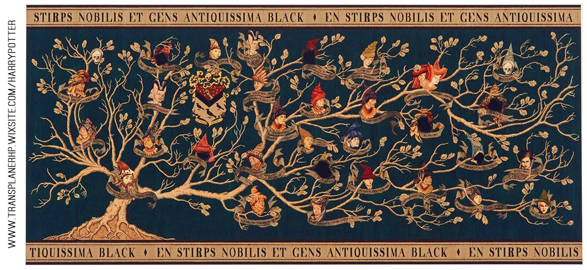
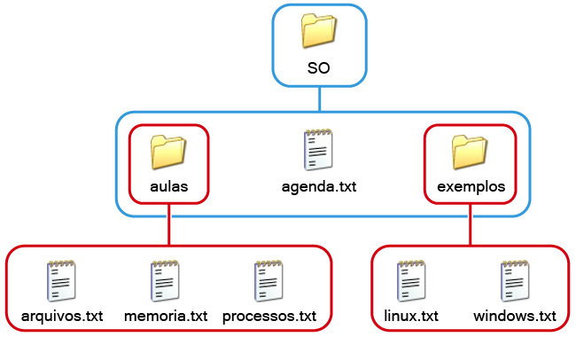
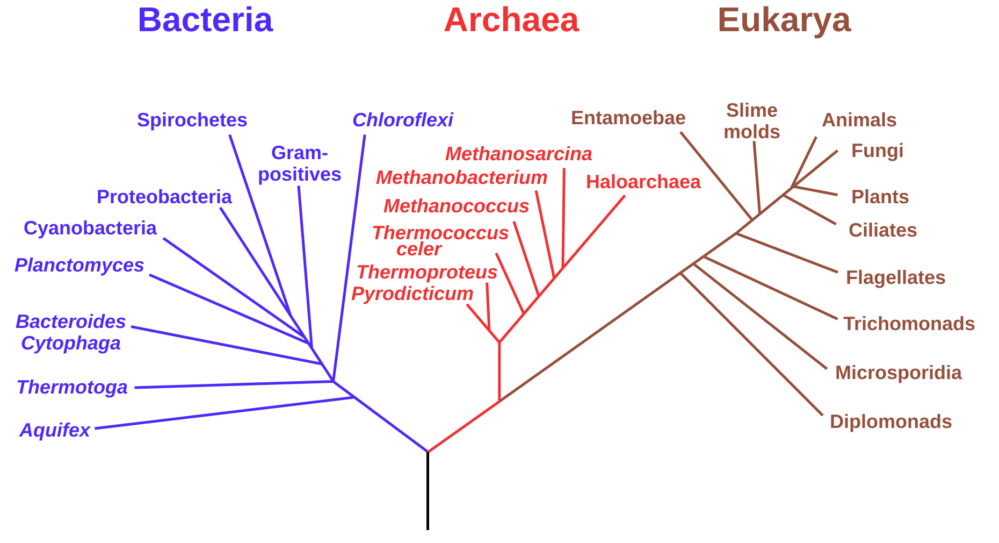
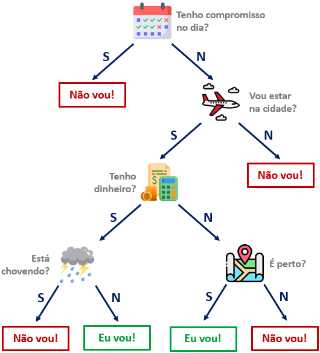

## Roteiro da Aula

- Árvores estão por toda parte
- Árvore Genealógica
- Estruturas com Autorreferência
- Recursão Estrutural
- Árvores Binárias (AB)
- Árvores Binárias de Pesquisa (ABP)

## Árvores estão por toda parte

{width=88% fig-alt="Tapeçaria com a árvore genealógica da família Black (Harry Potter)"}

## Árvores estão por toda parte

:::: {.columns style="display: flex; align-items: center;"}
::: {.column width="40%" .center}
{width=100% fig-alt="Árvore de pastas e arquivos em um explorador de arquivos"}
:::
::: {.column width="56%" .center}
{width=100% fig-alt="Diagrama de diretórios: SO contém aulas, agenda.txt e exemplos; aulas contém arquivos.txt, memoria.txt e processos.txt; exemplos contém linux.txt e windows.txt"}
:::
::::

## Árvores estão por toda parte

{width=75% fig-alt="Árvore filogenética com os domínios Bacteria, Archaea e Eukarya"}

## Árvores estão por toda parte

{height=520px fig-alt="Árvore de decisão: tenho compromisso no dia? vou estar na cidade? tenho dinheiro? está chovendo? é perto? — levando a Eu vou! ou Não vou!"}

## Árvores estão por toda parte

{width=78% fig-alt="Chaveamento das eliminatórias da Liga dos Campeões da UEFA"}

## Árvores estão por toda parte

::: {.cartoes}
::: {.cartao}
[🏆]{.emoji}

[Chaveamento de torneio]{.titulo}<br>[Eliminatórias de campeonatos esportivos.]{.desc}
:::
::: {.cartao}
[🌳]{.emoji}

[Árvore filogenética]{.titulo}<br>[Evolução e relações entre espécies.]{.desc}
:::
::: {.cartao}
[📁]{.emoji}

[Sistema de arquivos]{.titulo}<br>[Diretórios e subdiretórios no computador.]{.desc}
:::
::: {.cartao}
[🧠]{.emoji}

[Árvore de decisão]{.titulo}<br>[Modelos de classificação e aprendizado.]{.desc}
:::
:::

# Árvore Genealógica

::: {.icone-secao}
🌳
:::

## Árvore Genealógica

:::: {.columns style="display: flex; align-items: center;"}
::: {.column width="65%"}
- Cada nó da árvore representa os dados de uma pessoa.

- Cada pessoa tem um pai e uma mãe.

- O pai e/ou a mãe podem não ser conhecidos.
:::
::: {.column width="31%" .icone-secao}
[🧬]{style="font-size: 1.4em;"}
:::
::::

## Árvore Genealógica — exemplo

```{=html}
<svg viewBox="0 0 748 418" style="display:block; margin:0 auto; width:32.14em; max-width:100%; height:auto;" xmlns="http://www.w3.org/2000/svg" role="img" aria-label="Árvore genealógica: Gustavo (1988, tipo A) é filho de Fred (1958, tipo A) e de Eva (1960, tipo O); Eva é filha de Carlos (1926, tipo A) e de Betina (1927, tipo B). Setas sólidas indicam o pai e tracejadas, a mãe.">
<defs><marker id="a20-f1" viewBox="0 0 10 10" refX="10" refY="5" markerWidth="12" markerHeight="12" markerUnits="userSpaceOnUse" orient="auto"><path d="M0,0 L10,5 L0,10 z" fill="#000000"/></marker></defs>
<line x1="79" y1="84" x2="174" y2="168" stroke="#000000" stroke-width="2" marker-end="url(#a20-f1)"/>
<line x1="269" y1="84" x2="174" y2="168" stroke="#000000" stroke-width="2" stroke-dasharray="7 5" marker-end="url(#a20-f1)"/>
<line x1="529" y1="84" x2="354" y2="333" stroke="#000000" stroke-width="2" marker-end="url(#a20-f1)"/>
<line x1="174" y1="249" x2="354" y2="333" stroke="#000000" stroke-width="2" stroke-dasharray="7 5" marker-end="url(#a20-f1)"/>
<rect x="4" y="4" width="150" height="80" fill="#5b7a99" stroke="#3e5466" stroke-width="2"/>
<text x="79" y="23" font-size="20" text-anchor="middle" dominant-baseline="central" fill="#ffffff" font-family="'Lexend', 'Gill Sans Nova', Arial, sans-serif" font-weight="bold">Carlos</text>
<text x="79" y="45" font-size="16" text-anchor="middle" dominant-baseline="central" fill="#ffffff" font-family="'Lexend', 'Gill Sans Nova', Arial, sans-serif" font-weight="normal">nasc. 1926</text>
<text x="79" y="66" font-size="16" text-anchor="middle" dominant-baseline="central" fill="#ffff66" font-family="'Lexend', 'Gill Sans Nova', Arial, sans-serif" font-weight="bold">tipo A</text>
<rect x="194" y="4" width="150" height="80" fill="#5b7a99" stroke="#3e5466" stroke-width="2"/>
<text x="269" y="23" font-size="20" text-anchor="middle" dominant-baseline="central" fill="#ffffff" font-family="'Lexend', 'Gill Sans Nova', Arial, sans-serif" font-weight="bold">Betina</text>
<text x="269" y="45" font-size="16" text-anchor="middle" dominant-baseline="central" fill="#ffffff" font-family="'Lexend', 'Gill Sans Nova', Arial, sans-serif" font-weight="normal">nasc. 1927</text>
<text x="269" y="66" font-size="16" text-anchor="middle" dominant-baseline="central" fill="#ffff66" font-family="'Lexend', 'Gill Sans Nova', Arial, sans-serif" font-weight="bold">tipo B</text>
<rect x="454" y="4" width="150" height="80" fill="#5b7a99" stroke="#3e5466" stroke-width="2"/>
<text x="529" y="23" font-size="20" text-anchor="middle" dominant-baseline="central" fill="#ffffff" font-family="'Lexend', 'Gill Sans Nova', Arial, sans-serif" font-weight="bold">Fred</text>
<text x="529" y="45" font-size="16" text-anchor="middle" dominant-baseline="central" fill="#ffffff" font-family="'Lexend', 'Gill Sans Nova', Arial, sans-serif" font-weight="normal">nasc. 1958</text>
<text x="529" y="66" font-size="16" text-anchor="middle" dominant-baseline="central" fill="#ffff66" font-family="'Lexend', 'Gill Sans Nova', Arial, sans-serif" font-weight="bold">tipo A</text>
<rect x="99" y="169" width="150" height="80" fill="#5b7a99" stroke="#3e5466" stroke-width="2"/>
<text x="174" y="188" font-size="20" text-anchor="middle" dominant-baseline="central" fill="#ffffff" font-family="'Lexend', 'Gill Sans Nova', Arial, sans-serif" font-weight="bold">Eva</text>
<text x="174" y="210" font-size="16" text-anchor="middle" dominant-baseline="central" fill="#ffffff" font-family="'Lexend', 'Gill Sans Nova', Arial, sans-serif" font-weight="normal">nasc. 1960</text>
<text x="174" y="231" font-size="16" text-anchor="middle" dominant-baseline="central" fill="#ffff66" font-family="'Lexend', 'Gill Sans Nova', Arial, sans-serif" font-weight="bold">tipo O</text>
<rect x="279" y="334" width="150" height="80" fill="#5b7a99" stroke="#3e5466" stroke-width="2"/>
<text x="354" y="353" font-size="20" text-anchor="middle" dominant-baseline="central" fill="#ffffff" font-family="'Lexend', 'Gill Sans Nova', Arial, sans-serif" font-weight="bold">Gustavo</text>
<text x="354" y="375" font-size="16" text-anchor="middle" dominant-baseline="central" fill="#ffffff" font-family="'Lexend', 'Gill Sans Nova', Arial, sans-serif" font-weight="normal">nasc. 1988</text>
<text x="354" y="396" font-size="16" text-anchor="middle" dominant-baseline="central" fill="#ffff66" font-family="'Lexend', 'Gill Sans Nova', Arial, sans-serif" font-weight="bold">tipo A</text>
<line x1="638" y1="20" x2="693" y2="20" stroke="#000000" stroke-width="2" marker-end="url(#a20-f1)"/>
<text x="706" y="20" font-size="17" text-anchor="start" dominant-baseline="central" fill="#262626" font-family="'Lexend', 'Gill Sans Nova', Arial, sans-serif" font-weight="normal">pai</text>
<line x1="638" y1="54" x2="693" y2="54" stroke="#000000" stroke-width="2" stroke-dasharray="7 5" marker-end="url(#a20-f1)"/>
<text x="706" y="54" font-size="17" text-anchor="start" dominant-baseline="central" fill="#262626" font-family="'Lexend', 'Gill Sans Nova', Arial, sans-serif" font-weight="normal">mãe</text>
</svg>
```

::: {.fragment .balao style="top: 62%; left: 80%; width: 26%; border-color: #bf8f00; background: #ffe699; border-radius: 50%; padding: 1.4em 0.8em;"}
[Como representar esta informação?]{.forte}
:::

## Como representar essa informação?

Cada nó da árvore contém as informações de uma pessoa: nome, ano, tipo sanguíneo, e os pais.

<br>

```pyret
data Pessoa:
  | pessoa(
      nome      :: String,  # nome da pessoa
      ano       :: Number,  # ano de nascimento
      tipo-sang :: String,  # tipo sanguíneo
      pai       :: ???,     # representa o pai da pessoa
      mae       :: ???      # representa a mãe da pessoa
    )
end
```

## Autorreferência

O pai e a mãe também são `Pessoa` — o tipo se refere a si mesmo.

<br>

```pyret
data Pessoa:
  | pessoa(
      nome      :: String,
      ano       :: Number,
      tipo-sang :: String,
      pai       :: Pessoa,  # ← autorreferência!
      mae       :: Pessoa   # ← autorreferência!
    )
end
```

## E quando o pai ou a mãe são desconhecidos?

Acrescentamos uma variante [ninguem]{.vermelho} para representar a ausência de informação.

<br>

```{.pyret code-line-numbers="2"}
data Pessoa:
  | ninguem   # caso base: pai/mãe desconhecido(a)
  | pessoa(
      nome      :: String, # nome da pessoa
      ano       :: Number, # ano de nascimento
      tipo-sang :: String, # tipo sanguíneo
      pai       :: Pessoa, # representa o pai da pessoa
      mae       :: Pessoa  # representa a mãe da pessoa
    )
end
```

## Exemplo: a família

:::: {.columns style="display: flex; align-items: center;"}
::: {.column width="54%"}
```{=html}
<svg viewBox="0 0 608 418" style="display:block; margin:0 auto; width:21.71em; max-width:100%; height:auto;" xmlns="http://www.w3.org/2000/svg" role="img" aria-label="Árvore genealógica: Gustavo (1988, tipo A) é filho de Fred (1958, tipo A) e de Eva (1960, tipo O); Eva é filha de Carlos (1926, tipo A) e de Betina (1927, tipo B). Setas sólidas indicam o pai e tracejadas, a mãe.">
<defs><marker id="a20-f2" viewBox="0 0 10 10" refX="10" refY="5" markerWidth="12" markerHeight="12" markerUnits="userSpaceOnUse" orient="auto"><path d="M0,0 L10,5 L0,10 z" fill="#000000"/></marker></defs>
<line x1="79" y1="84" x2="174" y2="168" stroke="#000000" stroke-width="2" marker-end="url(#a20-f2)"/>
<line x1="269" y1="84" x2="174" y2="168" stroke="#000000" stroke-width="2" stroke-dasharray="7 5" marker-end="url(#a20-f2)"/>
<line x1="529" y1="84" x2="354" y2="333" stroke="#000000" stroke-width="2" marker-end="url(#a20-f2)"/>
<line x1="174" y1="249" x2="354" y2="333" stroke="#000000" stroke-width="2" stroke-dasharray="7 5" marker-end="url(#a20-f2)"/>
<rect x="4" y="4" width="150" height="80" fill="#5b7a99" stroke="#3e5466" stroke-width="2"/>
<text x="79" y="23" font-size="20" text-anchor="middle" dominant-baseline="central" fill="#ffffff" font-family="'Lexend', 'Gill Sans Nova', Arial, sans-serif" font-weight="bold">Carlos</text>
<text x="79" y="45" font-size="16" text-anchor="middle" dominant-baseline="central" fill="#ffffff" font-family="'Lexend', 'Gill Sans Nova', Arial, sans-serif" font-weight="normal">nasc. 1926</text>
<text x="79" y="66" font-size="16" text-anchor="middle" dominant-baseline="central" fill="#ffff66" font-family="'Lexend', 'Gill Sans Nova', Arial, sans-serif" font-weight="bold">tipo A</text>
<rect x="194" y="4" width="150" height="80" fill="#5b7a99" stroke="#3e5466" stroke-width="2"/>
<text x="269" y="23" font-size="20" text-anchor="middle" dominant-baseline="central" fill="#ffffff" font-family="'Lexend', 'Gill Sans Nova', Arial, sans-serif" font-weight="bold">Betina</text>
<text x="269" y="45" font-size="16" text-anchor="middle" dominant-baseline="central" fill="#ffffff" font-family="'Lexend', 'Gill Sans Nova', Arial, sans-serif" font-weight="normal">nasc. 1927</text>
<text x="269" y="66" font-size="16" text-anchor="middle" dominant-baseline="central" fill="#ffff66" font-family="'Lexend', 'Gill Sans Nova', Arial, sans-serif" font-weight="bold">tipo B</text>
<rect x="454" y="4" width="150" height="80" fill="#5b7a99" stroke="#3e5466" stroke-width="2"/>
<text x="529" y="23" font-size="20" text-anchor="middle" dominant-baseline="central" fill="#ffffff" font-family="'Lexend', 'Gill Sans Nova', Arial, sans-serif" font-weight="bold">Fred</text>
<text x="529" y="45" font-size="16" text-anchor="middle" dominant-baseline="central" fill="#ffffff" font-family="'Lexend', 'Gill Sans Nova', Arial, sans-serif" font-weight="normal">nasc. 1958</text>
<text x="529" y="66" font-size="16" text-anchor="middle" dominant-baseline="central" fill="#ffff66" font-family="'Lexend', 'Gill Sans Nova', Arial, sans-serif" font-weight="bold">tipo A</text>
<rect x="99" y="169" width="150" height="80" fill="#5b7a99" stroke="#3e5466" stroke-width="2"/>
<text x="174" y="188" font-size="20" text-anchor="middle" dominant-baseline="central" fill="#ffffff" font-family="'Lexend', 'Gill Sans Nova', Arial, sans-serif" font-weight="bold">Eva</text>
<text x="174" y="210" font-size="16" text-anchor="middle" dominant-baseline="central" fill="#ffffff" font-family="'Lexend', 'Gill Sans Nova', Arial, sans-serif" font-weight="normal">nasc. 1960</text>
<text x="174" y="231" font-size="16" text-anchor="middle" dominant-baseline="central" fill="#ffff66" font-family="'Lexend', 'Gill Sans Nova', Arial, sans-serif" font-weight="bold">tipo O</text>
<rect x="279" y="334" width="150" height="80" fill="#5b7a99" stroke="#3e5466" stroke-width="2"/>
<text x="354" y="353" font-size="20" text-anchor="middle" dominant-baseline="central" fill="#ffffff" font-family="'Lexend', 'Gill Sans Nova', Arial, sans-serif" font-weight="bold">Gustavo</text>
<text x="354" y="375" font-size="16" text-anchor="middle" dominant-baseline="central" fill="#ffffff" font-family="'Lexend', 'Gill Sans Nova', Arial, sans-serif" font-weight="normal">nasc. 1988</text>
<text x="354" y="396" font-size="16" text-anchor="middle" dominant-baseline="central" fill="#ffff66" font-family="'Lexend', 'Gill Sans Nova', Arial, sans-serif" font-weight="bold">tipo A</text>
</svg>
```
:::
::: {.column width="42%"}
::: {style="font-size: 0.9em;"}
```pyret
CARLOS  = pessoa("Carlos",
            1926, "A",
            ninguem, ninguem)
BETINA  = pessoa("Betina",
            1927, "B",
            ninguem, ninguem)
EVA     = pessoa("Eva",
            1960, "O",
            CARLOS,  BETINA)
FRED    = pessoa("Fred",
            1958, "A",
            ninguem, ninguem)
GUSTAVO = pessoa("Gustavo",
            1988, "A",
            FRED,    EVA)
```
:::
:::
::::

# Como processar dados com autorreferência?

::: {.center}
{width=200px fig-alt="Ponto de interrogação"}
:::

## Estrutura de Programas Recursivos

Uma forma abstrata de descrever [repetição]{.alert} em processos.

Ênfase em [quebrar (decompor)]{.alert} o problema em problemas menores até que a solução seja trivial, e então montar a solução através da [combinação]{.alert} das soluções menores.

::: {.caixa}
[Ideia básica]{.alert}

:::: {.columns}
::: {.column width="48%"}
::: {.caixa-trivial style="font-size: 0.8em; min-height: 7.5em;"}
[Se o problema for TRIVIAL]{.titulo-trivial}

→ resolva-o diretamente

[Exemplos: lista vazia, árvore vazia, número zero, caso base ninguem…]{.muted .italico style="font-size: 0.85em;"}
:::
:::
::: {.column width="48%"}
::: {.caixa-dificil style="font-size: 0.8em; min-height: 7.5em;"}
[Se o problema for DIFÍCIL]{.titulo-dificil}

→ quebre em sub-problemas,<br>
→ resolva cada sub-problema,<br>
→ combine as soluções
:::
:::
::::
:::

## Ancestral com tipo sanguíneo O?

::: {.caixa .italico}
Construir uma função que, dada uma pessoa, verifica se ela ou algum de seus ancestrais tem/teve tipo sanguíneo “O”.
:::

::: {.passos}
::: {.passo}
[Passo 1]{.rotulo}

[Nome da função]{.muted}

[ancestral-tipo-o]{.mono .forte .vermelho}
:::
::: {.passo}
[Passo 2]{.rotulo}

[Tipos]{.muted}

Entrada: [Pessoa]{.mono .forte .azul}<br>Saída: [Boolean]{.mono .forte .azul}
:::
::: {.passo}
[Passo 3]{.rotulo}

[Implementação]{.muted}

[Definir como a função gera o resultado…]{.italico}
:::
:::

<br>

::: {.center .muted .italico}
Aplicamos a estratégia: trivial → resolver, difícil → decompor + resolver + combinar.
:::

## Exemplos

```{=html}
<svg viewBox="0 0 608 418" style="display:block; margin:0 auto; width:22.86em; max-width:100%; height:auto;" xmlns="http://www.w3.org/2000/svg" role="img" aria-label="Árvore genealógica: Gustavo (1988, tipo A) é filho de Fred (1958, tipo A) e de Eva (1960, tipo O); Eva é filha de Carlos (1926, tipo A) e de Betina (1927, tipo B). Setas sólidas indicam o pai e tracejadas, a mãe.">
<defs><marker id="a20-f3" viewBox="0 0 10 10" refX="10" refY="5" markerWidth="12" markerHeight="12" markerUnits="userSpaceOnUse" orient="auto"><path d="M0,0 L10,5 L0,10 z" fill="#000000"/></marker></defs>
<line x1="79" y1="84" x2="174" y2="168" stroke="#000000" stroke-width="2" marker-end="url(#a20-f3)"/>
<line x1="269" y1="84" x2="174" y2="168" stroke="#000000" stroke-width="2" stroke-dasharray="7 5" marker-end="url(#a20-f3)"/>
<line x1="529" y1="84" x2="354" y2="333" stroke="#000000" stroke-width="2" marker-end="url(#a20-f3)"/>
<line x1="174" y1="249" x2="354" y2="333" stroke="#000000" stroke-width="2" stroke-dasharray="7 5" marker-end="url(#a20-f3)"/>
<rect x="4" y="4" width="150" height="80" fill="#5b7a99" stroke="#3e5466" stroke-width="2"/>
<text x="79" y="23" font-size="20" text-anchor="middle" dominant-baseline="central" fill="#ffffff" font-family="'Lexend', 'Gill Sans Nova', Arial, sans-serif" font-weight="bold">Carlos</text>
<text x="79" y="45" font-size="16" text-anchor="middle" dominant-baseline="central" fill="#ffffff" font-family="'Lexend', 'Gill Sans Nova', Arial, sans-serif" font-weight="normal">nasc. 1926</text>
<text x="79" y="66" font-size="16" text-anchor="middle" dominant-baseline="central" fill="#ffff66" font-family="'Lexend', 'Gill Sans Nova', Arial, sans-serif" font-weight="bold">tipo A</text>
<rect x="194" y="4" width="150" height="80" fill="#5b7a99" stroke="#3e5466" stroke-width="2"/>
<text x="269" y="23" font-size="20" text-anchor="middle" dominant-baseline="central" fill="#ffffff" font-family="'Lexend', 'Gill Sans Nova', Arial, sans-serif" font-weight="bold">Betina</text>
<text x="269" y="45" font-size="16" text-anchor="middle" dominant-baseline="central" fill="#ffffff" font-family="'Lexend', 'Gill Sans Nova', Arial, sans-serif" font-weight="normal">nasc. 1927</text>
<text x="269" y="66" font-size="16" text-anchor="middle" dominant-baseline="central" fill="#ffff66" font-family="'Lexend', 'Gill Sans Nova', Arial, sans-serif" font-weight="bold">tipo B</text>
<rect x="454" y="4" width="150" height="80" fill="#5b7a99" stroke="#3e5466" stroke-width="2"/>
<text x="529" y="23" font-size="20" text-anchor="middle" dominant-baseline="central" fill="#ffffff" font-family="'Lexend', 'Gill Sans Nova', Arial, sans-serif" font-weight="bold">Fred</text>
<text x="529" y="45" font-size="16" text-anchor="middle" dominant-baseline="central" fill="#ffffff" font-family="'Lexend', 'Gill Sans Nova', Arial, sans-serif" font-weight="normal">nasc. 1958</text>
<text x="529" y="66" font-size="16" text-anchor="middle" dominant-baseline="central" fill="#ffff66" font-family="'Lexend', 'Gill Sans Nova', Arial, sans-serif" font-weight="bold">tipo A</text>
<rect x="99" y="169" width="150" height="80" fill="#5b7a99" stroke="#3e5466" stroke-width="2"/>
<text x="174" y="188" font-size="20" text-anchor="middle" dominant-baseline="central" fill="#ffffff" font-family="'Lexend', 'Gill Sans Nova', Arial, sans-serif" font-weight="bold">Eva</text>
<text x="174" y="210" font-size="16" text-anchor="middle" dominant-baseline="central" fill="#ffffff" font-family="'Lexend', 'Gill Sans Nova', Arial, sans-serif" font-weight="normal">nasc. 1960</text>
<text x="174" y="231" font-size="16" text-anchor="middle" dominant-baseline="central" fill="#ffff66" font-family="'Lexend', 'Gill Sans Nova', Arial, sans-serif" font-weight="bold">tipo O</text>
<rect x="279" y="334" width="150" height="80" fill="#5b7a99" stroke="#3e5466" stroke-width="2"/>
<text x="354" y="353" font-size="20" text-anchor="middle" dominant-baseline="central" fill="#ffffff" font-family="'Lexend', 'Gill Sans Nova', Arial, sans-serif" font-weight="bold">Gustavo</text>
<text x="354" y="375" font-size="16" text-anchor="middle" dominant-baseline="central" fill="#ffffff" font-family="'Lexend', 'Gill Sans Nova', Arial, sans-serif" font-weight="normal">nasc. 1988</text>
<text x="354" y="396" font-size="16" text-anchor="middle" dominant-baseline="central" fill="#ffff66" font-family="'Lexend', 'Gill Sans Nova', Arial, sans-serif" font-weight="bold">tipo A</text>
</svg>
```

:::: {.columns}
::: {.column width="48%"}
::: {.caixa-verde .center .mono style="font-size: 0.75em; padding: 0.7em;"}
ancestral-tipo-o(GUSTAVO) = [true]{.verde .forte}
:::
:::
::: {.column width="48%"}
::: {.caixa-vermelha .center .mono style="font-size: 0.75em; padding: 0.7em;"}
ancestral-tipo-o(FRED) = [false]{.vermelho .forte}
:::
:::
::::

## ancestral-tipo-o: modelo da solução

[Dada uma pessoa p:]{.italico}

::: {.modelo}
::: {.fragment .caixa-trivial}
[Trivial: resolver]{.titulo-trivial}

Se [p é ninguem]{.campo style="width: 14em;"} , [devolver false]{.campo style="width: 20em;"}
:::

::: {.fragment .caixa-trivial}
[Trivial: resolver]{.titulo-trivial}

Se [p tem tipo sang. \"O\"]{.campo style="width: 14em;"} , [devolver true]{.campo style="width: 20em;"}
:::

::: {.fragment .caixa-dificil}
[Difícil: Decompor]{.titulo-dificil}

Se [Senão]{.campo style="width: 11em;"}

[combinar soluções:]{.muted style="margin-left: 2.2em; width: 13em;"} [OU]{.campo .forte style="min-width: 5em; font-style: normal;"}

[verificar tipo O nos ancestrais por parte de mãe]{.campo .recuo style="width: 24em;"} [mãe de p]{.campo style="width: 11em;"}

[verificar tipo O nos ancestrais por parte de pai]{.campo .recuo style="width: 24em;"} [pai de p]{.campo style="width: 11em;"}
:::
:::

## ancestral-tipo-o

::: {.pyret-live data-height="560" style="font-size: 0.85em;"}
::: {style="display: none;"}
```pyret
# Definições dos slides anteriores (necessárias para executar o exemplo)
data Pessoa:
  | ninguem   # caso base: pai/mãe desconhecido(a)
  | pessoa(
      nome      :: String, # nome da pessoa
      ano       :: Number, # ano de nascimento
      tipo-sang :: String, # tipo sanguíneo
      pai       :: Pessoa, # representa o pai da pessoa
      mae       :: Pessoa  # representa a mãe da pessoa
    )
end

CARLOS  = pessoa("Carlos", 1926, "A", ninguem, ninguem)
BETINA  = pessoa("Betina", 1927, "B", ninguem, ninguem)
EVA     = pessoa("Eva", 1960, "O", CARLOS, BETINA)
FRED    = pessoa("Fred", 1958, "A", ninguem, ninguem)
GUSTAVO = pessoa("Gustavo", 1988, "A", FRED, EVA)
```
:::
````pyret
fun ancestral-tipo-o(p :: Pessoa) -> Boolean:
  doc: ```Dada uma pessoa, verifica se esta pessoa ou algum ancestral
       tem tipo sanguíneo O.```
  cases (Pessoa) p:
      # Se p é ninguém, retorna falso
    | ninguem => false
    | pessoa(nome, ano, tipo, pai, mae) =>
      (tipo == "O") or          # Se p é tipo O
      ancestral-tipo-o(pai) or  # ou existe ancestral por parte de pai tipo O
      ancestral-tipo-o(mae)     # ou existe ancestral por parte de mãe tipo O
  end
where:
  ancestral-tipo-o(GUSTAVO) is true
  ancestral-tipo-o(FRED)    is false
end
````
:::

## Exercício 1

::: {.exercicio}
[EXERCÍCIO 1]{.etiqueta}

Construa uma função que, dada uma pessoa, conta o número de ancestrais conhecidos.

Faça 2 versões:

- uma contando a própria pessoa
- uma contando somente seus ancestrais
:::

::: {.dica}
Resolva em Pyret. Lembre: pense no caso trivial e no caso difícil.
:::

# Árvores Binárias

::: {.icone-secao}
🌲
:::

## Árvores: Conceitos

:::: {.columns style="display: flex; align-items: center;"}
::: {.column width="50%"}
```{=html}
<defs><marker id="a20-n4" viewBox="0 0 10 10" refX="10" refY="5" markerWidth="12" markerHeight="12" markerUnits="userSpaceOnUse" orient="auto"><path d="M0,0 L10,5 L0,10 z" fill="#555555"/></marker><marker id="a20-g5" viewBox="0 0 10 10" refX="10" refY="5" markerWidth="12" markerHeight="12" markerUnits="userSpaceOnUse" orient="auto"><path d="M0,0 L10,5 L0,10 z" fill="#bfbfbf"/></marker><marker id="a20-o6" viewBox="0 0 10 10" refX="10" refY="5" markerWidth="12" markerHeight="12" markerUnits="userSpaceOnUse" orient="auto"><path d="M0,0 L10,5 L0,10 z" fill="#bf8f00"/></marker></defs>
<line x1="278.8" y1="81.2" x2="201.9" y2="158.1" stroke="#555555" stroke-width="2" marker-end="url(#a20-n4)"/>
<svg viewBox="0 0 520 360" style="display:block; margin:0 auto; width:18.57em; max-width:100%; height:auto;" xmlns="http://www.w3.org/2000/svg" role="img" aria-label="Árvore com raiz A no nível 0; B e C no nível 1, filhos de A; D e E (filhos de B) e F (filho de C) no nível 2. A é a raiz e F é uma folha.">
<text x="2" y="280" font-size="15" text-anchor="start" dominant-baseline="central" fill="#595959" font-family="'Lexend', 'Gill Sans Nova', Arial, sans-serif" font-weight="normal" font-style="italic">nível 2</text>
<line x1="0" y1="300" x2="500" y2="300" stroke="#bfbfbf" stroke-width="1.5" stroke-dasharray="6 5"/>
<text x="2" y="160" font-size="15" text-anchor="start" dominant-baseline="central" fill="#595959" font-family="'Lexend', 'Gill Sans Nova', Arial, sans-serif" font-weight="normal" font-style="italic">nível 1</text>
<line x1="0" y1="180" x2="500" y2="180" stroke="#bfbfbf" stroke-width="1.5" stroke-dasharray="6 5"/>
<text x="2" y="40" font-size="15" text-anchor="start" dominant-baseline="central" fill="#595959" font-family="'Lexend', 'Gill Sans Nova', Arial, sans-serif" font-weight="normal" font-style="italic">nível 0</text>
<line x1="0" y1="60" x2="500" y2="60" stroke="#bfbfbf" stroke-width="1.5" stroke-dasharray="6 5"/>
<line x1="320.3" y1="82.1" x2="389.1" y2="157.1" stroke="#555555" stroke-width="2" marker-end="url(#a20-n4)"/>
<line x1="164.9" y1="205.9" x2="125.6" y2="273.2" stroke="#555555" stroke-width="2" marker-end="url(#a20-n4)"/>
<line x1="195.1" y1="205.9" x2="234.4" y2="273.2" stroke="#555555" stroke-width="2" marker-end="url(#a20-n4)"/>
<line x1="410.0" y1="210.0" x2="410.0" y2="269.0" stroke="#555555" stroke-width="2" marker-end="url(#a20-n4)"/>
<circle cx="300" cy="60" r="30" fill="#ffd966" stroke="#bf8f00" stroke-width="2"/>
<text x="300" y="60" font-size="22" text-anchor="middle" dominant-baseline="central" fill="#23373b" font-family="'Lexend', 'Gill Sans Nova', Arial, sans-serif" font-weight="bold">A</text>
<circle cx="180" cy="180" r="30" fill="#ffd966" stroke="#bf8f00" stroke-width="2"/>
<text x="180" y="180" font-size="22" text-anchor="middle" dominant-baseline="central" fill="#23373b" font-family="'Lexend', 'Gill Sans Nova', Arial, sans-serif" font-weight="bold">B</text>
<circle cx="410" cy="180" r="30" fill="#ffd966" stroke="#bf8f00" stroke-width="2"/>
<text x="410" y="180" font-size="22" text-anchor="middle" dominant-baseline="central" fill="#23373b" font-family="'Lexend', 'Gill Sans Nova', Arial, sans-serif" font-weight="bold">C</text>
<circle cx="110" cy="300" r="30" fill="#ffd966" stroke="#bf8f00" stroke-width="2"/>
<text x="110" y="300" font-size="22" text-anchor="middle" dominant-baseline="central" fill="#23373b" font-family="'Lexend', 'Gill Sans Nova', Arial, sans-serif" font-weight="bold">D</text>
<circle cx="250" cy="300" r="30" fill="#ffd966" stroke="#bf8f00" stroke-width="2"/>
<text x="250" y="300" font-size="22" text-anchor="middle" dominant-baseline="central" fill="#23373b" font-family="'Lexend', 'Gill Sans Nova', Arial, sans-serif" font-weight="bold">E</text>
<circle cx="410" cy="300" r="30" fill="#ffd966" stroke="#bf8f00" stroke-width="2"/>
<text x="410" y="300" font-size="22" text-anchor="middle" dominant-baseline="central" fill="#23373b" font-family="'Lexend', 'Gill Sans Nova', Arial, sans-serif" font-weight="bold">F</text>
<line x1="325" y1="44" x2="358" y2="30" stroke="#c00000" stroke-width="2"/>
<text x="362" y="30" font-size="18" text-anchor="start" dominant-baseline="central" fill="#c00000" font-family="'Lexend', 'Gill Sans Nova', Arial, sans-serif" font-weight="bold">raiz</text>
<line x1="435" y1="316" x2="460" y2="338" stroke="#c00000" stroke-width="2"/>
<text x="464" y="342" font-size="18" text-anchor="start" dominant-baseline="central" fill="#c00000" font-family="'Lexend', 'Gill Sans Nova', Arial, sans-serif" font-weight="bold">folha</text>
</svg>
```

::: {.caixa-trivial .center .forte style="font-size: 0.7em; background: #fff8e1; margin-top: 0.8em;"}
profundidade = maior nível = 2
:::
:::
::: {.column width="48%"}
::: {style="font-size: 0.8em; line-height: 1.35;"}
[Nó]{.alert}  Cada elemento da árvore.

[Raiz]{.alert}  Nó especial no topo.

[Grau de um nó]{.alert}  Número de filhos (sub-árvores).

[Grau da árvore]{.alert}  Maior grau entre todos os nós.

[Folha]{.alert}  Nó sem filhos.

[Nível]{.alert}  Distância do nó até a raiz.

[Profundidade]{.alert}  Maior nível da árvore.
:::
:::
::::

## Árvore Binária

Cada nó tem no máximo dois filhos: esquerda e direita.

<br>

```pyret
data AB:
  | vazia
  | no(
      id       :: Number,  # identificador do nó
      conteudo :: String,  # conteúdo do nó
      esq      :: AB,      # sub-árvore esquerda
      dir      :: AB       # sub-árvore direita
    )
end
```

## Árvore Binária — exemplo

:::: {.columns style="display: flex; align-items: center;"}
::: {.column width="50%"}
```{=html}
<svg viewBox="0 0 410 385" style="display:block; margin:0 auto; width:14.64em; max-width:100%; height:auto;" xmlns="http://www.w3.org/2000/svg" role="img" aria-label="Árvore binária: raiz 10 (A); filhos 12 (B) à esquerda e 3 (C) à direita; 3 tem filhos 15 (D) e 20 (E); 15 tem filho esquerdo 1 (F).">
<defs><marker id="a20-n7" viewBox="0 0 10 10" refX="10" refY="5" markerWidth="12" markerHeight="12" markerUnits="userSpaceOnUse" orient="auto"><path d="M0,0 L10,5 L0,10 z" fill="#555555"/></marker><marker id="a20-g8" viewBox="0 0 10 10" refX="10" refY="5" markerWidth="12" markerHeight="12" markerUnits="userSpaceOnUse" orient="auto"><path d="M0,0 L10,5 L0,10 z" fill="#bfbfbf"/></marker><marker id="a20-o9" viewBox="0 0 10 10" refX="10" refY="5" markerWidth="12" markerHeight="12" markerUnits="userSpaceOnUse" orient="auto"><path d="M0,0 L10,5 L0,10 z" fill="#bf8f00"/></marker></defs>
<line x1="169.4" y1="47.9" x2="81.4" y2="115.5" stroke="#555555" stroke-width="2" marker-end="url(#a20-n7)"/>
<line x1="210.0" y1="48.6" x2="289.3" y2="114.7" stroke="#555555" stroke-width="2" marker-end="url(#a20-n7)"/>
<line x1="295.8" y1="153.8" x2="259.7" y2="209.4" stroke="#555555" stroke-width="2" marker-end="url(#a20-n7)"/>
<line x1="324.2" y1="153.8" x2="360.3" y2="209.4" stroke="#555555" stroke-width="2" marker-end="url(#a20-n7)"/>
<line x1="230.8" y1="253.8" x2="194.7" y2="309.4" stroke="#555555" stroke-width="2" marker-end="url(#a20-n7)"/>
<circle cx="190" cy="32" r="26" fill="#ffd966" stroke="#bf8f00" stroke-width="2"/>
<text x="190" y="32" font-size="22" text-anchor="middle" dominant-baseline="central" fill="#23373b" font-family="'Lexend', 'Gill Sans Nova', Arial, sans-serif" font-weight="bold">10</text>
<rect x="179" y="61" width="22" height="20" fill="#f2f2f2" stroke="#bfbfbf" stroke-width="1"/>
<text x="190" y="71" font-size="13" text-anchor="middle" dominant-baseline="central" fill="#23373b" font-family="'Lexend', 'Gill Sans Nova', Arial, sans-serif" font-weight="bold">A</text>
<circle cx="60" cy="132" r="26" fill="#ffd966" stroke="#bf8f00" stroke-width="2"/>
<text x="60" y="132" font-size="22" text-anchor="middle" dominant-baseline="central" fill="#23373b" font-family="'Lexend', 'Gill Sans Nova', Arial, sans-serif" font-weight="bold">12</text>
<rect x="49" y="161" width="22" height="20" fill="#f2f2f2" stroke="#bfbfbf" stroke-width="1"/>
<text x="60" y="171" font-size="13" text-anchor="middle" dominant-baseline="central" fill="#23373b" font-family="'Lexend', 'Gill Sans Nova', Arial, sans-serif" font-weight="bold">B</text>
<circle cx="310" cy="132" r="26" fill="#ffd966" stroke="#bf8f00" stroke-width="2"/>
<text x="310" y="132" font-size="22" text-anchor="middle" dominant-baseline="central" fill="#23373b" font-family="'Lexend', 'Gill Sans Nova', Arial, sans-serif" font-weight="bold">3</text>
<rect x="299" y="161" width="22" height="20" fill="#f2f2f2" stroke="#bfbfbf" stroke-width="1"/>
<text x="310" y="171" font-size="13" text-anchor="middle" dominant-baseline="central" fill="#23373b" font-family="'Lexend', 'Gill Sans Nova', Arial, sans-serif" font-weight="bold">C</text>
<circle cx="245" cy="232" r="26" fill="#ffd966" stroke="#bf8f00" stroke-width="2"/>
<text x="245" y="232" font-size="22" text-anchor="middle" dominant-baseline="central" fill="#23373b" font-family="'Lexend', 'Gill Sans Nova', Arial, sans-serif" font-weight="bold">15</text>
<rect x="234" y="261" width="22" height="20" fill="#f2f2f2" stroke="#bfbfbf" stroke-width="1"/>
<text x="245" y="271" font-size="13" text-anchor="middle" dominant-baseline="central" fill="#23373b" font-family="'Lexend', 'Gill Sans Nova', Arial, sans-serif" font-weight="bold">D</text>
<circle cx="375" cy="232" r="26" fill="#ffd966" stroke="#bf8f00" stroke-width="2"/>
<text x="375" y="232" font-size="22" text-anchor="middle" dominant-baseline="central" fill="#23373b" font-family="'Lexend', 'Gill Sans Nova', Arial, sans-serif" font-weight="bold">20</text>
<rect x="364" y="261" width="22" height="20" fill="#f2f2f2" stroke="#bfbfbf" stroke-width="1"/>
<text x="375" y="271" font-size="13" text-anchor="middle" dominant-baseline="central" fill="#23373b" font-family="'Lexend', 'Gill Sans Nova', Arial, sans-serif" font-weight="bold">E</text>
<circle cx="180" cy="332" r="26" fill="#ffd966" stroke="#bf8f00" stroke-width="2"/>
<text x="180" y="332" font-size="22" text-anchor="middle" dominant-baseline="central" fill="#23373b" font-family="'Lexend', 'Gill Sans Nova', Arial, sans-serif" font-weight="bold">1</text>
<rect x="169" y="361" width="22" height="20" fill="#f2f2f2" stroke="#bfbfbf" stroke-width="1"/>
<text x="180" y="371" font-size="13" text-anchor="middle" dominant-baseline="central" fill="#23373b" font-family="'Lexend', 'Gill Sans Nova', Arial, sans-serif" font-weight="bold">F</text>
</svg>
```
:::
::: {.column width="46%"}
::: {style="font-size: 0.9em;"}
```pyret
AB1 =
no(10, "A",
  no(12, "B", vazia, vazia),
  no(3,  "C",
    no(15, "D",
      no(1, "F", vazia, vazia),
      vazia),
    no(20, "E", vazia, vazia)))
```
:::
:::
::::

## Exercício 2

::: {.exercicio}
[EXERCÍCIO 2]{.etiqueta}

Construa uma função que, dada uma árvore binária, retorna uma lista com os identificadores (ids) dos nós da árvore.
:::

::: {.dica}
Resolva em Pyret. Lembre: pense no caso trivial e no caso difícil.
:::

# Árvore Binária de Pesquisa

::: {.icone-secao}
🔎
:::

## Árvore Binária de Pesquisa (ABP)

Uma ABP é uma AB que respeita a invariante:<br>
ids da sub-árvore esquerda < id da raiz < ids da sub-árvore direita.

<br>

::: {style="font-size: 0.9em;"}
```pyret
data ABP:
  | vazia
  | no(
      id       :: Number,
      conteudo :: String,
      esq      :: ABP,  # contém apenas nós com identificadores menores que id
      dir      :: ABP   # contém apenas nós com identificadores maiores que id
    )
end
```
:::

## Árvore Binária × Árvore Binária de Pesquisa

:::: {.columns}
::: {.column width="48%"}
::: {.caixa .center style="padding: 0.4em 0.4em 0.8em;"}
[(a) Árvore Binária]{.forte}

[&nbsp;]{.mono style="font-size: 0.55em;"}

```{=html}
<svg viewBox="0 0 410 385" style="display:block; margin:0 auto; width:14.29em; max-width:100%; height:auto;" xmlns="http://www.w3.org/2000/svg" role="img" aria-label="Árvore binária: raiz 10 (A); filhos 12 (B) à esquerda e 3 (C) à direita; 3 tem filhos 15 (D) e 20 (E); 15 tem filho esquerdo 1 (F).">
<defs><marker id="a20-n10" viewBox="0 0 10 10" refX="10" refY="5" markerWidth="12" markerHeight="12" markerUnits="userSpaceOnUse" orient="auto"><path d="M0,0 L10,5 L0,10 z" fill="#555555"/></marker><marker id="a20-g11" viewBox="0 0 10 10" refX="10" refY="5" markerWidth="12" markerHeight="12" markerUnits="userSpaceOnUse" orient="auto"><path d="M0,0 L10,5 L0,10 z" fill="#bfbfbf"/></marker><marker id="a20-o12" viewBox="0 0 10 10" refX="10" refY="5" markerWidth="12" markerHeight="12" markerUnits="userSpaceOnUse" orient="auto"><path d="M0,0 L10,5 L0,10 z" fill="#bf8f00"/></marker></defs>
<line x1="169.4" y1="47.9" x2="81.4" y2="115.5" stroke="#555555" stroke-width="2" marker-end="url(#a20-n10)"/>
<line x1="210.0" y1="48.6" x2="289.3" y2="114.7" stroke="#555555" stroke-width="2" marker-end="url(#a20-n10)"/>
<line x1="295.8" y1="153.8" x2="259.7" y2="209.4" stroke="#555555" stroke-width="2" marker-end="url(#a20-n10)"/>
<line x1="324.2" y1="153.8" x2="360.3" y2="209.4" stroke="#555555" stroke-width="2" marker-end="url(#a20-n10)"/>
<line x1="230.8" y1="253.8" x2="194.7" y2="309.4" stroke="#555555" stroke-width="2" marker-end="url(#a20-n10)"/>
<circle cx="190" cy="32" r="26" fill="#ffd966" stroke="#bf8f00" stroke-width="2"/>
<text x="190" y="32" font-size="22" text-anchor="middle" dominant-baseline="central" fill="#23373b" font-family="'Lexend', 'Gill Sans Nova', Arial, sans-serif" font-weight="bold">10</text>
<rect x="179" y="61" width="22" height="20" fill="#f2f2f2" stroke="#bfbfbf" stroke-width="1"/>
<text x="190" y="71" font-size="13" text-anchor="middle" dominant-baseline="central" fill="#23373b" font-family="'Lexend', 'Gill Sans Nova', Arial, sans-serif" font-weight="bold">A</text>
<circle cx="60" cy="132" r="26" fill="#ffd966" stroke="#bf8f00" stroke-width="2"/>
<text x="60" y="132" font-size="22" text-anchor="middle" dominant-baseline="central" fill="#23373b" font-family="'Lexend', 'Gill Sans Nova', Arial, sans-serif" font-weight="bold">12</text>
<rect x="49" y="161" width="22" height="20" fill="#f2f2f2" stroke="#bfbfbf" stroke-width="1"/>
<text x="60" y="171" font-size="13" text-anchor="middle" dominant-baseline="central" fill="#23373b" font-family="'Lexend', 'Gill Sans Nova', Arial, sans-serif" font-weight="bold">B</text>
<circle cx="310" cy="132" r="26" fill="#ffd966" stroke="#bf8f00" stroke-width="2"/>
<text x="310" y="132" font-size="22" text-anchor="middle" dominant-baseline="central" fill="#23373b" font-family="'Lexend', 'Gill Sans Nova', Arial, sans-serif" font-weight="bold">3</text>
<rect x="299" y="161" width="22" height="20" fill="#f2f2f2" stroke="#bfbfbf" stroke-width="1"/>
<text x="310" y="171" font-size="13" text-anchor="middle" dominant-baseline="central" fill="#23373b" font-family="'Lexend', 'Gill Sans Nova', Arial, sans-serif" font-weight="bold">C</text>
<circle cx="245" cy="232" r="26" fill="#ffd966" stroke="#bf8f00" stroke-width="2"/>
<text x="245" y="232" font-size="22" text-anchor="middle" dominant-baseline="central" fill="#23373b" font-family="'Lexend', 'Gill Sans Nova', Arial, sans-serif" font-weight="bold">15</text>
<rect x="234" y="261" width="22" height="20" fill="#f2f2f2" stroke="#bfbfbf" stroke-width="1"/>
<text x="245" y="271" font-size="13" text-anchor="middle" dominant-baseline="central" fill="#23373b" font-family="'Lexend', 'Gill Sans Nova', Arial, sans-serif" font-weight="bold">D</text>
<circle cx="375" cy="232" r="26" fill="#ffd966" stroke="#bf8f00" stroke-width="2"/>
<text x="375" y="232" font-size="22" text-anchor="middle" dominant-baseline="central" fill="#23373b" font-family="'Lexend', 'Gill Sans Nova', Arial, sans-serif" font-weight="bold">20</text>
<rect x="364" y="261" width="22" height="20" fill="#f2f2f2" stroke="#bfbfbf" stroke-width="1"/>
<text x="375" y="271" font-size="13" text-anchor="middle" dominant-baseline="central" fill="#23373b" font-family="'Lexend', 'Gill Sans Nova', Arial, sans-serif" font-weight="bold">E</text>
<circle cx="180" cy="332" r="26" fill="#ffd966" stroke="#bf8f00" stroke-width="2"/>
<text x="180" y="332" font-size="22" text-anchor="middle" dominant-baseline="central" fill="#23373b" font-family="'Lexend', 'Gill Sans Nova', Arial, sans-serif" font-weight="bold">1</text>
<rect x="169" y="361" width="22" height="20" fill="#f2f2f2" stroke="#bfbfbf" stroke-width="1"/>
<text x="180" y="371" font-size="13" text-anchor="middle" dominant-baseline="central" fill="#23373b" font-family="'Lexend', 'Gill Sans Nova', Arial, sans-serif" font-weight="bold">F</text>
</svg>
```
:::
:::
::: {.column width="48%"}
::: {.caixa-azul .center style="padding: 0.4em 0.4em 0.8em;"}
[(b) Árvore Binária de Pesquisa]{.titulo-azul}

[invariante: ids da esq < raiz < ids da dir]{.mono .italico style="font-size: 0.55em; color: #1f4e79;"}

```{=html}
<svg viewBox="0 0 410 385" style="display:block; margin:0 auto; width:14.29em; max-width:100%; height:auto;" xmlns="http://www.w3.org/2000/svg" role="img" aria-label="Árvore binária de pesquisa: raiz 10 (A); filhos 3 (B) à esquerda e 17 (C) à direita; 17 tem filhos 15 (D) e 20 (E); 15 tem filho esquerdo 11 (F).">
<defs><marker id="a20-n13" viewBox="0 0 10 10" refX="10" refY="5" markerWidth="12" markerHeight="12" markerUnits="userSpaceOnUse" orient="auto"><path d="M0,0 L10,5 L0,10 z" fill="#555555"/></marker><marker id="a20-g14" viewBox="0 0 10 10" refX="10" refY="5" markerWidth="12" markerHeight="12" markerUnits="userSpaceOnUse" orient="auto"><path d="M0,0 L10,5 L0,10 z" fill="#bfbfbf"/></marker><marker id="a20-o15" viewBox="0 0 10 10" refX="10" refY="5" markerWidth="12" markerHeight="12" markerUnits="userSpaceOnUse" orient="auto"><path d="M0,0 L10,5 L0,10 z" fill="#bf8f00"/></marker></defs>
<line x1="169.4" y1="47.9" x2="81.4" y2="115.5" stroke="#555555" stroke-width="2" marker-end="url(#a20-n13)"/>
<line x1="210.0" y1="48.6" x2="289.3" y2="114.7" stroke="#555555" stroke-width="2" marker-end="url(#a20-n13)"/>
<line x1="295.8" y1="153.8" x2="259.7" y2="209.4" stroke="#555555" stroke-width="2" marker-end="url(#a20-n13)"/>
<line x1="324.2" y1="153.8" x2="360.3" y2="209.4" stroke="#555555" stroke-width="2" marker-end="url(#a20-n13)"/>
<line x1="230.8" y1="253.8" x2="194.7" y2="309.4" stroke="#555555" stroke-width="2" marker-end="url(#a20-n13)"/>
<circle cx="190" cy="32" r="26" fill="#ffd966" stroke="#bf8f00" stroke-width="2"/>
<text x="190" y="32" font-size="22" text-anchor="middle" dominant-baseline="central" fill="#23373b" font-family="'Lexend', 'Gill Sans Nova', Arial, sans-serif" font-weight="bold">10</text>
<rect x="179" y="61" width="22" height="20" fill="#f2f2f2" stroke="#bfbfbf" stroke-width="1"/>
<text x="190" y="71" font-size="13" text-anchor="middle" dominant-baseline="central" fill="#23373b" font-family="'Lexend', 'Gill Sans Nova', Arial, sans-serif" font-weight="bold">A</text>
<circle cx="60" cy="132" r="26" fill="#ffd966" stroke="#bf8f00" stroke-width="2"/>
<text x="60" y="132" font-size="22" text-anchor="middle" dominant-baseline="central" fill="#23373b" font-family="'Lexend', 'Gill Sans Nova', Arial, sans-serif" font-weight="bold">3</text>
<rect x="49" y="161" width="22" height="20" fill="#f2f2f2" stroke="#bfbfbf" stroke-width="1"/>
<text x="60" y="171" font-size="13" text-anchor="middle" dominant-baseline="central" fill="#23373b" font-family="'Lexend', 'Gill Sans Nova', Arial, sans-serif" font-weight="bold">B</text>
<circle cx="310" cy="132" r="26" fill="#ffd966" stroke="#bf8f00" stroke-width="2"/>
<text x="310" y="132" font-size="22" text-anchor="middle" dominant-baseline="central" fill="#23373b" font-family="'Lexend', 'Gill Sans Nova', Arial, sans-serif" font-weight="bold">17</text>
<rect x="299" y="161" width="22" height="20" fill="#f2f2f2" stroke="#bfbfbf" stroke-width="1"/>
<text x="310" y="171" font-size="13" text-anchor="middle" dominant-baseline="central" fill="#23373b" font-family="'Lexend', 'Gill Sans Nova', Arial, sans-serif" font-weight="bold">C</text>
<circle cx="245" cy="232" r="26" fill="#ffd966" stroke="#bf8f00" stroke-width="2"/>
<text x="245" y="232" font-size="22" text-anchor="middle" dominant-baseline="central" fill="#23373b" font-family="'Lexend', 'Gill Sans Nova', Arial, sans-serif" font-weight="bold">15</text>
<rect x="234" y="261" width="22" height="20" fill="#f2f2f2" stroke="#bfbfbf" stroke-width="1"/>
<text x="245" y="271" font-size="13" text-anchor="middle" dominant-baseline="central" fill="#23373b" font-family="'Lexend', 'Gill Sans Nova', Arial, sans-serif" font-weight="bold">D</text>
<circle cx="375" cy="232" r="26" fill="#ffd966" stroke="#bf8f00" stroke-width="2"/>
<text x="375" y="232" font-size="22" text-anchor="middle" dominant-baseline="central" fill="#23373b" font-family="'Lexend', 'Gill Sans Nova', Arial, sans-serif" font-weight="bold">20</text>
<rect x="364" y="261" width="22" height="20" fill="#f2f2f2" stroke="#bfbfbf" stroke-width="1"/>
<text x="375" y="271" font-size="13" text-anchor="middle" dominant-baseline="central" fill="#23373b" font-family="'Lexend', 'Gill Sans Nova', Arial, sans-serif" font-weight="bold">E</text>
<circle cx="180" cy="332" r="26" fill="#ffd966" stroke="#bf8f00" stroke-width="2"/>
<text x="180" y="332" font-size="22" text-anchor="middle" dominant-baseline="central" fill="#23373b" font-family="'Lexend', 'Gill Sans Nova', Arial, sans-serif" font-weight="bold">11</text>
<rect x="169" y="361" width="22" height="20" fill="#f2f2f2" stroke="#bfbfbf" stroke-width="1"/>
<text x="180" y="371" font-size="13" text-anchor="middle" dominant-baseline="central" fill="#23373b" font-family="'Lexend', 'Gill Sans Nova', Arial, sans-serif" font-weight="bold">F</text>
</svg>
```
:::
:::
::::

## Busca em ABP — por que é eficiente?

Procurando o id = 15 nesta ABP:

:::: {.columns style="display: flex; align-items: center;"}
::: {.column width="50%"}
```{=html}
<svg viewBox="0 0 475 310" style="display:block; margin:0 auto; width:16.96em; max-width:100%; height:auto;" xmlns="http://www.w3.org/2000/svg" role="img" aria-label="ABP com raiz 10; 3 (filhos 1 e 7) à esquerda; 17 (filhos 15 e 20) à direita. O caminho da busca por 15 passa por 10, 17 e 15, destacado.">
<defs><marker id="a20-n16" viewBox="0 0 10 10" refX="10" refY="5" markerWidth="12" markerHeight="12" markerUnits="userSpaceOnUse" orient="auto"><path d="M0,0 L10,5 L0,10 z" fill="#555555"/></marker><marker id="a20-g17" viewBox="0 0 10 10" refX="10" refY="5" markerWidth="12" markerHeight="12" markerUnits="userSpaceOnUse" orient="auto"><path d="M0,0 L10,5 L0,10 z" fill="#bfbfbf"/></marker><marker id="a20-o18" viewBox="0 0 10 10" refX="10" refY="5" markerWidth="12" markerHeight="12" markerUnits="userSpaceOnUse" orient="auto"><path d="M0,0 L10,5 L0,10 z" fill="#bf8f00"/></marker></defs>
<line x1="216.0" y1="61.2" x2="134.7" y2="133.1" stroke="#bfbfbf" stroke-width="1.5" marker-end="url(#a20-g17)"/>
<line x1="264.0" y1="61.2" x2="345.3" y2="133.1" stroke="#bf8f00" stroke-width="3" marker-end="url(#a20-o18)"/>
<line x1="93.4" y1="182.3" x2="57.2" y2="241.8" stroke="#bfbfbf" stroke-width="1.5" marker-end="url(#a20-g17)"/>
<line x1="125.7" y1="182.9" x2="158.8" y2="241.3" stroke="#bfbfbf" stroke-width="1.5" marker-end="url(#a20-g17)"/>
<line x1="353.4" y1="182.3" x2="317.2" y2="241.8" stroke="#bf8f00" stroke-width="3" marker-end="url(#a20-o18)"/>
<line x1="385.7" y1="182.9" x2="418.8" y2="241.3" stroke="#bfbfbf" stroke-width="1.5" marker-end="url(#a20-g17)"/>
<circle cx="240" cy="40" r="32" fill="#ffe699" stroke="#bf8f00" stroke-width="3"/>
<text x="240" y="40" font-size="22" text-anchor="middle" dominant-baseline="central" fill="#23373b" font-family="'Lexend', 'Gill Sans Nova', Arial, sans-serif" font-weight="bold">10</text>
<circle cx="110" cy="155" r="32" fill="#fafafa" stroke="#bfbfbf" stroke-width="1.5"/>
<text x="110" y="155" font-size="22" text-anchor="middle" dominant-baseline="central" fill="#595959" font-family="'Lexend', 'Gill Sans Nova', Arial, sans-serif" font-weight="bold">3</text>
<circle cx="370" cy="155" r="32" fill="#ffe699" stroke="#bf8f00" stroke-width="3"/>
<text x="370" y="155" font-size="22" text-anchor="middle" dominant-baseline="central" fill="#23373b" font-family="'Lexend', 'Gill Sans Nova', Arial, sans-serif" font-weight="bold">17</text>
<circle cx="40" cy="270" r="32" fill="#fafafa" stroke="#bfbfbf" stroke-width="1.5"/>
<text x="40" y="270" font-size="22" text-anchor="middle" dominant-baseline="central" fill="#595959" font-family="'Lexend', 'Gill Sans Nova', Arial, sans-serif" font-weight="bold">1</text>
<circle cx="175" cy="270" r="32" fill="#fafafa" stroke="#bfbfbf" stroke-width="1.5"/>
<text x="175" y="270" font-size="22" text-anchor="middle" dominant-baseline="central" fill="#595959" font-family="'Lexend', 'Gill Sans Nova', Arial, sans-serif" font-weight="bold">7</text>
<circle cx="300" cy="270" r="32" fill="#c6efce" stroke="#548235" stroke-width="3.5"/>
<text x="300" y="270" font-size="22" text-anchor="middle" dominant-baseline="central" fill="#3a7a10" font-family="'Lexend', 'Gill Sans Nova', Arial, sans-serif" font-weight="bold">15</text>
<circle cx="435" cy="270" r="32" fill="#fafafa" stroke="#bfbfbf" stroke-width="1.5"/>
<text x="435" y="270" font-size="22" text-anchor="middle" dominant-baseline="central" fill="#595959" font-family="'Lexend', 'Gill Sans Nova', Arial, sans-serif" font-weight="bold">20</text>
</svg>
```
:::
::: {.column width="46%"}
::: {.circulos .busca style="font-size: 0.9em;"}
1. [Visito a raiz: 10]{.forte} [15 > 10 → vou pela direita]{.sub}
2. [Visito o nó: 17]{.forte} [15 < 17 → vou pela esquerda]{.sub}
3. [Visito o nó: 15]{.forte} [15 == 15 → encontrei!]{.sub}
:::
:::
::::

::: {.caixa-verde .center .italico style="font-size: 0.7em;"}
3 visitas para encontrar 15, numa árvore com 7 nós. Em uma AB qualquer, no pior caso teríamos que visitar todos os 7.
:::

## Construindo uma ABP a partir de uma lista

Vamos construir uma ABP a partir de uma lista de pares (identificador, conteúdo).

[Antes, precisamos definir o tipo de cada elemento da lista:]{.muted .italico}

```pyret
data Par:
  | par(id :: Number, cont :: String)
end
```

<br>

::: {.caixa}
[Exemplo: uma lista de 3 pares]{.forte .muted style="font-size: 0.8em;"}

```pyret
L = [list: par(10, "Alice"),  par(7, "Bob"),  par(15, "Cris")]
```
:::

## constroi-abp: contrato e exemplos

::: {.caixa style="font-size: 0.8em;"}
[constroi-abp]{.mono .forte .vermelho} [:: List\<Par\> -> ABP]{.mono .azul} &nbsp; [Dada uma lista de pares (id, conteúdo), constrói uma ABP.]{.muted .italico style="font-size: 0.85em;"}
:::

[Exemplos:]{.forte style="font-size: 0.85em;"}

::: {.caixa .center .mono style="font-size: 0.8em;"}
constroi-abp(empty) &nbsp; → &nbsp; [vazia]{.vermelho .forte}
:::

:::: {.columns}
::: {.column width="52%"}
::: {.caixa style="font-size: 0.85em;"}
[Entrada — lista L1:]{.forte .muted}

```pyret
L1 = [list:
  par(11, "F"),
  par(20, "E"),
  par(3,  "B"),
  par(15, "D"),
  par(17, "C"),
  par(10, "A")
]
```
:::
:::
::: {.column width="44%"}
::: {.caixa-azul style="font-size: 0.8em;"}
[Saída — ABP construída:]{.titulo-azul}

```{=html}
<svg viewBox="0 0 360 300" style="display:block; margin:0 auto; width:12.86em; max-width:100%; height:auto;" xmlns="http://www.w3.org/2000/svg" role="img" aria-label="ABP construída a partir de L1: raiz 10; 3 à esquerda; 17 à direita, com filhos 15 e 20; 15 tem filho esquerdo 11.">
<defs><marker id="a20-n19" viewBox="0 0 10 10" refX="10" refY="5" markerWidth="12" markerHeight="12" markerUnits="userSpaceOnUse" orient="auto"><path d="M0,0 L10,5 L0,10 z" fill="#555555"/></marker><marker id="a20-g20" viewBox="0 0 10 10" refX="10" refY="5" markerWidth="12" markerHeight="12" markerUnits="userSpaceOnUse" orient="auto"><path d="M0,0 L10,5 L0,10 z" fill="#bfbfbf"/></marker><marker id="a20-o21" viewBox="0 0 10 10" refX="10" refY="5" markerWidth="12" markerHeight="12" markerUnits="userSpaceOnUse" orient="auto"><path d="M0,0 L10,5 L0,10 z" fill="#bf8f00"/></marker></defs>
<line x1="147.9" y1="43.6" x2="63.0" y2="95.8" stroke="#555555" stroke-width="2" marker-end="url(#a20-n19)"/>
<line x1="189.4" y1="47.3" x2="239.8" y2="92.1" stroke="#555555" stroke-width="2" marker-end="url(#a20-n19)"/>
<line x1="243.6" y1="130.2" x2="212.0" y2="169.0" stroke="#555555" stroke-width="2" marker-end="url(#a20-n19)"/>
<line x1="276.4" y1="130.2" x2="308.0" y2="169.0" stroke="#555555" stroke-width="2" marker-end="url(#a20-n19)"/>
<line x1="178.6" y1="210.2" x2="147.0" y2="249.0" stroke="#555555" stroke-width="2" marker-end="url(#a20-n19)"/>
<circle cx="170" cy="30" r="26" fill="#ffd966" stroke="#bf8f00" stroke-width="2"/>
<text x="170" y="30" font-size="20" text-anchor="middle" dominant-baseline="central" fill="#23373b" font-family="'Lexend', 'Gill Sans Nova', Arial, sans-serif" font-weight="bold">10</text>
<circle cx="40" cy="110" r="26" fill="#ffd966" stroke="#bf8f00" stroke-width="2"/>
<text x="40" y="110" font-size="20" text-anchor="middle" dominant-baseline="central" fill="#23373b" font-family="'Lexend', 'Gill Sans Nova', Arial, sans-serif" font-weight="bold">3</text>
<circle cx="260" cy="110" r="26" fill="#ffd966" stroke="#bf8f00" stroke-width="2"/>
<text x="260" y="110" font-size="20" text-anchor="middle" dominant-baseline="central" fill="#23373b" font-family="'Lexend', 'Gill Sans Nova', Arial, sans-serif" font-weight="bold">17</text>
<circle cx="195" cy="190" r="26" fill="#ffd966" stroke="#bf8f00" stroke-width="2"/>
<text x="195" y="190" font-size="20" text-anchor="middle" dominant-baseline="central" fill="#23373b" font-family="'Lexend', 'Gill Sans Nova', Arial, sans-serif" font-weight="bold">15</text>
<circle cx="325" cy="190" r="26" fill="#ffd966" stroke="#bf8f00" stroke-width="2"/>
<text x="325" y="190" font-size="20" text-anchor="middle" dominant-baseline="central" fill="#23373b" font-family="'Lexend', 'Gill Sans Nova', Arial, sans-serif" font-weight="bold">20</text>
<circle cx="130" cy="270" r="26" fill="#ffd966" stroke="#bf8f00" stroke-width="2"/>
<text x="130" y="270" font-size="20" text-anchor="middle" dominant-baseline="central" fill="#23373b" font-family="'Lexend', 'Gill Sans Nova', Arial, sans-serif" font-weight="bold">11</text>
</svg>
```
:::
:::
::::

## constroi-abp: modelo da solução

[Dada uma lista lp de pares:]{.italico}

::: {.modelo}
::: {.fragment .caixa-trivial}
[Trivial: resolver]{.titulo-trivial}

Se [lp é vazia]{.campo style="width: 14em;"} , [devolver a árvore vazia]{.campo style="width: 20em;"}
:::

::: {.fragment .caixa-dificil}
[Difícil: Decompor]{.titulo-dificil}

Se [lp não é vazia]{.campo style="width: 11em;"}

[Combinar soluções:]{.forte .muted style="margin-left: 1em;"} [Insere primeiro elemento de lp na]{.campo style="font-style: normal;"}

[ABP construída com]{.campo style="width: 15em; margin-left: 7em;"} [O resto de lp]{.campo style="width: 15em;"}
:::
:::

## constroi-abp

::: {style="font-size: 0.85em;"}
```pyret
fun constroi-abp(lp :: List<Par>) -> ABP:
  doc: "Constrói uma ABP a partir de uma lista de pares (id, conteúdo)."
  cases (List) lp:
    | empty => vazia            # Se lista é vazia, retorna ABP vazia
    | link(primeiro, resto) =>  # Se lista não é vazia
        insere-no(              # Insere um nó com,
                  primeiro.id,     # ID do primeiro nó da lista
                  primeiro.cont,   # Conteúdo do primeiro nó da lista
                  constroi-abp(resto))  # Na árvore com o resto dos pares de lp
  end
where:
  constroi-abp(empty) is vazia
end
```
:::

## insere-no: contrato e exemplos

::: {.caixa style="font-size: 0.8em;"}
[insere-no]{.mono .forte .vermelho} [:: Number, String, ABP -> ABP]{.mono .azul}

[Insere um nó com id e conteúdo numa ABP, preservando a invariante.]{.muted .italico style="font-size: 0.85em;"}
:::

[Exemplo: inserir o nó (15, \"D\") nesta ABP →]{.forte style="font-size: 0.85em;"}

:::: {.columns style="display: flex; align-items: center;"}
::: {.column width="44%"}
::: {.caixa .center}
[Antes]{.forte .muted style="font-size: 0.8em;"}

```{=html}
<svg viewBox="0 0 360 245" style="display:block; margin:0 auto; width:12.86em; max-width:100%; height:auto;" xmlns="http://www.w3.org/2000/svg" role="img" aria-label="Antes: raiz 10; 3 à esquerda; 17 à direita, com filho direito 20.">
<defs><marker id="a20-n22" viewBox="0 0 10 10" refX="10" refY="5" markerWidth="12" markerHeight="12" markerUnits="userSpaceOnUse" orient="auto"><path d="M0,0 L10,5 L0,10 z" fill="#555555"/></marker><marker id="a20-g23" viewBox="0 0 10 10" refX="10" refY="5" markerWidth="12" markerHeight="12" markerUnits="userSpaceOnUse" orient="auto"><path d="M0,0 L10,5 L0,10 z" fill="#bfbfbf"/></marker><marker id="a20-o24" viewBox="0 0 10 10" refX="10" refY="5" markerWidth="12" markerHeight="12" markerUnits="userSpaceOnUse" orient="auto"><path d="M0,0 L10,5 L0,10 z" fill="#bf8f00"/></marker></defs>
<line x1="130.3" y1="46.9" x2="65.5" y2="102.4" stroke="#555555" stroke-width="2" marker-end="url(#a20-n22)"/>
<line x1="169.7" y1="46.9" x2="234.5" y2="102.4" stroke="#555555" stroke-width="2" marker-end="url(#a20-n22)"/>
<line x1="270.2" y1="141.1" x2="304.2" y2="188.1" stroke="#555555" stroke-width="2" marker-end="url(#a20-n22)"/>
<circle cx="150" cy="30" r="26" fill="#ffd966" stroke="#bf8f00" stroke-width="2"/>
<text x="150" y="30" font-size="19" text-anchor="middle" dominant-baseline="central" fill="#23373b" font-family="'Lexend', 'Gill Sans Nova', Arial, sans-serif" font-weight="bold">10</text>
<circle cx="45" cy="120" r="26" fill="#ffd966" stroke="#bf8f00" stroke-width="2"/>
<text x="45" y="120" font-size="19" text-anchor="middle" dominant-baseline="central" fill="#23373b" font-family="'Lexend', 'Gill Sans Nova', Arial, sans-serif" font-weight="bold">3</text>
<circle cx="255" cy="120" r="26" fill="#ffd966" stroke="#bf8f00" stroke-width="2"/>
<text x="255" y="120" font-size="19" text-anchor="middle" dominant-baseline="central" fill="#23373b" font-family="'Lexend', 'Gill Sans Nova', Arial, sans-serif" font-weight="bold">17</text>
<circle cx="320" cy="210" r="26" fill="#ffd966" stroke="#bf8f00" stroke-width="2"/>
<text x="320" y="210" font-size="19" text-anchor="middle" dominant-baseline="central" fill="#23373b" font-family="'Lexend', 'Gill Sans Nova', Arial, sans-serif" font-weight="bold">20</text>
</svg>
```
:::
:::
::: {.column width="4%" .center}
[→]{style="font-size: 1.6em; color: #c00000; font-weight: 700;"}
:::
::: {.column width="44%"}
::: {.caixa-azul .center}
[Depois]{.titulo-azul style="font-size: 0.8em;"}

```{=html}
<svg viewBox="0 0 360 245" style="display:block; margin:0 auto; width:12.86em; max-width:100%; height:auto;" xmlns="http://www.w3.org/2000/svg" role="img" aria-label="Depois: raiz 10; 3 à esquerda; 17 à direita, com filhos 15 (novo, destacado) e 20.">
<defs><marker id="a20-n25" viewBox="0 0 10 10" refX="10" refY="5" markerWidth="12" markerHeight="12" markerUnits="userSpaceOnUse" orient="auto"><path d="M0,0 L10,5 L0,10 z" fill="#555555"/></marker><marker id="a20-g26" viewBox="0 0 10 10" refX="10" refY="5" markerWidth="12" markerHeight="12" markerUnits="userSpaceOnUse" orient="auto"><path d="M0,0 L10,5 L0,10 z" fill="#bfbfbf"/></marker><marker id="a20-o27" viewBox="0 0 10 10" refX="10" refY="5" markerWidth="12" markerHeight="12" markerUnits="userSpaceOnUse" orient="auto"><path d="M0,0 L10,5 L0,10 z" fill="#bf8f00"/></marker></defs>
<line x1="130.3" y1="46.9" x2="65.5" y2="102.4" stroke="#555555" stroke-width="2" marker-end="url(#a20-n25)"/>
<line x1="169.7" y1="46.9" x2="234.5" y2="102.4" stroke="#555555" stroke-width="2" marker-end="url(#a20-n25)"/>
<line x1="241.4" y1="142.2" x2="214.1" y2="187.0" stroke="#555555" stroke-width="2" marker-end="url(#a20-n25)"/>
<line x1="270.2" y1="141.1" x2="304.2" y2="188.1" stroke="#555555" stroke-width="2" marker-end="url(#a20-n25)"/>
<circle cx="150" cy="30" r="26" fill="#ffd966" stroke="#bf8f00" stroke-width="2"/>
<text x="150" y="30" font-size="19" text-anchor="middle" dominant-baseline="central" fill="#23373b" font-family="'Lexend', 'Gill Sans Nova', Arial, sans-serif" font-weight="bold">10</text>
<circle cx="45" cy="120" r="26" fill="#ffd966" stroke="#bf8f00" stroke-width="2"/>
<text x="45" y="120" font-size="19" text-anchor="middle" dominant-baseline="central" fill="#23373b" font-family="'Lexend', 'Gill Sans Nova', Arial, sans-serif" font-weight="bold">3</text>
<circle cx="255" cy="120" r="26" fill="#ffd966" stroke="#bf8f00" stroke-width="2"/>
<text x="255" y="120" font-size="19" text-anchor="middle" dominant-baseline="central" fill="#23373b" font-family="'Lexend', 'Gill Sans Nova', Arial, sans-serif" font-weight="bold">17</text>
<circle cx="320" cy="210" r="26" fill="#ffd966" stroke="#bf8f00" stroke-width="2"/>
<text x="320" y="210" font-size="19" text-anchor="middle" dominant-baseline="central" fill="#23373b" font-family="'Lexend', 'Gill Sans Nova', Arial, sans-serif" font-weight="bold">20</text>
<circle cx="200" cy="210" r="26" fill="#c6efce" stroke="#548235" stroke-width="3.5"/>
<text x="200" y="210" font-size="19" text-anchor="middle" dominant-baseline="central" fill="#3a7a10" font-family="'Lexend', 'Gill Sans Nova', Arial, sans-serif" font-weight="bold">15</text>
</svg>
```
:::
:::
::::

## insere-no: modelo da solução

[Dados id, cont e abp:]{.italico}

::: {.modelo}
::: {.fragment .caixa-trivial}
[Trivial: resolver]{.titulo-trivial}

Se [abp é vazia]{.campo style="width: 14em;"} , [criar ABP com um único nó (id, cont)]{.campo style="width: 20em;"}
:::

::: {.fragment .caixa-dificil}
[Difícil: Decompor]{.titulo-dificil}

Se [id > abp.id]{.campo style="width: 10em;"} , o resultado é: [no(abp.id, abp.conteudo, abp.esq, insere-no(id, cont, abp.dir))]{.campo .mono style="white-space: nowrap; font-size: 0.85em;"}

[→ mantém raiz e esq; insere recursivamente à direita]{.nota}
:::

::: {.fragment .caixa-dificil}
[Difícil: Decompor]{.titulo-dificil}

Se [id < abp.id]{.campo style="width: 10em;"} , o resultado é: [no(abp.id, abp.conteudo, insere-no(id, cont, abp.esq), abp.dir)]{.campo .mono style="white-space: nowrap; font-size: 0.85em;"}

[→ mantém raiz e dir; insere recursivamente à esquerda]{.nota}
:::
:::

## insere-nó {visibility="hidden"}

Dados [id]{.var}, [cont]{.var} e [abp]{.var}

::: {.modelo style="font-size: 0.74em;"}
::: {.caixa-trivial}
[Trivial: resolver]{.titulo-trivial}

Se [[abp]{.var} é vazia]{.campo data-rotulo="problema trivial?" style="width: 15em;"} , [montar uma ABP com apenas um nó com [id]{.var} e [cont]{.var}]{.campo data-rotulo="solução do problema trivial" style="width: 25em;"}
:::

::: {.caixa-dificil}
[Difícil: Decompor]{.titulo-dificil}

Se [[id]{.var} é maior que o id da raiz de [abp]{.var}]{.campo data-rotulo="problema difícil?" style="width: 18em;"} ,

[montar uma ABP com a raiz e sub-árvore esquerda de [abp]{.var}, tendo como sub-árvore direita:]{.campo data-rotulo="combinar soluções" style="width: 30em; margin-left: 5em;"}

[ABP construída inserindo [id]{.var}, [cont]{.var} na]{.campo data-rotulo="solução do problema menor 1" style="width: 18em; margin-left: 7em;"} [sub-árvore direita de [abp]{.var}]{.campo data-rotulo="gerar problema menor 1" style="width: 15em;"}
:::

::: {.caixa-dificil}
[Difícil: Decompor]{.titulo-dificil}

Se [[id]{.var} é menor que o id da raiz de [abp]{.var}]{.campo style="width: 18em;"} , …..
:::
:::

## insere-no

::: {.pyret-live data-height="600" style="font-size: 0.85em;"}
::: {style="display: none;"}
```pyret
# Definições dos slides anteriores (necessárias para executar o exemplo)
data ABP:
  | vazia
  | no(
      id       :: Number,
      conteudo :: String,
      esq      :: ABP,  # contém apenas nós com identificadores menores que id
      dir      :: ABP   # contém apenas nós com identificadores maiores que id
    )
end

data Par:
  | par(id :: Number, cont :: String)
end

L1 = [list: par(11, "F"), par(20, "E"), par(3, "B"), par(15, "D"), par(17, "C"), par(10, "A")]
```
:::
````pyret
fun insere-no(id :: Number, c :: String, abp :: ABP) -> ABP:
  doc: ```Dado um id, um conteúdo e uma ABP, insere um novo nó na ABP.
       Assume que não existe o ID na árvore previamente.```
  cases (ABP) abp:
    | vazia => no(id, c, vazia, vazia) # Se ABP vazia, constrói ABP com um nó
    | no(r-id, r-c, esq, dir) =>
      ask:
        | id > r-id then:
          no(r-id, r-c,  # ABP construída inserindo o nó na subárvore direita
            esq,                    # subárvore esquerda
            insere-no(id, c, dir))  # nova subárvore direita da ABP
        | id < r-id then:
          no(r-id, r-c,  # ABP construída inserindo o nó na subárvore esquerda
            insere-no(id, c, esq),  # nova subárvore esquerda da ABP
            dir)                    # subárvore direita
      end
  end
end
````
::: {style="display: none;"}
```pyret
# Do slide "constroi-abp": experimente constroi-abp(L1) no painel de interações
fun constroi-abp(lp :: List<Par>) -> ABP:
  doc: "Constrói uma ABP a partir de uma lista de pares (id, conteúdo)."
  cases (List) lp:
    | empty => vazia
    | link(primeiro, resto) =>
      insere-no(primeiro.id, primeiro.cont, constroi-abp(resto))
  end
where:
  constroi-abp(empty) is vazia
end
```
:::
:::

## Exercício 3

::: {.exercicio}
[EXERCÍCIO 3]{.etiqueta}

Desenvolva uma função que, dados um identificador e uma ABP, retorna o conteúdo associado a este id na árvore.

Se não houver nó com este id, retorna "Nó não encontrado".
:::

::: {.dica}
Resolva em Pyret. Lembre: pense no caso trivial e no caso difícil.
:::

## Recapitulando

::: {.circulos}
1. [Autorreferência]{.forte} [Tipos que se referem a si mesmos permitem representar estruturas hierárquicas.]{.sub}
2. [Recursão estrutural]{.forte} [Caso trivial (resolva) + caso difícil (decomponha, resolva, combine).]{.sub}
3. [Árvore binária (AB)]{.forte} [Cada nó tem no máximo 2 filhos: esq e dir.]{.sub}
4. [Árvore binária de pesquisa (ABP)]{.forte} [AB com invariante: ids esq < raiz < ids dir → busca eficiente.]{.sub}
:::

#

::: {style="text-align: center; margin-top: 15vh;"}
[?]{style="font-size: 5em; color: #d10000; font-weight: 700;"}
:::
