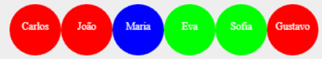

## Árvores

- Na última aula, vimos que árvores são estruturas muito boas para representar informação.

<br>

- Como exemplo, construímos uma árvore genealógica com os antepassados de uma pessoa.
  - Cada nó da árvore representa os dados de uma pessoa.
  - Cada pessoa tem um pai e uma mãe.
  - O pai e/ou a mãe podem não ser conhecidos.

## Árvore Genealógica — Exemplo

:::: {.columns style="display: flex; align-items: center;"}
::: {.column width="74%"}
```{=html}
<svg class="arvore" viewBox="0 0 840 438" xmlns="http://www.w3.org/2000/svg" role="img" aria-label="Árvore de antepassados de Gustavo: pai Fred e mãe Eva; Eva tem pai Carlos e mãe Betina" font-family="Lexend, 'Gill Sans Nova', 'Gill Sans', 'Trebuchet MS', Arial, sans-serif">
<defs><marker id="ponta-anc3" viewBox="0 0 10 10" refX="9" refY="5" markerWidth="4" markerHeight="4" orient="auto-start-reverse"><path d="M0,0 L10,5 L0,10 z" fill="#000"/></marker></defs>
<line x1="87" y1="91" x2="184" y2="170" stroke="#000" stroke-width="2" marker-end="url(#ponta-anc3)"/>
<line x1="288" y1="91" x2="192" y2="170" stroke="#000" stroke-width="2" stroke-dasharray="7 5" marker-end="url(#ponta-anc3)"/>
<line x1="586" y1="91" x2="386" y2="343" stroke="#000" stroke-width="2" marker-end="url(#ponta-anc3)"/>
<line x1="187" y1="264" x2="382" y2="343" stroke="#000" stroke-width="2" stroke-dasharray="7 5" marker-end="url(#ponta-anc3)"/>
<rect x="0" y="0" width="172" height="90" fill="#5b7a99" stroke="#3e5466" stroke-width="1.5"/>
<text x="86" y="30" text-anchor="middle" font-size="18" font-weight="700" fill="#fff">Carlos</text>
<text x="86" y="54" text-anchor="middle" font-size="14" fill="#fff">nasc. 1926</text>
<text x="86" y="75" text-anchor="middle" font-size="14" font-weight="700" fill="#ffff66">tipo A</text>
<rect x="202" y="0" width="172" height="90" fill="#5b7a99" stroke="#3e5466" stroke-width="1.5"/>
<text x="288" y="30" text-anchor="middle" font-size="18" font-weight="700" fill="#fff">Betina</text>
<text x="288" y="54" text-anchor="middle" font-size="14" fill="#fff">nasc. 1927</text>
<text x="288" y="75" text-anchor="middle" font-size="14" font-weight="700" fill="#ffff66">tipo B</text>
<rect x="500" y="0" width="172" height="90" fill="#5b7a99" stroke="#3e5466" stroke-width="1.5"/>
<text x="586" y="30" text-anchor="middle" font-size="18" font-weight="700" fill="#fff">Fred</text>
<text x="586" y="54" text-anchor="middle" font-size="14" fill="#fff">nasc. 1958</text>
<text x="586" y="75" text-anchor="middle" font-size="14" font-weight="700" fill="#ffff66">tipo A</text>
<rect x="101" y="173" width="172" height="90" fill="#5b7a99" stroke="#3e5466" stroke-width="1.5"/>
<text x="187" y="203" text-anchor="middle" font-size="18" font-weight="700" fill="#fff">Eva</text>
<text x="187" y="227" text-anchor="middle" font-size="14" fill="#fff">nasc. 1960</text>
<text x="187" y="248" text-anchor="middle" font-size="14" font-weight="700" fill="#ffff66">tipo O</text>
<rect x="298" y="346" width="172" height="90" fill="#5b7a99" stroke="#3e5466" stroke-width="1.5"/>
<text x="384" y="376" text-anchor="middle" font-size="18" font-weight="700" fill="#fff">Gustavo</text>
<text x="384" y="400" text-anchor="middle" font-size="14" fill="#fff">nasc. 1988</text>
<text x="384" y="421" text-anchor="middle" font-size="14" font-weight="700" fill="#ffff66">tipo A</text>
<line x1="730" y1="12" x2="785" y2="12" stroke="#000" stroke-width="2" marker-end="url(#ponta-anc3)"/>
<line x1="730" y1="50" x2="785" y2="50" stroke="#000" stroke-width="2" stroke-dasharray="7 5" marker-end="url(#ponta-anc3)"/>
<text x="798" y="18" font-size="17" fill="#262626">pai</text>
<text x="798" y="56" font-size="17" fill="#262626">mãe</text>
</svg>
```
:::
::: {.column width="24%"}
::: {.fragment}
[Como representar esta informação?]{.balao-elipse}
:::
:::
::::

## Definição de Dados - [Autorreferência]{.roxo}

Note que a estrutura [Pessoa]{.azul} tem [autorreferência]{.roxo}:

- o pai e a mãe de uma [pessoa]{.azul} são [pessoas]{.azul} ...

<br>

```pyret
data Pessoa:
  | ninguem   # caso base: pai/mãe desconhecido(a)
  | pessoa(
      nome      :: String, # nome da pessoa
      ano       :: Number, # ano de nascimento
      tipo-sang :: String, # tipo sanguíneo
      pai       :: Pessoa, # representa o pai da pessoa
      mae       :: Pessoa  # representa a mãe da pessoa
    )
end
```

## Exemplo: a família

:::: {.columns style="display: flex; align-items: center;"}
::: {.column width="58%"}
```{=html}
<svg class="arvore" viewBox="0 0 674 438" xmlns="http://www.w3.org/2000/svg" role="img" aria-label="Árvore de antepassados de Gustavo: pai Fred e mãe Eva; Eva tem pai Carlos e mãe Betina" font-family="Lexend, 'Gill Sans Nova', 'Gill Sans', 'Trebuchet MS', Arial, sans-serif">
<defs><marker id="ponta-anc5" viewBox="0 0 10 10" refX="9" refY="5" markerWidth="4" markerHeight="4" orient="auto-start-reverse"><path d="M0,0 L10,5 L0,10 z" fill="#000"/></marker></defs>
<line x1="87" y1="91" x2="184" y2="170" stroke="#000" stroke-width="2" marker-end="url(#ponta-anc5)"/>
<line x1="288" y1="91" x2="192" y2="170" stroke="#000" stroke-width="2" stroke-dasharray="7 5" marker-end="url(#ponta-anc5)"/>
<line x1="586" y1="91" x2="386" y2="343" stroke="#000" stroke-width="2" marker-end="url(#ponta-anc5)"/>
<line x1="187" y1="264" x2="382" y2="343" stroke="#000" stroke-width="2" stroke-dasharray="7 5" marker-end="url(#ponta-anc5)"/>
<rect x="0" y="0" width="172" height="90" fill="#5b7a99" stroke="#3e5466" stroke-width="1.5"/>
<text x="86" y="30" text-anchor="middle" font-size="18" font-weight="700" fill="#fff">Carlos</text>
<text x="86" y="54" text-anchor="middle" font-size="14" fill="#fff">nasc. 1926</text>
<text x="86" y="75" text-anchor="middle" font-size="14" font-weight="700" fill="#ffff66">tipo A</text>
<rect x="202" y="0" width="172" height="90" fill="#5b7a99" stroke="#3e5466" stroke-width="1.5"/>
<text x="288" y="30" text-anchor="middle" font-size="18" font-weight="700" fill="#fff">Betina</text>
<text x="288" y="54" text-anchor="middle" font-size="14" fill="#fff">nasc. 1927</text>
<text x="288" y="75" text-anchor="middle" font-size="14" font-weight="700" fill="#ffff66">tipo B</text>
<rect x="500" y="0" width="172" height="90" fill="#5b7a99" stroke="#3e5466" stroke-width="1.5"/>
<text x="586" y="30" text-anchor="middle" font-size="18" font-weight="700" fill="#fff">Fred</text>
<text x="586" y="54" text-anchor="middle" font-size="14" fill="#fff">nasc. 1958</text>
<text x="586" y="75" text-anchor="middle" font-size="14" font-weight="700" fill="#ffff66">tipo A</text>
<rect x="101" y="173" width="172" height="90" fill="#5b7a99" stroke="#3e5466" stroke-width="1.5"/>
<text x="187" y="203" text-anchor="middle" font-size="18" font-weight="700" fill="#fff">Eva</text>
<text x="187" y="227" text-anchor="middle" font-size="14" fill="#fff">nasc. 1960</text>
<text x="187" y="248" text-anchor="middle" font-size="14" font-weight="700" fill="#ffff66">tipo O</text>
<rect x="298" y="346" width="172" height="90" fill="#5b7a99" stroke="#3e5466" stroke-width="1.5"/>
<text x="384" y="376" text-anchor="middle" font-size="18" font-weight="700" fill="#fff">Gustavo</text>
<text x="384" y="400" text-anchor="middle" font-size="14" fill="#fff">nasc. 1988</text>
<text x="384" y="421" text-anchor="middle" font-size="14" font-weight="700" fill="#ffff66">tipo A</text>
</svg>
```
:::
::: {.column width="40%"}
::: {style="font-size: 0.75em;"}
```pyret
CARLOS  = pessoa("Carlos",
            1926, "A",
            ninguem, ninguem)
BETINA  = pessoa("Betina",
            1927, "B",
            ninguem, ninguem)
EVA     = pessoa("Eva",
            1960, "O",
            CARLOS,  BETINA)
FRED    = pessoa("Fred",
            1958, "A",
            ninguem, ninguem)
GUSTAVO = pessoa("Gustavo",
            1988, "A",
            FRED,    EVA)
```
:::
:::
::::

## ancestral-tipo-o: modelo da solução

```{=html}
<div class="modelo-solucao">
<p class="dado">Dada uma pessoa <span class="verde">p</span>:</p>
<div class="faixa trivial">
  <div class="titulo-faixa">Trivial: Resolver</div>
  <div class="linha">
    <span class="rotulo">Se</span>
    <span class="campo" style="width: 17em;"><span class="fragment"><span class="verde">p</span> é ninguem</span></span>
    <span>,</span>
    <span class="campo" style="width: 24em;"><span class="fragment">devolver <span class="vermelho">false</span></span></span>
  </div>
</div>
<div class="faixa trivial">
  <div class="titulo-faixa">Trivial: Resolver</div>
  <div class="linha">
    <span class="rotulo">Se</span>
    <span class="campo" style="width: 17em;"><span class="fragment"><span class="verde">p</span> tem tipo sang. "O"</span></span>
    <span>,</span>
    <span class="campo" style="width: 24em;"><span class="fragment">devolver <span class="verde">true</span></span></span>
  </div>
</div>
<div class="faixa dificil">
  <div class="titulo-faixa">Difícil: Decompor</div>
  <div class="linha">
    <span class="rotulo">Se</span>
    <span class="campo" style="width: 13em;"><span class="fragment">Senão</span></span>
  </div>
  <div class="linha" style="margin-top: 0.9em;">
    <span class="combinar">Combinar Soluções:</span>
    <span class="campo" style="width: 17em;"><span class="fragment">OU</span></span>
  </div>
  <div class="linha" style="margin-top: 0.7em;">
    <span style="width: 6em; flex: none;"></span>
    <span class="sub" style="width: 22.6em;">Solução dos subproblemas:</span>
    <span class="sub">Gerar problemas menores:</span>
  </div>
  <div class="linha">
    <span style="width: 6em; flex: none;"></span>
    <span class="campo" style="width: 22em;"><span class="fragment">Verificar se existe ancestral com tipo O em</span></span>
    <span class="campo" style="width: 17em;"><span class="fragment">Ancestrais por parte de pai de <span class="verde">p</span></span></span>
  </div>
  <div class="linha">
    <span style="width: 6em; flex: none;"></span>
    <span class="campo" style="width: 22em;"><span class="fragment">Verificar se existe ancestral com tipo O em</span></span>
    <span class="campo" style="width: 17em;"><span class="fragment">Ancestrais por parte de mãe de <span class="verde">p</span></span></span>
  </div>
</div>
</div>
```

## ancestral-tipo-o

::: {.pyret-live data-height="520" style="font-size: 0.8em;"}
::: {style="display: none;"}
```pyret
data Pessoa:
  | ninguem   # caso base: pai/mãe desconhecido(a)
  | pessoa(
      nome      :: String, # nome da pessoa
      ano       :: Number, # ano de nascimento
      tipo-sang :: String, # tipo sanguíneo
      pai       :: Pessoa, # representa o pai da pessoa
      mae       :: Pessoa  # representa a mãe da pessoa
    )
end

CARLOS  = pessoa("Carlos",  1926, "A", ninguem, ninguem)
BETINA  = pessoa("Betina",  1927, "B", ninguem, ninguem)
EVA     = pessoa("Eva",     1960, "O", CARLOS,  BETINA)
FRED    = pessoa("Fred",    1958, "A", ninguem, ninguem)
GUSTAVO = pessoa("Gustavo", 1988, "A", FRED,    EVA)
```
:::
```pyret
fun ancestral-tipo-o(p :: Pessoa) -> Boolean:
  doc: "Dada uma pessoa, verifica se esta pessoa ou algum ancestral tem tipo sanguíneo O."
  cases (Pessoa) p:
      # Se p é ninguém, retorna falso
    | ninguem => false
    | pessoa(nome, ano, tipo, pai, mae) =>
      (tipo == "O") or          # Se p é tipo O
      ancestral-tipo-o(pai) or  # ou existe ancestral por parte de pai tipo O
      ancestral-tipo-o(mae)     # ou existe ancestral por parte de mãe tipo O
  end
where:
  ancestral-tipo-o(GUSTAVO) is true
  ancestral-tipo-o(FRED)    is false
end
```
:::

## Revisando

- Um algoritmo é composto por:
  - [definição de dados]{.azul}
  - [definição das estruturas de controle]{.vermelho}, que dizem como os dados de entrada são processados para gerar a saída (no caso de Pyret, a estrutura de controle é uma função)

<br>

- Vamos analisar a definição do tipo de dado [Pessoa]{.azul} e a função [ancestral-tipo-o]{.vermelho}, que opera sobre elementos do tipo [Pessoa]{.azul} ...

## Dados e Função

:::: {.columns style="display: flex; align-items: center;"}
::: {.column width="14%" .rotulo-codigo}
[Dados]{.azul}
:::
::: {.column width="84%"}
::: {.borda-azul style="font-size: 0.74em;"}
```pyret
data Pessoa:
  | ninguem
  | pessoa(
      nome      :: String,  # Nome da pessoa
      ano       :: Number,  # Ano de nascimento da pessoa
      tipo-sang :: String,  # Tipo sanguíneo da pessoa
      pai       :: Pessoa,  # Pai da pessoa
      mae       :: Pessoa   # Mãe da pessoa
    )
end
```
:::
:::
::::

:::: {.columns style="display: flex; align-items: center;"}
::: {.column width="14%" .rotulo-codigo}
[Função]{.vermelho}
:::
::: {.column width="84%"}
::: {.borda-vermelha style="font-size: 0.74em;"}
```pyret
fun ancestral-tipo-o(p :: Pessoa) -> Boolean:
    cases (Pessoa) p:
        | ninguem => false
        | pessoa(n, a, o, pai, mae) =>
            ask:
                | o == "O" then: true
                | otherwise: ancestral-tipo-o(pai) or ancestral-tipo-o(mae)
            end
    end
end
```
:::
:::
::::

## Árvores N-árias

- Até agora, estudamos [árvores binárias]{.azul}:
  - Cada nodo referencia até [2 outros nodos]{.azul}
  - Exemplo: pai e mãe em uma árvore genealógica

::: {.pergunta}
[P.]{.azul} Como construir uma árvore com os descendentes de uma pessoa?
:::

## Árvore Genealógica de Descendentes

:::: {.columns style="display: flex; align-items: center;"}
::: {.column width="74%"}
```{=html}
<svg class="arvore" viewBox="0 0 808 425" xmlns="http://www.w3.org/2000/svg" role="img" aria-label="Árvore de descendentes: Carlos e Betina têm os filhos João, Maria e Eva; Eva e Fred têm os filhos Sofia e Gustavo" font-family="Lexend, 'Gill Sans Nova', 'Gill Sans', 'Trebuchet MS', Arial, sans-serif">
<defs><marker id="ponta-desc11" viewBox="0 0 10 10" refX="9" refY="5" markerWidth="4" markerHeight="4" orient="auto-start-reverse"><path d="M0,0 L10,5 L0,10 z" fill="#000"/></marker></defs>
<line x1="86" y1="90" x2="86" y2="170" stroke="#000" stroke-width="3" marker-end="url(#ponta-desc11)"/>
<line x1="92" y1="92" x2="262" y2="170" stroke="#000" stroke-width="3" marker-end="url(#ponta-desc11)"/>
<line x1="97" y1="92" x2="482" y2="170" stroke="#000" stroke-width="3" marker-end="url(#ponta-desc11)"/>
<line x1="286" y1="90" x2="104" y2="170" stroke="#000" stroke-width="3" marker-end="url(#ponta-desc11)"/>
<line x1="285" y1="90" x2="285" y2="170" stroke="#000" stroke-width="3" marker-end="url(#ponta-desc11)"/>
<line x1="285" y1="90" x2="522" y2="170" stroke="#000" stroke-width="3" marker-end="url(#ponta-desc11)"/>
<line x1="505" y1="263" x2="505" y2="330" stroke="#000" stroke-width="3" marker-end="url(#ponta-desc11)"/>
<line x1="505" y1="263" x2="722" y2="330" stroke="#000" stroke-width="3" marker-end="url(#ponta-desc11)"/>
<line x1="719" y1="263" x2="537" y2="330" stroke="#000" stroke-width="3" marker-end="url(#ponta-desc11)"/>
<line x1="746" y1="263" x2="746" y2="330" stroke="#000" stroke-width="3" marker-end="url(#ponta-desc11)"/>
<rect x="0" y="0" width="172" height="90" fill="#5b7a99" stroke="#3e5466" stroke-width="1.5"/>
<text x="86" y="30" text-anchor="middle" font-size="18" font-weight="700" fill="#fff">Carlos</text>
<text x="86" y="54" text-anchor="middle" font-size="14" fill="#fff">nasc. 1926</text>
<text x="86" y="75" text-anchor="middle" font-size="14" font-weight="700" fill="#ffff66">tipo A</text>
<rect x="201" y="0" width="172" height="90" fill="#5b7a99" stroke="#3e5466" stroke-width="1.5"/>
<text x="287" y="30" text-anchor="middle" font-size="18" font-weight="700" fill="#fff">Betina</text>
<text x="287" y="54" text-anchor="middle" font-size="14" fill="#fff">nasc. 1927</text>
<text x="287" y="75" text-anchor="middle" font-size="14" font-weight="700" fill="#ffff66">tipo A</text>
<rect x="0" y="172" width="172" height="90" fill="#5b7a99" stroke="#3e5466" stroke-width="1.5"/>
<text x="86" y="202" text-anchor="middle" font-size="18" font-weight="700" fill="#fff">João</text>
<text x="86" y="226" text-anchor="middle" font-size="14" fill="#fff">nasc. 1952</text>
<text x="86" y="247" text-anchor="middle" font-size="14" font-weight="700" fill="#ffff66">tipo A</text>
<rect x="204" y="172" width="172" height="90" fill="#5b7a99" stroke="#3e5466" stroke-width="1.5"/>
<text x="290" y="202" text-anchor="middle" font-size="18" font-weight="700" fill="#fff">Maria</text>
<text x="290" y="226" text-anchor="middle" font-size="14" fill="#fff">nasc. 1955</text>
<text x="290" y="247" text-anchor="middle" font-size="14" font-weight="700" fill="#ffff66">tipo B</text>
<rect x="419" y="172" width="172" height="90" fill="#5b7a99" stroke="#3e5466" stroke-width="1.5"/>
<text x="505" y="202" text-anchor="middle" font-size="18" font-weight="700" fill="#fff">Eva</text>
<text x="505" y="226" text-anchor="middle" font-size="14" fill="#fff">nasc. 1960</text>
<text x="505" y="247" text-anchor="middle" font-size="14" font-weight="700" fill="#ffff66">tipo O</text>
<rect x="635" y="172" width="172" height="90" fill="#5b7a99" stroke="#3e5466" stroke-width="1.5"/>
<text x="721" y="202" text-anchor="middle" font-size="18" font-weight="700" fill="#fff">Fred</text>
<text x="721" y="226" text-anchor="middle" font-size="14" fill="#fff">nasc. 1958</text>
<text x="721" y="247" text-anchor="middle" font-size="14" font-weight="700" fill="#ffff66">tipo B</text>
<rect x="419" y="333" width="172" height="90" fill="#5b7a99" stroke="#3e5466" stroke-width="1.5"/>
<text x="505" y="363" text-anchor="middle" font-size="18" font-weight="700" fill="#fff">Sofia</text>
<text x="505" y="387" text-anchor="middle" font-size="14" fill="#fff">nasc. 1986</text>
<text x="505" y="408" text-anchor="middle" font-size="14" font-weight="700" fill="#ffff66">tipo O</text>
<rect x="635" y="333" width="172" height="90" fill="#5b7a99" stroke="#3e5466" stroke-width="1.5"/>
<text x="721" y="363" text-anchor="middle" font-size="18" font-weight="700" fill="#fff">Gustavo</text>
<text x="721" y="387" text-anchor="middle" font-size="14" fill="#fff">nasc. 1988</text>
<text x="721" y="408" text-anchor="middle" font-size="14" font-weight="700" fill="#ffff66">tipo A</text>
</svg>
```
:::
::: {.column width="24%"}
::: {.fragment}
[Como representar esta informação?]{.balao-elipse}
:::
:::
::::

## Referência Mútua

:::: {.columns style="display: flex; align-items: center;"}
::: {.column width="14%" .rotulo-codigo}
[Dados]{.azul}
:::
::: {.column width="84%"}
::: {style="font-size: 0.85em;"}
```pyret
type ListaDeFilhos = List<Pessoa>
# data ListaDeFilhos:
#     | empty
#     | link(
#         first :: Pessoa,
#         rest :: ListaDeFilhos
#     )
# end
```
:::
:::
::::

:::: {.columns .fragment style="display: flex; align-items: center;"}
::: {.column width="14%" .rotulo-codigo}
[Dados]{.azul}
:::
::: {.column width="84%"}
::: {style="font-size: 0.85em;"}
```pyret
data Pessoa:
    | pessoa(
        nome :: String,         # Nome da pessoa
        ano :: Number,          # Ano de nascimento da pessoa
        tipo-sang :: String,    # Tipo sanguíneo da pessoa
        filhos :: ListaDeFilhos # Filhos da pessoa
    )
end
```
:::
:::
::::

## Referência Mútua

```{=html}
<svg class="codigo-anotado" viewBox="0 0 902 524" xmlns="http://www.w3.org/2000/svg" role="img" aria-label="Pessoa referencia ListaDeFilhos e ListaDeFilhos referencia Pessoa (referência mútua); ListaDeFilhos referencia a si mesma no campo rest (autorreferência)" font-family="SFMono-Regular, Menlo, Monaco, Consolas, 'Liberation Mono', 'Courier New', monospace" font-size="20">
<defs>
<marker id="ponta-p-dados13" viewBox="0 0 10 10" refX="9" refY="5" markerWidth="5" markerHeight="5" orient="auto-start-reverse"><path d="M0,0 L10,5 L0,10 z" fill="#000"/></marker>
<marker id="ponta-c-dados13" viewBox="0 0 10 10" refX="9" refY="5" markerWidth="5" markerHeight="5" orient="auto-start-reverse"><path d="M0,0 L10,5 L0,10 z" fill="#a6a6a6"/></marker>
</defs>
<rect x="120" y="288" width="780" height="234" fill="#fff" stroke="#23373b" stroke-opacity="0.3" stroke-width="1.5" rx="3"/>
<rect x="120" y="2" width="780" height="234" fill="#fff" stroke="#23373b" stroke-opacity="0.3" stroke-width="1.5" rx="3"/>
<text x="52" y="414" fill="#0070c0" font-size="26" text-anchor="middle" font-family="Lexend, 'Gill Sans Nova', 'Gill Sans', 'Trebuchet MS', Arial, sans-serif">Dados</text>
<text x="52" y="128" fill="#0070c0" font-size="26" text-anchor="middle" font-family="Lexend, 'Gill Sans Nova', 'Gill Sans', 'Trebuchet MS', Arial, sans-serif">Dados</text>
<rect x="190" y="297" width="92" height="27" fill="none" stroke="#c55a11" stroke-width="3"/>
<rect x="346" y="432" width="164" height="27" fill="none" stroke="#c55a11" stroke-width="3"/>
<rect x="214" y="38" width="176" height="27" fill="none" stroke="#c55a11" stroke-width="3"/>
<rect x="358" y="119" width="92" height="27" fill="none" stroke="#c55a11" stroke-width="3"/>
<rect x="346" y="146" width="164" height="27" fill="none" stroke="#c55a11" stroke-width="3"/>
<text x="134" y="316.44" textLength="48" lengthAdjust="spacingAndGlyphs" fill="#b91c1c">data</text>
<text x="194" y="316.44" textLength="72" lengthAdjust="spacingAndGlyphs" fill="#0070c0">Pessoa</text>
<text x="266" y="316.44" textLength="12" lengthAdjust="spacingAndGlyphs" fill="#0070c0">:</text>
<text x="182" y="343.44" textLength="12" lengthAdjust="spacingAndGlyphs" fill="#111827">|</text>
<text x="206" y="343.44" textLength="72" lengthAdjust="spacingAndGlyphs" fill="#5b21b6">pessoa</text>
<text x="278" y="343.44" textLength="12" lengthAdjust="spacingAndGlyphs" fill="#111827">(</text>
<text x="230" y="370.44" textLength="48" lengthAdjust="spacingAndGlyphs" fill="#0a192f">nome</text>
<text x="290" y="370.44" textLength="24" lengthAdjust="spacingAndGlyphs" fill="#111827">::</text>
<text x="326" y="370.44" textLength="72" lengthAdjust="spacingAndGlyphs" fill="#5b21b6">String</text>
<text x="398" y="370.44" textLength="12" lengthAdjust="spacingAndGlyphs" fill="#111827">,</text>
<text x="518" y="370.44" textLength="12" lengthAdjust="spacingAndGlyphs" fill="#d97706" font-style="italic">#</text>
<text x="542" y="370.44" textLength="48" lengthAdjust="spacingAndGlyphs" fill="#d97706" font-style="italic">Nome</text>
<text x="602" y="370.44" textLength="24" lengthAdjust="spacingAndGlyphs" fill="#d97706" font-style="italic">da</text>
<text x="638" y="370.44" textLength="72" lengthAdjust="spacingAndGlyphs" fill="#d97706" font-style="italic">pessoa</text>
<text x="230" y="397.44" textLength="36" lengthAdjust="spacingAndGlyphs" fill="#0a192f">ano</text>
<text x="278" y="397.44" textLength="24" lengthAdjust="spacingAndGlyphs" fill="#111827">::</text>
<text x="314" y="397.44" textLength="72" lengthAdjust="spacingAndGlyphs" fill="#5b21b6">Number</text>
<text x="386" y="397.44" textLength="12" lengthAdjust="spacingAndGlyphs" fill="#111827">,</text>
<text x="518" y="397.44" textLength="12" lengthAdjust="spacingAndGlyphs" fill="#d97706" font-style="italic">#</text>
<text x="542" y="397.44" textLength="36" lengthAdjust="spacingAndGlyphs" fill="#d97706" font-style="italic">Ano</text>
<text x="590" y="397.44" textLength="24" lengthAdjust="spacingAndGlyphs" fill="#d97706" font-style="italic">de</text>
<text x="626" y="397.44" textLength="120" lengthAdjust="spacingAndGlyphs" fill="#d97706" font-style="italic">nascimento</text>
<text x="758" y="397.44" textLength="24" lengthAdjust="spacingAndGlyphs" fill="#d97706" font-style="italic">da</text>
<text x="794" y="397.44" textLength="72" lengthAdjust="spacingAndGlyphs" fill="#d97706" font-style="italic">pessoa</text>
<text x="230" y="424.44" textLength="108" lengthAdjust="spacingAndGlyphs" fill="#0a192f">tipo-sang</text>
<text x="350" y="424.44" textLength="24" lengthAdjust="spacingAndGlyphs" fill="#111827">::</text>
<text x="386" y="424.44" textLength="72" lengthAdjust="spacingAndGlyphs" fill="#5b21b6">String</text>
<text x="458" y="424.44" textLength="12" lengthAdjust="spacingAndGlyphs" fill="#111827">,</text>
<text x="518" y="424.44" textLength="12" lengthAdjust="spacingAndGlyphs" fill="#d97706" font-style="italic">#</text>
<text x="542" y="424.44" textLength="48" lengthAdjust="spacingAndGlyphs" fill="#d97706" font-style="italic">Tipo</text>
<text x="602" y="424.44" textLength="108" lengthAdjust="spacingAndGlyphs" fill="#d97706" font-style="italic">sanguíneo</text>
<text x="722" y="424.44" textLength="24" lengthAdjust="spacingAndGlyphs" fill="#d97706" font-style="italic">da</text>
<text x="758" y="424.44" textLength="72" lengthAdjust="spacingAndGlyphs" fill="#d97706" font-style="italic">pessoa</text>
<text x="230" y="451.44" textLength="72" lengthAdjust="spacingAndGlyphs" fill="#0a192f">filhos</text>
<text x="314" y="451.44" textLength="24" lengthAdjust="spacingAndGlyphs" fill="#111827">::</text>
<text x="350" y="451.44" textLength="156" lengthAdjust="spacingAndGlyphs" fill="#00a040">ListaDeFilhos</text>
<text x="518" y="451.44" textLength="12" lengthAdjust="spacingAndGlyphs" fill="#d97706" font-style="italic">#</text>
<text x="542" y="451.44" textLength="72" lengthAdjust="spacingAndGlyphs" fill="#d97706" font-style="italic">Filhos</text>
<text x="626" y="451.44" textLength="24" lengthAdjust="spacingAndGlyphs" fill="#d97706" font-style="italic">da</text>
<text x="662" y="451.44" textLength="72" lengthAdjust="spacingAndGlyphs" fill="#d97706" font-style="italic">pessoa</text>
<text x="182" y="478.44" textLength="12" lengthAdjust="spacingAndGlyphs" fill="#111827">)</text>
<text x="134" y="505.44" textLength="36" lengthAdjust="spacingAndGlyphs" fill="#b91c1c">end</text>
<text x="134" y="30.44" textLength="48" lengthAdjust="spacingAndGlyphs" fill="#b91c1c">type</text>
<text x="194" y="30.44" textLength="156" lengthAdjust="spacingAndGlyphs" fill="#00a040">ListaDeFilhos</text>
<text x="362" y="30.44" textLength="12" lengthAdjust="spacingAndGlyphs" fill="#111827">=</text>
<text x="386" y="30.44" textLength="48" lengthAdjust="spacingAndGlyphs" fill="#5b21b6">List</text>
<text x="434" y="30.44" textLength="12" lengthAdjust="spacingAndGlyphs" fill="#111827">&lt;</text>
<text x="446" y="30.44" textLength="72" lengthAdjust="spacingAndGlyphs" fill="#0070c0">Pessoa</text>
<text x="518" y="30.44" textLength="12" lengthAdjust="spacingAndGlyphs" fill="#111827">&gt;</text>
<text x="134" y="57.44" textLength="12" lengthAdjust="spacingAndGlyphs" fill="#d97706" font-style="italic">#</text>
<text x="158" y="57.44" textLength="48" lengthAdjust="spacingAndGlyphs" fill="#d97706" font-style="italic">data</text>
<text x="218" y="57.44" textLength="168" lengthAdjust="spacingAndGlyphs" fill="#00a040" font-style="italic">ListaDeFilhos:</text>
<text x="134" y="84.44" textLength="12" lengthAdjust="spacingAndGlyphs" fill="#d97706" font-style="italic">#</text>
<text x="206" y="84.44" textLength="12" lengthAdjust="spacingAndGlyphs" fill="#d97706" font-style="italic">|</text>
<text x="230" y="84.44" textLength="60" lengthAdjust="spacingAndGlyphs" fill="#d97706" font-style="italic">empty</text>
<text x="134" y="111.44" textLength="12" lengthAdjust="spacingAndGlyphs" fill="#d97706" font-style="italic">#</text>
<text x="206" y="111.44" textLength="12" lengthAdjust="spacingAndGlyphs" fill="#d97706" font-style="italic">|</text>
<text x="230" y="111.44" textLength="60" lengthAdjust="spacingAndGlyphs" fill="#d97706" font-style="italic">link(</text>
<text x="134" y="138.44" textLength="12" lengthAdjust="spacingAndGlyphs" fill="#d97706" font-style="italic">#</text>
<text x="254" y="138.44" textLength="60" lengthAdjust="spacingAndGlyphs" fill="#d97706" font-style="italic">first</text>
<text x="326" y="138.44" textLength="24" lengthAdjust="spacingAndGlyphs" fill="#d97706" font-style="italic">::</text>
<text x="362" y="138.44" textLength="84" lengthAdjust="spacingAndGlyphs" fill="#0070c0" font-style="italic">Pessoa,</text>
<text x="134" y="165.44" textLength="12" lengthAdjust="spacingAndGlyphs" fill="#d97706" font-style="italic">#</text>
<text x="254" y="165.44" textLength="48" lengthAdjust="spacingAndGlyphs" fill="#d97706" font-style="italic">rest</text>
<text x="314" y="165.44" textLength="24" lengthAdjust="spacingAndGlyphs" fill="#d97706" font-style="italic">::</text>
<text x="350" y="165.44" textLength="156" lengthAdjust="spacingAndGlyphs" fill="#00a040" font-style="italic">ListaDeFilhos</text>
<text x="134" y="192.44" textLength="12" lengthAdjust="spacingAndGlyphs" fill="#d97706" font-style="italic">#</text>
<text x="206" y="192.44" textLength="12" lengthAdjust="spacingAndGlyphs" fill="#d97706" font-style="italic">)</text>
<text x="134" y="219.44" textLength="12" lengthAdjust="spacingAndGlyphs" fill="#d97706" font-style="italic">#</text>
<text x="158" y="219.44" textLength="36" lengthAdjust="spacingAndGlyphs" fill="#d97706" font-style="italic">end</text>
<line x1="395.2" y1="459" x2="240.4" y2="38" stroke="#000" stroke-width="2.5" marker-end="url(#ponta-p-dados13)"/>
<line x1="385.6" y1="119" x2="231.4" y2="324" stroke="#000" stroke-width="2.5" marker-end="url(#ponta-p-dados13)"/>
<line x1="510.0" y1="159.5" x2="390.0" y2="65" stroke="#a6a6a6" stroke-width="2.5" marker-end="url(#ponta-c-dados13)"/>
<text x="520" y="272" fill="#000" font-size="26" text-anchor="middle" font-family="Lexend, 'Gill Sans Nova', 'Gill Sans', 'Trebuchet MS', Arial, sans-serif">REFERÊNCIA MÚTUA</text>
<text x="550" y="95" fill="#a6a6a6" font-size="26" text-anchor="start" font-family="Lexend, 'Gill Sans Nova', 'Gill Sans', 'Trebuchet MS', Arial, sans-serif">AUTORREFERÊNCIA</text>
</svg>
```

## Árvore Genealógica de Descendentes

::: {style="width: 72%; margin: 0 auto;"}
```{=html}
<svg class="arvore" viewBox="0 0 808 425" xmlns="http://www.w3.org/2000/svg" role="img" aria-label="Árvore de descendentes: Carlos e Betina têm os filhos João, Maria e Eva; Eva e Fred têm os filhos Sofia e Gustavo" font-family="Lexend, 'Gill Sans Nova', 'Gill Sans', 'Trebuchet MS', Arial, sans-serif">
<defs><marker id="ponta-desc14" viewBox="0 0 10 10" refX="9" refY="5" markerWidth="4" markerHeight="4" orient="auto-start-reverse"><path d="M0,0 L10,5 L0,10 z" fill="#000"/></marker></defs>
<line x1="86" y1="90" x2="86" y2="170" stroke="#000" stroke-width="3" marker-end="url(#ponta-desc14)"/>
<line x1="92" y1="92" x2="262" y2="170" stroke="#000" stroke-width="3" marker-end="url(#ponta-desc14)"/>
<line x1="97" y1="92" x2="482" y2="170" stroke="#000" stroke-width="3" marker-end="url(#ponta-desc14)"/>
<line x1="286" y1="90" x2="104" y2="170" stroke="#000" stroke-width="3" marker-end="url(#ponta-desc14)"/>
<line x1="285" y1="90" x2="285" y2="170" stroke="#000" stroke-width="3" marker-end="url(#ponta-desc14)"/>
<line x1="285" y1="90" x2="522" y2="170" stroke="#000" stroke-width="3" marker-end="url(#ponta-desc14)"/>
<line x1="505" y1="263" x2="505" y2="330" stroke="#000" stroke-width="3" marker-end="url(#ponta-desc14)"/>
<line x1="505" y1="263" x2="722" y2="330" stroke="#000" stroke-width="3" marker-end="url(#ponta-desc14)"/>
<line x1="719" y1="263" x2="537" y2="330" stroke="#000" stroke-width="3" marker-end="url(#ponta-desc14)"/>
<line x1="746" y1="263" x2="746" y2="330" stroke="#000" stroke-width="3" marker-end="url(#ponta-desc14)"/>
<rect x="0" y="0" width="172" height="90" fill="#5b7a99" stroke="#3e5466" stroke-width="1.5"/>
<text x="86" y="30" text-anchor="middle" font-size="18" font-weight="700" fill="#fff">Carlos</text>
<text x="86" y="54" text-anchor="middle" font-size="14" fill="#fff">nasc. 1926</text>
<text x="86" y="75" text-anchor="middle" font-size="14" font-weight="700" fill="#ffff66">tipo A</text>
<rect x="201" y="0" width="172" height="90" fill="#d6dce5" stroke="#3e5466" stroke-width="1.5"/>
<text x="287" y="30" text-anchor="middle" font-size="18" font-weight="700" fill="#fff">Betina</text>
<text x="287" y="54" text-anchor="middle" font-size="14" fill="#fff">nasc. 1927</text>
<text x="287" y="75" text-anchor="middle" font-size="14" font-weight="700" fill="#ffff66">tipo A</text>
<rect x="0" y="172" width="172" height="90" fill="#5b7a99" stroke="#3e5466" stroke-width="1.5"/>
<text x="86" y="202" text-anchor="middle" font-size="18" font-weight="700" fill="#fff">João</text>
<text x="86" y="226" text-anchor="middle" font-size="14" fill="#fff">nasc. 1952</text>
<text x="86" y="247" text-anchor="middle" font-size="14" font-weight="700" fill="#ffff66">tipo A</text>
<rect x="204" y="172" width="172" height="90" fill="#5b7a99" stroke="#3e5466" stroke-width="1.5"/>
<text x="290" y="202" text-anchor="middle" font-size="18" font-weight="700" fill="#fff">Maria</text>
<text x="290" y="226" text-anchor="middle" font-size="14" fill="#fff">nasc. 1955</text>
<text x="290" y="247" text-anchor="middle" font-size="14" font-weight="700" fill="#ffff66">tipo B</text>
<rect x="419" y="172" width="172" height="90" fill="#5b7a99" stroke="#3e5466" stroke-width="1.5"/>
<text x="505" y="202" text-anchor="middle" font-size="18" font-weight="700" fill="#fff">Eva</text>
<text x="505" y="226" text-anchor="middle" font-size="14" fill="#fff">nasc. 1960</text>
<text x="505" y="247" text-anchor="middle" font-size="14" font-weight="700" fill="#ffff66">tipo O</text>
<rect x="635" y="172" width="172" height="90" fill="#d6dce5" stroke="#3e5466" stroke-width="1.5"/>
<text x="721" y="202" text-anchor="middle" font-size="18" font-weight="700" fill="#fff">Fred</text>
<text x="721" y="226" text-anchor="middle" font-size="14" fill="#fff">nasc. 1958</text>
<text x="721" y="247" text-anchor="middle" font-size="14" font-weight="700" fill="#ffff66">tipo B</text>
<rect x="419" y="333" width="172" height="90" fill="#5b7a99" stroke="#3e5466" stroke-width="1.5"/>
<text x="505" y="363" text-anchor="middle" font-size="18" font-weight="700" fill="#fff">Sofia</text>
<text x="505" y="387" text-anchor="middle" font-size="14" fill="#fff">nasc. 1986</text>
<text x="505" y="408" text-anchor="middle" font-size="14" font-weight="700" fill="#ffff66">tipo O</text>
<rect x="635" y="333" width="172" height="90" fill="#5b7a99" stroke="#3e5466" stroke-width="1.5"/>
<text x="721" y="363" text-anchor="middle" font-size="18" font-weight="700" fill="#fff">Gustavo</text>
<text x="721" y="387" text-anchor="middle" font-size="14" fill="#fff">nasc. 1988</text>
<text x="721" y="408" text-anchor="middle" font-size="14" font-weight="700" fill="#ffff66">tipo A</text>
</svg>
```
:::

::: {style="font-size: 0.85em;"}
```pyret
pessoa("Carlos", 1926, "A",
       [list: pessoa("João", 1952, "A", empty),
              pessoa("Maria", 1955, "B", empty),
              pessoa("Eva", 1960, "O",
                [list: pessoa("Sofia", 1986, "O", empty),
                       pessoa("Gustavo", 1988, "A", empty)])])
```
:::

## Árvore Genealógica de Descendentes

::: {style="width: 72%; margin: 0 auto;"}
```{=html}
<svg class="arvore" viewBox="0 0 808 425" xmlns="http://www.w3.org/2000/svg" role="img" aria-label="Árvore de descendentes: Carlos e Betina têm os filhos João, Maria e Eva; Eva e Fred têm os filhos Sofia e Gustavo" font-family="Lexend, 'Gill Sans Nova', 'Gill Sans', 'Trebuchet MS', Arial, sans-serif">
<defs><marker id="ponta-desc15" viewBox="0 0 10 10" refX="9" refY="5" markerWidth="4" markerHeight="4" orient="auto-start-reverse"><path d="M0,0 L10,5 L0,10 z" fill="#000"/></marker></defs>
<line x1="86" y1="90" x2="86" y2="170" stroke="#000" stroke-width="3" marker-end="url(#ponta-desc15)"/>
<line x1="92" y1="92" x2="262" y2="170" stroke="#000" stroke-width="3" marker-end="url(#ponta-desc15)"/>
<line x1="97" y1="92" x2="482" y2="170" stroke="#000" stroke-width="3" marker-end="url(#ponta-desc15)"/>
<line x1="286" y1="90" x2="104" y2="170" stroke="#000" stroke-width="3" marker-end="url(#ponta-desc15)"/>
<line x1="285" y1="90" x2="285" y2="170" stroke="#000" stroke-width="3" marker-end="url(#ponta-desc15)"/>
<line x1="285" y1="90" x2="522" y2="170" stroke="#000" stroke-width="3" marker-end="url(#ponta-desc15)"/>
<line x1="505" y1="263" x2="505" y2="330" stroke="#000" stroke-width="3" marker-end="url(#ponta-desc15)"/>
<line x1="505" y1="263" x2="722" y2="330" stroke="#000" stroke-width="3" marker-end="url(#ponta-desc15)"/>
<line x1="719" y1="263" x2="537" y2="330" stroke="#000" stroke-width="3" marker-end="url(#ponta-desc15)"/>
<line x1="746" y1="263" x2="746" y2="330" stroke="#000" stroke-width="3" marker-end="url(#ponta-desc15)"/>
<rect x="0" y="0" width="172" height="90" fill="#5b7a99" stroke="#3e5466" stroke-width="1.5"/>
<text x="86" y="30" text-anchor="middle" font-size="18" font-weight="700" fill="#fff">Carlos</text>
<text x="86" y="54" text-anchor="middle" font-size="14" fill="#fff">nasc. 1926</text>
<text x="86" y="75" text-anchor="middle" font-size="14" font-weight="700" fill="#ffff66">tipo A</text>
<rect x="201" y="0" width="172" height="90" fill="#d6dce5" stroke="#3e5466" stroke-width="1.5"/>
<text x="287" y="30" text-anchor="middle" font-size="18" font-weight="700" fill="#fff">Betina</text>
<text x="287" y="54" text-anchor="middle" font-size="14" fill="#fff">nasc. 1927</text>
<text x="287" y="75" text-anchor="middle" font-size="14" font-weight="700" fill="#ffff66">tipo A</text>
<rect x="0" y="172" width="172" height="90" fill="#5b7a99" stroke="#3e5466" stroke-width="1.5"/>
<text x="86" y="202" text-anchor="middle" font-size="18" font-weight="700" fill="#fff">João</text>
<text x="86" y="226" text-anchor="middle" font-size="14" fill="#fff">nasc. 1952</text>
<text x="86" y="247" text-anchor="middle" font-size="14" font-weight="700" fill="#ffff66">tipo A</text>
<rect x="204" y="172" width="172" height="90" fill="#5b7a99" stroke="#3e5466" stroke-width="1.5"/>
<text x="290" y="202" text-anchor="middle" font-size="18" font-weight="700" fill="#fff">Maria</text>
<text x="290" y="226" text-anchor="middle" font-size="14" fill="#fff">nasc. 1955</text>
<text x="290" y="247" text-anchor="middle" font-size="14" font-weight="700" fill="#ffff66">tipo B</text>
<rect x="419" y="172" width="172" height="90" fill="#5b7a99" stroke="#3e5466" stroke-width="1.5"/>
<text x="505" y="202" text-anchor="middle" font-size="18" font-weight="700" fill="#fff">Eva</text>
<text x="505" y="226" text-anchor="middle" font-size="14" fill="#fff">nasc. 1960</text>
<text x="505" y="247" text-anchor="middle" font-size="14" font-weight="700" fill="#ffff66">tipo O</text>
<rect x="635" y="172" width="172" height="90" fill="#d6dce5" stroke="#3e5466" stroke-width="1.5"/>
<text x="721" y="202" text-anchor="middle" font-size="18" font-weight="700" fill="#fff">Fred</text>
<text x="721" y="226" text-anchor="middle" font-size="14" fill="#fff">nasc. 1958</text>
<text x="721" y="247" text-anchor="middle" font-size="14" font-weight="700" fill="#ffff66">tipo B</text>
<rect x="419" y="333" width="172" height="90" fill="#5b7a99" stroke="#3e5466" stroke-width="1.5"/>
<text x="505" y="363" text-anchor="middle" font-size="18" font-weight="700" fill="#fff">Sofia</text>
<text x="505" y="387" text-anchor="middle" font-size="14" fill="#fff">nasc. 1986</text>
<text x="505" y="408" text-anchor="middle" font-size="14" font-weight="700" fill="#ffff66">tipo O</text>
<rect x="635" y="333" width="172" height="90" fill="#5b7a99" stroke="#3e5466" stroke-width="1.5"/>
<text x="721" y="363" text-anchor="middle" font-size="18" font-weight="700" fill="#fff">Gustavo</text>
<text x="721" y="387" text-anchor="middle" font-size="14" fill="#fff">nasc. 1988</text>
<text x="721" y="408" text-anchor="middle" font-size="14" font-weight="700" fill="#ffff66">tipo A</text>
</svg>
```
:::

:::: {.columns}
::: {.column width="49%"}
::: {style="font-size: 0.7em;"}
```pyret
JOAO = pessoa("João", 1952, "A", empty)
MARIA = pessoa("Maria", 1955, "B", empty)
SOFIA = pessoa("Sofia", 1986, "O", empty)
GUSTAVO = pessoa("Gustavo", 1988, "A", empty)
```
:::
:::
::: {.column width="51%"}
::: {style="font-size: 0.7em;"}
```pyret
LF-EVA = [list: SOFIA, GUSTAVO]
EVA = pessoa("Eva", 1960, "O", LF-EVA)
LF-CARLOS = [list: JOAO, MARIA, EVA]
CARLOS = pessoa("Carlos", 1926, "A", LF-CARLOS)
```
:::
:::
::::

## Descendente Tipo O

```{=html}
<div class="ficha">
  <div class="aba">Descendente Tipo O</div>
  <div class="item"><span class="azul">Obj:</span> <span class="laranja">Dada uma</span> <span class="azul">pessoa</span><span class="laranja">, verifica se ela ou algum de seus descendentes tem tipo sanguíneo “O”.</span></div>
  <div class="item"><span class="verde">Entrada:</span> Uma pessoa.</div>
  <div class="item"><span class="vermelho">Saída:</span> Um booleano.</div>
</div>
<div class="funcao-caixa-preta">
  <div><span class="verde">p</span> <span class="azul">:: Pessoa</span></div>
  <div class="seta">&#129123;</div>
  <div class="caixa-funcao">descendente-tipo-o</div>
  <div class="seta">&#129123;</div>
  <div class="azul">Boolean</div>
</div>
```

## Descendente Tipo O

::: {style="width: 72%; margin: 0 auto;"}
```{=html}
<svg class="arvore" viewBox="0 0 808 425" xmlns="http://www.w3.org/2000/svg" role="img" aria-label="Árvore de descendentes: Carlos e Betina têm os filhos João, Maria e Eva; Eva e Fred têm os filhos Sofia e Gustavo" font-family="Lexend, 'Gill Sans Nova', 'Gill Sans', 'Trebuchet MS', Arial, sans-serif">
<defs><marker id="ponta-desc17" viewBox="0 0 10 10" refX="9" refY="5" markerWidth="4" markerHeight="4" orient="auto-start-reverse"><path d="M0,0 L10,5 L0,10 z" fill="#000"/></marker></defs>
<line x1="86" y1="90" x2="86" y2="170" stroke="#000" stroke-width="3" marker-end="url(#ponta-desc17)"/>
<line x1="92" y1="92" x2="262" y2="170" stroke="#000" stroke-width="3" marker-end="url(#ponta-desc17)"/>
<line x1="97" y1="92" x2="482" y2="170" stroke="#000" stroke-width="3" marker-end="url(#ponta-desc17)"/>
<line x1="286" y1="90" x2="104" y2="170" stroke="#000" stroke-width="3" marker-end="url(#ponta-desc17)"/>
<line x1="285" y1="90" x2="285" y2="170" stroke="#000" stroke-width="3" marker-end="url(#ponta-desc17)"/>
<line x1="285" y1="90" x2="522" y2="170" stroke="#000" stroke-width="3" marker-end="url(#ponta-desc17)"/>
<line x1="505" y1="263" x2="505" y2="330" stroke="#000" stroke-width="3" marker-end="url(#ponta-desc17)"/>
<line x1="505" y1="263" x2="722" y2="330" stroke="#000" stroke-width="3" marker-end="url(#ponta-desc17)"/>
<line x1="719" y1="263" x2="537" y2="330" stroke="#000" stroke-width="3" marker-end="url(#ponta-desc17)"/>
<line x1="746" y1="263" x2="746" y2="330" stroke="#000" stroke-width="3" marker-end="url(#ponta-desc17)"/>
<rect x="0" y="0" width="172" height="90" fill="#5b7a99" stroke="#3e5466" stroke-width="1.5"/>
<text x="86" y="30" text-anchor="middle" font-size="18" font-weight="700" fill="#fff">Carlos</text>
<text x="86" y="54" text-anchor="middle" font-size="14" fill="#fff">nasc. 1926</text>
<text x="86" y="75" text-anchor="middle" font-size="14" font-weight="700" fill="#ffff66">tipo A</text>
<rect x="201" y="0" width="172" height="90" fill="#d6dce5" stroke="#3e5466" stroke-width="1.5"/>
<text x="287" y="30" text-anchor="middle" font-size="18" font-weight="700" fill="#fff">Betina</text>
<text x="287" y="54" text-anchor="middle" font-size="14" fill="#fff">nasc. 1927</text>
<text x="287" y="75" text-anchor="middle" font-size="14" font-weight="700" fill="#ffff66">tipo A</text>
<rect x="0" y="172" width="172" height="90" fill="#5b7a99" stroke="#3e5466" stroke-width="1.5"/>
<text x="86" y="202" text-anchor="middle" font-size="18" font-weight="700" fill="#fff">João</text>
<text x="86" y="226" text-anchor="middle" font-size="14" fill="#fff">nasc. 1952</text>
<text x="86" y="247" text-anchor="middle" font-size="14" font-weight="700" fill="#ffff66">tipo A</text>
<rect x="204" y="172" width="172" height="90" fill="#5b7a99" stroke="#3e5466" stroke-width="1.5"/>
<text x="290" y="202" text-anchor="middle" font-size="18" font-weight="700" fill="#fff">Maria</text>
<text x="290" y="226" text-anchor="middle" font-size="14" fill="#fff">nasc. 1955</text>
<text x="290" y="247" text-anchor="middle" font-size="14" font-weight="700" fill="#ffff66">tipo B</text>
<rect x="419" y="172" width="172" height="90" fill="#5b7a99" stroke="#3e5466" stroke-width="1.5"/>
<text x="505" y="202" text-anchor="middle" font-size="18" font-weight="700" fill="#fff">Eva</text>
<text x="505" y="226" text-anchor="middle" font-size="14" fill="#fff">nasc. 1960</text>
<text x="505" y="247" text-anchor="middle" font-size="14" font-weight="700" fill="#ffff66">tipo O</text>
<rect x="635" y="172" width="172" height="90" fill="#d6dce5" stroke="#3e5466" stroke-width="1.5"/>
<text x="721" y="202" text-anchor="middle" font-size="18" font-weight="700" fill="#fff">Fred</text>
<text x="721" y="226" text-anchor="middle" font-size="14" fill="#fff">nasc. 1958</text>
<text x="721" y="247" text-anchor="middle" font-size="14" font-weight="700" fill="#ffff66">tipo B</text>
<rect x="419" y="333" width="172" height="90" fill="#5b7a99" stroke="#3e5466" stroke-width="1.5"/>
<text x="505" y="363" text-anchor="middle" font-size="18" font-weight="700" fill="#fff">Sofia</text>
<text x="505" y="387" text-anchor="middle" font-size="14" fill="#fff">nasc. 1986</text>
<text x="505" y="408" text-anchor="middle" font-size="14" font-weight="700" fill="#ffff66">tipo O</text>
<rect x="635" y="333" width="172" height="90" fill="#5b7a99" stroke="#3e5466" stroke-width="1.5"/>
<text x="721" y="363" text-anchor="middle" font-size="18" font-weight="700" fill="#fff">Gustavo</text>
<text x="721" y="387" text-anchor="middle" font-size="14" fill="#fff">nasc. 1988</text>
<text x="721" y="408" text-anchor="middle" font-size="14" font-weight="700" fill="#ffff66">tipo A</text>
</svg>
```
:::

::: {style="width: 62%;"}
```pyret
check:
    descendente-tipo-o(CARLOS) is true
    descendente-tipo-o(JOAO) is false
end
```
:::

## Decomposição

```{=html}
<div class="decomposicao">
<p class="dado">Dada uma pessoa <span class="verde">p</span>:</p>
<div class="titulo-faixa azul">Trivial: resolver</div>
<div class="faixa trivial">
  <div class="linha">
    <span class="se">Se</span>
    <div class="campo"><span class="legenda">problema trivial?</span><div class="caixa"><span class="fragment" data-fragment-index="0"><span class="verde">p</span> é tipo O</span></div></div>
    <span class="virgula">,</span>
    <div class="campo"><span class="legenda">solução do problema trivial</span><div class="caixa"><span class="fragment" data-fragment-index="1">true</span></div></div>
  </div>
</div>
<div class="titulo-faixa vermelho">Difícil: Decompor</div>
<div class="faixa dificil">
  <div class="linha">
    <span class="se">Se</span>
    <div class="campo"><span class="legenda">problema difícil?</span><div class="caixa"><span class="fragment" data-fragment-index="2"><span class="verde">p</span> não é tipo O</span></div></div>
    <span class="virgula">,</span>
  </div>
  <div class="linha recuo1">
    <div class="campo"><span class="legenda">combinar soluções</span><div class="caixa"><span class="proibido fragment" data-fragment-index="5"></span></div></div>
  </div>
  <div class="linha recuo2">
    <div class="campo"><span class="legenda">solução do problema menor</span><div class="caixa pequena"><span class="fragment" data-fragment-index="3">verificar se tem alguém tipo “O” entre os descendentes</span></div></div>
    <div class="campo"><span class="legenda">gerar problema menor</span><div class="caixa"><span class="fragment" data-fragment-index="4">filhos de <span class="verde">p</span></span></div></div>
  </div>
  <div class="linha recuo2">
    <div class="campo"><span class="legenda">solução do problema menor 2</span><div class="caixa"><span class="proibido fragment" data-fragment-index="5"></span></div></div>
    <div class="campo"><span class="legenda">gerar problema menor</span><div class="caixa"><span class="proibido fragment" data-fragment-index="5"></span></div></div>
  </div>
</div>
</div>
```

## Descendente Tipo O

::: {.absolute top="85" left="0" width="960"}
```{.pyret .code-overflow-wrap code-line-numbers="false"}
fun descendente-tipo-o(p :: Pessoa) -> Boolean:
    doc: "Dada uma pessoa, verifica se ela ou algum de seus descendentes tem tipo sanguíneo O."
    ask:
        # Se p tem tipo O, devolver true
        | p.tipo-sang == "O" then: true
        # Senão,
        | otherwise:
            # Existe alguém com tipo O entre
            ???
                p.filhos  # os filhos de p?
    end
where:
    descendente-tipo-o(CARLOS) is true
    descendente-tipo-o(JOAO) is false
end
```
:::

::: {.absolute .fragment .nota-codigo top="338" left="226"}
[[]{.seta-esq style="width: 6em;"}[O que colocar aqui?]{.caixa-nota}]{.vermelho}
:::

::: {.absolute .nota-codigo top="407" left="300"}
[↘ tipo ListaDeFilhos]{.azul}
:::

## Descendente Tipo O

```{.pyret .code-overflow-wrap code-line-numbers="false"}
fun descendente-tipo-o(p :: Pessoa) -> Boolean:
    doc: "Dada uma pessoa, verifica se ela ou algum de seus descendentes tem tipo sanguíneo O."
    ask:
        # Se p tem tipo O, devolver true
        | p.tipo-sang == "O" then: true
        # Senão,
        | otherwise:
            # Existe alguém com tipo O entre os filhos de p?
            descendente-tipo-o-lista(p.filhos)
    end
where:
    descendente-tipo-o(CARLOS) is true
    descendente-tipo-o(JOAO) is false
end
```

## Descendente Tipo O na Lista

```{=html}
<div class="ficha">
  <div class="aba">Descendente Tipo O na Lista</div>
  <div class="item"><span class="azul">Obj:</span> <span class="laranja">Dada uma</span> <span class="verde">lista de pessoas</span><span class="laranja">, verifica se alguma pessoa da lista, ou algum de seus descendentes tem tipo sanguíneo “O”.</span></div>
  <div class="item"><span class="verde">Entrada:</span> Uma lista de filhos.</div>
  <div class="item"><span class="vermelho">Saída:</span> Um booleano.</div>
</div>
<div class="funcao-caixa-preta">
  <div><span class="verde">lf</span> <span class="azul">:: ListaDeFilhos</span></div>
  <div class="seta">&#129123;</div>
  <div class="caixa-funcao">descendente-tipo-o-lista</div>
  <div class="seta">&#129123;</div>
  <div class="azul">Boolean</div>
</div>
```

## Decomposição

```{=html}
<div class="decomposicao">
<p class="dado">Dada uma lista <span class="verde">lf</span>:</p>
<div class="titulo-faixa azul">Trivial: resolver</div>
<div class="faixa trivial">
  <div class="linha">
    <span class="se">Se</span>
    <div class="campo"><span class="legenda">problema trivial?</span><div class="caixa"><span class="fragment" data-fragment-index="0"><span class="verde">lf</span> é vazia</span></div></div>
    <span class="virgula">,</span>
    <div class="campo"><span class="legenda">solução do problema trivial</span><div class="caixa"><span class="fragment" data-fragment-index="1">false</span></div></div>
  </div>
</div>
<div class="titulo-faixa vermelho">Difícil: Decompor</div>
<div class="faixa dificil">
  <div class="linha">
    <span class="se">Se</span>
    <div class="campo"><span class="legenda">problema difícil?</span><div class="caixa"><span class="fragment" data-fragment-index="2"><span class="verde">lf</span> não é vazia</span></div></div>
    <span class="virgula">,</span>
  </div>
  <div class="linha recuo1">
    <div class="campo"><span class="legenda">combinar soluções</span><div class="caixa"><span class="fragment" data-fragment-index="7">OU</span></div></div>
  </div>
  <div class="linha recuo2">
    <div class="campo"><span class="legenda">solução do problema menor</span><div class="caixa pequena"><span class="fragment" data-fragment-index="3">verificar se tem alguém tipo “O” entre os descendentes de</span></div></div>
    <div class="campo"><span class="legenda">gerar problema menor</span><div class="caixa"><span class="fragment" data-fragment-index="4">primeiro elemento de <span class="verde">lf</span></span></div></div>
  </div>
  <div class="linha recuo2">
    <div class="campo"><span class="legenda">solução do problema menor 2</span><div class="caixa pequena"><span class="fragment" data-fragment-index="5">verificar se tem alguém tipo “O” entre os descendentes de</span></div></div>
    <div class="campo"><span class="legenda">gerar problema menor</span><div class="caixa"><span class="fragment" data-fragment-index="6">resto de <span class="verde">lf</span></span></div></div>
  </div>
</div>
</div>
```

## Descendente Tipo O na Lista

::: {.absolute top="85" left="0" width="960" style="font-size: 0.9em;"}
```{.pyret .code-overflow-wrap code-line-numbers="false"}
fun descendente-tipo-o-lista(lf :: ListaDeFilhos) -> Boolean:
    doc: "Dada uma lista de filhos, verifica se algum deles ou seus descendentes tem tipo sanguíneo O."
    cases (ListaDeFilhos) lf:
        # Se a lista de filhos é vazia, devolver false
        | empty => false
        | link(f, r) =>
            # Existe um descendente com tipo O entre:
            # 1) o primeiro filho e seus filhos?, ou
            # 2) entre o resto dos filhos?
            ??? (f) or
            ??? (r)
    end
where:
    descendente-tipo-o-lista(empty) is false
    descendente-tipo-o-lista(LF-CARLOS) is true
    descendente-tipo-o-lista(LF-EVA) is true
end
```
:::

::: {.absolute .nota-codigo top="344" left="312"}
[[]{.seta-dir style="width: 2.5em;"}Pessoa]{.azul}
:::

::: {.absolute .nota-codigo top="368" left="282"}
[[]{.seta-dir style="width: 2.5em;"}ListaDeFilhos]{.azul}
:::

## Descendente Tipo O na Lista

::: {.pyret-live data-height="560" style="font-size: 0.9em;"}
::: {style="display: none;"}
```pyret
type ListaDeFilhos = List<Pessoa>

data Pessoa:
    | pessoa(
        nome :: String,         # Nome da pessoa
        ano :: Number,          # Ano de nascimento da pessoa
        tipo-sang :: String,    # Tipo sanguíneo da pessoa
        filhos :: ListaDeFilhos # Filhos da pessoa
    )
end

JOAO = pessoa("João", 1952, "A", empty)
MARIA = pessoa("Maria", 1955, "B", empty)
SOFIA = pessoa("Sofia", 1986, "O", empty)
GUSTAVO = pessoa("Gustavo", 1988, "A", empty)
LF-EVA = [list: SOFIA, GUSTAVO]
EVA = pessoa("Eva", 1960, "O", LF-EVA)
LF-CARLOS = [list: JOAO, MARIA, EVA]
CARLOS = pessoa("Carlos", 1926, "A", LF-CARLOS)

fun descendente-tipo-o(p :: Pessoa) -> Boolean:
    doc: "Dada uma pessoa, verifica se ela ou algum de seus descendentes tem tipo sanguíneo O."
    ask:
        | p.tipo-sang == "O" then: true
        | otherwise: descendente-tipo-o-lista(p.filhos)
    end
where:
    descendente-tipo-o(CARLOS) is true
    descendente-tipo-o(JOAO) is false
end
```
:::
```{.pyret .code-overflow-wrap code-line-numbers="false"}
fun descendente-tipo-o-lista(lf :: ListaDeFilhos) -> Boolean:
    doc: "Dada uma lista de filhos, verifica se algum deles ou seus descendentes tem tipo sanguíneo O."
    cases (ListaDeFilhos) lf:
        # Se a lista de filhos é vazia, devolver false
        | empty => false
        | link(f, r) =>
            # Existe um descendente com tipo O entre:
            # 1) o primeiro filho e seus filhos?, ou
            # 2) entre o resto dos filhos?
            descendente-tipo-o(f) or
            descendente-tipo-o-lista(r)
    end
where:
    descendente-tipo-o-lista(empty) is false
    descendente-tipo-o-lista(LF-CARLOS) is true
    descendente-tipo-o-lista(LF-EVA) is true
end
```
:::

## Referência Mútua

:::: {.columns style="display: flex; align-items: center;"}
::: {.column width="14%" .rotulo-codigo}
[Função]{.vermelho}
:::
::: {.column width="84%"}
::: {style="font-size: 0.85em;"}
```pyret
fun descendente-tipo-o(p :: Pessoa) -> Boolean:
    ask:
        | p.tipo-sang == "O" then: true
        | otherwise:
            descendente-tipo-o-lista(p.filhos)
    end
end
```
:::
:::
::::

:::: {.columns style="display: flex; align-items: center;"}
::: {.column width="14%" .rotulo-codigo}
[Função]{.vermelho}
:::
::: {.column width="84%"}
::: {style="font-size: 0.85em;"}
```pyret
fun descendente-tipo-o-lista(lf :: ListaDeFilhos) -> Boolean:
    cases (ListaDeFilhos) lf:
        | empty => false
        | link(f, r) =>
            descendente-tipo-o(f) or
            descendente-tipo-o-lista(r)
    end
end
```
:::
:::
::::

## Referência Mútua

```{=html}
<svg class="codigo-anotado" viewBox="0 0 922 497" xmlns="http://www.w3.org/2000/svg" role="img" aria-label="descendente-tipo-o chama descendente-tipo-o-lista e vice-versa (referência mútua); descendente-tipo-o-lista chama a si mesma (autorreferência)" font-family="SFMono-Regular, Menlo, Monaco, Consolas, 'Liberation Mono', 'Courier New', monospace" font-size="20">
<defs>
<marker id="ponta-p-funcoes26" viewBox="0 0 10 10" refX="9" refY="5" markerWidth="5" markerHeight="5" orient="auto-start-reverse"><path d="M0,0 L10,5 L0,10 z" fill="#000"/></marker>
<marker id="ponta-c-funcoes26" viewBox="0 0 10 10" refX="9" refY="5" markerWidth="5" markerHeight="5" orient="auto-start-reverse"><path d="M0,0 L10,5 L0,10 z" fill="#a6a6a6"/></marker>
</defs>
<rect x="130" y="2" width="790" height="207" fill="#fff" stroke="#23373b" stroke-opacity="0.3" stroke-width="1.5" rx="3"/>
<rect x="130" y="261" width="790" height="234" fill="#fff" stroke="#23373b" stroke-opacity="0.3" stroke-width="1.5" rx="3"/>
<text x="55" y="114.5" fill="#c00000" font-size="26" text-anchor="middle" font-family="Lexend, 'Gill Sans Nova', 'Gill Sans', 'Trebuchet MS', Arial, sans-serif">Função</text>
<text x="55" y="387" fill="#c00000" font-size="26" text-anchor="middle" font-family="Lexend, 'Gill Sans Nova', 'Gill Sans', 'Trebuchet MS', Arial, sans-serif">Função</text>
<rect x="188" y="11" width="224" height="27" fill="none" stroke="#c55a11" stroke-width="3"/>
<rect x="284" y="119" width="296" height="27" fill="none" stroke="#c55a11" stroke-width="3"/>
<rect x="188" y="270" width="296" height="27" fill="none" stroke="#c55a11" stroke-width="3"/>
<rect x="284" y="378" width="224" height="27" fill="none" stroke="#c55a11" stroke-width="3"/>
<rect x="284" y="405" width="296" height="27" fill="none" stroke="#c55a11" stroke-width="3"/>
<text x="144" y="30.439999999999998" textLength="36" lengthAdjust="spacingAndGlyphs" fill="#b91c1c">fun</text>
<text x="192" y="30.439999999999998" textLength="216" lengthAdjust="spacingAndGlyphs" fill="#0070c0">descendente-tipo-o</text>
<text x="408" y="30.439999999999998" textLength="12" lengthAdjust="spacingAndGlyphs" fill="#111827">(</text>
<text x="420" y="30.439999999999998" textLength="12" lengthAdjust="spacingAndGlyphs" fill="#15803d">p</text>
<text x="444" y="30.439999999999998" textLength="24" lengthAdjust="spacingAndGlyphs" fill="#111827">::</text>
<text x="480" y="30.439999999999998" textLength="72" lengthAdjust="spacingAndGlyphs" fill="#5b21b6">Pessoa</text>
<text x="552" y="30.439999999999998" textLength="12" lengthAdjust="spacingAndGlyphs" fill="#111827">)</text>
<text x="576" y="30.439999999999998" textLength="24" lengthAdjust="spacingAndGlyphs" fill="#111827">-&gt;</text>
<text x="612" y="30.439999999999998" textLength="84" lengthAdjust="spacingAndGlyphs" fill="#5b21b6">Boolean</text>
<text x="696" y="30.439999999999998" textLength="12" lengthAdjust="spacingAndGlyphs" fill="#111827">:</text>
<text x="192" y="57.44" textLength="36" lengthAdjust="spacingAndGlyphs" fill="#b91c1c">ask</text>
<text x="228" y="57.44" textLength="12" lengthAdjust="spacingAndGlyphs" fill="#111827">:</text>
<text x="240" y="84.44" textLength="12" lengthAdjust="spacingAndGlyphs" fill="#111827">|</text>
<text x="264" y="84.44" textLength="12" lengthAdjust="spacingAndGlyphs" fill="#15803d">p</text>
<text x="276" y="84.44" textLength="12" lengthAdjust="spacingAndGlyphs" fill="#111827">.</text>
<text x="288" y="84.44" textLength="108" lengthAdjust="spacingAndGlyphs" fill="#0a192f">tipo-sang</text>
<text x="408" y="84.44" textLength="24" lengthAdjust="spacingAndGlyphs" fill="#111827">==</text>
<text x="444" y="84.44" textLength="36" lengthAdjust="spacingAndGlyphs" fill="#14532d">&quot;O&quot;</text>
<text x="492" y="84.44" textLength="48" lengthAdjust="spacingAndGlyphs" fill="#b91c1c">then</text>
<text x="540" y="84.44" textLength="12" lengthAdjust="spacingAndGlyphs" fill="#111827">:</text>
<text x="564" y="84.44" textLength="48" lengthAdjust="spacingAndGlyphs" fill="#b91c1c">true</text>
<text x="240" y="111.44" textLength="12" lengthAdjust="spacingAndGlyphs" fill="#111827">|</text>
<text x="264" y="111.44" textLength="108" lengthAdjust="spacingAndGlyphs" fill="#b91c1c">otherwise</text>
<text x="372" y="111.44" textLength="12" lengthAdjust="spacingAndGlyphs" fill="#111827">:</text>
<text x="288" y="138.44" textLength="288" lengthAdjust="spacingAndGlyphs" fill="#00a040">descendente-tipo-o-lista</text>
<text x="576" y="138.44" textLength="12" lengthAdjust="spacingAndGlyphs" fill="#111827">(</text>
<text x="588" y="138.44" textLength="12" lengthAdjust="spacingAndGlyphs" fill="#15803d">p</text>
<text x="600" y="138.44" textLength="12" lengthAdjust="spacingAndGlyphs" fill="#111827">.</text>
<text x="612" y="138.44" textLength="72" lengthAdjust="spacingAndGlyphs" fill="#0a192f">filhos</text>
<text x="684" y="138.44" textLength="12" lengthAdjust="spacingAndGlyphs" fill="#111827">)</text>
<text x="192" y="165.44" textLength="36" lengthAdjust="spacingAndGlyphs" fill="#b91c1c">end</text>
<text x="144" y="192.44" textLength="36" lengthAdjust="spacingAndGlyphs" fill="#b91c1c">end</text>
<text x="144" y="289.44" textLength="36" lengthAdjust="spacingAndGlyphs" fill="#b91c1c">fun</text>
<text x="192" y="289.44" textLength="288" lengthAdjust="spacingAndGlyphs" fill="#00a040">descendente-tipo-o-lista</text>
<text x="480" y="289.44" textLength="12" lengthAdjust="spacingAndGlyphs" fill="#111827">(</text>
<text x="492" y="289.44" textLength="24" lengthAdjust="spacingAndGlyphs" fill="#15803d">lf</text>
<text x="528" y="289.44" textLength="24" lengthAdjust="spacingAndGlyphs" fill="#111827">::</text>
<text x="564" y="289.44" textLength="156" lengthAdjust="spacingAndGlyphs" fill="#5b21b6">ListaDeFilhos</text>
<text x="720" y="289.44" textLength="12" lengthAdjust="spacingAndGlyphs" fill="#111827">)</text>
<text x="744" y="289.44" textLength="24" lengthAdjust="spacingAndGlyphs" fill="#111827">-&gt;</text>
<text x="780" y="289.44" textLength="84" lengthAdjust="spacingAndGlyphs" fill="#5b21b6">Boolean</text>
<text x="864" y="289.44" textLength="12" lengthAdjust="spacingAndGlyphs" fill="#111827">:</text>
<text x="192" y="316.44" textLength="60" lengthAdjust="spacingAndGlyphs" fill="#b91c1c">cases</text>
<text x="264" y="316.44" textLength="12" lengthAdjust="spacingAndGlyphs" fill="#111827">(</text>
<text x="276" y="316.44" textLength="156" lengthAdjust="spacingAndGlyphs" fill="#5b21b6">ListaDeFilhos</text>
<text x="432" y="316.44" textLength="12" lengthAdjust="spacingAndGlyphs" fill="#111827">)</text>
<text x="456" y="316.44" textLength="24" lengthAdjust="spacingAndGlyphs" fill="#15803d">lf</text>
<text x="480" y="316.44" textLength="12" lengthAdjust="spacingAndGlyphs" fill="#111827">:</text>
<text x="240" y="343.44" textLength="12" lengthAdjust="spacingAndGlyphs" fill="#111827">|</text>
<text x="264" y="343.44" textLength="60" lengthAdjust="spacingAndGlyphs" fill="#5b21b6">empty</text>
<text x="336" y="343.44" textLength="24" lengthAdjust="spacingAndGlyphs" fill="#111827">=&gt;</text>
<text x="372" y="343.44" textLength="60" lengthAdjust="spacingAndGlyphs" fill="#b91c1c">false</text>
<text x="240" y="370.44" textLength="12" lengthAdjust="spacingAndGlyphs" fill="#111827">|</text>
<text x="264" y="370.44" textLength="48" lengthAdjust="spacingAndGlyphs" fill="#5b21b6">link</text>
<text x="312" y="370.44" textLength="12" lengthAdjust="spacingAndGlyphs" fill="#111827">(</text>
<text x="324" y="370.44" textLength="12" lengthAdjust="spacingAndGlyphs" fill="#15803d">f</text>
<text x="336" y="370.44" textLength="12" lengthAdjust="spacingAndGlyphs" fill="#111827">,</text>
<text x="360" y="370.44" textLength="12" lengthAdjust="spacingAndGlyphs" fill="#15803d">r</text>
<text x="372" y="370.44" textLength="12" lengthAdjust="spacingAndGlyphs" fill="#111827">)</text>
<text x="396" y="370.44" textLength="24" lengthAdjust="spacingAndGlyphs" fill="#111827">=&gt;</text>
<text x="288" y="397.44" textLength="216" lengthAdjust="spacingAndGlyphs" fill="#0070c0">descendente-tipo-o</text>
<text x="504" y="397.44" textLength="12" lengthAdjust="spacingAndGlyphs" fill="#111827">(</text>
<text x="516" y="397.44" textLength="12" lengthAdjust="spacingAndGlyphs" fill="#15803d">f</text>
<text x="528" y="397.44" textLength="12" lengthAdjust="spacingAndGlyphs" fill="#111827">)</text>
<text x="552" y="397.44" textLength="24" lengthAdjust="spacingAndGlyphs" fill="#b91c1c">or</text>
<text x="288" y="424.44" textLength="288" lengthAdjust="spacingAndGlyphs" fill="#00a040">descendente-tipo-o-lista</text>
<text x="576" y="424.44" textLength="12" lengthAdjust="spacingAndGlyphs" fill="#111827">(</text>
<text x="588" y="424.44" textLength="12" lengthAdjust="spacingAndGlyphs" fill="#15803d">r</text>
<text x="600" y="424.44" textLength="12" lengthAdjust="spacingAndGlyphs" fill="#111827">)</text>
<text x="192" y="451.44" textLength="36" lengthAdjust="spacingAndGlyphs" fill="#b91c1c">end</text>
<text x="144" y="478.44" textLength="36" lengthAdjust="spacingAndGlyphs" fill="#b91c1c">end</text>
<line x1="417.2" y1="146.0" x2="410.0" y2="270.0" stroke="#000" stroke-width="2.5" marker-end="url(#ponta-p-funcoes26)" marker-start="url(#ponta-p-funcoes26)"/>
<line x1="306.4" y1="378.0" x2="232.8" y2="38.0" stroke="#000" stroke-width="2.5" marker-end="url(#ponta-p-funcoes26)" marker-start="url(#ponta-p-funcoes26)"/>
<line x1="580.0" y1="407.7" x2="484.0" y2="297.0" stroke="#a6a6a6" stroke-width="2.5" marker-end="url(#ponta-c-funcoes26)" marker-start="url(#ponta-c-funcoes26)"/>
<text x="590" y="245" fill="#000" font-size="26" text-anchor="middle" font-family="Lexend, 'Gill Sans Nova', 'Gill Sans', 'Trebuchet MS', Arial, sans-serif">REFERÊNCIA MÚTUA</text>
<text x="544" y="333" fill="#a6a6a6" font-size="26" text-anchor="start" font-family="Lexend, 'Gill Sans Nova', 'Gill Sans', 'Trebuchet MS', Arial, sans-serif">AUTORREFERÊNCIA</text>
</svg>
```

## Referência Mútua

```{=html}
<svg class="codigo-anotado" viewBox="0 0 902 524" xmlns="http://www.w3.org/2000/svg" role="img" aria-label="Pessoa referencia ListaDeFilhos e ListaDeFilhos referencia Pessoa (referência mútua); ListaDeFilhos referencia a si mesma no campo rest (autorreferência)" font-family="SFMono-Regular, Menlo, Monaco, Consolas, 'Liberation Mono', 'Courier New', monospace" font-size="20">
<defs>
<marker id="ponta-p-dados27" viewBox="0 0 10 10" refX="9" refY="5" markerWidth="5" markerHeight="5" orient="auto-start-reverse"><path d="M0,0 L10,5 L0,10 z" fill="#000"/></marker>
<marker id="ponta-c-dados27" viewBox="0 0 10 10" refX="9" refY="5" markerWidth="5" markerHeight="5" orient="auto-start-reverse"><path d="M0,0 L10,5 L0,10 z" fill="#a6a6a6"/></marker>
</defs>
<rect x="120" y="288" width="780" height="234" fill="#fff" stroke="#23373b" stroke-opacity="0.3" stroke-width="1.5" rx="3"/>
<rect x="120" y="2" width="780" height="234" fill="#fff" stroke="#23373b" stroke-opacity="0.3" stroke-width="1.5" rx="3"/>
<text x="52" y="414" fill="#0070c0" font-size="26" text-anchor="middle" font-family="Lexend, 'Gill Sans Nova', 'Gill Sans', 'Trebuchet MS', Arial, sans-serif">Dados</text>
<text x="52" y="128" fill="#0070c0" font-size="26" text-anchor="middle" font-family="Lexend, 'Gill Sans Nova', 'Gill Sans', 'Trebuchet MS', Arial, sans-serif">Dados</text>
<rect x="190" y="297" width="92" height="27" fill="none" stroke="#c55a11" stroke-width="3"/>
<rect x="346" y="432" width="164" height="27" fill="none" stroke="#c55a11" stroke-width="3"/>
<rect x="214" y="38" width="176" height="27" fill="none" stroke="#c55a11" stroke-width="3"/>
<rect x="358" y="119" width="92" height="27" fill="none" stroke="#c55a11" stroke-width="3"/>
<rect x="346" y="146" width="164" height="27" fill="none" stroke="#c55a11" stroke-width="3"/>
<text x="134" y="316.44" textLength="48" lengthAdjust="spacingAndGlyphs" fill="#b91c1c">data</text>
<text x="194" y="316.44" textLength="72" lengthAdjust="spacingAndGlyphs" fill="#0070c0">Pessoa</text>
<text x="266" y="316.44" textLength="12" lengthAdjust="spacingAndGlyphs" fill="#0070c0">:</text>
<text x="182" y="343.44" textLength="12" lengthAdjust="spacingAndGlyphs" fill="#111827">|</text>
<text x="206" y="343.44" textLength="72" lengthAdjust="spacingAndGlyphs" fill="#5b21b6">pessoa</text>
<text x="278" y="343.44" textLength="12" lengthAdjust="spacingAndGlyphs" fill="#111827">(</text>
<text x="230" y="370.44" textLength="48" lengthAdjust="spacingAndGlyphs" fill="#0a192f">nome</text>
<text x="290" y="370.44" textLength="24" lengthAdjust="spacingAndGlyphs" fill="#111827">::</text>
<text x="326" y="370.44" textLength="72" lengthAdjust="spacingAndGlyphs" fill="#5b21b6">String</text>
<text x="398" y="370.44" textLength="12" lengthAdjust="spacingAndGlyphs" fill="#111827">,</text>
<text x="518" y="370.44" textLength="12" lengthAdjust="spacingAndGlyphs" fill="#d97706" font-style="italic">#</text>
<text x="542" y="370.44" textLength="48" lengthAdjust="spacingAndGlyphs" fill="#d97706" font-style="italic">Nome</text>
<text x="602" y="370.44" textLength="24" lengthAdjust="spacingAndGlyphs" fill="#d97706" font-style="italic">da</text>
<text x="638" y="370.44" textLength="72" lengthAdjust="spacingAndGlyphs" fill="#d97706" font-style="italic">pessoa</text>
<text x="230" y="397.44" textLength="36" lengthAdjust="spacingAndGlyphs" fill="#0a192f">ano</text>
<text x="278" y="397.44" textLength="24" lengthAdjust="spacingAndGlyphs" fill="#111827">::</text>
<text x="314" y="397.44" textLength="72" lengthAdjust="spacingAndGlyphs" fill="#5b21b6">Number</text>
<text x="386" y="397.44" textLength="12" lengthAdjust="spacingAndGlyphs" fill="#111827">,</text>
<text x="518" y="397.44" textLength="12" lengthAdjust="spacingAndGlyphs" fill="#d97706" font-style="italic">#</text>
<text x="542" y="397.44" textLength="36" lengthAdjust="spacingAndGlyphs" fill="#d97706" font-style="italic">Ano</text>
<text x="590" y="397.44" textLength="24" lengthAdjust="spacingAndGlyphs" fill="#d97706" font-style="italic">de</text>
<text x="626" y="397.44" textLength="120" lengthAdjust="spacingAndGlyphs" fill="#d97706" font-style="italic">nascimento</text>
<text x="758" y="397.44" textLength="24" lengthAdjust="spacingAndGlyphs" fill="#d97706" font-style="italic">da</text>
<text x="794" y="397.44" textLength="72" lengthAdjust="spacingAndGlyphs" fill="#d97706" font-style="italic">pessoa</text>
<text x="230" y="424.44" textLength="108" lengthAdjust="spacingAndGlyphs" fill="#0a192f">tipo-sang</text>
<text x="350" y="424.44" textLength="24" lengthAdjust="spacingAndGlyphs" fill="#111827">::</text>
<text x="386" y="424.44" textLength="72" lengthAdjust="spacingAndGlyphs" fill="#5b21b6">String</text>
<text x="458" y="424.44" textLength="12" lengthAdjust="spacingAndGlyphs" fill="#111827">,</text>
<text x="518" y="424.44" textLength="12" lengthAdjust="spacingAndGlyphs" fill="#d97706" font-style="italic">#</text>
<text x="542" y="424.44" textLength="48" lengthAdjust="spacingAndGlyphs" fill="#d97706" font-style="italic">Tipo</text>
<text x="602" y="424.44" textLength="108" lengthAdjust="spacingAndGlyphs" fill="#d97706" font-style="italic">sanguíneo</text>
<text x="722" y="424.44" textLength="24" lengthAdjust="spacingAndGlyphs" fill="#d97706" font-style="italic">da</text>
<text x="758" y="424.44" textLength="72" lengthAdjust="spacingAndGlyphs" fill="#d97706" font-style="italic">pessoa</text>
<text x="230" y="451.44" textLength="72" lengthAdjust="spacingAndGlyphs" fill="#0a192f">filhos</text>
<text x="314" y="451.44" textLength="24" lengthAdjust="spacingAndGlyphs" fill="#111827">::</text>
<text x="350" y="451.44" textLength="156" lengthAdjust="spacingAndGlyphs" fill="#00a040">ListaDeFilhos</text>
<text x="518" y="451.44" textLength="12" lengthAdjust="spacingAndGlyphs" fill="#d97706" font-style="italic">#</text>
<text x="542" y="451.44" textLength="72" lengthAdjust="spacingAndGlyphs" fill="#d97706" font-style="italic">Filhos</text>
<text x="626" y="451.44" textLength="24" lengthAdjust="spacingAndGlyphs" fill="#d97706" font-style="italic">da</text>
<text x="662" y="451.44" textLength="72" lengthAdjust="spacingAndGlyphs" fill="#d97706" font-style="italic">pessoa</text>
<text x="182" y="478.44" textLength="12" lengthAdjust="spacingAndGlyphs" fill="#111827">)</text>
<text x="134" y="505.44" textLength="36" lengthAdjust="spacingAndGlyphs" fill="#b91c1c">end</text>
<text x="134" y="30.44" textLength="48" lengthAdjust="spacingAndGlyphs" fill="#b91c1c">type</text>
<text x="194" y="30.44" textLength="156" lengthAdjust="spacingAndGlyphs" fill="#00a040">ListaDeFilhos</text>
<text x="362" y="30.44" textLength="12" lengthAdjust="spacingAndGlyphs" fill="#111827">=</text>
<text x="386" y="30.44" textLength="48" lengthAdjust="spacingAndGlyphs" fill="#5b21b6">List</text>
<text x="434" y="30.44" textLength="12" lengthAdjust="spacingAndGlyphs" fill="#111827">&lt;</text>
<text x="446" y="30.44" textLength="72" lengthAdjust="spacingAndGlyphs" fill="#0070c0">Pessoa</text>
<text x="518" y="30.44" textLength="12" lengthAdjust="spacingAndGlyphs" fill="#111827">&gt;</text>
<text x="134" y="57.44" textLength="12" lengthAdjust="spacingAndGlyphs" fill="#d97706" font-style="italic">#</text>
<text x="158" y="57.44" textLength="48" lengthAdjust="spacingAndGlyphs" fill="#d97706" font-style="italic">data</text>
<text x="218" y="57.44" textLength="168" lengthAdjust="spacingAndGlyphs" fill="#00a040" font-style="italic">ListaDeFilhos:</text>
<text x="134" y="84.44" textLength="12" lengthAdjust="spacingAndGlyphs" fill="#d97706" font-style="italic">#</text>
<text x="206" y="84.44" textLength="12" lengthAdjust="spacingAndGlyphs" fill="#d97706" font-style="italic">|</text>
<text x="230" y="84.44" textLength="60" lengthAdjust="spacingAndGlyphs" fill="#d97706" font-style="italic">empty</text>
<text x="134" y="111.44" textLength="12" lengthAdjust="spacingAndGlyphs" fill="#d97706" font-style="italic">#</text>
<text x="206" y="111.44" textLength="12" lengthAdjust="spacingAndGlyphs" fill="#d97706" font-style="italic">|</text>
<text x="230" y="111.44" textLength="60" lengthAdjust="spacingAndGlyphs" fill="#d97706" font-style="italic">link(</text>
<text x="134" y="138.44" textLength="12" lengthAdjust="spacingAndGlyphs" fill="#d97706" font-style="italic">#</text>
<text x="254" y="138.44" textLength="60" lengthAdjust="spacingAndGlyphs" fill="#d97706" font-style="italic">first</text>
<text x="326" y="138.44" textLength="24" lengthAdjust="spacingAndGlyphs" fill="#d97706" font-style="italic">::</text>
<text x="362" y="138.44" textLength="84" lengthAdjust="spacingAndGlyphs" fill="#0070c0" font-style="italic">Pessoa,</text>
<text x="134" y="165.44" textLength="12" lengthAdjust="spacingAndGlyphs" fill="#d97706" font-style="italic">#</text>
<text x="254" y="165.44" textLength="48" lengthAdjust="spacingAndGlyphs" fill="#d97706" font-style="italic">rest</text>
<text x="314" y="165.44" textLength="24" lengthAdjust="spacingAndGlyphs" fill="#d97706" font-style="italic">::</text>
<text x="350" y="165.44" textLength="156" lengthAdjust="spacingAndGlyphs" fill="#00a040" font-style="italic">ListaDeFilhos</text>
<text x="134" y="192.44" textLength="12" lengthAdjust="spacingAndGlyphs" fill="#d97706" font-style="italic">#</text>
<text x="206" y="192.44" textLength="12" lengthAdjust="spacingAndGlyphs" fill="#d97706" font-style="italic">)</text>
<text x="134" y="219.44" textLength="12" lengthAdjust="spacingAndGlyphs" fill="#d97706" font-style="italic">#</text>
<text x="158" y="219.44" textLength="36" lengthAdjust="spacingAndGlyphs" fill="#d97706" font-style="italic">end</text>
<line x1="395.2" y1="459" x2="240.4" y2="38" stroke="#000" stroke-width="2.5" marker-end="url(#ponta-p-dados27)"/>
<line x1="385.6" y1="119" x2="231.4" y2="324" stroke="#000" stroke-width="2.5" marker-end="url(#ponta-p-dados27)"/>
<line x1="510.0" y1="159.5" x2="390.0" y2="65" stroke="#a6a6a6" stroke-width="2.5" marker-end="url(#ponta-c-dados27)"/>
<text x="520" y="272" fill="#000" font-size="26" text-anchor="middle" font-family="Lexend, 'Gill Sans Nova', 'Gill Sans', 'Trebuchet MS', Arial, sans-serif">REFERÊNCIA MÚTUA</text>
<text x="550" y="95" fill="#a6a6a6" font-size="26" text-anchor="start" font-family="Lexend, 'Gill Sans Nova', 'Gill Sans', 'Trebuchet MS', Arial, sans-serif">AUTORREFERÊNCIA</text>
</svg>
```

## Referência Mútua {.hide-header}

::: {.absolute top="0" left="0" width="610"}
```{=html}
<svg class="codigo-anotado" viewBox="0 0 902 524" xmlns="http://www.w3.org/2000/svg" role="img" aria-label="Pessoa referencia ListaDeFilhos e ListaDeFilhos referencia Pessoa (referência mútua); ListaDeFilhos referencia a si mesma no campo rest (autorreferência)" font-family="SFMono-Regular, Menlo, Monaco, Consolas, 'Liberation Mono', 'Courier New', monospace" font-size="20">
<defs>
<marker id="ponta-p-dados28" viewBox="0 0 10 10" refX="9" refY="5" markerWidth="5" markerHeight="5" orient="auto-start-reverse"><path d="M0,0 L10,5 L0,10 z" fill="#000"/></marker>
<marker id="ponta-c-dados28" viewBox="0 0 10 10" refX="9" refY="5" markerWidth="5" markerHeight="5" orient="auto-start-reverse"><path d="M0,0 L10,5 L0,10 z" fill="#a6a6a6"/></marker>
</defs>
<rect x="120" y="288" width="780" height="234" fill="#fff" stroke="#23373b" stroke-opacity="0.3" stroke-width="1.5" rx="3"/>
<rect x="120" y="2" width="780" height="234" fill="#fff" stroke="#23373b" stroke-opacity="0.3" stroke-width="1.5" rx="3"/>
<text x="52" y="414" fill="#0070c0" font-size="26" text-anchor="middle" font-family="Lexend, 'Gill Sans Nova', 'Gill Sans', 'Trebuchet MS', Arial, sans-serif">Dados</text>
<text x="52" y="128" fill="#0070c0" font-size="26" text-anchor="middle" font-family="Lexend, 'Gill Sans Nova', 'Gill Sans', 'Trebuchet MS', Arial, sans-serif">Dados</text>
<rect x="190" y="297" width="92" height="27" fill="none" stroke="#c55a11" stroke-width="3"/>
<rect x="346" y="432" width="164" height="27" fill="none" stroke="#c55a11" stroke-width="3"/>
<rect x="214" y="38" width="176" height="27" fill="none" stroke="#c55a11" stroke-width="3"/>
<rect x="358" y="119" width="92" height="27" fill="none" stroke="#c55a11" stroke-width="3"/>
<rect x="346" y="146" width="164" height="27" fill="none" stroke="#c55a11" stroke-width="3"/>
<text x="134" y="316.44" textLength="48" lengthAdjust="spacingAndGlyphs" fill="#b91c1c">data</text>
<text x="194" y="316.44" textLength="72" lengthAdjust="spacingAndGlyphs" fill="#0070c0">Pessoa</text>
<text x="266" y="316.44" textLength="12" lengthAdjust="spacingAndGlyphs" fill="#0070c0">:</text>
<text x="182" y="343.44" textLength="12" lengthAdjust="spacingAndGlyphs" fill="#111827">|</text>
<text x="206" y="343.44" textLength="72" lengthAdjust="spacingAndGlyphs" fill="#5b21b6">pessoa</text>
<text x="278" y="343.44" textLength="12" lengthAdjust="spacingAndGlyphs" fill="#111827">(</text>
<text x="230" y="370.44" textLength="48" lengthAdjust="spacingAndGlyphs" fill="#0a192f">nome</text>
<text x="290" y="370.44" textLength="24" lengthAdjust="spacingAndGlyphs" fill="#111827">::</text>
<text x="326" y="370.44" textLength="72" lengthAdjust="spacingAndGlyphs" fill="#5b21b6">String</text>
<text x="398" y="370.44" textLength="12" lengthAdjust="spacingAndGlyphs" fill="#111827">,</text>
<text x="518" y="370.44" textLength="12" lengthAdjust="spacingAndGlyphs" fill="#d97706" font-style="italic">#</text>
<text x="542" y="370.44" textLength="48" lengthAdjust="spacingAndGlyphs" fill="#d97706" font-style="italic">Nome</text>
<text x="602" y="370.44" textLength="24" lengthAdjust="spacingAndGlyphs" fill="#d97706" font-style="italic">da</text>
<text x="638" y="370.44" textLength="72" lengthAdjust="spacingAndGlyphs" fill="#d97706" font-style="italic">pessoa</text>
<text x="230" y="397.44" textLength="36" lengthAdjust="spacingAndGlyphs" fill="#0a192f">ano</text>
<text x="278" y="397.44" textLength="24" lengthAdjust="spacingAndGlyphs" fill="#111827">::</text>
<text x="314" y="397.44" textLength="72" lengthAdjust="spacingAndGlyphs" fill="#5b21b6">Number</text>
<text x="386" y="397.44" textLength="12" lengthAdjust="spacingAndGlyphs" fill="#111827">,</text>
<text x="518" y="397.44" textLength="12" lengthAdjust="spacingAndGlyphs" fill="#d97706" font-style="italic">#</text>
<text x="542" y="397.44" textLength="36" lengthAdjust="spacingAndGlyphs" fill="#d97706" font-style="italic">Ano</text>
<text x="590" y="397.44" textLength="24" lengthAdjust="spacingAndGlyphs" fill="#d97706" font-style="italic">de</text>
<text x="626" y="397.44" textLength="120" lengthAdjust="spacingAndGlyphs" fill="#d97706" font-style="italic">nascimento</text>
<text x="758" y="397.44" textLength="24" lengthAdjust="spacingAndGlyphs" fill="#d97706" font-style="italic">da</text>
<text x="794" y="397.44" textLength="72" lengthAdjust="spacingAndGlyphs" fill="#d97706" font-style="italic">pessoa</text>
<text x="230" y="424.44" textLength="108" lengthAdjust="spacingAndGlyphs" fill="#0a192f">tipo-sang</text>
<text x="350" y="424.44" textLength="24" lengthAdjust="spacingAndGlyphs" fill="#111827">::</text>
<text x="386" y="424.44" textLength="72" lengthAdjust="spacingAndGlyphs" fill="#5b21b6">String</text>
<text x="458" y="424.44" textLength="12" lengthAdjust="spacingAndGlyphs" fill="#111827">,</text>
<text x="518" y="424.44" textLength="12" lengthAdjust="spacingAndGlyphs" fill="#d97706" font-style="italic">#</text>
<text x="542" y="424.44" textLength="48" lengthAdjust="spacingAndGlyphs" fill="#d97706" font-style="italic">Tipo</text>
<text x="602" y="424.44" textLength="108" lengthAdjust="spacingAndGlyphs" fill="#d97706" font-style="italic">sanguíneo</text>
<text x="722" y="424.44" textLength="24" lengthAdjust="spacingAndGlyphs" fill="#d97706" font-style="italic">da</text>
<text x="758" y="424.44" textLength="72" lengthAdjust="spacingAndGlyphs" fill="#d97706" font-style="italic">pessoa</text>
<text x="230" y="451.44" textLength="72" lengthAdjust="spacingAndGlyphs" fill="#0a192f">filhos</text>
<text x="314" y="451.44" textLength="24" lengthAdjust="spacingAndGlyphs" fill="#111827">::</text>
<text x="350" y="451.44" textLength="156" lengthAdjust="spacingAndGlyphs" fill="#00a040">ListaDeFilhos</text>
<text x="518" y="451.44" textLength="12" lengthAdjust="spacingAndGlyphs" fill="#d97706" font-style="italic">#</text>
<text x="542" y="451.44" textLength="72" lengthAdjust="spacingAndGlyphs" fill="#d97706" font-style="italic">Filhos</text>
<text x="626" y="451.44" textLength="24" lengthAdjust="spacingAndGlyphs" fill="#d97706" font-style="italic">da</text>
<text x="662" y="451.44" textLength="72" lengthAdjust="spacingAndGlyphs" fill="#d97706" font-style="italic">pessoa</text>
<text x="182" y="478.44" textLength="12" lengthAdjust="spacingAndGlyphs" fill="#111827">)</text>
<text x="134" y="505.44" textLength="36" lengthAdjust="spacingAndGlyphs" fill="#b91c1c">end</text>
<text x="134" y="30.44" textLength="48" lengthAdjust="spacingAndGlyphs" fill="#b91c1c">type</text>
<text x="194" y="30.44" textLength="156" lengthAdjust="spacingAndGlyphs" fill="#00a040">ListaDeFilhos</text>
<text x="362" y="30.44" textLength="12" lengthAdjust="spacingAndGlyphs" fill="#111827">=</text>
<text x="386" y="30.44" textLength="48" lengthAdjust="spacingAndGlyphs" fill="#5b21b6">List</text>
<text x="434" y="30.44" textLength="12" lengthAdjust="spacingAndGlyphs" fill="#111827">&lt;</text>
<text x="446" y="30.44" textLength="72" lengthAdjust="spacingAndGlyphs" fill="#0070c0">Pessoa</text>
<text x="518" y="30.44" textLength="12" lengthAdjust="spacingAndGlyphs" fill="#111827">&gt;</text>
<text x="134" y="57.44" textLength="12" lengthAdjust="spacingAndGlyphs" fill="#d97706" font-style="italic">#</text>
<text x="158" y="57.44" textLength="48" lengthAdjust="spacingAndGlyphs" fill="#d97706" font-style="italic">data</text>
<text x="218" y="57.44" textLength="168" lengthAdjust="spacingAndGlyphs" fill="#00a040" font-style="italic">ListaDeFilhos:</text>
<text x="134" y="84.44" textLength="12" lengthAdjust="spacingAndGlyphs" fill="#d97706" font-style="italic">#</text>
<text x="206" y="84.44" textLength="12" lengthAdjust="spacingAndGlyphs" fill="#d97706" font-style="italic">|</text>
<text x="230" y="84.44" textLength="60" lengthAdjust="spacingAndGlyphs" fill="#d97706" font-style="italic">empty</text>
<text x="134" y="111.44" textLength="12" lengthAdjust="spacingAndGlyphs" fill="#d97706" font-style="italic">#</text>
<text x="206" y="111.44" textLength="12" lengthAdjust="spacingAndGlyphs" fill="#d97706" font-style="italic">|</text>
<text x="230" y="111.44" textLength="60" lengthAdjust="spacingAndGlyphs" fill="#d97706" font-style="italic">link(</text>
<text x="134" y="138.44" textLength="12" lengthAdjust="spacingAndGlyphs" fill="#d97706" font-style="italic">#</text>
<text x="254" y="138.44" textLength="60" lengthAdjust="spacingAndGlyphs" fill="#d97706" font-style="italic">first</text>
<text x="326" y="138.44" textLength="24" lengthAdjust="spacingAndGlyphs" fill="#d97706" font-style="italic">::</text>
<text x="362" y="138.44" textLength="84" lengthAdjust="spacingAndGlyphs" fill="#0070c0" font-style="italic">Pessoa,</text>
<text x="134" y="165.44" textLength="12" lengthAdjust="spacingAndGlyphs" fill="#d97706" font-style="italic">#</text>
<text x="254" y="165.44" textLength="48" lengthAdjust="spacingAndGlyphs" fill="#d97706" font-style="italic">rest</text>
<text x="314" y="165.44" textLength="24" lengthAdjust="spacingAndGlyphs" fill="#d97706" font-style="italic">::</text>
<text x="350" y="165.44" textLength="156" lengthAdjust="spacingAndGlyphs" fill="#00a040" font-style="italic">ListaDeFilhos</text>
<text x="134" y="192.44" textLength="12" lengthAdjust="spacingAndGlyphs" fill="#d97706" font-style="italic">#</text>
<text x="206" y="192.44" textLength="12" lengthAdjust="spacingAndGlyphs" fill="#d97706" font-style="italic">)</text>
<text x="134" y="219.44" textLength="12" lengthAdjust="spacingAndGlyphs" fill="#d97706" font-style="italic">#</text>
<text x="158" y="219.44" textLength="36" lengthAdjust="spacingAndGlyphs" fill="#d97706" font-style="italic">end</text>
<line x1="395.2" y1="459" x2="240.4" y2="38" stroke="#000" stroke-width="2.5" marker-end="url(#ponta-p-dados28)"/>
<line x1="385.6" y1="119" x2="231.4" y2="324" stroke="#000" stroke-width="2.5" marker-end="url(#ponta-p-dados28)"/>
<line x1="510.0" y1="159.5" x2="390.0" y2="65" stroke="#a6a6a6" stroke-width="2.5" marker-end="url(#ponta-c-dados28)"/>
<text x="520" y="272" fill="#000" font-size="26" text-anchor="middle" font-family="Lexend, 'Gill Sans Nova', 'Gill Sans', 'Trebuchet MS', Arial, sans-serif">REFERÊNCIA MÚTUA</text>
<text x="550" y="95" fill="#a6a6a6" font-size="26" text-anchor="start" font-family="Lexend, 'Gill Sans Nova', 'Gill Sans', 'Trebuchet MS', Arial, sans-serif">AUTORREFERÊNCIA</text>
</svg>
```
:::

::: {.absolute top="90" right="0" width="370"}
::: {.nota-resumo}
Note a relação entre as [definições de dados]{.azul} e as [funções]{.vermelho} que tratam esses dados
:::
:::

::: {.absolute bottom="10" right="0" width="630"}
```{=html}
<svg class="codigo-anotado" viewBox="0 0 922 497" xmlns="http://www.w3.org/2000/svg" role="img" aria-label="descendente-tipo-o chama descendente-tipo-o-lista e vice-versa (referência mútua); descendente-tipo-o-lista chama a si mesma (autorreferência)" font-family="SFMono-Regular, Menlo, Monaco, Consolas, 'Liberation Mono', 'Courier New', monospace" font-size="20">
<defs>
<marker id="ponta-p-funcoes28" viewBox="0 0 10 10" refX="9" refY="5" markerWidth="5" markerHeight="5" orient="auto-start-reverse"><path d="M0,0 L10,5 L0,10 z" fill="#000"/></marker>
<marker id="ponta-c-funcoes28" viewBox="0 0 10 10" refX="9" refY="5" markerWidth="5" markerHeight="5" orient="auto-start-reverse"><path d="M0,0 L10,5 L0,10 z" fill="#a6a6a6"/></marker>
</defs>
<rect x="130" y="2" width="790" height="207" fill="#fff" stroke="#23373b" stroke-opacity="0.3" stroke-width="1.5" rx="3"/>
<rect x="130" y="261" width="790" height="234" fill="#fff" stroke="#23373b" stroke-opacity="0.3" stroke-width="1.5" rx="3"/>
<text x="55" y="114.5" fill="#c00000" font-size="26" text-anchor="middle" font-family="Lexend, 'Gill Sans Nova', 'Gill Sans', 'Trebuchet MS', Arial, sans-serif">Função</text>
<text x="55" y="387" fill="#c00000" font-size="26" text-anchor="middle" font-family="Lexend, 'Gill Sans Nova', 'Gill Sans', 'Trebuchet MS', Arial, sans-serif">Função</text>
<rect x="188" y="11" width="224" height="27" fill="none" stroke="#c55a11" stroke-width="3"/>
<rect x="284" y="119" width="296" height="27" fill="none" stroke="#c55a11" stroke-width="3"/>
<rect x="188" y="270" width="296" height="27" fill="none" stroke="#c55a11" stroke-width="3"/>
<rect x="284" y="378" width="224" height="27" fill="none" stroke="#c55a11" stroke-width="3"/>
<rect x="284" y="405" width="296" height="27" fill="none" stroke="#c55a11" stroke-width="3"/>
<text x="144" y="30.439999999999998" textLength="36" lengthAdjust="spacingAndGlyphs" fill="#b91c1c">fun</text>
<text x="192" y="30.439999999999998" textLength="216" lengthAdjust="spacingAndGlyphs" fill="#0070c0">descendente-tipo-o</text>
<text x="408" y="30.439999999999998" textLength="12" lengthAdjust="spacingAndGlyphs" fill="#111827">(</text>
<text x="420" y="30.439999999999998" textLength="12" lengthAdjust="spacingAndGlyphs" fill="#15803d">p</text>
<text x="444" y="30.439999999999998" textLength="24" lengthAdjust="spacingAndGlyphs" fill="#111827">::</text>
<text x="480" y="30.439999999999998" textLength="72" lengthAdjust="spacingAndGlyphs" fill="#5b21b6">Pessoa</text>
<text x="552" y="30.439999999999998" textLength="12" lengthAdjust="spacingAndGlyphs" fill="#111827">)</text>
<text x="576" y="30.439999999999998" textLength="24" lengthAdjust="spacingAndGlyphs" fill="#111827">-&gt;</text>
<text x="612" y="30.439999999999998" textLength="84" lengthAdjust="spacingAndGlyphs" fill="#5b21b6">Boolean</text>
<text x="696" y="30.439999999999998" textLength="12" lengthAdjust="spacingAndGlyphs" fill="#111827">:</text>
<text x="192" y="57.44" textLength="36" lengthAdjust="spacingAndGlyphs" fill="#b91c1c">ask</text>
<text x="228" y="57.44" textLength="12" lengthAdjust="spacingAndGlyphs" fill="#111827">:</text>
<text x="240" y="84.44" textLength="12" lengthAdjust="spacingAndGlyphs" fill="#111827">|</text>
<text x="264" y="84.44" textLength="12" lengthAdjust="spacingAndGlyphs" fill="#15803d">p</text>
<text x="276" y="84.44" textLength="12" lengthAdjust="spacingAndGlyphs" fill="#111827">.</text>
<text x="288" y="84.44" textLength="108" lengthAdjust="spacingAndGlyphs" fill="#0a192f">tipo-sang</text>
<text x="408" y="84.44" textLength="24" lengthAdjust="spacingAndGlyphs" fill="#111827">==</text>
<text x="444" y="84.44" textLength="36" lengthAdjust="spacingAndGlyphs" fill="#14532d">&quot;O&quot;</text>
<text x="492" y="84.44" textLength="48" lengthAdjust="spacingAndGlyphs" fill="#b91c1c">then</text>
<text x="540" y="84.44" textLength="12" lengthAdjust="spacingAndGlyphs" fill="#111827">:</text>
<text x="564" y="84.44" textLength="48" lengthAdjust="spacingAndGlyphs" fill="#b91c1c">true</text>
<text x="240" y="111.44" textLength="12" lengthAdjust="spacingAndGlyphs" fill="#111827">|</text>
<text x="264" y="111.44" textLength="108" lengthAdjust="spacingAndGlyphs" fill="#b91c1c">otherwise</text>
<text x="372" y="111.44" textLength="12" lengthAdjust="spacingAndGlyphs" fill="#111827">:</text>
<text x="288" y="138.44" textLength="288" lengthAdjust="spacingAndGlyphs" fill="#00a040">descendente-tipo-o-lista</text>
<text x="576" y="138.44" textLength="12" lengthAdjust="spacingAndGlyphs" fill="#111827">(</text>
<text x="588" y="138.44" textLength="12" lengthAdjust="spacingAndGlyphs" fill="#15803d">p</text>
<text x="600" y="138.44" textLength="12" lengthAdjust="spacingAndGlyphs" fill="#111827">.</text>
<text x="612" y="138.44" textLength="72" lengthAdjust="spacingAndGlyphs" fill="#0a192f">filhos</text>
<text x="684" y="138.44" textLength="12" lengthAdjust="spacingAndGlyphs" fill="#111827">)</text>
<text x="192" y="165.44" textLength="36" lengthAdjust="spacingAndGlyphs" fill="#b91c1c">end</text>
<text x="144" y="192.44" textLength="36" lengthAdjust="spacingAndGlyphs" fill="#b91c1c">end</text>
<text x="144" y="289.44" textLength="36" lengthAdjust="spacingAndGlyphs" fill="#b91c1c">fun</text>
<text x="192" y="289.44" textLength="288" lengthAdjust="spacingAndGlyphs" fill="#00a040">descendente-tipo-o-lista</text>
<text x="480" y="289.44" textLength="12" lengthAdjust="spacingAndGlyphs" fill="#111827">(</text>
<text x="492" y="289.44" textLength="24" lengthAdjust="spacingAndGlyphs" fill="#15803d">lf</text>
<text x="528" y="289.44" textLength="24" lengthAdjust="spacingAndGlyphs" fill="#111827">::</text>
<text x="564" y="289.44" textLength="156" lengthAdjust="spacingAndGlyphs" fill="#5b21b6">ListaDeFilhos</text>
<text x="720" y="289.44" textLength="12" lengthAdjust="spacingAndGlyphs" fill="#111827">)</text>
<text x="744" y="289.44" textLength="24" lengthAdjust="spacingAndGlyphs" fill="#111827">-&gt;</text>
<text x="780" y="289.44" textLength="84" lengthAdjust="spacingAndGlyphs" fill="#5b21b6">Boolean</text>
<text x="864" y="289.44" textLength="12" lengthAdjust="spacingAndGlyphs" fill="#111827">:</text>
<text x="192" y="316.44" textLength="60" lengthAdjust="spacingAndGlyphs" fill="#b91c1c">cases</text>
<text x="264" y="316.44" textLength="12" lengthAdjust="spacingAndGlyphs" fill="#111827">(</text>
<text x="276" y="316.44" textLength="156" lengthAdjust="spacingAndGlyphs" fill="#5b21b6">ListaDeFilhos</text>
<text x="432" y="316.44" textLength="12" lengthAdjust="spacingAndGlyphs" fill="#111827">)</text>
<text x="456" y="316.44" textLength="24" lengthAdjust="spacingAndGlyphs" fill="#15803d">lf</text>
<text x="480" y="316.44" textLength="12" lengthAdjust="spacingAndGlyphs" fill="#111827">:</text>
<text x="240" y="343.44" textLength="12" lengthAdjust="spacingAndGlyphs" fill="#111827">|</text>
<text x="264" y="343.44" textLength="60" lengthAdjust="spacingAndGlyphs" fill="#5b21b6">empty</text>
<text x="336" y="343.44" textLength="24" lengthAdjust="spacingAndGlyphs" fill="#111827">=&gt;</text>
<text x="372" y="343.44" textLength="60" lengthAdjust="spacingAndGlyphs" fill="#b91c1c">false</text>
<text x="240" y="370.44" textLength="12" lengthAdjust="spacingAndGlyphs" fill="#111827">|</text>
<text x="264" y="370.44" textLength="48" lengthAdjust="spacingAndGlyphs" fill="#5b21b6">link</text>
<text x="312" y="370.44" textLength="12" lengthAdjust="spacingAndGlyphs" fill="#111827">(</text>
<text x="324" y="370.44" textLength="12" lengthAdjust="spacingAndGlyphs" fill="#15803d">f</text>
<text x="336" y="370.44" textLength="12" lengthAdjust="spacingAndGlyphs" fill="#111827">,</text>
<text x="360" y="370.44" textLength="12" lengthAdjust="spacingAndGlyphs" fill="#15803d">r</text>
<text x="372" y="370.44" textLength="12" lengthAdjust="spacingAndGlyphs" fill="#111827">)</text>
<text x="396" y="370.44" textLength="24" lengthAdjust="spacingAndGlyphs" fill="#111827">=&gt;</text>
<text x="288" y="397.44" textLength="216" lengthAdjust="spacingAndGlyphs" fill="#0070c0">descendente-tipo-o</text>
<text x="504" y="397.44" textLength="12" lengthAdjust="spacingAndGlyphs" fill="#111827">(</text>
<text x="516" y="397.44" textLength="12" lengthAdjust="spacingAndGlyphs" fill="#15803d">f</text>
<text x="528" y="397.44" textLength="12" lengthAdjust="spacingAndGlyphs" fill="#111827">)</text>
<text x="552" y="397.44" textLength="24" lengthAdjust="spacingAndGlyphs" fill="#b91c1c">or</text>
<text x="288" y="424.44" textLength="288" lengthAdjust="spacingAndGlyphs" fill="#00a040">descendente-tipo-o-lista</text>
<text x="576" y="424.44" textLength="12" lengthAdjust="spacingAndGlyphs" fill="#111827">(</text>
<text x="588" y="424.44" textLength="12" lengthAdjust="spacingAndGlyphs" fill="#15803d">r</text>
<text x="600" y="424.44" textLength="12" lengthAdjust="spacingAndGlyphs" fill="#111827">)</text>
<text x="192" y="451.44" textLength="36" lengthAdjust="spacingAndGlyphs" fill="#b91c1c">end</text>
<text x="144" y="478.44" textLength="36" lengthAdjust="spacingAndGlyphs" fill="#b91c1c">end</text>
<line x1="417.2" y1="146.0" x2="410.0" y2="270.0" stroke="#000" stroke-width="2.5" marker-end="url(#ponta-p-funcoes28)" marker-start="url(#ponta-p-funcoes28)"/>
<line x1="306.4" y1="378.0" x2="232.8" y2="38.0" stroke="#000" stroke-width="2.5" marker-end="url(#ponta-p-funcoes28)" marker-start="url(#ponta-p-funcoes28)"/>
<line x1="580.0" y1="407.7" x2="484.0" y2="297.0" stroke="#a6a6a6" stroke-width="2.5" marker-end="url(#ponta-c-funcoes28)" marker-start="url(#ponta-c-funcoes28)"/>
<text x="590" y="245" fill="#000" font-size="26" text-anchor="middle" font-family="Lexend, 'Gill Sans Nova', 'Gill Sans', 'Trebuchet MS', Arial, sans-serif">REFERÊNCIA MÚTUA</text>
<text x="544" y="333" fill="#a6a6a6" font-size="26" text-anchor="start" font-family="Lexend, 'Gill Sans Nova', 'Gill Sans', 'Trebuchet MS', Arial, sans-serif">AUTORREFERÊNCIA</text>
</svg>
```
:::

## Páginas Web: Referência Mútua

:::: {.columns}
::: {.column width="17%"}
{width=100% fig-alt="Menu lateral do portal do aluno da UFRGS, com seções (Informações Pessoais, Informações do Aluno, Matrícula, ...) que contêm páginas e outras seções"}
:::
::: {.column width="81%"}
::: {style="font-size: 0.78em;"}
```pyret
data Conteudo:
    | pagina(s :: String)  # Página web com conteúdo
    | secao(
        titulo :: String,   # Título da Seção
        conteudo :: List<Conteudo>
        # Uma lista de conteúdos, contendo paginas e/ou seções
    )
end
```
:::
::: {style="font-size: 0.74em; width: 64%; margin: 0 auto;"}
```pyret
ALUNO :: Conteudo =
  secao("Graduacao",
    [list:
      secao("Informações Pessoais",
        [list:
            pagina("Dados Pessoais"),
            pagina("Vínculos"),
            pagina("Qualificações")]),
      secao("Informações do Aluno",
         [list: ...]),
      secao("Matrícula",
         [list: ...])
    ]
  )
```
:::
:::
::::

## Exercícios

- Para resolver os exercícios 1 a 5 a seguir, siga os passos e use o modelo de solução para as funções recursivas.

## Passos

[Objetivo:]{.azul} Construir uma função que, dados ..., faz ...

<br>

[Passo 1:]{.azul} Definir nome da função:

<br>

[Passo 2:]{.azul} Definir tipos de entradas e saída:

<br>

[Passo 3:]{.azul} Definir como a função gera o resultado ...

## Modelo da Solução

```{=html}
<div class="decomposicao">
<p class="dado">Dado(s) ...</p>
<div class="titulo-faixa azul">Trivial: resolver</div>
<div class="faixa trivial">
  <div class="linha">
    <span class="se">Se</span>
    <div class="campo"><span class="legenda">problema trivial?</span><div class="caixa"></div></div>
    <span class="virgula">,</span>
    <div class="campo"><span class="legenda">solução do problema trivial</span><div class="caixa"></div></div>
  </div>
</div>
<div class="titulo-faixa vermelho">Difícil: Decompor</div>
<div class="faixa dificil">
  <div class="linha">
    <span class="se">Se</span>
    <div class="campo"><span class="legenda">problema difícil?</span><div class="caixa"></div></div>
    <span class="virgula">,</span>
  </div>
  <div class="linha recuo1">
    <div class="campo"><span class="legenda">combinar soluções</span><div class="caixa"></div></div>
  </div>
  <div class="linha recuo2">
    <div class="campo"><span class="legenda">solução do problema menor</span><div class="caixa"></div></div>
    <div class="campo"><span class="legenda">gerar problema menor</span><div class="caixa"></div></div>
  </div>
  <div class="linha recuo2">
    <div class="campo"><span class="legenda">solução do problema menor 2</span><div class="caixa"></div></div>
    <div class="campo"><span class="legenda">gerar problema menor</span><div class="caixa"></div></div>
  </div>
</div>
</div>
```

## Exercício 1

- Construa uma função que, dada uma pessoa, conta o número de descendentes da pessoa com tipo sanguíneo “O”.

## Exercício 2

- Construa uma função que, dada uma pessoa, retorna uma lista com os nomes dos descendentes da pessoa com tipo sanguíneo “O”.

## Exercício 3

- Construa uma função que, dada uma pessoa, devolve os nomes dos descendentes da pessoa com tipo sanguíneo “O”, dentro de círculos azuis. Se não houver descendente de tipo “O”, retorna a mensagem (string) “Não há descendentes com tipo sanguíneo O”.

## Exercício 4

- Generalize a função da questão anterior para receber, além da pessoa, o tipo sanguíneo a ser procurado. Se não houver descendente com o tipo procurado, retorna a mensagem (string) “Não há descendentes de tipo sanguíneo ...”, onde ... deve ser o tipo procurado (pode usar o operador “+” para unir strings).

## Exercício 5

- Construa uma função que, dada uma pessoa, devolve uma imagem com os nomes da pessoa e seus descendentes, cada indivíduo dentro de um círculo, onde a cor do círculo deve ser:
- “vermelho”, se tipo sanguíneo “A”
- “azul”, se tipo sanguíneo “B”
- “verde”, se tipo sanguíneo “O”

<br>

{.nostretch fig-align="center" width="540" fig-alt="Exemplo de resultado: círculos lado a lado com os nomes Carlos, João, Maria, Eva, Sofia e Gustavo, nas cores vermelho, vermelho, azul, verde, verde e vermelho"}

#

::: {style="text-align: center; margin-top: 15vh;"}
[?]{style="font-size: 5em; color: #d10000; font-weight: 700;"}
:::
