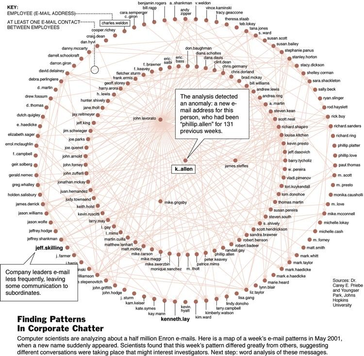
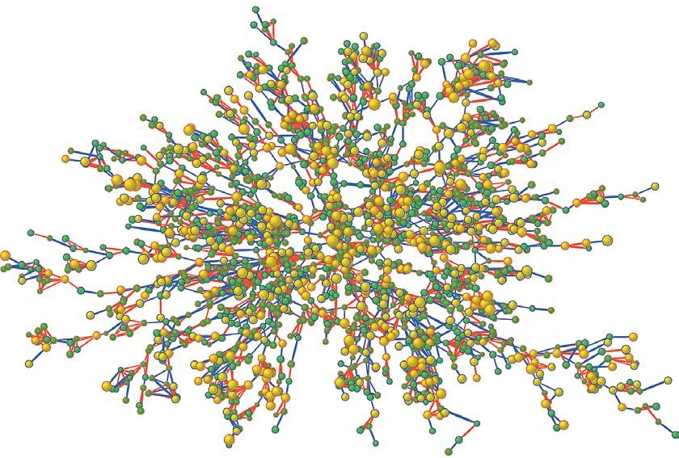
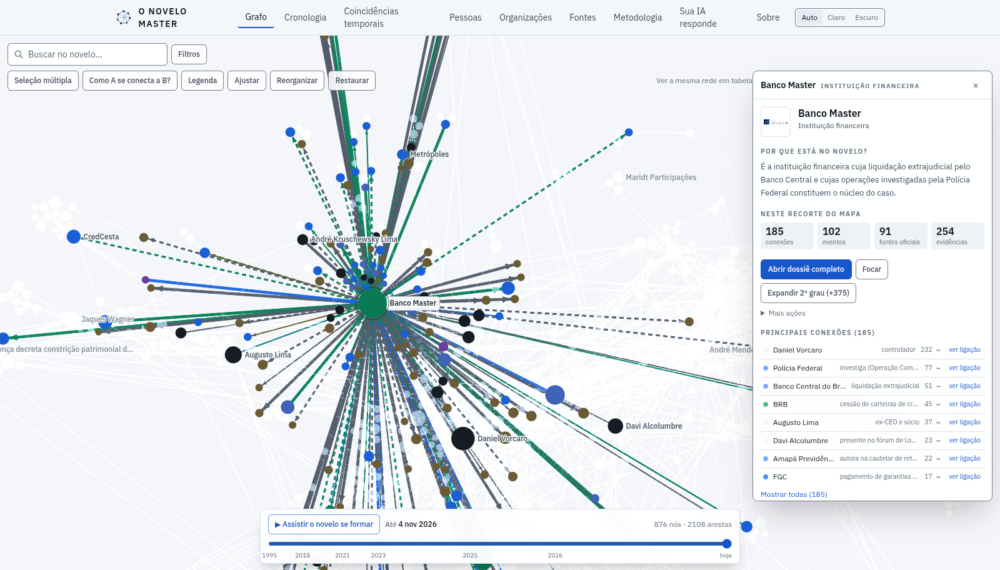
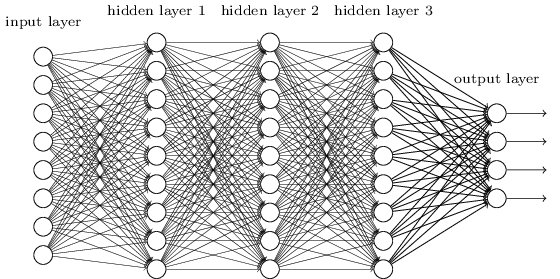
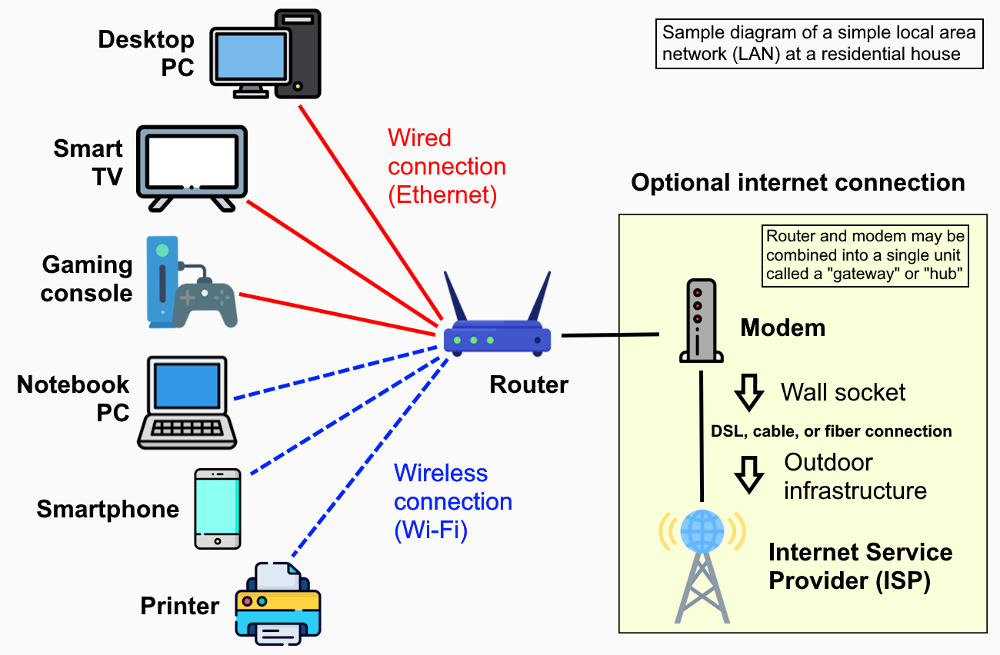
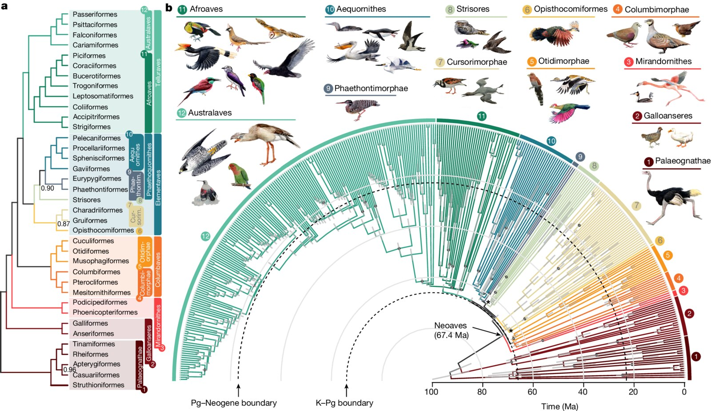
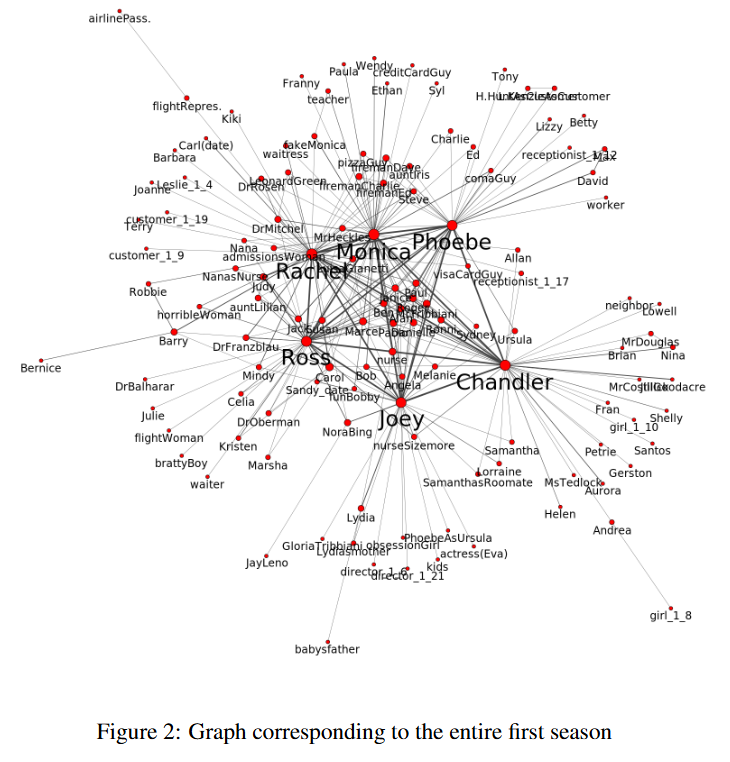
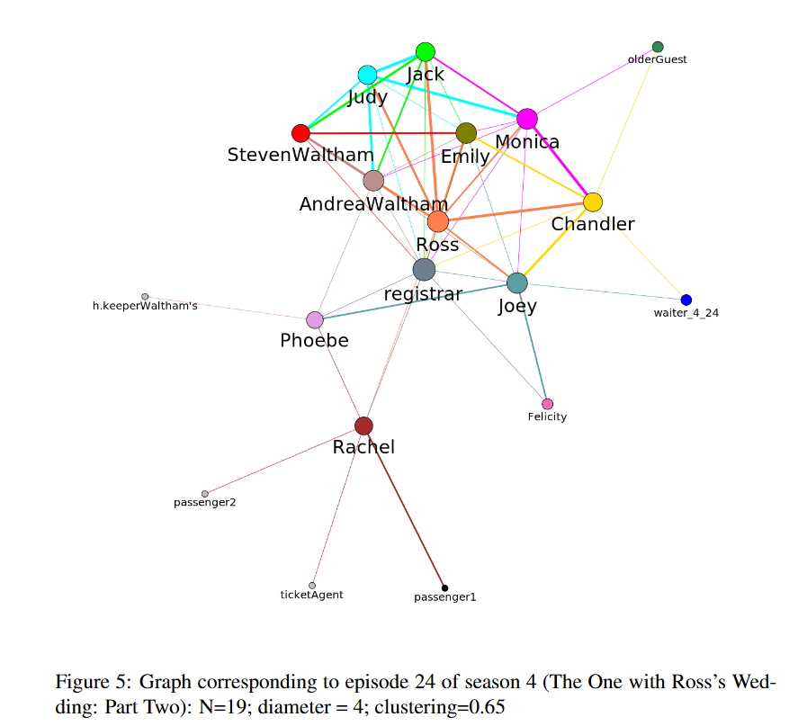
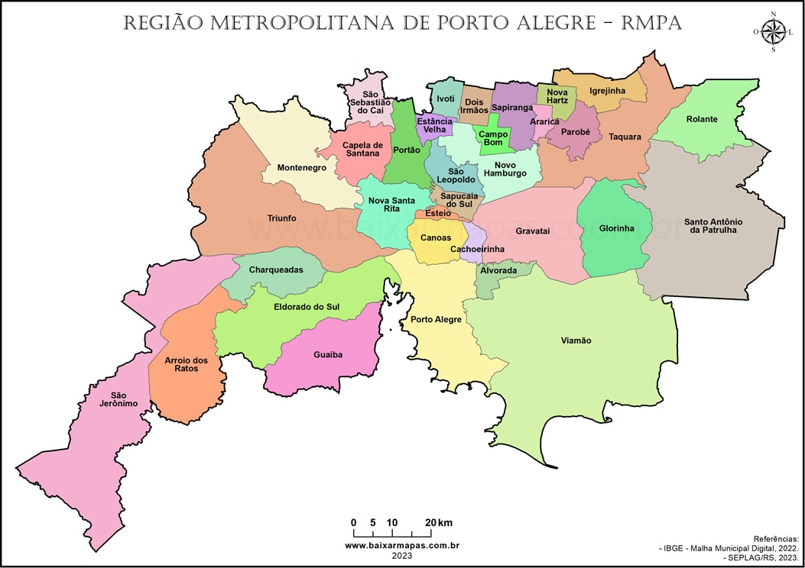
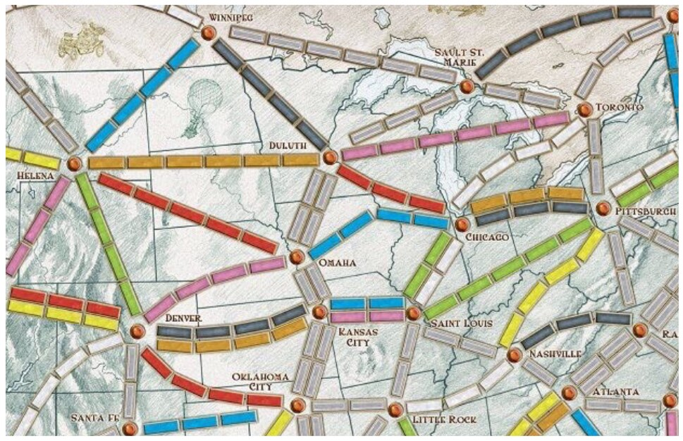

# Grafos

## Grafos

- [Grafos]{.azul} são estruturas que podemos usar para representar informação
- São muito usados quando a informação que precisa ser descrita [contém referências]{.azul}, formando [redes]{.azul}

<br>

- Exemplos:
  - redes sociais
  - web
  - redes de co-expressão gênica
  - mapas
  - diagramas de fluxo de controle
  - relações ...

## Aplicações

::: {style="font-size: 0.7em; width: 85%; margin: 0 auto;"}
| graph | node | edge |
|:-----:|:----:|:----:|
| **communication** | telephone, computer | fiber optic cable |
| **circuit** | gate, register, processor | wire |
| **mechanical** | joint | rod, beam, spring |
| **financial** | stock, currency | transactions |
| **transportation** | street intersection, airport | highway, airway route |
| **internet** | class C network | connection |
| **game** | board position | legal move |
| **social relationship** | person, actor | friendship, movie cast |
| **neural network** | neuron | synapse |
| **protein network** | protein | protein-protein interaction |
| **molecule** | atom | bond |
:::

## Uma Semana de Emails

{fig-align="center" height="600"}

## Framingham Heart Study

{fig-align="center" height="480"}

::: {.absolute bottom="0" left="0" style="font-size: 0.45em; font-weight: 700;"}
“The Spread of Obesity in a Large Social Network over 32 Years” by Christakis and Fowler in New England Journal of Medicine, 2007
:::

## Investigações

<!-- O site proíbe ser embutido em iframe (CSP frame-ancestors), então a figura
     é uma captura que abre o grafo interativo numa nova aba. -->
::: {style="text-align: center;"}
[{width="100%" fig-alt="Grafo do caso Banco Master no site O Novelo Master: o Banco Master no centro, ligado a pessoas, empresas e órgãos públicos"}](https://novelo-master.fausel.adv.br/grafo/?n=banco-master){target="_blank" preview-link="false"}
:::

::: {.absolute bottom="0" left="0" style="font-size: 0.5em;"}
O Novelo Master: [novelo-master.fausel.adv.br](https://novelo-master.fausel.adv.br/grafo/?n=banco-master){target="_blank" preview-link="false"} (clique na imagem para abrir o grafo interativo)
:::

## Redes Neurais

<br>

{fig-align="center" width="70%"}

## Redes de Computadores

{fig-align="center" height="540"}

## Filogenia

{fig-align="center" height="540"}

## Personagens

:::: {.columns style="display: flex; align-items: center;"}
::: {.column width="46%"}
{width="100%"}
:::
::: {.column width="52%"}
{width="100%"}
:::
::::

::: {.absolute bottom="0" left="0" style="font-size: 0.5em;"}
I will be there for you: six friends in a clique. Ana L. C. Bazzan. 2019.
:::

## Grafos

- Um grafo é composto de [nodos]{.azul} (ou vértices) e de [arestas]{.azul} (ou arcos), que relacionam estes nodos
- Arestas podem ser [dirigidas]{.azul} ou não, e podem ter [pesos]{.azul} associados ou não.

<br>

:::: {.columns style="display: flex; align-items: flex-end;"}
::: {.column width="33%"}
```{=html}
<svg viewBox="0 0 290 180" style="display:block; margin:0 auto; width:100%; max-width:100%; height:auto;" xmlns="http://www.w3.org/2000/svg" role="img" aria-label="Grafo não dirigido com A, B, C e D">
<text x="145" y="18" font-size="19" text-anchor="middle" fill="#2e8b3e" font-family="Lexend, 'Gill Sans Nova', 'Gill Sans', 'Trebuchet MS', Arial, sans-serif">Grafo não dirigido</text>
<path d="M 41.8 116.2 Q 53.2 81.2 88.2 69.8" fill="none" stroke="#555555" stroke-width="2.5"/>
<path d="M 134.8 72.2 Q 169.7 87.7 175.9 125.3" fill="none" stroke="#555555" stroke-width="2.5"/>
<path d="M 58.3 145.7 Q 106.2 157.0 155.1 152.4" fill="none" stroke="#555555" stroke-width="2.5"/>
<path d="M 203.2 140.8 Q 231.6 129.6 242.8 101.2" fill="none" stroke="#555555" stroke-width="2.5"/>
<circle cx="34" cy="140" r="24" fill="#2e9a47" stroke="#23793a" stroke-width="2"/>
<text x="34" y="140" font-size="22" text-anchor="middle" dominant-baseline="central" fill="#ffffff" font-family="Lexend, 'Gill Sans Nova', 'Gill Sans', 'Trebuchet MS', Arial, sans-serif">A</text>
<circle cx="112" cy="62" r="24" fill="#2e9a47" stroke="#23793a" stroke-width="2"/>
<text x="112" y="62" font-size="22" text-anchor="middle" dominant-baseline="central" fill="#ffffff" font-family="Lexend, 'Gill Sans Nova', 'Gill Sans', 'Trebuchet MS', Arial, sans-serif">B</text>
<circle cx="180" cy="150" r="24" fill="#2e9a47" stroke="#23793a" stroke-width="2"/>
<text x="180" y="150" font-size="22" text-anchor="middle" dominant-baseline="central" fill="#ffffff" font-family="Lexend, 'Gill Sans Nova', 'Gill Sans', 'Trebuchet MS', Arial, sans-serif">C</text>
<circle cx="252" cy="78" r="24" fill="#2e9a47" stroke="#23793a" stroke-width="2"/>
<text x="252" y="78" font-size="22" text-anchor="middle" dominant-baseline="central" fill="#ffffff" font-family="Lexend, 'Gill Sans Nova', 'Gill Sans', 'Trebuchet MS', Arial, sans-serif">D</text>
</svg>
```
:::
::: {.column width="33%"}
```{=html}
<svg viewBox="0 0 290 180" style="display:block; margin:0 auto; width:100%; max-width:100%; height:auto;" xmlns="http://www.w3.org/2000/svg" role="img" aria-label="Grafo dirigido com arestas B→A, B→C, A→C e C→D">
<defs><marker id="arr-dirigido-2" viewBox="0 0 10 10" refX="9" refY="5" markerWidth="7" markerHeight="7" orient="auto-start-reverse"><path d="M 0 0 L 10 5 L 0 10 z" fill="#222222"/></marker></defs>
<text x="145" y="18" font-size="19" text-anchor="middle" fill="#0563c1" font-family="Lexend, 'Gill Sans Nova', 'Gill Sans', 'Trebuchet MS', Arial, sans-serif">Grafo dirigido</text>
<path d="M 88.0 69.1 Q 51.8 79.8 41.6 114.1" fill="none" stroke="#222222" stroke-width="2.5" marker-end="url(#arr-dirigido-2)"/>
<path d="M 134.8 72.2 Q 169.7 87.7 175.6 123.4" fill="none" stroke="#222222" stroke-width="2.5" marker-end="url(#arr-dirigido-2)"/>
<path d="M 58.3 145.7 Q 106.2 157.0 153.1 152.5" fill="none" stroke="#222222" stroke-width="2.5" marker-end="url(#arr-dirigido-2)"/>
<path d="M 203.2 140.8 Q 231.6 129.6 242.0 103.1" fill="none" stroke="#222222" stroke-width="2.5" marker-end="url(#arr-dirigido-2)"/>
<circle cx="34" cy="140" r="24" fill="#0563c1" stroke="#044a91" stroke-width="2"/>
<text x="34" y="140" font-size="22" text-anchor="middle" dominant-baseline="central" fill="#ffffff" font-family="Lexend, 'Gill Sans Nova', 'Gill Sans', 'Trebuchet MS', Arial, sans-serif">A</text>
<circle cx="112" cy="62" r="24" fill="#0563c1" stroke="#044a91" stroke-width="2"/>
<text x="112" y="62" font-size="22" text-anchor="middle" dominant-baseline="central" fill="#ffffff" font-family="Lexend, 'Gill Sans Nova', 'Gill Sans', 'Trebuchet MS', Arial, sans-serif">B</text>
<circle cx="180" cy="150" r="24" fill="#0563c1" stroke="#044a91" stroke-width="2"/>
<text x="180" y="150" font-size="22" text-anchor="middle" dominant-baseline="central" fill="#ffffff" font-family="Lexend, 'Gill Sans Nova', 'Gill Sans', 'Trebuchet MS', Arial, sans-serif">C</text>
<circle cx="252" cy="78" r="24" fill="#0563c1" stroke="#044a91" stroke-width="2"/>
<text x="252" y="78" font-size="22" text-anchor="middle" dominant-baseline="central" fill="#ffffff" font-family="Lexend, 'Gill Sans Nova', 'Gill Sans', 'Trebuchet MS', Arial, sans-serif">D</text>
</svg>
```
:::
::: {.column width="33%"}
```{=html}
<svg viewBox="0 0 290 200" style="display:block; margin:0 auto; width:100%; max-width:100%; height:auto;" xmlns="http://www.w3.org/2000/svg" role="img" aria-label="Grafo com pesos: A–B 20, B–C 5, A–C 10, C–D 10">
<text x="145" y="18" font-size="19" text-anchor="middle" fill="#e46c0a" font-family="Lexend, 'Gill Sans Nova', 'Gill Sans', 'Trebuchet MS', Arial, sans-serif">Grafo com pesos</text>
<path d="M 41.8 116.2 Q 53.2 81.2 88.2 69.8" fill="none" stroke="#555555" stroke-width="2.5"/>
<text x="40" y="78" font-size="20" text-anchor="middle" dominant-baseline="central" fill="#e46c0a" font-family="Lexend, 'Gill Sans Nova', 'Gill Sans', 'Trebuchet MS', Arial, sans-serif">20</text>
<path d="M 134.8 72.2 Q 169.7 87.7 175.9 125.3" fill="none" stroke="#555555" stroke-width="2.5"/>
<text x="163" y="100" font-size="20" text-anchor="middle" dominant-baseline="central" fill="#e46c0a" font-family="Lexend, 'Gill Sans Nova', 'Gill Sans', 'Trebuchet MS', Arial, sans-serif">5</text>
<path d="M 58.3 145.7 Q 106.2 157.0 155.1 152.4" fill="none" stroke="#555555" stroke-width="2.5"/>
<text x="105" y="186" font-size="20" text-anchor="middle" dominant-baseline="central" fill="#e46c0a" font-family="Lexend, 'Gill Sans Nova', 'Gill Sans', 'Trebuchet MS', Arial, sans-serif">10</text>
<path d="M 203.2 140.8 Q 231.6 129.6 242.8 101.2" fill="none" stroke="#555555" stroke-width="2.5"/>
<text x="262" y="140" font-size="20" text-anchor="middle" dominant-baseline="central" fill="#e46c0a" font-family="Lexend, 'Gill Sans Nova', 'Gill Sans', 'Trebuchet MS', Arial, sans-serif">10</text>
<circle cx="34" cy="140" r="24" fill="#e46c0a" stroke="#b85508" stroke-width="2"/>
<text x="34" y="140" font-size="22" text-anchor="middle" dominant-baseline="central" fill="#ffffff" font-family="Lexend, 'Gill Sans Nova', 'Gill Sans', 'Trebuchet MS', Arial, sans-serif">A</text>
<circle cx="112" cy="62" r="24" fill="#e46c0a" stroke="#b85508" stroke-width="2"/>
<text x="112" y="62" font-size="22" text-anchor="middle" dominant-baseline="central" fill="#ffffff" font-family="Lexend, 'Gill Sans Nova', 'Gill Sans', 'Trebuchet MS', Arial, sans-serif">B</text>
<circle cx="180" cy="150" r="24" fill="#e46c0a" stroke="#b85508" stroke-width="2"/>
<text x="180" y="150" font-size="22" text-anchor="middle" dominant-baseline="central" fill="#ffffff" font-family="Lexend, 'Gill Sans Nova', 'Gill Sans', 'Trebuchet MS', Arial, sans-serif">C</text>
<circle cx="252" cy="78" r="24" fill="#e46c0a" stroke="#b85508" stroke-width="2"/>
<text x="252" y="78" font-size="22" text-anchor="middle" dominant-baseline="central" fill="#ffffff" font-family="Lexend, 'Gill Sans Nova', 'Gill Sans', 'Trebuchet MS', Arial, sans-serif">D</text>
</svg>
```
:::
::::

## Grafos Não-Direcionados

:::: {.columns}
::: {.column width="45%"}
[Notação: $G = (V, E)$]{.azul}

- $V$ : nodos (ou vértices)
- $E$ : arestas entre nodos
:::
::: {.column width="40%"}
```{=html}
<svg viewBox="0 0 320 327" style="display:block; margin:0 auto; width:11em; max-width:100%; height:auto;" xmlns="http://www.w3.org/2000/svg" role="img" aria-label="Grafo não direcionado com vértices 1 a 8">
<path d="M 146.5 48.6 L 108.5 101.4" fill="none" stroke="#555555" stroke-width="2.5"/>
<path d="M 173.5 48.6 L 211.5 101.4" fill="none" stroke="#555555" stroke-width="2.5"/>
<path d="M 118.0 120.0 L 202.0 120.0" fill="none" stroke="#555555" stroke-width="2.5"/>
<path d="M 81.3 138.5 L 43.7 189.5" fill="none" stroke="#555555" stroke-width="2.5"/>
<path d="M 108.7 138.5 L 146.3 189.5" fill="none" stroke="#555555" stroke-width="2.5"/>
<path d="M 211.3 138.5 L 173.7 189.5" fill="none" stroke="#555555" stroke-width="2.5"/>
<path d="M 238.5 101.4 L 276.5 48.6" fill="none" stroke="#555555" stroke-width="2.5"/>
<path d="M 238.7 138.5 L 276.3 189.5" fill="none" stroke="#555555" stroke-width="2.5"/>
<path d="M 53.0 208.0 L 137.0 208.0" fill="none" stroke="#555555" stroke-width="2.5"/>
<path d="M 160.0 231.0 L 160.0 274.0" fill="none" stroke="#555555" stroke-width="2.5"/>
<path d="M 290.0 53.0 L 290.0 185.0" fill="none" stroke="#555555" stroke-width="2.5"/>
<circle cx="160" cy="30" r="22" fill="#23373b" stroke="#152224" stroke-width="2"/>
<text x="160" y="30" font-size="19" text-anchor="middle" dominant-baseline="central" fill="#ffffff" font-family="Lexend, 'Gill Sans Nova', 'Gill Sans', 'Trebuchet MS', Arial, sans-serif" font-weight="bold">1</text>
<circle cx="290" cy="30" r="22" fill="#23373b" stroke="#152224" stroke-width="2"/>
<text x="290" y="30" font-size="19" text-anchor="middle" dominant-baseline="central" fill="#ffffff" font-family="Lexend, 'Gill Sans Nova', 'Gill Sans', 'Trebuchet MS', Arial, sans-serif" font-weight="bold">7</text>
<circle cx="95" cy="120" r="22" fill="#23373b" stroke="#152224" stroke-width="2"/>
<text x="95" y="120" font-size="19" text-anchor="middle" dominant-baseline="central" fill="#ffffff" font-family="Lexend, 'Gill Sans Nova', 'Gill Sans', 'Trebuchet MS', Arial, sans-serif" font-weight="bold">2</text>
<circle cx="225" cy="120" r="22" fill="#23373b" stroke="#152224" stroke-width="2"/>
<text x="225" y="120" font-size="19" text-anchor="middle" dominant-baseline="central" fill="#ffffff" font-family="Lexend, 'Gill Sans Nova', 'Gill Sans', 'Trebuchet MS', Arial, sans-serif" font-weight="bold">3</text>
<circle cx="30" cy="208" r="22" fill="#23373b" stroke="#152224" stroke-width="2"/>
<text x="30" y="208" font-size="19" text-anchor="middle" dominant-baseline="central" fill="#ffffff" font-family="Lexend, 'Gill Sans Nova', 'Gill Sans', 'Trebuchet MS', Arial, sans-serif" font-weight="bold">4</text>
<circle cx="160" cy="208" r="22" fill="#23373b" stroke="#152224" stroke-width="2"/>
<text x="160" y="208" font-size="19" text-anchor="middle" dominant-baseline="central" fill="#ffffff" font-family="Lexend, 'Gill Sans Nova', 'Gill Sans', 'Trebuchet MS', Arial, sans-serif" font-weight="bold">5</text>
<circle cx="290" cy="208" r="22" fill="#23373b" stroke="#152224" stroke-width="2"/>
<text x="290" y="208" font-size="19" text-anchor="middle" dominant-baseline="central" fill="#ffffff" font-family="Lexend, 'Gill Sans Nova', 'Gill Sans', 'Trebuchet MS', Arial, sans-serif" font-weight="bold">8</text>
<circle cx="160" cy="297" r="22" fill="#23373b" stroke="#152224" stroke-width="2"/>
<text x="160" y="297" font-size="19" text-anchor="middle" dominant-baseline="central" fill="#ffffff" font-family="Lexend, 'Gill Sans Nova', 'Gill Sans', 'Trebuchet MS', Arial, sans-serif" font-weight="bold">6</text>
</svg>
```
:::
::::

[Exemplo:]{.azul}

::: {style="font-size: 0.85em;"}
- $V = \{1, 2, 3, 4, 5, 6, 7, 8\}$
- $E = \{1{-}2,\ 1{-}3,\ 2{-}3,\ 2{-}4,\ 2{-}5,\ 3{-}5,\ 3{-}7,\ 3{-}8,\ 4{-}5,\ 5{-}6,\ 7{-}8\}$
:::

## Grafos

- Normalmente, grafos [não são tipos pré-definidos]{.azul} nas linguagens de programação

<br>

- Portanto, para usar grafos como representação, precisamos escolher uma forma de defini-los em termos das construções que as linguagens nos oferecem

<br>

- Existem inúmeras maneiras de representar grafos computacionalmente

## Grafo – Definição

<br>

```pyret
data Nodo:
   nodo(
       id :: String,              # Identificador do nodo
       vizinhos :: List<String>   # Lista de nomes dos vizinhos do nodo
   )
end


type Grafo = List<Nodo>
# Um Grafo é:
# | empty
# | link(first :: Nodo, rest :: List<Nodo>)
```

## Exemplo

:::: {.columns style="display: flex; align-items: center;"}
::: {.column width="40%"}
```{=html}
<svg viewBox="0 0 300 165" style="display:block; margin:0 auto; width:13em; max-width:100%; height:auto;" xmlns="http://www.w3.org/2000/svg" role="img" aria-label="Grafo não dirigido: A–B, B–C, A–C e C–D">
<path d="M 48.4 94.3 Q 59.2 61.2 92.3 50.4" fill="none" stroke="#555555" stroke-width="2.5"/>
<path d="M 142.7 53.0 Q 175.7 67.7 181.6 103.4" fill="none" stroke="#555555" stroke-width="2.5"/>
<path d="M 66.3 126.2 Q 112.2 137.0 159.1 132.5" fill="none" stroke="#555555" stroke-width="2.5"/>
<path d="M 211.1 120.0 Q 237.6 109.6 248.0 83.1" fill="none" stroke="#555555" stroke-width="2.5"/>
<circle cx="40" cy="120" r="26" fill="#2e9a47" stroke="#23793a" stroke-width="2"/>
<text x="40" y="120" font-size="24" text-anchor="middle" dominant-baseline="central" fill="#ffffff" font-family="Lexend, 'Gill Sans Nova', 'Gill Sans', 'Trebuchet MS', Arial, sans-serif">A</text>
<circle cx="118" cy="42" r="26" fill="#2e9a47" stroke="#23793a" stroke-width="2"/>
<text x="118" y="42" font-size="24" text-anchor="middle" dominant-baseline="central" fill="#ffffff" font-family="Lexend, 'Gill Sans Nova', 'Gill Sans', 'Trebuchet MS', Arial, sans-serif">B</text>
<circle cx="186" cy="130" r="26" fill="#2e9a47" stroke="#23793a" stroke-width="2"/>
<text x="186" y="130" font-size="24" text-anchor="middle" dominant-baseline="central" fill="#ffffff" font-family="Lexend, 'Gill Sans Nova', 'Gill Sans', 'Trebuchet MS', Arial, sans-serif">C</text>
<circle cx="258" cy="58" r="26" fill="#2e9a47" stroke="#23793a" stroke-width="2"/>
<text x="258" y="58" font-size="24" text-anchor="middle" dominant-baseline="central" fill="#ffffff" font-family="Lexend, 'Gill Sans Nova', 'Gill Sans', 'Trebuchet MS', Arial, sans-serif">D</text>
</svg>
```
:::
::: {.column width="58%"}
- O grafo ao lado pode ser representado por uma lista de nodos:

```{=html}
<svg class="codigo-anotado" viewBox="0 0 456 266" xmlns="http://www.w3.org/2000/svg" role="img" aria-label="Definição do grafo G como lista de nodos; em cada nodo, o primeiro argumento é o nome do nodo e o segundo é a lista dos vizinhos" font-family="SFMono-Regular, Menlo, Monaco, Consolas, 'Liberation Mono', 'Courier New', monospace" font-size="20">
<rect x="2" y="2" width="452" height="194" fill="#fff" stroke="#23373b" stroke-opacity="0.18" stroke-width="1.5" rx="4"/>
<text x="18" y="33.5" textLength="12" lengthAdjust="spacingAndGlyphs" fill="#0a192f">G</text>
<text x="42" y="33.5" textLength="24" lengthAdjust="spacingAndGlyphs" fill="#111827">::</text>
<text x="78" y="33.5" textLength="60" lengthAdjust="spacingAndGlyphs" fill="#5b21b6">Grafo</text>
<text x="150" y="33.5" textLength="12" lengthAdjust="spacingAndGlyphs" fill="#111827">=</text>
<text x="174" y="33.5" textLength="12" lengthAdjust="spacingAndGlyphs" fill="#111827">[</text>
<text x="186" y="33.5" textLength="48" lengthAdjust="spacingAndGlyphs" fill="#0a192f">list</text>
<text x="234" y="33.5" textLength="12" lengthAdjust="spacingAndGlyphs" fill="#111827">:</text>
<text x="42" y="62.5" textLength="48" lengthAdjust="spacingAndGlyphs" fill="#0066cc">nodo</text>
<text x="90" y="62.5" textLength="12" lengthAdjust="spacingAndGlyphs" fill="#111827">(</text>
<text x="102" y="62.5" textLength="36" lengthAdjust="spacingAndGlyphs" fill="#14532d">&quot;A&quot;</text>
<text x="138" y="62.5" textLength="12" lengthAdjust="spacingAndGlyphs" fill="#111827">,</text>
<text x="162" y="62.5" textLength="12" lengthAdjust="spacingAndGlyphs" fill="#111827">[</text>
<text x="174" y="62.5" textLength="48" lengthAdjust="spacingAndGlyphs" fill="#0a192f">list</text>
<text x="222" y="62.5" textLength="12" lengthAdjust="spacingAndGlyphs" fill="#111827">:</text>
<text x="246" y="62.5" textLength="36" lengthAdjust="spacingAndGlyphs" fill="#14532d">&quot;B&quot;</text>
<text x="282" y="62.5" textLength="12" lengthAdjust="spacingAndGlyphs" fill="#111827">,</text>
<text x="306" y="62.5" textLength="36" lengthAdjust="spacingAndGlyphs" fill="#14532d">&quot;C&quot;</text>
<text x="342" y="62.5" textLength="12" lengthAdjust="spacingAndGlyphs" fill="#111827">]</text>
<text x="354" y="62.5" textLength="12" lengthAdjust="spacingAndGlyphs" fill="#111827">)</text>
<text x="366" y="62.5" textLength="12" lengthAdjust="spacingAndGlyphs" fill="#111827">,</text>
<text x="42" y="91.5" textLength="48" lengthAdjust="spacingAndGlyphs" fill="#0066cc">nodo</text>
<text x="90" y="91.5" textLength="12" lengthAdjust="spacingAndGlyphs" fill="#111827">(</text>
<text x="102" y="91.5" textLength="36" lengthAdjust="spacingAndGlyphs" fill="#14532d">&quot;B&quot;</text>
<text x="138" y="91.5" textLength="12" lengthAdjust="spacingAndGlyphs" fill="#111827">,</text>
<text x="162" y="91.5" textLength="12" lengthAdjust="spacingAndGlyphs" fill="#111827">[</text>
<text x="174" y="91.5" textLength="48" lengthAdjust="spacingAndGlyphs" fill="#0a192f">list</text>
<text x="222" y="91.5" textLength="12" lengthAdjust="spacingAndGlyphs" fill="#111827">:</text>
<text x="246" y="91.5" textLength="36" lengthAdjust="spacingAndGlyphs" fill="#14532d">&quot;A&quot;</text>
<text x="282" y="91.5" textLength="12" lengthAdjust="spacingAndGlyphs" fill="#111827">,</text>
<text x="306" y="91.5" textLength="36" lengthAdjust="spacingAndGlyphs" fill="#14532d">&quot;C&quot;</text>
<text x="342" y="91.5" textLength="12" lengthAdjust="spacingAndGlyphs" fill="#111827">]</text>
<text x="354" y="91.5" textLength="12" lengthAdjust="spacingAndGlyphs" fill="#111827">)</text>
<text x="366" y="91.5" textLength="12" lengthAdjust="spacingAndGlyphs" fill="#111827">,</text>
<text x="42" y="120.5" textLength="48" lengthAdjust="spacingAndGlyphs" fill="#0066cc">nodo</text>
<text x="90" y="120.5" textLength="12" lengthAdjust="spacingAndGlyphs" fill="#111827">(</text>
<text x="102" y="120.5" textLength="36" lengthAdjust="spacingAndGlyphs" fill="#14532d">&quot;C&quot;</text>
<text x="138" y="120.5" textLength="12" lengthAdjust="spacingAndGlyphs" fill="#111827">,</text>
<text x="162" y="120.5" textLength="12" lengthAdjust="spacingAndGlyphs" fill="#111827">[</text>
<text x="174" y="120.5" textLength="48" lengthAdjust="spacingAndGlyphs" fill="#0a192f">list</text>
<text x="222" y="120.5" textLength="12" lengthAdjust="spacingAndGlyphs" fill="#111827">:</text>
<text x="246" y="120.5" textLength="36" lengthAdjust="spacingAndGlyphs" fill="#14532d">&quot;A&quot;</text>
<text x="282" y="120.5" textLength="12" lengthAdjust="spacingAndGlyphs" fill="#111827">,</text>
<text x="306" y="120.5" textLength="36" lengthAdjust="spacingAndGlyphs" fill="#14532d">&quot;B&quot;</text>
<text x="342" y="120.5" textLength="12" lengthAdjust="spacingAndGlyphs" fill="#111827">,</text>
<text x="366" y="120.5" textLength="36" lengthAdjust="spacingAndGlyphs" fill="#14532d">&quot;D&quot;</text>
<text x="402" y="120.5" textLength="12" lengthAdjust="spacingAndGlyphs" fill="#111827">]</text>
<text x="414" y="120.5" textLength="12" lengthAdjust="spacingAndGlyphs" fill="#111827">)</text>
<text x="426" y="120.5" textLength="12" lengthAdjust="spacingAndGlyphs" fill="#111827">,</text>
<text x="42" y="149.5" textLength="48" lengthAdjust="spacingAndGlyphs" fill="#0066cc">nodo</text>
<text x="90" y="149.5" textLength="12" lengthAdjust="spacingAndGlyphs" fill="#111827">(</text>
<text x="102" y="149.5" textLength="36" lengthAdjust="spacingAndGlyphs" fill="#14532d">&quot;D&quot;</text>
<text x="138" y="149.5" textLength="12" lengthAdjust="spacingAndGlyphs" fill="#111827">,</text>
<text x="162" y="149.5" textLength="12" lengthAdjust="spacingAndGlyphs" fill="#111827">[</text>
<text x="174" y="149.5" textLength="48" lengthAdjust="spacingAndGlyphs" fill="#0a192f">list</text>
<text x="222" y="149.5" textLength="12" lengthAdjust="spacingAndGlyphs" fill="#111827">:</text>
<text x="246" y="149.5" textLength="36" lengthAdjust="spacingAndGlyphs" fill="#14532d">&quot;C&quot;</text>
<text x="282" y="149.5" textLength="12" lengthAdjust="spacingAndGlyphs" fill="#111827">]</text>
<text x="294" y="149.5" textLength="12" lengthAdjust="spacingAndGlyphs" fill="#111827">)</text>
<text x="18" y="178.5" textLength="12" lengthAdjust="spacingAndGlyphs" fill="#111827">]</text>
<g class="fragment">
<rect x="99" y="42" width="42" height="114" rx="6" fill="#3a7a10" fill-opacity="0.08" stroke="#3a7a10" stroke-width="2"/>
<rect x="159" y="42" width="258" height="114" rx="6" fill="#0070c0" fill-opacity="0.08" stroke="#0070c0" stroke-width="2"/>
<line x1="120" y1="155" x2="120" y2="236" stroke="#3a7a10" stroke-width="2"/><text x="120" y="256" fill="#3a7a10" font-size="21" text-anchor="middle" font-family="Lexend, 'Gill Sans Nova', 'Gill Sans', 'Trebuchet MS', Arial, sans-serif">nome do nodo</text>
<line x1="288" y1="155" x2="288" y2="206" stroke="#0070c0" stroke-width="2"/><text x="288" y="226" fill="#0070c0" font-size="21" text-anchor="middle" font-family="Lexend, 'Gill Sans Nova', 'Gill Sans', 'Trebuchet MS', Arial, sans-serif">vizinhos do nodo</text>
</g>
</svg>
```
:::
::::

## Questão

- Como representar este grafo?

<br>

```{=html}
<svg viewBox="0 0 730 350" style="display:block; margin:0 auto; width:26em; max-width:100%; height:auto;" xmlns="http://www.w3.org/2000/svg" role="img" aria-label="Grafo com Duluth, Toronto, Chicago e Pittsburgh; Toronto ligado às outras três cidades">
<path d="M 152 68 Q 300 15 420 40" fill="none" stroke="#111111" stroke-width="3"/>
<path d="M 425 70 Q 300 120 247 292" fill="none" stroke="#111111" stroke-width="3"/>
<path d="M 535 70 Q 600 120 622 222" fill="none" stroke="#111111" stroke-width="3"/>
<rect x="25" y="54" width="150" height="56" rx="28" fill="#c0560c"/>
<text x="100" y="82" font-size="22" text-anchor="middle" dominant-baseline="central" fill="#ffffff" font-family="Lexend, 'Gill Sans Nova', 'Gill Sans', 'Trebuchet MS', Arial, sans-serif">Duluth</text>
<rect x="405" y="20" width="150" height="56" rx="28" fill="#c0560c"/>
<text x="480" y="48" font-size="22" text-anchor="middle" dominant-baseline="central" fill="#ffffff" font-family="Lexend, 'Gill Sans Nova', 'Gill Sans', 'Trebuchet MS', Arial, sans-serif">Toronto</text>
<rect x="170" y="282" width="150" height="56" rx="28" fill="#c0560c"/>
<text x="245" y="310" font-size="22" text-anchor="middle" dominant-baseline="central" fill="#ffffff" font-family="Lexend, 'Gill Sans Nova', 'Gill Sans', 'Trebuchet MS', Arial, sans-serif">Chicago</text>
<rect x="555" y="212" width="150" height="56" rx="28" fill="#c0560c"/>
<text x="630" y="240" font-size="22" text-anchor="middle" dominant-baseline="central" fill="#ffffff" font-family="Lexend, 'Gill Sans Nova', 'Gill Sans', 'Trebuchet MS', Arial, sans-serif">Pittsburgh</text>
</svg>
```

## Questão

- Qual dos seguintes elementos pode ser considerado a representação do nodo com nome Chicago no grafo do slide anterior, segundo a definição de [Nodo]{.roxo} e [Grafo]{.roxo}?

<br>

a) `[list: "Chicago", "Toronto"]`
b) `nodo("Chicago", nodo("Toronto", empty))`
c) `nodo("Chicago", empty)`
d) `nodo("Chicago", [list: "Toronto"])`
e) Nenhuma das anteriores

##  {visibility="hidden"}

{fig-align="center" height="680"}

## Exercício

- Construa uma representação no Pyret para o grafo abaixo.

<br>

- Seu grafo deve ser uma lista com 16 nodos, um para cada cidade com nome visível neste mapa (Raleigh, cortada à direita, fica de fora).

{fig-align="center" height="330"}

# Vizinhos

## Vizinhos

```{=html}
<div class="ficha">
  <div class="aba">vizinhos</div>
  <div class="item"><span class="azul">Obj:</span> <span class="laranja">Dados um grafo e um id de um nodo, devolve os ids dos vizinhos do nodo no grafo. O nodo deve fazer parte do grafo.</span></div>
  <div class="item"><span class="verde">Entrada:</span> Um grafo e um id.</div>
  <div class="item"><span class="vermelho">Saída:</span> Uma lista de ids.</div>
</div>
<div class="funcao-caixa-preta">
  <div class="entradas">
    <div><div><span class="verde">g</span> <span class="roxo">:: Grafo</span></div><div class="seta">&#129123;</div></div>
    <div><div><span class="verde">id</span> <span class="roxo">:: String</span></div><div class="seta">&#129123;</div></div>
  </div>
  <div class="caixa-funcao">vizinhos</div>
  <div class="seta">&#129123;</div>
  <div class="roxo">List&lt;String&gt;</div>
</div>
```

## Vizinhos

::: {.pyret-live data-height="560"}
::: {style="display: none;"}
```pyret
data Nodo:
    nodo(
        id :: String,              # Identificador do nodo
        vizinhos :: List<String>   # Lista de nomes dos vizinhos do nodo
    )
end

type Grafo = List<Nodo>
# Um Grafo é:
# | empty
# | link(first :: Nodo, rest :: List<Nodo>)

G :: Grafo = [list:
                nodo("A", [list: "B", "C"]),
                nodo("B", [list: "A", "C"]),
                nodo("C", [list: "A", "B", "D"]),
                nodo("D", [list: "C"])
            ]

G1 :: Grafo = [list:
  nodo("A", [list: "B", "E"]),
  nodo("B", [list: "E", "F"]),
  nodo("C", [list: "D"]),
  nodo("D", empty),
  nodo("E", [list: "C", "F"]),
  nodo("F", [list: "D", "G"]),
  nodo("G", empty)
]
```
:::
::: {style="font-size: 0.85em;"}
```{.pyret .code-overflow-wrap}
fun vizinhos(g :: Grafo, id :: String) -> List<String>:
    doc: "Dados um grafo e um identificador de nodo, retorna a lista de vizinhos do nodo correspondente. O nodo deve fazer parte do grafo."
    cases (Grafo) g:
        # Se o grafo estiver vazio, retorna lista vazia
        | empty => empty
        | link(f, r) =>
            ask:
                # Se o nodo atual é o que estamos procurando, retorna seus vizinhos
                | f.id == id then: f.vizinhos
                # Senão, procura os vizinhos do id nos nodos restantes do grafo
                | otherwise: vizinhos(r, id)
            end
    end
end
```
:::
:::

- Construa os exemplos/testes para a função *vizinhos*.

## Está na Lista?

```{=html}
<div class="ficha">
  <div class="aba">Está na lista?</div>
  <div class="item"><span class="azul">Obj:</span> <span class="laranja">Dados um nome (string) e uma lista de strings, diz se o nome dado está na lista.</span></div>
  <div class="item"><span class="verde">Entrada:</span> Uma lista de strings e uma string.</div>
  <div class="item"><span class="vermelho">Saída:</span> Um booleano.</div>
</div>
<div class="funcao-caixa-preta">
  <div class="entradas">
    <div><div><span class="verde">l</span> <span class="roxo">:: List&lt;String&gt;</span></div><div class="seta">&#129123;</div></div>
    <div><div><span class="verde">id</span> <span class="roxo">:: String</span></div><div class="seta">&#129123;</div></div>
  </div>
  <div class="caixa-funcao">esta-na-lista</div>
  <div class="seta">&#129123;</div>
  <div class="roxo">Boolean</div>
</div>
```

## esta-na-lista

::: {.pyret-live data-height="520"}
::: {style="font-size: 0.9em;"}
```{.pyret .code-overflow-wrap}
fun esta-na-lista(l :: List<String>, id :: String) -> Boolean:
    doc: "Determina se um identificador de nodo está presente em uma lista de strings."
    cases (List<String>) l:
        | empty => false
        | link(f, r) =>
            ask:
                | f == id then: true
                | otherwise: esta-na-lista(r, id)
            end
    end
where:
    esta-na-lista([list: "A", "B", "C"], "B") is true
    esta-na-lista([list: "A", "B", "C"], "D") is false
end
```
:::
:::

# Caminhos

## Caminho

- Um [caminho]{.azul} em um grafo é uma lista de nodos [(sem repetição)]{.vermelho} que estão conectados
- Por exemplo, no grafo abaixo existem vários caminhos entre Chicago e Toronto:

:::: {.columns style="display: flex; align-items: center;"}
::: {.column width="50%"}
{width="100%"}
:::
::: {.column width="48%"}
::: {style="font-size: 0.8em;"}
Chicago → Toronto

Chicago → Pittsburgh → Toronto

Chicago → Duluth → Toronto

Chicago → Duluth → Sault St. Marie → Toronto

Chicago → Omaha → Duluth → Toronto

…
:::
:::
::::

## Busca em Grafos

[Conectividade:]{.azul}

- Dados dois vértices $u$ e $v$, existe um [caminho]{.azul} entre $u$ e $v$ ?

[Caminho Mais Curto:]{.azul}

- Dados dois vértices $u$ e $v$, qual é o [comprimento]{.vermelho} do [caminho mais curto]{.azul} entre $u$ e $v$ ?

[Objetivo:]{.azul}

- Encontrar todos os vértices conectados a um vértice origem.
- Visitar cada vértice no máximo uma vez.

## Encontrar Caminho

- Dados um mapa e 2 cidades (origem e destino), como [encontrar um caminho]{.azul} entre elas?
  - Por exemplo, como encontrar um caminho entre [Denver]{.verde} e [Toronto]{.vermelho}?

:::: {.columns style="display: flex; align-items: center;"}
::: {.column width="52%"}
{width="100%"}
:::
::: {.column width="46%"}
::: {style="font-size: 0.85em;"}
[Ideia:]{.azul} procurar um caminho de um dos [vizinhos de Denver]{.azul} até [Toronto]{.vermelho}:

- Omaha → Duluth → [Toronto]{.vermelho}

E colocar o nome Denver na frente:

- [Denver]{.verde} → Omaha → Duluth → [Toronto]{.vermelho}
:::
:::
::::

## Encontrar Menor Caminho

```{=html}
<div class="ficha">
  <div class="aba">Encontrar menor caminho</div>
  <div class="item"><span class="azul">Obj:</span> <span class="laranja">Dados um grafo, uma origem e um destino, encontrar o menor caminho no grafo conectando a origem ao destino.</span></div>
  <div class="item"><span class="verde">Entrada:</span> Um grafo, um id de origem e um id de destino.</div>
  <div class="item"><span class="vermelho">Saída:</span> Uma lista de ids dos nodos no caminho.</div>
</div>
<div class="funcao-caixa-preta">
  <div class="entradas">
    <div><div><span class="verde">g</span> <span class="roxo">:: Grafo</span></div><div class="seta">&#129123;</div></div>
    <div><div><span class="verde">origem</span> <span class="roxo">:: String</span></div><div class="seta">&#129123;</div></div>
    <div><div><span class="verde">destino</span> <span class="roxo">:: String</span></div><div class="seta">&#129123;</div></div>
  </div>
  <div class="caixa-funcao">menor-caminho</div>
  <div class="seta">&#129123;</div>
  <div class="roxo">List&lt;String&gt;</div>
</div>
```

## menor-caminho

::: {style="font-size: 0.85em;"}
```{.pyret .code-overflow-wrap}
fun menor-caminho(g :: Grafo, origem :: String, destino :: String) -> List<String>:
    doc: "Dados um grafo, um nodo de origem e um nodo de destino, retorna o caminho mais curto (em número de arestas) do nodo origem ao nodo destino, ou lista vazia se não existe."

where:
    menor-caminho(G1, "A", "G") is [list: "A", "B", "F", "G"]
    menor-caminho(G1, "C", "A") is empty
end
```
:::

```{=html}
<svg viewBox="0 0 475 290" style="display:block; margin:0 auto; width:15em; max-width:100%; height:auto;" xmlns="http://www.w3.org/2000/svg" role="img" aria-label="Grafo dirigido G1 com arestas A→B, A→E, B→E, B→F, E→C, E→F, C→D, F→D e F→G">
<defs><marker id="arr-g1-10" viewBox="0 0 10 10" refX="9" refY="5" markerWidth="7" markerHeight="7" orient="auto-start-reverse"><path d="M 0 0 L 10 5 L 0 10 z" fill="#555555"/></marker></defs>
<text x="0" y="40" font-size="30" font-weight="bold" font-style="italic" fill="#7030a0" font-family="Lexend, 'Gill Sans Nova', 'Gill Sans', 'Trebuchet MS', Arial, sans-serif">G1:</text>
<path d="M 249.8 38.7 Q 329.0 28.0 406.2 38.4" fill="none" stroke="#555555" stroke-width="2.5" marker-end="url(#arr-g1-10)"/>
<path d="M 224.3 67.0 L 222.7 123.0" fill="none" stroke="#555555" stroke-width="2.5" marker-end="url(#arr-g1-10)"/>
<path d="M 412.7 56.6 Q 335.7 112.0 247.6 141.4" fill="none" stroke="#555555" stroke-width="2.5" marker-end="url(#arr-g1-10)"/>
<path d="M 443.5 64.7 Q 457.5 95.0 447.0 124.5" fill="none" stroke="#555555" stroke-width="2.5" marker-end="url(#arr-g1-10)"/>
<path d="M 197.3 153.7 Q 129.9 163.8 74.6 200.2" fill="none" stroke="#555555" stroke-width="2.5" marker-end="url(#arr-g1-10)"/>
<path d="M 246.9 152.3 Q 330.0 160.0 411.1 152.5" fill="none" stroke="#555555" stroke-width="2.5" marker-end="url(#arr-g1-10)"/>
<path d="M 74.0 226.8 Q 133.5 258.8 199.0 259.6" fill="none" stroke="#555555" stroke-width="2.5" marker-end="url(#arr-g1-10)"/>
<path d="M 417.8 164.7 Q 340.3 221.0 251.6 251.3" fill="none" stroke="#555555" stroke-width="2.5" marker-end="url(#arr-g1-10)"/>
<path d="M 441.6 174.7 Q 446.0 205.0 441.9 233.3" fill="none" stroke="#555555" stroke-width="2.5" marker-end="url(#arr-g1-10)"/>
<circle cx="225" cy="42" r="24" fill="#23373b" stroke="#152224" stroke-width="2"/>
<text x="225" y="42" font-size="21" text-anchor="middle" dominant-baseline="central" fill="#ffffff" font-family="Lexend, 'Gill Sans Nova', 'Gill Sans', 'Trebuchet MS', Arial, sans-serif" font-weight="bold">A</text>
<circle cx="433" cy="42" r="24" fill="#23373b" stroke="#152224" stroke-width="2"/>
<text x="433" y="42" font-size="21" text-anchor="middle" dominant-baseline="central" fill="#ffffff" font-family="Lexend, 'Gill Sans Nova', 'Gill Sans', 'Trebuchet MS', Arial, sans-serif" font-weight="bold">B</text>
<circle cx="222" cy="150" r="24" fill="#23373b" stroke="#152224" stroke-width="2"/>
<text x="222" y="150" font-size="21" text-anchor="middle" dominant-baseline="central" fill="#ffffff" font-family="Lexend, 'Gill Sans Nova', 'Gill Sans', 'Trebuchet MS', Arial, sans-serif" font-weight="bold">E</text>
<circle cx="438" cy="150" r="24" fill="#23373b" stroke="#152224" stroke-width="2"/>
<text x="438" y="150" font-size="21" text-anchor="middle" dominant-baseline="central" fill="#ffffff" font-family="Lexend, 'Gill Sans Nova', 'Gill Sans', 'Trebuchet MS', Arial, sans-serif" font-weight="bold">F</text>
<circle cx="52" cy="215" r="24" fill="#23373b" stroke="#152224" stroke-width="2"/>
<text x="52" y="215" font-size="21" text-anchor="middle" dominant-baseline="central" fill="#ffffff" font-family="Lexend, 'Gill Sans Nova', 'Gill Sans', 'Trebuchet MS', Arial, sans-serif" font-weight="bold">C</text>
<circle cx="226" cy="260" r="24" fill="#23373b" stroke="#152224" stroke-width="2"/>
<text x="226" y="260" font-size="21" text-anchor="middle" dominant-baseline="central" fill="#ffffff" font-family="Lexend, 'Gill Sans Nova', 'Gill Sans', 'Trebuchet MS', Arial, sans-serif" font-weight="bold">D</text>
<circle cx="438" cy="260" r="24" fill="#23373b" stroke="#152224" stroke-width="2"/>
<text x="438" y="260" font-size="21" text-anchor="middle" dominant-baseline="central" fill="#ffffff" font-family="Lexend, 'Gill Sans Nova', 'Gill Sans', 'Trebuchet MS', Arial, sans-serif" font-weight="bold">G</text>
</svg>
```

# Busca em Largura (BFS)

## Busca em Largura (BFS)

[Breadth-First Search (BFS):]{.azul}

- Explora a partir de um nodo origem $s$ todos os vértices visitando [vértices em camadas]{.vermelho}.

<br>

[BFS:]{.azul}

- $L_0 = \{s\}$.
- $L_1 =$ todos vértices adjacentes a $s$.
- $L_2 =$ todos vértices que não pertencem a $L_0$ ou $L_1$, e que [possuem uma aresta que conecta a um vértice em]{.azul} $L_1$.
- $L_{i+1} =$ todos vértices que não pertencem a camadas anteriores, e que possuem uma aresta que conecta a um vértice em $L_i$.

## Busca em Largura (BFS)

[Breadth-First Search (BFS):]{.azul}

- Explora a partir de $s$ todos os vértices adicionando vértices em camadas.

<br>

```{=html}
<svg class="camadas-bfs" viewBox="0 0 830 300" xmlns="http://www.w3.org/2000/svg" role="img" aria-label="Busca em largura: a origem s forma a camada L0; seus vizinhos formam L1; os vizinhos de L1 ainda não alcançados formam L2; e assim por diante, até a camada L(n−1)" font-family="Lexend, 'Gill Sans Nova', 'Gill Sans', 'Trebuchet MS', Arial, sans-serif">
<rect x="27" y="14" width="66" height="236" rx="18" fill="#dae3f3"/>
<text x="60" y="288" font-size="30" text-anchor="middle" fill="#23373b" font-family="KaTeX_Math, 'Times New Roman', serif" font-style="italic">L<tspan font-size="20" dy="7" font-family="KaTeX_Main, 'Times New Roman', serif" font-style="normal">0</tspan></text>
<rect x="202" y="14" width="76" height="236" rx="18" fill="#dae3f3"/>
<text x="240" y="288" font-size="30" text-anchor="middle" fill="#23373b" font-family="KaTeX_Math, 'Times New Roman', serif" font-style="italic">L<tspan font-size="20" dy="7" font-family="KaTeX_Main, 'Times New Roman', serif" font-style="normal">1</tspan></text>
<rect x="392" y="14" width="76" height="236" rx="18" fill="#dae3f3"/>
<text x="430" y="288" font-size="30" text-anchor="middle" fill="#23373b" font-family="KaTeX_Math, 'Times New Roman', serif" font-style="italic">L<tspan font-size="20" dy="7" font-family="KaTeX_Main, 'Times New Roman', serif" font-style="normal">2</tspan></text>
<rect x="732" y="14" width="76" height="236" rx="18" fill="#dae3f3"/>
<text x="770" y="288" font-size="30" text-anchor="middle" fill="#23373b" font-family="KaTeX_Math, 'Times New Roman', serif" font-style="italic">L<tspan font-size="20" dy="7" font-family="KaTeX_Main, 'Times New Roman', serif" font-style="normal">n−1</tspan></text>
<line x1="60" y1="132" x2="240" y2="62" stroke="#8c979c" stroke-width="2.5"/>
<line x1="60" y1="132" x2="240" y2="132" stroke="#8c979c" stroke-width="2.5"/>
<line x1="60" y1="132" x2="240" y2="202" stroke="#8c979c" stroke-width="2.5"/>
<line x1="240" y1="62" x2="430" y2="48" stroke="#8c979c" stroke-width="2.5"/>
<line x1="240" y1="62" x2="430" y2="106" stroke="#8c979c" stroke-width="2.5"/>
<line x1="240" y1="132" x2="430" y2="106" stroke="#8c979c" stroke-width="2.5"/>
<line x1="240" y1="132" x2="430" y2="164" stroke="#8c979c" stroke-width="2.5"/>
<line x1="240" y1="202" x2="430" y2="222" stroke="#8c979c" stroke-width="2.5"/>
<line x1="430" y1="48" x2="500" y2="37.6" stroke="#8c979c" stroke-width="2.5"/>
<line x1="430" y1="106" x2="500" y2="102.5" stroke="#8c979c" stroke-width="2.5"/>
<line x1="430" y1="164" x2="500" y2="167.5" stroke="#8c979c" stroke-width="2.5"/>
<line x1="430" y1="222" x2="500" y2="232.4" stroke="#8c979c" stroke-width="2.5"/>
<line x1="700" y1="70.3" x2="770" y2="80" stroke="#8c979c" stroke-width="2.5"/>
<line x1="700" y1="150.8" x2="770" y2="150" stroke="#8c979c" stroke-width="2.5"/>
<line x1="700" y1="219.8" x2="770" y2="210" stroke="#8c979c" stroke-width="2.5"/>
<circle cx="572" cy="135" r="6" fill="#23373b"/>
<circle cx="600" cy="135" r="6" fill="#23373b"/>
<circle cx="628" cy="135" r="6" fill="#23373b"/>
<circle cx="60" cy="132" r="21" fill="#c00000"/>
<text x="60" y="132" font-size="24" text-anchor="middle" dominant-baseline="central" fill="#fff" font-family="KaTeX_Math, 'Times New Roman', serif" font-style="italic">s</text>
<circle cx="240" cy="62" r="15" fill="#23373b"/>
<circle cx="240" cy="132" r="15" fill="#23373b"/>
<circle cx="240" cy="202" r="15" fill="#23373b"/>
<circle cx="430" cy="48" r="15" fill="#23373b"/>
<circle cx="430" cy="106" r="15" fill="#23373b"/>
<circle cx="430" cy="164" r="15" fill="#23373b"/>
<circle cx="430" cy="222" r="15" fill="#23373b"/>
<circle cx="770" cy="80" r="15" fill="#23373b"/>
<circle cx="770" cy="150" r="15" fill="#23373b"/>
<circle cx="770" cy="210" r="15" fill="#23373b"/>
</svg>
```

## BFS - Visualização

<br><br><br><br>

::: {.center}
<https://visualgo.net/en/dfsbfs>
:::

## Existe Caminho?

- Vamos primeiro desenvolver uma [busca em largura]{.azul} para verificar se [existe um caminho]{.azul} entre dois nodos em um grafo.

<br>

- Depois, vamos modificar o algoritmo para retornar o [menor caminho]{.vermelho}!

## Existe Caminho

```{=html}
<div class="ficha">
  <div class="aba">Existe caminho</div>
  <div class="item"><span class="azul">Obj:</span> <span class="laranja">Dados um grafo, uma origem e um destino, verificar se existe caminho no grafo conectando a origem ao destino.</span></div>
  <div class="item"><span class="verde">Entrada:</span> Um grafo, um id de origem e um id de destino.</div>
  <div class="item"><span class="vermelho">Saída:</span> Um booleano indicando se existe caminho.</div>
</div>
<div class="funcao-caixa-preta">
  <div class="entradas">
    <div><div><span class="verde">g</span> <span class="roxo">:: Grafo</span></div><div class="seta">&#129123;</div></div>
    <div><div><span class="verde">origem</span> <span class="roxo">:: String</span></div><div class="seta">&#129123;</div></div>
    <div><div><span class="verde">destino</span> <span class="roxo">:: String</span></div><div class="seta">&#129123;</div></div>
  </div>
  <div class="caixa-funcao">existe-caminho</div>
  <div class="seta">&#129123;</div>
  <div class="roxo">Boolean</div>
</div>
```

## Busca em Largura

::: {.entrada-saida}
[Entrada:]{.verde} o grafo [g]{.var .grafo}, o [destino]{.var .destino} e a [fila]{.var .fila} de nodos a visitar (começa com a origem)

[Saída:]{.vermelho} true se algum nodo da [fila]{.var .fila} leva ao [destino]{.var .destino}; senão, false
:::

::: {.modelo-recursivo .sem-combinar}
::: {.fragment .trivial}
se [a [fila]{.var .fila} é vazia]{.cond} [devolver false]{.res .fragment}
:::

::: {.fragment .trivial}
se [o primeiro nodo da [fila]{.var .fila} é o [destino]{.var .destino}]{.cond} [devolver true]{.res .fragment}
:::

::: {.fragment .dificil}
se [o primeiro nodo da [fila]{.var .fila} não é o [destino]{.var .destino}]{.cond}

[buscar o [destino]{.var .destino} a partir do]{.sol .fragment} [resto da [fila]{.var .fila} + vizinhos do primeiro]{.sub .fragment}
:::
:::

## Existe Caminho?

::: {.pyret-live data-height="600"}
::: {style="display: none;"}
```pyret
data Nodo:
    nodo(
        id :: String,              # Identificador do nodo
        vizinhos :: List<String>   # Lista de nomes dos vizinhos do nodo
    )
end

type Grafo = List<Nodo>
# Um Grafo é:
# | empty
# | link(first :: Nodo, rest :: List<Nodo>)

G :: Grafo = [list:
                nodo("A", [list: "B", "C"]),
                nodo("B", [list: "A", "C"]),
                nodo("C", [list: "A", "B", "D"]),
                nodo("D", [list: "C"])
            ]

G1 :: Grafo = [list:
  nodo("A", [list: "B", "E"]),
  nodo("B", [list: "E", "F"]),
  nodo("C", [list: "D"]),
  nodo("D", empty),
  nodo("E", [list: "C", "F"]),
  nodo("F", [list: "D", "G"]),
  nodo("G", empty)
]

fun vizinhos(g :: Grafo, id :: String) -> List<String>:
    doc: "Dados um grafo e um identificador de nodo, retorna a lista de vizinhos do nodo correspondente. O nodo deve fazer parte do grafo."
    cases (Grafo) g:
        # Se o grafo estiver vazio, retorna lista vazia
        | empty => empty
        | link(f, r) =>
            ask:
                # Se o nodo atual é o que estamos procurando, retorna seus vizinhos
                | f.id == id then: f.vizinhos
                # Senão, procura os vizinhos do id nos nodos restantes do grafo
                | otherwise: vizinhos(r, id)
            end
    end
end
```
:::
::: {style="font-size: 0.8em;"}
```{.pyret .code-overflow-wrap}
fun existe-caminho(g :: Grafo, origem :: String, destino :: String) -> Boolean:
    doc: "Dados um grafo, um nodo de origem e um nodo de destino, determina se existe um caminho do nodo origem ao nodo destino."

    fun busca-em-largura(fila :: List<String>) -> Boolean:
        cases (List<String>) fila:
            | empty => false # Fila vazia: não existe caminho
            | link(no, resto) =>
                ask:
                    | no == destino then: true
                    | otherwise:
                        # Os vizinhos do nodo atual vão para o fim da fila
                        nova-fila = resto + vizinhos(g, no)
                        busca-em-largura(nova-fila)
                end
        end
    end

    busca-em-largura([list: origem])
where:
    existe-caminho(G1, "A", "G") is true
    existe-caminho(G1, "C", "A") is false
end
```
:::
:::

::: {.absolute bottom="25" right="0" width="250"}
```{=html}
<svg viewBox="0 0 475 290" style="display:block; margin:0 auto; width:15em; max-width:100%; height:auto;" xmlns="http://www.w3.org/2000/svg" role="img" aria-label="Grafo dirigido G1 com arestas A→B, A→E, B→E, B→F, E→C, E→F, C→D, F→D e F→G">
<defs><marker id="arr-g1-13" viewBox="0 0 10 10" refX="9" refY="5" markerWidth="7" markerHeight="7" orient="auto-start-reverse"><path d="M 0 0 L 10 5 L 0 10 z" fill="#555555"/></marker></defs>
<text x="0" y="40" font-size="30" font-weight="bold" font-style="italic" fill="#7030a0" font-family="Lexend, 'Gill Sans Nova', 'Gill Sans', 'Trebuchet MS', Arial, sans-serif">G1:</text>
<path d="M 249.8 38.7 Q 329.0 28.0 406.2 38.4" fill="none" stroke="#555555" stroke-width="2.5" marker-end="url(#arr-g1-13)"/>
<path d="M 224.3 67.0 L 222.7 123.0" fill="none" stroke="#555555" stroke-width="2.5" marker-end="url(#arr-g1-13)"/>
<path d="M 412.7 56.6 Q 335.7 112.0 247.6 141.4" fill="none" stroke="#555555" stroke-width="2.5" marker-end="url(#arr-g1-13)"/>
<path d="M 443.5 64.7 Q 457.5 95.0 447.0 124.5" fill="none" stroke="#555555" stroke-width="2.5" marker-end="url(#arr-g1-13)"/>
<path d="M 197.3 153.7 Q 129.9 163.8 74.6 200.2" fill="none" stroke="#555555" stroke-width="2.5" marker-end="url(#arr-g1-13)"/>
<path d="M 246.9 152.3 Q 330.0 160.0 411.1 152.5" fill="none" stroke="#555555" stroke-width="2.5" marker-end="url(#arr-g1-13)"/>
<path d="M 74.0 226.8 Q 133.5 258.8 199.0 259.6" fill="none" stroke="#555555" stroke-width="2.5" marker-end="url(#arr-g1-13)"/>
<path d="M 417.8 164.7 Q 340.3 221.0 251.6 251.3" fill="none" stroke="#555555" stroke-width="2.5" marker-end="url(#arr-g1-13)"/>
<path d="M 441.6 174.7 Q 446.0 205.0 441.9 233.3" fill="none" stroke="#555555" stroke-width="2.5" marker-end="url(#arr-g1-13)"/>
<circle cx="225" cy="42" r="24" fill="#23373b" stroke="#152224" stroke-width="2"/>
<text x="225" y="42" font-size="21" text-anchor="middle" dominant-baseline="central" fill="#ffffff" font-family="Lexend, 'Gill Sans Nova', 'Gill Sans', 'Trebuchet MS', Arial, sans-serif" font-weight="bold">A</text>
<circle cx="433" cy="42" r="24" fill="#23373b" stroke="#152224" stroke-width="2"/>
<text x="433" y="42" font-size="21" text-anchor="middle" dominant-baseline="central" fill="#ffffff" font-family="Lexend, 'Gill Sans Nova', 'Gill Sans', 'Trebuchet MS', Arial, sans-serif" font-weight="bold">B</text>
<circle cx="222" cy="150" r="24" fill="#23373b" stroke="#152224" stroke-width="2"/>
<text x="222" y="150" font-size="21" text-anchor="middle" dominant-baseline="central" fill="#ffffff" font-family="Lexend, 'Gill Sans Nova', 'Gill Sans', 'Trebuchet MS', Arial, sans-serif" font-weight="bold">E</text>
<circle cx="438" cy="150" r="24" fill="#23373b" stroke="#152224" stroke-width="2"/>
<text x="438" y="150" font-size="21" text-anchor="middle" dominant-baseline="central" fill="#ffffff" font-family="Lexend, 'Gill Sans Nova', 'Gill Sans', 'Trebuchet MS', Arial, sans-serif" font-weight="bold">F</text>
<circle cx="52" cy="215" r="24" fill="#23373b" stroke="#152224" stroke-width="2"/>
<text x="52" y="215" font-size="21" text-anchor="middle" dominant-baseline="central" fill="#ffffff" font-family="Lexend, 'Gill Sans Nova', 'Gill Sans', 'Trebuchet MS', Arial, sans-serif" font-weight="bold">C</text>
<circle cx="226" cy="260" r="24" fill="#23373b" stroke="#152224" stroke-width="2"/>
<text x="226" y="260" font-size="21" text-anchor="middle" dominant-baseline="central" fill="#ffffff" font-family="Lexend, 'Gill Sans Nova', 'Gill Sans', 'Trebuchet MS', Arial, sans-serif" font-weight="bold">D</text>
<circle cx="438" cy="260" r="24" fill="#23373b" stroke="#152224" stroke-width="2"/>
<text x="438" y="260" font-size="21" text-anchor="middle" dominant-baseline="central" fill="#ffffff" font-family="Lexend, 'Gill Sans Nova', 'Gill Sans', 'Trebuchet MS', Arial, sans-serif" font-weight="bold">G</text>
</svg>
```
:::

## Ciclos

Nossa versão atual da busca em largura possui um problema:

- E se houverem [ciclos no grafo]{.azul}?

<br>

[Exemplo:]{.azul} Procurar um caminho de [Denver]{.verde} até [Toronto]{.vermelho}

::: {style="margin-left: 1.5em;"}
1. procurar um caminho de um dos vizinhos de [Denver]{.verde}, por exemplo [Omaha]{.laranja}, até [Toronto]{.vermelho}
2. procurar um caminho de um dos vizinhos de [Omaha]{.laranja}, por exemplo [Denver]{.verde}, até [Toronto]{.vermelho}
3. procurar um caminho de um dos vizinhos de [Denver]{.verde}, por exemplo [Omaha]{.laranja}, até [Toronto]{.vermelho}

...
:::

[É necessário guardar a lista de cidades já visitadas!]{.vermelho}

## Busca em Largura

::: {.entrada-saida}
[Entrada:]{.verde} o grafo [g]{.var .grafo}, o [destino]{.var .destino}, a [fila]{.var .fila} de nodos a visitar (começa com a origem) e a lista de [visitados]{.var .visitados} (começa vazia)

[Saída:]{.vermelho} true se algum nodo da [fila]{.var .fila} leva ao [destino]{.var .destino}; senão, false
:::

::: {.modelo-recursivo .sem-combinar style="font-size: 0.72em;"}
::: {.trivial}
se [a [fila]{.var .fila} é vazia]{.cond} [devolver false]{.res}
:::

::: {.trivial}
se [o primeiro nodo da [fila]{.var .fila} é o [destino]{.var .destino}]{.cond} [devolver true]{.res}
:::

::: {.fragment .dificil}
se [o primeiro nodo da [fila]{.var .fila} está em [visitados]{.var .visitados}]{.cond}

[buscar o [destino]{.var .destino} a partir do]{.sol .fragment} [resto da [fila]{.var .fila}]{.sub .fragment}
:::

::: {.dificil}
senão

[buscar o [destino]{.var .destino} a partir do]{.sol} [resto da [fila]{.var .fila} + vizinhos do primeiro[<br>(o primeiro entra em [visitados]{.var .visitados})]{.fragment}]{.sub}
:::
:::

## Existe Caminho?

::: {.pyret-live data-height="600"}
::: {style="display: none;"}
```pyret
data Nodo:
    nodo(
        id :: String,              # Identificador do nodo
        vizinhos :: List<String>   # Lista de nomes dos vizinhos do nodo
    )
end

type Grafo = List<Nodo>
# Um Grafo é:
# | empty
# | link(first :: Nodo, rest :: List<Nodo>)

G :: Grafo = [list:
                nodo("A", [list: "B", "C"]),
                nodo("B", [list: "A", "C"]),
                nodo("C", [list: "A", "B", "D"]),
                nodo("D", [list: "C"])
            ]

G1 :: Grafo = [list:
  nodo("A", [list: "B", "E"]),
  nodo("B", [list: "E", "F"]),
  nodo("C", [list: "D"]),
  nodo("D", empty),
  nodo("E", [list: "C", "F"]),
  nodo("F", [list: "D", "G"]),
  nodo("G", empty)
]

fun vizinhos(g :: Grafo, id :: String) -> List<String>:
    doc: "Dados um grafo e um identificador de nodo, retorna a lista de vizinhos do nodo correspondente. O nodo deve fazer parte do grafo."
    cases (Grafo) g:
        # Se o grafo estiver vazio, retorna lista vazia
        | empty => empty
        | link(f, r) =>
            ask:
                # Se o nodo atual é o que estamos procurando, retorna seus vizinhos
                | f.id == id then: f.vizinhos
                # Senão, procura os vizinhos do id nos nodos restantes do grafo
                | otherwise: vizinhos(r, id)
            end
    end
end

fun esta-na-lista(l :: List<String>, id :: String) -> Boolean:
    doc: "Determina se um identificador de nodo está presente em uma lista de strings."
    cases (List<String>) l:
        | empty => false
        | link(f, r) =>
            ask:
                | f == id then: true
                | otherwise: esta-na-lista(r, id)
            end
    end
where:
    esta-na-lista([list: "A", "B", "C"], "B") is true
    esta-na-lista([list: "A", "B", "C"], "D") is false
end
```
:::
::: {style="font-size: 0.78em;"}
```{.pyret .code-overflow-wrap code-line-numbers="4,10,11,15,20|"}
fun existe-caminho(g :: Grafo, origem :: String, destino :: String) -> Boolean:
    doc: "Dados um grafo, um nodo de origem e um nodo de destino, determina se existe um caminho do nodo origem ao nodo destino."

    fun busca-em-largura(fila :: List<String>, visitados :: List<String>) -> Boolean:
        cases (List<String>) fila:
            | empty => false # Fila vazia: não existe caminho
            | link(no, resto) =>
                ask:
                    | no == destino then: true
                    # Nodo já visitado: segue com o resto da fila
                    | esta-na-lista(visitados, no) then: busca-em-largura(resto, visitados)
                    | otherwise:
                        # Os vizinhos do nodo atual vão para o fim da fila
                        nova-fila = resto + vizinhos(g, no)
                        busca-em-largura(nova-fila, link(no, visitados))
                end
        end
    end

    busca-em-largura([list: origem], empty)
where:
    existe-caminho(G1, "A", "G") is true
    existe-caminho(G1, "C", "A") is false
end
```
:::
:::

::: {.absolute bottom="25" right="0" width="250"}
```{=html}
<svg viewBox="0 0 475 290" style="display:block; margin:0 auto; width:15em; max-width:100%; height:auto;" xmlns="http://www.w3.org/2000/svg" role="img" aria-label="Grafo dirigido G1 com arestas A→B, A→E, B→E, B→F, E→C, E→F, C→D, F→D e F→G">
<defs><marker id="arr-g1-14" viewBox="0 0 10 10" refX="9" refY="5" markerWidth="7" markerHeight="7" orient="auto-start-reverse"><path d="M 0 0 L 10 5 L 0 10 z" fill="#555555"/></marker></defs>
<text x="0" y="40" font-size="30" font-weight="bold" font-style="italic" fill="#7030a0" font-family="Lexend, 'Gill Sans Nova', 'Gill Sans', 'Trebuchet MS', Arial, sans-serif">G1:</text>
<path d="M 249.8 38.7 Q 329.0 28.0 406.2 38.4" fill="none" stroke="#555555" stroke-width="2.5" marker-end="url(#arr-g1-14)"/>
<path d="M 224.3 67.0 L 222.7 123.0" fill="none" stroke="#555555" stroke-width="2.5" marker-end="url(#arr-g1-14)"/>
<path d="M 412.7 56.6 Q 335.7 112.0 247.6 141.4" fill="none" stroke="#555555" stroke-width="2.5" marker-end="url(#arr-g1-14)"/>
<path d="M 443.5 64.7 Q 457.5 95.0 447.0 124.5" fill="none" stroke="#555555" stroke-width="2.5" marker-end="url(#arr-g1-14)"/>
<path d="M 197.3 153.7 Q 129.9 163.8 74.6 200.2" fill="none" stroke="#555555" stroke-width="2.5" marker-end="url(#arr-g1-14)"/>
<path d="M 246.9 152.3 Q 330.0 160.0 411.1 152.5" fill="none" stroke="#555555" stroke-width="2.5" marker-end="url(#arr-g1-14)"/>
<path d="M 74.0 226.8 Q 133.5 258.8 199.0 259.6" fill="none" stroke="#555555" stroke-width="2.5" marker-end="url(#arr-g1-14)"/>
<path d="M 417.8 164.7 Q 340.3 221.0 251.6 251.3" fill="none" stroke="#555555" stroke-width="2.5" marker-end="url(#arr-g1-14)"/>
<path d="M 441.6 174.7 Q 446.0 205.0 441.9 233.3" fill="none" stroke="#555555" stroke-width="2.5" marker-end="url(#arr-g1-14)"/>
<circle cx="225" cy="42" r="24" fill="#23373b" stroke="#152224" stroke-width="2"/>
<text x="225" y="42" font-size="21" text-anchor="middle" dominant-baseline="central" fill="#ffffff" font-family="Lexend, 'Gill Sans Nova', 'Gill Sans', 'Trebuchet MS', Arial, sans-serif" font-weight="bold">A</text>
<circle cx="433" cy="42" r="24" fill="#23373b" stroke="#152224" stroke-width="2"/>
<text x="433" y="42" font-size="21" text-anchor="middle" dominant-baseline="central" fill="#ffffff" font-family="Lexend, 'Gill Sans Nova', 'Gill Sans', 'Trebuchet MS', Arial, sans-serif" font-weight="bold">B</text>
<circle cx="222" cy="150" r="24" fill="#23373b" stroke="#152224" stroke-width="2"/>
<text x="222" y="150" font-size="21" text-anchor="middle" dominant-baseline="central" fill="#ffffff" font-family="Lexend, 'Gill Sans Nova', 'Gill Sans', 'Trebuchet MS', Arial, sans-serif" font-weight="bold">E</text>
<circle cx="438" cy="150" r="24" fill="#23373b" stroke="#152224" stroke-width="2"/>
<text x="438" y="150" font-size="21" text-anchor="middle" dominant-baseline="central" fill="#ffffff" font-family="Lexend, 'Gill Sans Nova', 'Gill Sans', 'Trebuchet MS', Arial, sans-serif" font-weight="bold">F</text>
<circle cx="52" cy="215" r="24" fill="#23373b" stroke="#152224" stroke-width="2"/>
<text x="52" y="215" font-size="21" text-anchor="middle" dominant-baseline="central" fill="#ffffff" font-family="Lexend, 'Gill Sans Nova', 'Gill Sans', 'Trebuchet MS', Arial, sans-serif" font-weight="bold">C</text>
<circle cx="226" cy="260" r="24" fill="#23373b" stroke="#152224" stroke-width="2"/>
<text x="226" y="260" font-size="21" text-anchor="middle" dominant-baseline="central" fill="#ffffff" font-family="Lexend, 'Gill Sans Nova', 'Gill Sans', 'Trebuchet MS', Arial, sans-serif" font-weight="bold">D</text>
<circle cx="438" cy="260" r="24" fill="#23373b" stroke="#152224" stroke-width="2"/>
<text x="438" y="260" font-size="21" text-anchor="middle" dominant-baseline="central" fill="#ffffff" font-family="Lexend, 'Gill Sans Nova', 'Gill Sans', 'Trebuchet MS', Arial, sans-serif" font-weight="bold">G</text>
</svg>
```
:::

## existe-caminho: passo a passo

```{=html}
<div class="passo-bfs">
<div class="passo-bfs-chamadas">
<p class="passo-bfs-rotulo">chamadas recursivas</p>
<div class="passo-bfs-linha externa"><code>existe-caminho(G1, "A", "G")</code><span class="fragment passo-bfs-ret" data-fragment-index="9">true</span></div>
<div class="passo-bfs-linha" style="--nivel: 1;"><div class="fragment semi-fade-out" data-fragment-index="1"><code>busca-em-largura(<span class="fila">[<b class="prim">A</b>]</span>, <span class="visitados">[]</span>)</code></div><span class="fragment passo-bfs-ret" data-fragment-index="9">true</span></div>
<div class="fragment " data-fragment-index="1"><div class="passo-bfs-linha" style="--nivel: 2;"><div class="fragment semi-fade-out" data-fragment-index="2"><code>busca-em-largura(<span class="fila">[<b class="prim">B</b>, E]</span>, <span class="visitados">[A]</span>)</code></div><span class="fragment passo-bfs-ret" data-fragment-index="9">true</span></div></div>
<div class="fragment " data-fragment-index="2"><div class="passo-bfs-linha" style="--nivel: 3;"><div class="fragment semi-fade-out" data-fragment-index="3"><code>busca-em-largura(<span class="fila">[<b class="prim">E</b>, E, F]</span>, <span class="visitados">[B, A]</span>)</code></div><span class="fragment passo-bfs-ret" data-fragment-index="9">true</span></div></div>
<div class="fragment " data-fragment-index="3"><div class="passo-bfs-linha" style="--nivel: 4;"><div class="fragment semi-fade-out" data-fragment-index="4"><code>busca-em-largura(<span class="fila">[<b class="prim">E</b>, F, C, F]</span>, <span class="visitados">[E, B, A]</span>)</code></div><span class="fragment passo-bfs-ret" data-fragment-index="9">true</span></div></div>
<div class="fragment " data-fragment-index="4"><div class="passo-bfs-linha" style="--nivel: 5;"><div class="fragment semi-fade-out" data-fragment-index="5"><code>busca-em-largura(<span class="fila">[<b class="prim">F</b>, C, F]</span>, <span class="visitados">[E, B, A]</span>)</code></div><span class="fragment passo-bfs-ret" data-fragment-index="9">true</span></div></div>
<div class="fragment " data-fragment-index="5"><div class="passo-bfs-linha" style="--nivel: 6;"><div class="fragment semi-fade-out" data-fragment-index="6"><code>busca-em-largura(<span class="fila">[<b class="prim">C</b>, F, D, G]</span>, <span class="visitados">[F, E, B, A]</span>)</code></div><span class="fragment passo-bfs-ret" data-fragment-index="9">true</span></div></div>
<div class="fragment " data-fragment-index="6"><div class="passo-bfs-linha" style="--nivel: 7;"><div class="fragment semi-fade-out" data-fragment-index="7"><code>busca-em-largura(<span class="fila">[<b class="prim">F</b>, D, G, D]</span>, <span class="visitados">[C, F, E, B, A]</span>)</code></div><span class="fragment passo-bfs-ret" data-fragment-index="9">true</span></div></div>
<div class="fragment " data-fragment-index="7"><div class="passo-bfs-linha" style="--nivel: 8;"><div class="fragment semi-fade-out" data-fragment-index="8"><code>busca-em-largura(<span class="fila">[<b class="prim">D</b>, G, D]</span>, <span class="visitados">[C, F, E, B, A]</span>)</code></div><span class="fragment passo-bfs-ret" data-fragment-index="9">true</span></div></div>
<div class="fragment " data-fragment-index="8"><div class="passo-bfs-linha achou" style="--nivel: 9;"><code>busca-em-largura(<span class="fila">[<b class="prim">G</b>, D]</span>, <span class="visitados">[D, C, F, E, B, A]</span>)</code><span class="fragment passo-bfs-ret" data-fragment-index="8">true</span></div></div>
</div>
<div class="passo-bfs-grafo">
<p class="passo-bfs-rotulo">G1</p>
<div class="r-stack">
<div class="fragment fade-out" data-fragment-index="1"><svg viewBox="0 0 475 298" xmlns="http://www.w3.org/2000/svg" role="img" aria-label="Chamada 1: fila A; visitados nenhum" font-family="Lexend, 'Gill Sans Nova', 'Gill Sans', 'Trebuchet MS', Arial, sans-serif"><defs><marker id="pb1c" viewBox="0 0 10 10" refX="9" refY="5" markerWidth="6" markerHeight="6" orient="auto"><path d="M0,0 L10,5 L0,10 z" fill="#9aa5ab"/></marker><marker id="pb1l" viewBox="0 0 10 10" refX="9" refY="5" markerWidth="6" markerHeight="6" orient="auto"><path d="M0,0 L10,5 L0,10 z" fill="#c55a11"/></marker></defs><path d="M 249.8 38.7 Q 329.0 28.0 406.2 38.4" fill="none" stroke="#c55a11" stroke-width="3.5" marker-end="url(#pb1l)"/><path d="M 224.3 67.0 L 222.7 123.0" fill="none" stroke="#c55a11" stroke-width="3.5" marker-end="url(#pb1l)"/><path d="M 412.7 56.6 Q 335.7 112.0 247.6 141.4" fill="none" stroke="#9aa5ab" stroke-width="2.2" marker-end="url(#pb1c)"/><path d="M 443.5 64.7 Q 457.5 95.0 447.0 124.5" fill="none" stroke="#9aa5ab" stroke-width="2.2" marker-end="url(#pb1c)"/><path d="M 197.3 153.7 Q 129.9 163.8 74.6 200.2" fill="none" stroke="#9aa5ab" stroke-width="2.2" marker-end="url(#pb1c)"/><path d="M 246.9 152.3 Q 330.0 160.0 411.1 152.5" fill="none" stroke="#9aa5ab" stroke-width="2.2" marker-end="url(#pb1c)"/><path d="M 74.0 226.8 Q 133.5 258.8 199.0 259.6" fill="none" stroke="#9aa5ab" stroke-width="2.2" marker-end="url(#pb1c)"/><path d="M 417.8 164.7 Q 340.3 221.0 251.6 251.3" fill="none" stroke="#9aa5ab" stroke-width="2.2" marker-end="url(#pb1c)"/><path d="M 441.6 174.7 Q 446.0 205.0 441.9 233.3" fill="none" stroke="#9aa5ab" stroke-width="2.2" marker-end="url(#pb1c)"/><circle cx="225" cy="42" r="31" fill="#c55a11" fill-opacity="0.25"/><circle cx="225" cy="42" r="24" fill="#c55a11" stroke="#c55a11" stroke-width="2"/><text x="225" y="42" font-size="21" font-weight="700" text-anchor="middle" dominant-baseline="central" fill="#fff">A</text><circle cx="433" cy="42" r="24" fill="#dfe5e8" stroke="#9aa5ab" stroke-width="1.5"/><text x="433" y="42" font-size="21" font-weight="700" text-anchor="middle" dominant-baseline="central" fill="#23373b">B</text><circle cx="222" cy="150" r="24" fill="#dfe5e8" stroke="#9aa5ab" stroke-width="1.5"/><text x="222" y="150" font-size="21" font-weight="700" text-anchor="middle" dominant-baseline="central" fill="#23373b">E</text><circle cx="438" cy="150" r="24" fill="#dfe5e8" stroke="#9aa5ab" stroke-width="1.5"/><text x="438" y="150" font-size="21" font-weight="700" text-anchor="middle" dominant-baseline="central" fill="#23373b">F</text><circle cx="52" cy="215" r="24" fill="#dfe5e8" stroke="#9aa5ab" stroke-width="1.5"/><text x="52" y="215" font-size="21" font-weight="700" text-anchor="middle" dominant-baseline="central" fill="#23373b">C</text><circle cx="226" cy="260" r="24" fill="#dfe5e8" stroke="#9aa5ab" stroke-width="1.5"/><text x="226" y="260" font-size="21" font-weight="700" text-anchor="middle" dominant-baseline="central" fill="#23373b">D</text><circle cx="438" cy="260" r="31" fill="none" stroke="#c00000" stroke-width="2.5" stroke-dasharray="5 3"/><circle cx="438" cy="260" r="24" fill="#dfe5e8" stroke="#9aa5ab" stroke-width="1.5"/><text x="438" y="260" font-size="21" font-weight="700" text-anchor="middle" dominant-baseline="central" fill="#23373b">G</text></svg></div>
<div class="fragment fade-in-then-out" data-fragment-index="1"><svg viewBox="0 0 475 298" xmlns="http://www.w3.org/2000/svg" role="img" aria-label="Chamada 2: fila B, E; visitados A" font-family="Lexend, 'Gill Sans Nova', 'Gill Sans', 'Trebuchet MS', Arial, sans-serif"><defs><marker id="pb2c" viewBox="0 0 10 10" refX="9" refY="5" markerWidth="6" markerHeight="6" orient="auto"><path d="M0,0 L10,5 L0,10 z" fill="#9aa5ab"/></marker><marker id="pb2l" viewBox="0 0 10 10" refX="9" refY="5" markerWidth="6" markerHeight="6" orient="auto"><path d="M0,0 L10,5 L0,10 z" fill="#c55a11"/></marker></defs><path d="M 249.8 38.7 Q 329.0 28.0 406.2 38.4" fill="none" stroke="#9aa5ab" stroke-width="2.2" marker-end="url(#pb2c)"/><path d="M 224.3 67.0 L 222.7 123.0" fill="none" stroke="#9aa5ab" stroke-width="2.2" marker-end="url(#pb2c)"/><path d="M 412.7 56.6 Q 335.7 112.0 247.6 141.4" fill="none" stroke="#c55a11" stroke-width="3.5" marker-end="url(#pb2l)"/><path d="M 443.5 64.7 Q 457.5 95.0 447.0 124.5" fill="none" stroke="#c55a11" stroke-width="3.5" marker-end="url(#pb2l)"/><path d="M 197.3 153.7 Q 129.9 163.8 74.6 200.2" fill="none" stroke="#9aa5ab" stroke-width="2.2" marker-end="url(#pb2c)"/><path d="M 246.9 152.3 Q 330.0 160.0 411.1 152.5" fill="none" stroke="#9aa5ab" stroke-width="2.2" marker-end="url(#pb2c)"/><path d="M 74.0 226.8 Q 133.5 258.8 199.0 259.6" fill="none" stroke="#9aa5ab" stroke-width="2.2" marker-end="url(#pb2c)"/><path d="M 417.8 164.7 Q 340.3 221.0 251.6 251.3" fill="none" stroke="#9aa5ab" stroke-width="2.2" marker-end="url(#pb2c)"/><path d="M 441.6 174.7 Q 446.0 205.0 441.9 233.3" fill="none" stroke="#9aa5ab" stroke-width="2.2" marker-end="url(#pb2c)"/><circle cx="225" cy="42" r="24" fill="#1d4ed8" stroke="#1d4ed8" stroke-width="2"/><text x="225" y="42" font-size="21" font-weight="700" text-anchor="middle" dominant-baseline="central" fill="#fff">A</text><circle cx="433" cy="42" r="31" fill="#c55a11" fill-opacity="0.25"/><circle cx="433" cy="42" r="24" fill="#c55a11" stroke="#c55a11" stroke-width="2"/><text x="433" y="42" font-size="21" font-weight="700" text-anchor="middle" dominant-baseline="central" fill="#fff">B</text><circle cx="222" cy="150" r="24" fill="#fff" stroke="#c55a11" stroke-width="3.5"/><text x="222" y="150" font-size="21" font-weight="700" text-anchor="middle" dominant-baseline="central" fill="#c55a11">E</text><circle cx="438" cy="150" r="24" fill="#dfe5e8" stroke="#9aa5ab" stroke-width="1.5"/><text x="438" y="150" font-size="21" font-weight="700" text-anchor="middle" dominant-baseline="central" fill="#23373b">F</text><circle cx="52" cy="215" r="24" fill="#dfe5e8" stroke="#9aa5ab" stroke-width="1.5"/><text x="52" y="215" font-size="21" font-weight="700" text-anchor="middle" dominant-baseline="central" fill="#23373b">C</text><circle cx="226" cy="260" r="24" fill="#dfe5e8" stroke="#9aa5ab" stroke-width="1.5"/><text x="226" y="260" font-size="21" font-weight="700" text-anchor="middle" dominant-baseline="central" fill="#23373b">D</text><circle cx="438" cy="260" r="31" fill="none" stroke="#c00000" stroke-width="2.5" stroke-dasharray="5 3"/><circle cx="438" cy="260" r="24" fill="#dfe5e8" stroke="#9aa5ab" stroke-width="1.5"/><text x="438" y="260" font-size="21" font-weight="700" text-anchor="middle" dominant-baseline="central" fill="#23373b">G</text></svg></div>
<div class="fragment fade-in-then-out" data-fragment-index="2"><svg viewBox="0 0 475 298" xmlns="http://www.w3.org/2000/svg" role="img" aria-label="Chamada 3: fila E, E, F; visitados B, A" font-family="Lexend, 'Gill Sans Nova', 'Gill Sans', 'Trebuchet MS', Arial, sans-serif"><defs><marker id="pb3c" viewBox="0 0 10 10" refX="9" refY="5" markerWidth="6" markerHeight="6" orient="auto"><path d="M0,0 L10,5 L0,10 z" fill="#9aa5ab"/></marker><marker id="pb3l" viewBox="0 0 10 10" refX="9" refY="5" markerWidth="6" markerHeight="6" orient="auto"><path d="M0,0 L10,5 L0,10 z" fill="#c55a11"/></marker></defs><path d="M 249.8 38.7 Q 329.0 28.0 406.2 38.4" fill="none" stroke="#9aa5ab" stroke-width="2.2" marker-end="url(#pb3c)"/><path d="M 224.3 67.0 L 222.7 123.0" fill="none" stroke="#9aa5ab" stroke-width="2.2" marker-end="url(#pb3c)"/><path d="M 412.7 56.6 Q 335.7 112.0 247.6 141.4" fill="none" stroke="#9aa5ab" stroke-width="2.2" marker-end="url(#pb3c)"/><path d="M 443.5 64.7 Q 457.5 95.0 447.0 124.5" fill="none" stroke="#9aa5ab" stroke-width="2.2" marker-end="url(#pb3c)"/><path d="M 197.3 153.7 Q 129.9 163.8 74.6 200.2" fill="none" stroke="#c55a11" stroke-width="3.5" marker-end="url(#pb3l)"/><path d="M 246.9 152.3 Q 330.0 160.0 411.1 152.5" fill="none" stroke="#c55a11" stroke-width="3.5" marker-end="url(#pb3l)"/><path d="M 74.0 226.8 Q 133.5 258.8 199.0 259.6" fill="none" stroke="#9aa5ab" stroke-width="2.2" marker-end="url(#pb3c)"/><path d="M 417.8 164.7 Q 340.3 221.0 251.6 251.3" fill="none" stroke="#9aa5ab" stroke-width="2.2" marker-end="url(#pb3c)"/><path d="M 441.6 174.7 Q 446.0 205.0 441.9 233.3" fill="none" stroke="#9aa5ab" stroke-width="2.2" marker-end="url(#pb3c)"/><circle cx="225" cy="42" r="24" fill="#1d4ed8" stroke="#1d4ed8" stroke-width="2"/><text x="225" y="42" font-size="21" font-weight="700" text-anchor="middle" dominant-baseline="central" fill="#fff">A</text><circle cx="433" cy="42" r="24" fill="#1d4ed8" stroke="#1d4ed8" stroke-width="2"/><text x="433" y="42" font-size="21" font-weight="700" text-anchor="middle" dominant-baseline="central" fill="#fff">B</text><circle cx="222" cy="150" r="31" fill="#c55a11" fill-opacity="0.25"/><circle cx="222" cy="150" r="24" fill="#c55a11" stroke="#c55a11" stroke-width="2"/><text x="222" y="150" font-size="21" font-weight="700" text-anchor="middle" dominant-baseline="central" fill="#fff">E</text><circle cx="438" cy="150" r="24" fill="#fff" stroke="#c55a11" stroke-width="3.5"/><text x="438" y="150" font-size="21" font-weight="700" text-anchor="middle" dominant-baseline="central" fill="#c55a11">F</text><circle cx="52" cy="215" r="24" fill="#dfe5e8" stroke="#9aa5ab" stroke-width="1.5"/><text x="52" y="215" font-size="21" font-weight="700" text-anchor="middle" dominant-baseline="central" fill="#23373b">C</text><circle cx="226" cy="260" r="24" fill="#dfe5e8" stroke="#9aa5ab" stroke-width="1.5"/><text x="226" y="260" font-size="21" font-weight="700" text-anchor="middle" dominant-baseline="central" fill="#23373b">D</text><circle cx="438" cy="260" r="31" fill="none" stroke="#c00000" stroke-width="2.5" stroke-dasharray="5 3"/><circle cx="438" cy="260" r="24" fill="#dfe5e8" stroke="#9aa5ab" stroke-width="1.5"/><text x="438" y="260" font-size="21" font-weight="700" text-anchor="middle" dominant-baseline="central" fill="#23373b">G</text></svg></div>
<div class="fragment fade-in-then-out" data-fragment-index="3"><svg viewBox="0 0 475 298" xmlns="http://www.w3.org/2000/svg" role="img" aria-label="Chamada 4: fila E, F, C, F; visitados E, B, A" font-family="Lexend, 'Gill Sans Nova', 'Gill Sans', 'Trebuchet MS', Arial, sans-serif"><defs><marker id="pb4c" viewBox="0 0 10 10" refX="9" refY="5" markerWidth="6" markerHeight="6" orient="auto"><path d="M0,0 L10,5 L0,10 z" fill="#9aa5ab"/></marker><marker id="pb4l" viewBox="0 0 10 10" refX="9" refY="5" markerWidth="6" markerHeight="6" orient="auto"><path d="M0,0 L10,5 L0,10 z" fill="#c55a11"/></marker></defs><path d="M 249.8 38.7 Q 329.0 28.0 406.2 38.4" fill="none" stroke="#9aa5ab" stroke-width="2.2" marker-end="url(#pb4c)"/><path d="M 224.3 67.0 L 222.7 123.0" fill="none" stroke="#9aa5ab" stroke-width="2.2" marker-end="url(#pb4c)"/><path d="M 412.7 56.6 Q 335.7 112.0 247.6 141.4" fill="none" stroke="#9aa5ab" stroke-width="2.2" marker-end="url(#pb4c)"/><path d="M 443.5 64.7 Q 457.5 95.0 447.0 124.5" fill="none" stroke="#9aa5ab" stroke-width="2.2" marker-end="url(#pb4c)"/><path d="M 197.3 153.7 Q 129.9 163.8 74.6 200.2" fill="none" stroke="#9aa5ab" stroke-width="2.2" marker-end="url(#pb4c)"/><path d="M 246.9 152.3 Q 330.0 160.0 411.1 152.5" fill="none" stroke="#9aa5ab" stroke-width="2.2" marker-end="url(#pb4c)"/><path d="M 74.0 226.8 Q 133.5 258.8 199.0 259.6" fill="none" stroke="#9aa5ab" stroke-width="2.2" marker-end="url(#pb4c)"/><path d="M 417.8 164.7 Q 340.3 221.0 251.6 251.3" fill="none" stroke="#9aa5ab" stroke-width="2.2" marker-end="url(#pb4c)"/><path d="M 441.6 174.7 Q 446.0 205.0 441.9 233.3" fill="none" stroke="#9aa5ab" stroke-width="2.2" marker-end="url(#pb4c)"/><circle cx="225" cy="42" r="24" fill="#1d4ed8" stroke="#1d4ed8" stroke-width="2"/><text x="225" y="42" font-size="21" font-weight="700" text-anchor="middle" dominant-baseline="central" fill="#fff">A</text><circle cx="433" cy="42" r="24" fill="#1d4ed8" stroke="#1d4ed8" stroke-width="2"/><text x="433" y="42" font-size="21" font-weight="700" text-anchor="middle" dominant-baseline="central" fill="#fff">B</text><circle cx="222" cy="150" r="31" fill="#c55a11" fill-opacity="0.25"/><circle cx="222" cy="150" r="24" fill="#1d4ed8" stroke="#c55a11" stroke-width="3.5"/><text x="222" y="150" font-size="21" font-weight="700" text-anchor="middle" dominant-baseline="central" fill="#fff">E</text><circle cx="438" cy="150" r="24" fill="#fff" stroke="#c55a11" stroke-width="3.5"/><text x="438" y="150" font-size="21" font-weight="700" text-anchor="middle" dominant-baseline="central" fill="#c55a11">F</text><circle cx="52" cy="215" r="24" fill="#fff" stroke="#c55a11" stroke-width="3.5"/><text x="52" y="215" font-size="21" font-weight="700" text-anchor="middle" dominant-baseline="central" fill="#c55a11">C</text><circle cx="226" cy="260" r="24" fill="#dfe5e8" stroke="#9aa5ab" stroke-width="1.5"/><text x="226" y="260" font-size="21" font-weight="700" text-anchor="middle" dominant-baseline="central" fill="#23373b">D</text><circle cx="438" cy="260" r="31" fill="none" stroke="#c00000" stroke-width="2.5" stroke-dasharray="5 3"/><circle cx="438" cy="260" r="24" fill="#dfe5e8" stroke="#9aa5ab" stroke-width="1.5"/><text x="438" y="260" font-size="21" font-weight="700" text-anchor="middle" dominant-baseline="central" fill="#23373b">G</text></svg></div>
<div class="fragment fade-in-then-out" data-fragment-index="4"><svg viewBox="0 0 475 298" xmlns="http://www.w3.org/2000/svg" role="img" aria-label="Chamada 5: fila F, C, F; visitados E, B, A" font-family="Lexend, 'Gill Sans Nova', 'Gill Sans', 'Trebuchet MS', Arial, sans-serif"><defs><marker id="pb5c" viewBox="0 0 10 10" refX="9" refY="5" markerWidth="6" markerHeight="6" orient="auto"><path d="M0,0 L10,5 L0,10 z" fill="#9aa5ab"/></marker><marker id="pb5l" viewBox="0 0 10 10" refX="9" refY="5" markerWidth="6" markerHeight="6" orient="auto"><path d="M0,0 L10,5 L0,10 z" fill="#c55a11"/></marker></defs><path d="M 249.8 38.7 Q 329.0 28.0 406.2 38.4" fill="none" stroke="#9aa5ab" stroke-width="2.2" marker-end="url(#pb5c)"/><path d="M 224.3 67.0 L 222.7 123.0" fill="none" stroke="#9aa5ab" stroke-width="2.2" marker-end="url(#pb5c)"/><path d="M 412.7 56.6 Q 335.7 112.0 247.6 141.4" fill="none" stroke="#9aa5ab" stroke-width="2.2" marker-end="url(#pb5c)"/><path d="M 443.5 64.7 Q 457.5 95.0 447.0 124.5" fill="none" stroke="#9aa5ab" stroke-width="2.2" marker-end="url(#pb5c)"/><path d="M 197.3 153.7 Q 129.9 163.8 74.6 200.2" fill="none" stroke="#9aa5ab" stroke-width="2.2" marker-end="url(#pb5c)"/><path d="M 246.9 152.3 Q 330.0 160.0 411.1 152.5" fill="none" stroke="#9aa5ab" stroke-width="2.2" marker-end="url(#pb5c)"/><path d="M 74.0 226.8 Q 133.5 258.8 199.0 259.6" fill="none" stroke="#9aa5ab" stroke-width="2.2" marker-end="url(#pb5c)"/><path d="M 417.8 164.7 Q 340.3 221.0 251.6 251.3" fill="none" stroke="#c55a11" stroke-width="3.5" marker-end="url(#pb5l)"/><path d="M 441.6 174.7 Q 446.0 205.0 441.9 233.3" fill="none" stroke="#c55a11" stroke-width="3.5" marker-end="url(#pb5l)"/><circle cx="225" cy="42" r="24" fill="#1d4ed8" stroke="#1d4ed8" stroke-width="2"/><text x="225" y="42" font-size="21" font-weight="700" text-anchor="middle" dominant-baseline="central" fill="#fff">A</text><circle cx="433" cy="42" r="24" fill="#1d4ed8" stroke="#1d4ed8" stroke-width="2"/><text x="433" y="42" font-size="21" font-weight="700" text-anchor="middle" dominant-baseline="central" fill="#fff">B</text><circle cx="222" cy="150" r="24" fill="#1d4ed8" stroke="#1d4ed8" stroke-width="2"/><text x="222" y="150" font-size="21" font-weight="700" text-anchor="middle" dominant-baseline="central" fill="#fff">E</text><circle cx="438" cy="150" r="31" fill="#c55a11" fill-opacity="0.25"/><circle cx="438" cy="150" r="24" fill="#c55a11" stroke="#c55a11" stroke-width="2"/><text x="438" y="150" font-size="21" font-weight="700" text-anchor="middle" dominant-baseline="central" fill="#fff">F</text><circle cx="52" cy="215" r="24" fill="#fff" stroke="#c55a11" stroke-width="3.5"/><text x="52" y="215" font-size="21" font-weight="700" text-anchor="middle" dominant-baseline="central" fill="#c55a11">C</text><circle cx="226" cy="260" r="24" fill="#dfe5e8" stroke="#9aa5ab" stroke-width="1.5"/><text x="226" y="260" font-size="21" font-weight="700" text-anchor="middle" dominant-baseline="central" fill="#23373b">D</text><circle cx="438" cy="260" r="31" fill="none" stroke="#c00000" stroke-width="2.5" stroke-dasharray="5 3"/><circle cx="438" cy="260" r="24" fill="#dfe5e8" stroke="#9aa5ab" stroke-width="1.5"/><text x="438" y="260" font-size="21" font-weight="700" text-anchor="middle" dominant-baseline="central" fill="#23373b">G</text></svg></div>
<div class="fragment fade-in-then-out" data-fragment-index="5"><svg viewBox="0 0 475 298" xmlns="http://www.w3.org/2000/svg" role="img" aria-label="Chamada 6: fila C, F, D, G; visitados F, E, B, A" font-family="Lexend, 'Gill Sans Nova', 'Gill Sans', 'Trebuchet MS', Arial, sans-serif"><defs><marker id="pb6c" viewBox="0 0 10 10" refX="9" refY="5" markerWidth="6" markerHeight="6" orient="auto"><path d="M0,0 L10,5 L0,10 z" fill="#9aa5ab"/></marker><marker id="pb6l" viewBox="0 0 10 10" refX="9" refY="5" markerWidth="6" markerHeight="6" orient="auto"><path d="M0,0 L10,5 L0,10 z" fill="#c55a11"/></marker></defs><path d="M 249.8 38.7 Q 329.0 28.0 406.2 38.4" fill="none" stroke="#9aa5ab" stroke-width="2.2" marker-end="url(#pb6c)"/><path d="M 224.3 67.0 L 222.7 123.0" fill="none" stroke="#9aa5ab" stroke-width="2.2" marker-end="url(#pb6c)"/><path d="M 412.7 56.6 Q 335.7 112.0 247.6 141.4" fill="none" stroke="#9aa5ab" stroke-width="2.2" marker-end="url(#pb6c)"/><path d="M 443.5 64.7 Q 457.5 95.0 447.0 124.5" fill="none" stroke="#9aa5ab" stroke-width="2.2" marker-end="url(#pb6c)"/><path d="M 197.3 153.7 Q 129.9 163.8 74.6 200.2" fill="none" stroke="#9aa5ab" stroke-width="2.2" marker-end="url(#pb6c)"/><path d="M 246.9 152.3 Q 330.0 160.0 411.1 152.5" fill="none" stroke="#9aa5ab" stroke-width="2.2" marker-end="url(#pb6c)"/><path d="M 74.0 226.8 Q 133.5 258.8 199.0 259.6" fill="none" stroke="#c55a11" stroke-width="3.5" marker-end="url(#pb6l)"/><path d="M 417.8 164.7 Q 340.3 221.0 251.6 251.3" fill="none" stroke="#9aa5ab" stroke-width="2.2" marker-end="url(#pb6c)"/><path d="M 441.6 174.7 Q 446.0 205.0 441.9 233.3" fill="none" stroke="#9aa5ab" stroke-width="2.2" marker-end="url(#pb6c)"/><circle cx="225" cy="42" r="24" fill="#1d4ed8" stroke="#1d4ed8" stroke-width="2"/><text x="225" y="42" font-size="21" font-weight="700" text-anchor="middle" dominant-baseline="central" fill="#fff">A</text><circle cx="433" cy="42" r="24" fill="#1d4ed8" stroke="#1d4ed8" stroke-width="2"/><text x="433" y="42" font-size="21" font-weight="700" text-anchor="middle" dominant-baseline="central" fill="#fff">B</text><circle cx="222" cy="150" r="24" fill="#1d4ed8" stroke="#1d4ed8" stroke-width="2"/><text x="222" y="150" font-size="21" font-weight="700" text-anchor="middle" dominant-baseline="central" fill="#fff">E</text><circle cx="438" cy="150" r="24" fill="#1d4ed8" stroke="#c55a11" stroke-width="3.5"/><text x="438" y="150" font-size="21" font-weight="700" text-anchor="middle" dominant-baseline="central" fill="#fff">F</text><circle cx="52" cy="215" r="31" fill="#c55a11" fill-opacity="0.25"/><circle cx="52" cy="215" r="24" fill="#c55a11" stroke="#c55a11" stroke-width="2"/><text x="52" y="215" font-size="21" font-weight="700" text-anchor="middle" dominant-baseline="central" fill="#fff">C</text><circle cx="226" cy="260" r="24" fill="#fff" stroke="#c55a11" stroke-width="3.5"/><text x="226" y="260" font-size="21" font-weight="700" text-anchor="middle" dominant-baseline="central" fill="#c55a11">D</text><circle cx="438" cy="260" r="31" fill="none" stroke="#c00000" stroke-width="2.5" stroke-dasharray="5 3"/><circle cx="438" cy="260" r="24" fill="#fff" stroke="#c55a11" stroke-width="3.5"/><text x="438" y="260" font-size="21" font-weight="700" text-anchor="middle" dominant-baseline="central" fill="#c55a11">G</text></svg></div>
<div class="fragment fade-in-then-out" data-fragment-index="6"><svg viewBox="0 0 475 298" xmlns="http://www.w3.org/2000/svg" role="img" aria-label="Chamada 7: fila F, D, G, D; visitados C, F, E, B, A" font-family="Lexend, 'Gill Sans Nova', 'Gill Sans', 'Trebuchet MS', Arial, sans-serif"><defs><marker id="pb7c" viewBox="0 0 10 10" refX="9" refY="5" markerWidth="6" markerHeight="6" orient="auto"><path d="M0,0 L10,5 L0,10 z" fill="#9aa5ab"/></marker><marker id="pb7l" viewBox="0 0 10 10" refX="9" refY="5" markerWidth="6" markerHeight="6" orient="auto"><path d="M0,0 L10,5 L0,10 z" fill="#c55a11"/></marker></defs><path d="M 249.8 38.7 Q 329.0 28.0 406.2 38.4" fill="none" stroke="#9aa5ab" stroke-width="2.2" marker-end="url(#pb7c)"/><path d="M 224.3 67.0 L 222.7 123.0" fill="none" stroke="#9aa5ab" stroke-width="2.2" marker-end="url(#pb7c)"/><path d="M 412.7 56.6 Q 335.7 112.0 247.6 141.4" fill="none" stroke="#9aa5ab" stroke-width="2.2" marker-end="url(#pb7c)"/><path d="M 443.5 64.7 Q 457.5 95.0 447.0 124.5" fill="none" stroke="#9aa5ab" stroke-width="2.2" marker-end="url(#pb7c)"/><path d="M 197.3 153.7 Q 129.9 163.8 74.6 200.2" fill="none" stroke="#9aa5ab" stroke-width="2.2" marker-end="url(#pb7c)"/><path d="M 246.9 152.3 Q 330.0 160.0 411.1 152.5" fill="none" stroke="#9aa5ab" stroke-width="2.2" marker-end="url(#pb7c)"/><path d="M 74.0 226.8 Q 133.5 258.8 199.0 259.6" fill="none" stroke="#9aa5ab" stroke-width="2.2" marker-end="url(#pb7c)"/><path d="M 417.8 164.7 Q 340.3 221.0 251.6 251.3" fill="none" stroke="#9aa5ab" stroke-width="2.2" marker-end="url(#pb7c)"/><path d="M 441.6 174.7 Q 446.0 205.0 441.9 233.3" fill="none" stroke="#9aa5ab" stroke-width="2.2" marker-end="url(#pb7c)"/><circle cx="225" cy="42" r="24" fill="#1d4ed8" stroke="#1d4ed8" stroke-width="2"/><text x="225" y="42" font-size="21" font-weight="700" text-anchor="middle" dominant-baseline="central" fill="#fff">A</text><circle cx="433" cy="42" r="24" fill="#1d4ed8" stroke="#1d4ed8" stroke-width="2"/><text x="433" y="42" font-size="21" font-weight="700" text-anchor="middle" dominant-baseline="central" fill="#fff">B</text><circle cx="222" cy="150" r="24" fill="#1d4ed8" stroke="#1d4ed8" stroke-width="2"/><text x="222" y="150" font-size="21" font-weight="700" text-anchor="middle" dominant-baseline="central" fill="#fff">E</text><circle cx="438" cy="150" r="31" fill="#c55a11" fill-opacity="0.25"/><circle cx="438" cy="150" r="24" fill="#1d4ed8" stroke="#c55a11" stroke-width="3.5"/><text x="438" y="150" font-size="21" font-weight="700" text-anchor="middle" dominant-baseline="central" fill="#fff">F</text><circle cx="52" cy="215" r="24" fill="#1d4ed8" stroke="#1d4ed8" stroke-width="2"/><text x="52" y="215" font-size="21" font-weight="700" text-anchor="middle" dominant-baseline="central" fill="#fff">C</text><circle cx="226" cy="260" r="24" fill="#fff" stroke="#c55a11" stroke-width="3.5"/><text x="226" y="260" font-size="21" font-weight="700" text-anchor="middle" dominant-baseline="central" fill="#c55a11">D</text><circle cx="438" cy="260" r="31" fill="none" stroke="#c00000" stroke-width="2.5" stroke-dasharray="5 3"/><circle cx="438" cy="260" r="24" fill="#fff" stroke="#c55a11" stroke-width="3.5"/><text x="438" y="260" font-size="21" font-weight="700" text-anchor="middle" dominant-baseline="central" fill="#c55a11">G</text></svg></div>
<div class="fragment fade-in-then-out" data-fragment-index="7"><svg viewBox="0 0 475 298" xmlns="http://www.w3.org/2000/svg" role="img" aria-label="Chamada 8: fila D, G, D; visitados C, F, E, B, A" font-family="Lexend, 'Gill Sans Nova', 'Gill Sans', 'Trebuchet MS', Arial, sans-serif"><defs><marker id="pb8c" viewBox="0 0 10 10" refX="9" refY="5" markerWidth="6" markerHeight="6" orient="auto"><path d="M0,0 L10,5 L0,10 z" fill="#9aa5ab"/></marker><marker id="pb8l" viewBox="0 0 10 10" refX="9" refY="5" markerWidth="6" markerHeight="6" orient="auto"><path d="M0,0 L10,5 L0,10 z" fill="#c55a11"/></marker></defs><path d="M 249.8 38.7 Q 329.0 28.0 406.2 38.4" fill="none" stroke="#9aa5ab" stroke-width="2.2" marker-end="url(#pb8c)"/><path d="M 224.3 67.0 L 222.7 123.0" fill="none" stroke="#9aa5ab" stroke-width="2.2" marker-end="url(#pb8c)"/><path d="M 412.7 56.6 Q 335.7 112.0 247.6 141.4" fill="none" stroke="#9aa5ab" stroke-width="2.2" marker-end="url(#pb8c)"/><path d="M 443.5 64.7 Q 457.5 95.0 447.0 124.5" fill="none" stroke="#9aa5ab" stroke-width="2.2" marker-end="url(#pb8c)"/><path d="M 197.3 153.7 Q 129.9 163.8 74.6 200.2" fill="none" stroke="#9aa5ab" stroke-width="2.2" marker-end="url(#pb8c)"/><path d="M 246.9 152.3 Q 330.0 160.0 411.1 152.5" fill="none" stroke="#9aa5ab" stroke-width="2.2" marker-end="url(#pb8c)"/><path d="M 74.0 226.8 Q 133.5 258.8 199.0 259.6" fill="none" stroke="#9aa5ab" stroke-width="2.2" marker-end="url(#pb8c)"/><path d="M 417.8 164.7 Q 340.3 221.0 251.6 251.3" fill="none" stroke="#9aa5ab" stroke-width="2.2" marker-end="url(#pb8c)"/><path d="M 441.6 174.7 Q 446.0 205.0 441.9 233.3" fill="none" stroke="#9aa5ab" stroke-width="2.2" marker-end="url(#pb8c)"/><circle cx="225" cy="42" r="24" fill="#1d4ed8" stroke="#1d4ed8" stroke-width="2"/><text x="225" y="42" font-size="21" font-weight="700" text-anchor="middle" dominant-baseline="central" fill="#fff">A</text><circle cx="433" cy="42" r="24" fill="#1d4ed8" stroke="#1d4ed8" stroke-width="2"/><text x="433" y="42" font-size="21" font-weight="700" text-anchor="middle" dominant-baseline="central" fill="#fff">B</text><circle cx="222" cy="150" r="24" fill="#1d4ed8" stroke="#1d4ed8" stroke-width="2"/><text x="222" y="150" font-size="21" font-weight="700" text-anchor="middle" dominant-baseline="central" fill="#fff">E</text><circle cx="438" cy="150" r="24" fill="#1d4ed8" stroke="#1d4ed8" stroke-width="2"/><text x="438" y="150" font-size="21" font-weight="700" text-anchor="middle" dominant-baseline="central" fill="#fff">F</text><circle cx="52" cy="215" r="24" fill="#1d4ed8" stroke="#1d4ed8" stroke-width="2"/><text x="52" y="215" font-size="21" font-weight="700" text-anchor="middle" dominant-baseline="central" fill="#fff">C</text><circle cx="226" cy="260" r="31" fill="#c55a11" fill-opacity="0.25"/><circle cx="226" cy="260" r="24" fill="#c55a11" stroke="#c55a11" stroke-width="2"/><text x="226" y="260" font-size="21" font-weight="700" text-anchor="middle" dominant-baseline="central" fill="#fff">D</text><circle cx="438" cy="260" r="31" fill="none" stroke="#c00000" stroke-width="2.5" stroke-dasharray="5 3"/><circle cx="438" cy="260" r="24" fill="#fff" stroke="#c55a11" stroke-width="3.5"/><text x="438" y="260" font-size="21" font-weight="700" text-anchor="middle" dominant-baseline="central" fill="#c55a11">G</text></svg></div>
<div class="fragment fade-in" data-fragment-index="8"><svg viewBox="0 0 475 298" xmlns="http://www.w3.org/2000/svg" role="img" aria-label="Chamada 9: fila G, D; visitados D, C, F, E, B, A" font-family="Lexend, 'Gill Sans Nova', 'Gill Sans', 'Trebuchet MS', Arial, sans-serif"><defs><marker id="pb9c" viewBox="0 0 10 10" refX="9" refY="5" markerWidth="6" markerHeight="6" orient="auto"><path d="M0,0 L10,5 L0,10 z" fill="#9aa5ab"/></marker><marker id="pb9l" viewBox="0 0 10 10" refX="9" refY="5" markerWidth="6" markerHeight="6" orient="auto"><path d="M0,0 L10,5 L0,10 z" fill="#c55a11"/></marker></defs><path d="M 249.8 38.7 Q 329.0 28.0 406.2 38.4" fill="none" stroke="#9aa5ab" stroke-width="2.2" marker-end="url(#pb9c)"/><path d="M 224.3 67.0 L 222.7 123.0" fill="none" stroke="#9aa5ab" stroke-width="2.2" marker-end="url(#pb9c)"/><path d="M 412.7 56.6 Q 335.7 112.0 247.6 141.4" fill="none" stroke="#9aa5ab" stroke-width="2.2" marker-end="url(#pb9c)"/><path d="M 443.5 64.7 Q 457.5 95.0 447.0 124.5" fill="none" stroke="#9aa5ab" stroke-width="2.2" marker-end="url(#pb9c)"/><path d="M 197.3 153.7 Q 129.9 163.8 74.6 200.2" fill="none" stroke="#9aa5ab" stroke-width="2.2" marker-end="url(#pb9c)"/><path d="M 246.9 152.3 Q 330.0 160.0 411.1 152.5" fill="none" stroke="#9aa5ab" stroke-width="2.2" marker-end="url(#pb9c)"/><path d="M 74.0 226.8 Q 133.5 258.8 199.0 259.6" fill="none" stroke="#9aa5ab" stroke-width="2.2" marker-end="url(#pb9c)"/><path d="M 417.8 164.7 Q 340.3 221.0 251.6 251.3" fill="none" stroke="#9aa5ab" stroke-width="2.2" marker-end="url(#pb9c)"/><path d="M 441.6 174.7 Q 446.0 205.0 441.9 233.3" fill="none" stroke="#9aa5ab" stroke-width="2.2" marker-end="url(#pb9c)"/><circle cx="225" cy="42" r="24" fill="#1d4ed8" stroke="#1d4ed8" stroke-width="2"/><text x="225" y="42" font-size="21" font-weight="700" text-anchor="middle" dominant-baseline="central" fill="#fff">A</text><circle cx="433" cy="42" r="24" fill="#1d4ed8" stroke="#1d4ed8" stroke-width="2"/><text x="433" y="42" font-size="21" font-weight="700" text-anchor="middle" dominant-baseline="central" fill="#fff">B</text><circle cx="222" cy="150" r="24" fill="#1d4ed8" stroke="#1d4ed8" stroke-width="2"/><text x="222" y="150" font-size="21" font-weight="700" text-anchor="middle" dominant-baseline="central" fill="#fff">E</text><circle cx="438" cy="150" r="24" fill="#1d4ed8" stroke="#1d4ed8" stroke-width="2"/><text x="438" y="150" font-size="21" font-weight="700" text-anchor="middle" dominant-baseline="central" fill="#fff">F</text><circle cx="52" cy="215" r="24" fill="#1d4ed8" stroke="#1d4ed8" stroke-width="2"/><text x="52" y="215" font-size="21" font-weight="700" text-anchor="middle" dominant-baseline="central" fill="#fff">C</text><circle cx="226" cy="260" r="24" fill="#1d4ed8" stroke="#c55a11" stroke-width="3.5"/><text x="226" y="260" font-size="21" font-weight="700" text-anchor="middle" dominant-baseline="central" fill="#fff">D</text><circle cx="438" cy="260" r="31" fill="none" stroke="#c00000" stroke-width="2.5" stroke-dasharray="5 3"/><circle cx="438" cy="260" r="31" fill="#c55a11" fill-opacity="0.25"/><circle cx="438" cy="260" r="24" fill="#c55a11" stroke="#c55a11" stroke-width="2"/><text x="438" y="260" font-size="21" font-weight="700" text-anchor="middle" dominant-baseline="central" fill="#fff">G</text></svg></div>
</div>
<p class="passo-bfs-chave"><span><i class="atual"></i>primeiro da fila</span><span><i class="na-fila"></i>na fila</span><span><i class="visitado"></i>visitado</span><span><i class="destino"></i>destino</span></p>
</div>
<div class="passo-bfs-notas r-stack">
<div class="fragment fade-out passo-bfs-nota dificil" data-fragment-index="1"><span class="tipo">difícil</span><span>O primeiro da fila é <b>A</b>: não é o <span class="destino">destino</span> nem está em <span class="visitados">visitados</span>. Nova fila: <span class="fila">[]</span> + [B, E] = <span class="fila">[B, E]</span>; A entra em <span class="visitados">visitados</span>.</span></div>
<div class="fragment fade-in-then-out passo-bfs-nota dificil" data-fragment-index="1"><span class="tipo">difícil</span><span>O primeiro da fila é <b>B</b>: não é o <span class="destino">destino</span> nem está em <span class="visitados">visitados</span>. Nova fila: <span class="fila">[E]</span> + [E, F] = <span class="fila">[E, E, F]</span>; B entra em <span class="visitados">visitados</span>.</span></div>
<div class="fragment fade-in-then-out passo-bfs-nota dificil" data-fragment-index="2"><span class="tipo">difícil</span><span>O primeiro da fila é <b>E</b>: não é o <span class="destino">destino</span> nem está em <span class="visitados">visitados</span>. Nova fila: <span class="fila">[E, F]</span> + [C, F] = <span class="fila">[E, F, C, F]</span>; E entra em <span class="visitados">visitados</span>.</span></div>
<div class="fragment fade-in-then-out passo-bfs-nota dificil" data-fragment-index="3"><span class="tipo">difícil</span><span>O primeiro da fila é <b>E</b>, que já está em <span class="visitados">visitados</span>: buscar a partir do resto da fila, <span class="fila">[F, C, F]</span>.</span></div>
<div class="fragment fade-in-then-out passo-bfs-nota dificil" data-fragment-index="4"><span class="tipo">difícil</span><span>O primeiro da fila é <b>F</b>: não é o <span class="destino">destino</span> nem está em <span class="visitados">visitados</span>. Nova fila: <span class="fila">[C, F]</span> + [D, G] = <span class="fila">[C, F, D, G]</span>; F entra em <span class="visitados">visitados</span>.</span></div>
<div class="fragment fade-in-then-out passo-bfs-nota dificil" data-fragment-index="5"><span class="tipo">difícil</span><span>O primeiro da fila é <b>C</b>: não é o <span class="destino">destino</span> nem está em <span class="visitados">visitados</span>. Nova fila: <span class="fila">[F, D, G]</span> + [D] = <span class="fila">[F, D, G, D]</span>; C entra em <span class="visitados">visitados</span>.</span></div>
<div class="fragment fade-in-then-out passo-bfs-nota dificil" data-fragment-index="6"><span class="tipo">difícil</span><span>O primeiro da fila é <b>F</b>, que já está em <span class="visitados">visitados</span>: buscar a partir do resto da fila, <span class="fila">[D, G, D]</span>.</span></div>
<div class="fragment fade-in-then-out passo-bfs-nota dificil" data-fragment-index="7"><span class="tipo">difícil</span><span>O primeiro da fila é <b>D</b>: não é o <span class="destino">destino</span> nem está em <span class="visitados">visitados</span>. Nova fila: <span class="fila">[G, D]</span> + [] = <span class="fila">[G, D]</span> (D não tem vizinhos); D entra em <span class="visitados">visitados</span>.</span></div>
<div class="fragment fade-in-then-out passo-bfs-nota trivial" data-fragment-index="8"><span class="tipo">trivial</span><span>O primeiro da fila é <b>G</b>, o <span class="destino">destino</span>: devolve <b>true</b>.</span></div>
<div class="fragment fade-in passo-bfs-nota resultado" data-fragment-index="9"><span class="tipo">resultado</span><span>Nada a combinar: cada chamada devolve o resultado da seguinte, e <code>existe-caminho(G1, "A", "G")</code> devolve <b>true</b>. Os nodos saíram da fila na ordem A, B, E, F, C, D, G: camada por camada.</span></div>
</div>
</div>
```

# Menor Caminho

## Menor Caminho

:::: {.columns style="display: flex; align-items: center;"}
::: {.column width="62%"}
- A busca em largura visita os nodos [em camadas]{.vermelho}: primeiro os vizinhos da origem, depois os vizinhos dos vizinhos, e assim por diante.
- Em G1, a partir de A:
  - $L_0 = \{A\}$
  - $L_1 = \{B, E\}$
  - $L_2 = \{F, C\}$
  - $L_3 = \{D, G\}$
:::
::: {.column width="36%"}
```{=html}
<svg viewBox="0 0 475 290" style="display:block; margin:0 auto; width:15em; max-width:100%; height:auto;" xmlns="http://www.w3.org/2000/svg" role="img" aria-label="Grafo dirigido G1 com arestas A→B, A→E, B→E, B→F, E→C, E→F, C→D, F→D e F→G">
<defs><marker id="arr-g1-15" viewBox="0 0 10 10" refX="9" refY="5" markerWidth="7" markerHeight="7" orient="auto-start-reverse"><path d="M 0 0 L 10 5 L 0 10 z" fill="#555555"/></marker></defs>
<text x="0" y="40" font-size="30" font-weight="bold" font-style="italic" fill="#7030a0" font-family="Lexend, 'Gill Sans Nova', 'Gill Sans', 'Trebuchet MS', Arial, sans-serif">G1:</text>
<path d="M 249.8 38.7 Q 329.0 28.0 406.2 38.4" fill="none" stroke="#555555" stroke-width="2.5" marker-end="url(#arr-g1-15)"/>
<path d="M 224.3 67.0 L 222.7 123.0" fill="none" stroke="#555555" stroke-width="2.5" marker-end="url(#arr-g1-15)"/>
<path d="M 412.7 56.6 Q 335.7 112.0 247.6 141.4" fill="none" stroke="#555555" stroke-width="2.5" marker-end="url(#arr-g1-15)"/>
<path d="M 443.5 64.7 Q 457.5 95.0 447.0 124.5" fill="none" stroke="#555555" stroke-width="2.5" marker-end="url(#arr-g1-15)"/>
<path d="M 197.3 153.7 Q 129.9 163.8 74.6 200.2" fill="none" stroke="#555555" stroke-width="2.5" marker-end="url(#arr-g1-15)"/>
<path d="M 246.9 152.3 Q 330.0 160.0 411.1 152.5" fill="none" stroke="#555555" stroke-width="2.5" marker-end="url(#arr-g1-15)"/>
<path d="M 74.0 226.8 Q 133.5 258.8 199.0 259.6" fill="none" stroke="#555555" stroke-width="2.5" marker-end="url(#arr-g1-15)"/>
<path d="M 417.8 164.7 Q 340.3 221.0 251.6 251.3" fill="none" stroke="#555555" stroke-width="2.5" marker-end="url(#arr-g1-15)"/>
<path d="M 441.6 174.7 Q 446.0 205.0 441.9 233.3" fill="none" stroke="#555555" stroke-width="2.5" marker-end="url(#arr-g1-15)"/>
<circle cx="225" cy="42" r="24" fill="#23373b" stroke="#152224" stroke-width="2"/>
<text x="225" y="42" font-size="21" text-anchor="middle" dominant-baseline="central" fill="#ffffff" font-family="Lexend, 'Gill Sans Nova', 'Gill Sans', 'Trebuchet MS', Arial, sans-serif" font-weight="bold">A</text>
<circle cx="433" cy="42" r="24" fill="#23373b" stroke="#152224" stroke-width="2"/>
<text x="433" y="42" font-size="21" text-anchor="middle" dominant-baseline="central" fill="#ffffff" font-family="Lexend, 'Gill Sans Nova', 'Gill Sans', 'Trebuchet MS', Arial, sans-serif" font-weight="bold">B</text>
<circle cx="222" cy="150" r="24" fill="#23373b" stroke="#152224" stroke-width="2"/>
<text x="222" y="150" font-size="21" text-anchor="middle" dominant-baseline="central" fill="#ffffff" font-family="Lexend, 'Gill Sans Nova', 'Gill Sans', 'Trebuchet MS', Arial, sans-serif" font-weight="bold">E</text>
<circle cx="438" cy="150" r="24" fill="#23373b" stroke="#152224" stroke-width="2"/>
<text x="438" y="150" font-size="21" text-anchor="middle" dominant-baseline="central" fill="#ffffff" font-family="Lexend, 'Gill Sans Nova', 'Gill Sans', 'Trebuchet MS', Arial, sans-serif" font-weight="bold">F</text>
<circle cx="52" cy="215" r="24" fill="#23373b" stroke="#152224" stroke-width="2"/>
<text x="52" y="215" font-size="21" text-anchor="middle" dominant-baseline="central" fill="#ffffff" font-family="Lexend, 'Gill Sans Nova', 'Gill Sans', 'Trebuchet MS', Arial, sans-serif" font-weight="bold">C</text>
<circle cx="226" cy="260" r="24" fill="#23373b" stroke="#152224" stroke-width="2"/>
<text x="226" y="260" font-size="21" text-anchor="middle" dominant-baseline="central" fill="#ffffff" font-family="Lexend, 'Gill Sans Nova', 'Gill Sans', 'Trebuchet MS', Arial, sans-serif" font-weight="bold">D</text>
<circle cx="438" cy="260" r="24" fill="#23373b" stroke="#152224" stroke-width="2"/>
<text x="438" y="260" font-size="21" text-anchor="middle" dominant-baseline="central" fill="#ffffff" font-family="Lexend, 'Gill Sans Nova', 'Gill Sans', 'Trebuchet MS', Arial, sans-serif" font-weight="bold">G</text>
</svg>
```
:::
::::

- Por isso, a primeira vez que a busca chega ao destino é por um caminho com o [menor número de arestas]{.azul}.

::: {.fragment .vermelho style="text-align: center; margin-top: 0.6em;"}
Falta lembrar por onde passamos: como fazer a busca devolver o caminho?
:::

## Busca em Largura - Fila

:::: {.columns style="display: flex; align-items: center; font-size: 0.9em;"}
::: {.column width="69%"}
- Para devolver o caminho, vamos [“enfileirar”]{.verde} caminhos, e não só nodos.
- Exemplo: chegamos ao nodo “F” pelo caminho “A” → “B” → “F”.
  - Com os vizinhos de “F”, geramos os próximos caminhos: “A” → “B” → “F” → “D” e “A” → “B” → “F” → “G”.
:::
::: {.column width="29%"}
```{=html}
<svg viewBox="0 0 475 290" style="display:block; margin:0 auto; width:15em; max-width:100%; height:auto;" xmlns="http://www.w3.org/2000/svg" role="img" aria-label="Grafo dirigido G1 com arestas A→B, A→E, B→E, B→F, E→C, E→F, C→D, F→D e F→G">
<defs><marker id="arr-g1-16" viewBox="0 0 10 10" refX="9" refY="5" markerWidth="7" markerHeight="7" orient="auto-start-reverse"><path d="M 0 0 L 10 5 L 0 10 z" fill="#555555"/></marker></defs>
<text x="0" y="40" font-size="30" font-weight="bold" font-style="italic" fill="#7030a0" font-family="Lexend, 'Gill Sans Nova', 'Gill Sans', 'Trebuchet MS', Arial, sans-serif">G1:</text>
<path d="M 249.8 38.7 Q 329.0 28.0 406.2 38.4" fill="none" stroke="#555555" stroke-width="2.5" marker-end="url(#arr-g1-16)"/>
<path d="M 224.3 67.0 L 222.7 123.0" fill="none" stroke="#555555" stroke-width="2.5" marker-end="url(#arr-g1-16)"/>
<path d="M 412.7 56.6 Q 335.7 112.0 247.6 141.4" fill="none" stroke="#555555" stroke-width="2.5" marker-end="url(#arr-g1-16)"/>
<path d="M 443.5 64.7 Q 457.5 95.0 447.0 124.5" fill="none" stroke="#555555" stroke-width="2.5" marker-end="url(#arr-g1-16)"/>
<path d="M 197.3 153.7 Q 129.9 163.8 74.6 200.2" fill="none" stroke="#555555" stroke-width="2.5" marker-end="url(#arr-g1-16)"/>
<path d="M 246.9 152.3 Q 330.0 160.0 411.1 152.5" fill="none" stroke="#555555" stroke-width="2.5" marker-end="url(#arr-g1-16)"/>
<path d="M 74.0 226.8 Q 133.5 258.8 199.0 259.6" fill="none" stroke="#555555" stroke-width="2.5" marker-end="url(#arr-g1-16)"/>
<path d="M 417.8 164.7 Q 340.3 221.0 251.6 251.3" fill="none" stroke="#555555" stroke-width="2.5" marker-end="url(#arr-g1-16)"/>
<path d="M 441.6 174.7 Q 446.0 205.0 441.9 233.3" fill="none" stroke="#555555" stroke-width="2.5" marker-end="url(#arr-g1-16)"/>
<circle cx="225" cy="42" r="24" fill="#23373b" stroke="#152224" stroke-width="2"/>
<text x="225" y="42" font-size="21" text-anchor="middle" dominant-baseline="central" fill="#ffffff" font-family="Lexend, 'Gill Sans Nova', 'Gill Sans', 'Trebuchet MS', Arial, sans-serif" font-weight="bold">A</text>
<circle cx="433" cy="42" r="24" fill="#23373b" stroke="#152224" stroke-width="2"/>
<text x="433" y="42" font-size="21" text-anchor="middle" dominant-baseline="central" fill="#ffffff" font-family="Lexend, 'Gill Sans Nova', 'Gill Sans', 'Trebuchet MS', Arial, sans-serif" font-weight="bold">B</text>
<circle cx="222" cy="150" r="24" fill="#23373b" stroke="#152224" stroke-width="2"/>
<text x="222" y="150" font-size="21" text-anchor="middle" dominant-baseline="central" fill="#ffffff" font-family="Lexend, 'Gill Sans Nova', 'Gill Sans', 'Trebuchet MS', Arial, sans-serif" font-weight="bold">E</text>
<circle cx="438" cy="150" r="24" fill="#23373b" stroke="#152224" stroke-width="2"/>
<text x="438" y="150" font-size="21" text-anchor="middle" dominant-baseline="central" fill="#ffffff" font-family="Lexend, 'Gill Sans Nova', 'Gill Sans', 'Trebuchet MS', Arial, sans-serif" font-weight="bold">F</text>
<circle cx="52" cy="215" r="24" fill="#23373b" stroke="#152224" stroke-width="2"/>
<text x="52" y="215" font-size="21" text-anchor="middle" dominant-baseline="central" fill="#ffffff" font-family="Lexend, 'Gill Sans Nova', 'Gill Sans', 'Trebuchet MS', Arial, sans-serif" font-weight="bold">C</text>
<circle cx="226" cy="260" r="24" fill="#23373b" stroke="#152224" stroke-width="2"/>
<text x="226" y="260" font-size="21" text-anchor="middle" dominant-baseline="central" fill="#ffffff" font-family="Lexend, 'Gill Sans Nova', 'Gill Sans', 'Trebuchet MS', Arial, sans-serif" font-weight="bold">D</text>
<circle cx="438" cy="260" r="24" fill="#23373b" stroke="#152224" stroke-width="2"/>
<text x="438" y="260" font-size="21" text-anchor="middle" dominant-baseline="central" fill="#ffffff" font-family="Lexend, 'Gill Sans Nova', 'Gill Sans', 'Trebuchet MS', Arial, sans-serif" font-weight="bold">G</text>
</svg>
```
:::
::::

::: {style="font-size: 0.9em;"}
- Cada caminho é uma `List<String>`{.pyret} guardada [de trás para frente]{.vermelho}: “A” → “B” → “F” fica `[list: "F", "B", "A"]`{.pyret}.
  - Assim o nodo atual é o `first`, e estender o caminho é só fazer um `link`.
- A fila é uma `List<List<String>>`{.pyret}:

::: {style="margin-left: 1.5em; width: 80%;"}
```{.pyret code-line-numbers="false"}
| empty
| link(first :: List<String>, rest :: List<List<String>>)
```
:::
:::

## Estende Caminho

::: {.pyret-live data-height="520"}
::: {style="font-size: 0.85em;"}
```{.pyret .code-overflow-wrap}
fun estende-caminho(viz :: List<String>, caminho :: List<String>) -> List<List<String>>:
    doc: "Dada uma lista de vizinhos e um caminho, retorna uma lista de caminhos estendendo o caminho com cada vizinho sendo colocado na primeira posição do caminho."
    cases (List<String>) viz:
        | empty => empty
        | link(f, r) =>
            # Cria um novo caminho estendendo o caminho atual com o vizinho f
            novo-caminho = link(f, caminho)
            link(novo-caminho, estende-caminho(r, caminho))
    end
where:
    # "A" → "B" → "F" (guardado de trás para frente) estendido com os vizinhos de "F"
    estende-caminho([list: "D", "G"], [list: "F", "B", "A"]) is
        [list: [list: "D", "F", "B", "A"], [list: "G", "F", "B", "A"]]
    estende-caminho(empty, [list: "F", "B", "A"]) is empty
end
```
:::
:::

## Busca em Largura – Menor Caminho

::: {.entrada-saida}
[Entrada:]{.verde} o grafo [g]{.var .grafo}, o [destino]{.var .destino}, a [fila]{.var .fila} de caminhos a explorar (começa com o caminho que só tem a origem) e a lista de [visitados]{.var .visitados} (começa vazia)

[Saída:]{.vermelho} o primeiro caminho da [fila]{.var .fila} que chega ao [destino]{.var .destino} (o menor), ou lista vazia
:::

::: {.modelo-recursivo .sem-combinar style="font-size: 0.7em;"}
::: {.trivial}
se [a [fila]{.var .fila} é vazia]{.cond} [devolver lista vazia]{.res .fragment}
:::

::: {.trivial}
se [o primeiro caminho da [fila]{.var .fila} termina no [destino]{.var .destino}]{.cond} [devolver esse caminho]{.res .fragment}
:::

::: {.dificil}
se [o primeiro caminho da [fila]{.var .fila} termina num nodo que está em [visitados]{.var .visitados}]{.cond}

[buscar o [destino]{.var .destino} a partir do]{.sol} [resto da [fila]{.var .fila}]{.sub}
:::

::: {.dificil}
senão

[buscar o [destino]{.var .destino} a partir do]{.sol .fragment} [resto da [fila]{.var .fila} + caminhos estendidos<br>(o último nodo entra em [visitados]{.var .visitados})]{.sub .fragment}
:::
:::

## Menor Caminho

::: {.pyret-live data-height="600"}
::: {style="display: none;"}
```pyret
data Nodo:
    nodo(
        id :: String,              # Identificador do nodo
        vizinhos :: List<String>   # Lista de nomes dos vizinhos do nodo
    )
end

type Grafo = List<Nodo>
# Um Grafo é:
# | empty
# | link(first :: Nodo, rest :: List<Nodo>)

G :: Grafo = [list:
                nodo("A", [list: "B", "C"]),
                nodo("B", [list: "A", "C"]),
                nodo("C", [list: "A", "B", "D"]),
                nodo("D", [list: "C"])
            ]

G1 :: Grafo = [list:
  nodo("A", [list: "B", "E"]),
  nodo("B", [list: "E", "F"]),
  nodo("C", [list: "D"]),
  nodo("D", empty),
  nodo("E", [list: "C", "F"]),
  nodo("F", [list: "D", "G"]),
  nodo("G", empty)
]

fun vizinhos(g :: Grafo, id :: String) -> List<String>:
    doc: "Dados um grafo e um identificador de nodo, retorna a lista de vizinhos do nodo correspondente. O nodo deve fazer parte do grafo."
    cases (Grafo) g:
        # Se o grafo estiver vazio, retorna lista vazia
        | empty => empty
        | link(f, r) =>
            ask:
                # Se o nodo atual é o que estamos procurando, retorna seus vizinhos
                | f.id == id then: f.vizinhos
                # Senão, procura os vizinhos do id nos nodos restantes do grafo
                | otherwise: vizinhos(r, id)
            end
    end
end

fun esta-na-lista(l :: List<String>, id :: String) -> Boolean:
    doc: "Determina se um identificador de nodo está presente em uma lista de strings."
    cases (List<String>) l:
        | empty => false
        | link(f, r) =>
            ask:
                | f == id then: true
                | otherwise: esta-na-lista(r, id)
            end
    end
where:
    esta-na-lista([list: "A", "B", "C"], "B") is true
    esta-na-lista([list: "A", "B", "C"], "D") is false
end

fun estende-caminho(viz :: List<String>, caminho :: List<String>) -> List<List<String>>:
    doc: "Dada uma lista de vizinhos e um caminho, retorna uma lista de caminhos estendendo o caminho com cada vizinho sendo colocado na primeira posição do caminho."
    cases (List<String>) viz:
        | empty => empty
        | link(f, r) =>
            # Cria um novo caminho estendendo o caminho atual com o vizinho f
            novo-caminho = link(f, caminho)
            link(novo-caminho, estende-caminho(r, caminho))
    end
where:
    # "A" → "B" → "F" (guardado de trás para frente) estendido com os vizinhos de "F"
    estende-caminho([list: "D", "G"], [list: "F", "B", "A"]) is
        [list: [list: "D", "F", "B", "A"], [list: "G", "F", "B", "A"]]
    estende-caminho(empty, [list: "F", "B", "A"]) is empty
end
```
:::
::: {style="font-size: 0.72em;"}
```{.pyret .code-overflow-wrap code-line-numbers="1,4,5,6,7,8,10,14,15,21|"}
fun menor-caminho(g :: Grafo, origem :: String, destino :: String) -> List<String>:
    doc: "Dados um grafo, um nodo de origem e um nodo de destino, retorna o caminho mais curto (em número de arestas) do nodo origem ao nodo destino, ou lista vazia se não existe."

    fun busca-em-largura(fila :: List<List<String>>, visitados :: List<String>) -> List<String>:
        cases (List<List<String>>) fila:
            | empty => empty # Fila vazia: não existe caminho
            | link(caminho, resto) =>
                no = caminho.first # O caminho está de trás para frente: o nodo atual é o first
                ask:
                    | no == destino then: reverse(caminho) # Desvira o caminho
                    # Nodo já visitado: segue com o resto da fila
                    | esta-na-lista(visitados, no) then: busca-em-largura(resto, visitados)
                    | otherwise:
                        # Os caminhos estendidos com os vizinhos do nodo atual vão para o fim da fila
                        nova-fila = resto + estende-caminho(vizinhos(g, no), caminho)
                        busca-em-largura(nova-fila, link(no, visitados))
                end
        end
    end

    busca-em-largura([list: [list: origem]], empty)
where:
    menor-caminho(G1, "A", "G") is [list: "A", "B", "F", "G"]
    menor-caminho(G1, "C", "A") is empty
end
```
:::
:::

::: {.absolute bottom="15" right="0" width="230"}
```{=html}
<svg viewBox="0 0 475 290" style="display:block; margin:0 auto; width:15em; max-width:100%; height:auto;" xmlns="http://www.w3.org/2000/svg" role="img" aria-label="Grafo dirigido G1 com arestas A→B, A→E, B→E, B→F, E→C, E→F, C→D, F→D e F→G">
<defs><marker id="arr-g1-17" viewBox="0 0 10 10" refX="9" refY="5" markerWidth="7" markerHeight="7" orient="auto-start-reverse"><path d="M 0 0 L 10 5 L 0 10 z" fill="#555555"/></marker></defs>
<text x="0" y="40" font-size="30" font-weight="bold" font-style="italic" fill="#7030a0" font-family="Lexend, 'Gill Sans Nova', 'Gill Sans', 'Trebuchet MS', Arial, sans-serif">G1:</text>
<path d="M 249.8 38.7 Q 329.0 28.0 406.2 38.4" fill="none" stroke="#555555" stroke-width="2.5" marker-end="url(#arr-g1-17)"/>
<path d="M 224.3 67.0 L 222.7 123.0" fill="none" stroke="#555555" stroke-width="2.5" marker-end="url(#arr-g1-17)"/>
<path d="M 412.7 56.6 Q 335.7 112.0 247.6 141.4" fill="none" stroke="#555555" stroke-width="2.5" marker-end="url(#arr-g1-17)"/>
<path d="M 443.5 64.7 Q 457.5 95.0 447.0 124.5" fill="none" stroke="#555555" stroke-width="2.5" marker-end="url(#arr-g1-17)"/>
<path d="M 197.3 153.7 Q 129.9 163.8 74.6 200.2" fill="none" stroke="#555555" stroke-width="2.5" marker-end="url(#arr-g1-17)"/>
<path d="M 246.9 152.3 Q 330.0 160.0 411.1 152.5" fill="none" stroke="#555555" stroke-width="2.5" marker-end="url(#arr-g1-17)"/>
<path d="M 74.0 226.8 Q 133.5 258.8 199.0 259.6" fill="none" stroke="#555555" stroke-width="2.5" marker-end="url(#arr-g1-17)"/>
<path d="M 417.8 164.7 Q 340.3 221.0 251.6 251.3" fill="none" stroke="#555555" stroke-width="2.5" marker-end="url(#arr-g1-17)"/>
<path d="M 441.6 174.7 Q 446.0 205.0 441.9 233.3" fill="none" stroke="#555555" stroke-width="2.5" marker-end="url(#arr-g1-17)"/>
<circle cx="225" cy="42" r="24" fill="#23373b" stroke="#152224" stroke-width="2"/>
<text x="225" y="42" font-size="21" text-anchor="middle" dominant-baseline="central" fill="#ffffff" font-family="Lexend, 'Gill Sans Nova', 'Gill Sans', 'Trebuchet MS', Arial, sans-serif" font-weight="bold">A</text>
<circle cx="433" cy="42" r="24" fill="#23373b" stroke="#152224" stroke-width="2"/>
<text x="433" y="42" font-size="21" text-anchor="middle" dominant-baseline="central" fill="#ffffff" font-family="Lexend, 'Gill Sans Nova', 'Gill Sans', 'Trebuchet MS', Arial, sans-serif" font-weight="bold">B</text>
<circle cx="222" cy="150" r="24" fill="#23373b" stroke="#152224" stroke-width="2"/>
<text x="222" y="150" font-size="21" text-anchor="middle" dominant-baseline="central" fill="#ffffff" font-family="Lexend, 'Gill Sans Nova', 'Gill Sans', 'Trebuchet MS', Arial, sans-serif" font-weight="bold">E</text>
<circle cx="438" cy="150" r="24" fill="#23373b" stroke="#152224" stroke-width="2"/>
<text x="438" y="150" font-size="21" text-anchor="middle" dominant-baseline="central" fill="#ffffff" font-family="Lexend, 'Gill Sans Nova', 'Gill Sans', 'Trebuchet MS', Arial, sans-serif" font-weight="bold">F</text>
<circle cx="52" cy="215" r="24" fill="#23373b" stroke="#152224" stroke-width="2"/>
<text x="52" y="215" font-size="21" text-anchor="middle" dominant-baseline="central" fill="#ffffff" font-family="Lexend, 'Gill Sans Nova', 'Gill Sans', 'Trebuchet MS', Arial, sans-serif" font-weight="bold">C</text>
<circle cx="226" cy="260" r="24" fill="#23373b" stroke="#152224" stroke-width="2"/>
<text x="226" y="260" font-size="21" text-anchor="middle" dominant-baseline="central" fill="#ffffff" font-family="Lexend, 'Gill Sans Nova', 'Gill Sans', 'Trebuchet MS', Arial, sans-serif" font-weight="bold">D</text>
<circle cx="438" cy="260" r="24" fill="#23373b" stroke="#152224" stroke-width="2"/>
<text x="438" y="260" font-size="21" text-anchor="middle" dominant-baseline="central" fill="#ffffff" font-family="Lexend, 'Gill Sans Nova', 'Gill Sans', 'Trebuchet MS', Arial, sans-serif" font-weight="bold">G</text>
</svg>
```
:::

## menor-caminho: passo a passo

```{=html}
<div class="passo-bfs caminhos">
<div class="passo-bfs-chamadas">
<p class="passo-bfs-rotulo">chamadas recursivas <span class="passo-bfs-obs">(cada caminho está de trás para frente)</span></p>
<div class="passo-bfs-linha externa"><code>menor-caminho(G1, "A", "G")</code><span class="fragment passo-bfs-ret" data-fragment-index="9">[A,B,F,G]</span></div>
<div class="passo-bfs-linha" style="--nivel: 1;"><div class="fragment semi-fade-out" data-fragment-index="1"><code>busca-em-largura(<span class="fila">[<b class="prim">[A]</b>]</span>, <span class="visitados">[]</span>)</code></div><span class="fragment passo-bfs-ret" data-fragment-index="9">[A,B,F,G]</span></div>
<div class="fragment " data-fragment-index="1"><div class="passo-bfs-linha" style="--nivel: 2;"><div class="fragment semi-fade-out" data-fragment-index="2"><code>busca-em-largura(<span class="fila">[<b class="prim">[B,A]</b>, [E,A]]</span>, <span class="visitados">[A]</span>)</code></div><span class="fragment passo-bfs-ret" data-fragment-index="9">[A,B,F,G]</span></div></div>
<div class="fragment " data-fragment-index="2"><div class="passo-bfs-linha" style="--nivel: 3;"><div class="fragment semi-fade-out" data-fragment-index="3"><code>busca-em-largura(<span class="fila">[<b class="prim">[E,A]</b>, [E,B,A], [F,B,A]]</span>, <span class="visitados">[B,A]</span>)</code></div><span class="fragment passo-bfs-ret" data-fragment-index="9">[A,B,F,G]</span></div></div>
<div class="fragment " data-fragment-index="3"><div class="passo-bfs-linha" style="--nivel: 4;"><div class="fragment semi-fade-out" data-fragment-index="4"><code>busca-em-largura(<span class="fila">[<b class="prim">[E,B,A]</b>, [F,B,A], [C,E,A], [F,E,A]]</span>, <span class="visitados">[E,B,A]</span>)</code></div><span class="fragment passo-bfs-ret" data-fragment-index="9">[A,B,F,G]</span></div></div>
<div class="fragment " data-fragment-index="4"><div class="passo-bfs-linha" style="--nivel: 5;"><div class="fragment semi-fade-out" data-fragment-index="5"><code>busca-em-largura(<span class="fila">[<b class="prim">[F,B,A]</b>, [C,E,A], [F,E,A]]</span>, <span class="visitados">[E,B,A]</span>)</code></div><span class="fragment passo-bfs-ret" data-fragment-index="9">[A,B,F,G]</span></div></div>
<div class="fragment " data-fragment-index="5"><div class="passo-bfs-linha" style="--nivel: 6;"><div class="fragment semi-fade-out" data-fragment-index="6"><code>busca-em-largura(<span class="fila">[<b class="prim">[C,E,A]</b>, [F,E,A], [D,F,B,A], [G,F,B,A]]</span>, <span class="visitados">[F,E,B,A]</span>)</code></div><span class="fragment passo-bfs-ret" data-fragment-index="9">[A,B,F,G]</span></div></div>
<div class="fragment " data-fragment-index="6"><div class="passo-bfs-linha" style="--nivel: 7;"><div class="fragment semi-fade-out" data-fragment-index="7"><code>busca-em-largura(<span class="fila">[<b class="prim">[F,E,A]</b>, [D,F,B,A], [G,F,B,A], [D,C,E,A]]</span>, <span class="visitados">[C,F,E,B,A]</span>)</code></div><span class="fragment passo-bfs-ret" data-fragment-index="9">[A,B,F,G]</span></div></div>
<div class="fragment " data-fragment-index="7"><div class="passo-bfs-linha" style="--nivel: 8;"><div class="fragment semi-fade-out" data-fragment-index="8"><code>busca-em-largura(<span class="fila">[<b class="prim">[D,F,B,A]</b>, [G,F,B,A], [D,C,E,A]]</span>, <span class="visitados">[C,F,E,B,A]</span>)</code></div><span class="fragment passo-bfs-ret" data-fragment-index="9">[A,B,F,G]</span></div></div>
<div class="fragment " data-fragment-index="8"><div class="passo-bfs-linha achou" style="--nivel: 9;"><code>busca-em-largura(<span class="fila">[<b class="prim">[G,F,B,A]</b>, [D,C,E,A]]</span>, <span class="visitados">[D,C,F,E,B,A]</span>)</code><span class="fragment passo-bfs-ret" data-fragment-index="8">[A,B,F,G]</span></div></div>
</div>
<div class="passo-bfs-notas r-stack">
<div class="fragment fade-out passo-bfs-nota dificil" data-fragment-index="1"><span class="tipo">difícil</span><span>O primeiro caminho da fila, <span class="fila">[A]</span>, termina em <b>A</b>: não é o <span class="destino">destino</span> nem está em <span class="visitados">visitados</span>. Os caminhos estendidos <span class="fila">[B,A]</span> e <span class="fila">[E,A]</span> vão para o fim da fila; A entra em <span class="visitados">visitados</span>.</span></div>
<div class="fragment fade-in-then-out passo-bfs-nota dificil" data-fragment-index="1"><span class="tipo">difícil</span><span>O primeiro caminho da fila, <span class="fila">[B,A]</span>, termina em <b>B</b>: não é o <span class="destino">destino</span> nem está em <span class="visitados">visitados</span>. Os caminhos estendidos <span class="fila">[E,B,A]</span> e <span class="fila">[F,B,A]</span> vão para o fim da fila; B entra em <span class="visitados">visitados</span>.</span></div>
<div class="fragment fade-in-then-out passo-bfs-nota dificil" data-fragment-index="2"><span class="tipo">difícil</span><span>O primeiro caminho da fila, <span class="fila">[E,A]</span>, termina em <b>E</b>: não é o <span class="destino">destino</span> nem está em <span class="visitados">visitados</span>. Os caminhos estendidos <span class="fila">[C,E,A]</span> e <span class="fila">[F,E,A]</span> vão para o fim da fila; E entra em <span class="visitados">visitados</span>.</span></div>
<div class="fragment fade-in-then-out passo-bfs-nota dificil" data-fragment-index="3"><span class="tipo">difícil</span><span>O primeiro caminho da fila, <span class="fila">[E,B,A]</span>, termina em <b>E</b>, que já está em <span class="visitados">visitados</span>: descarta esse caminho e busca a partir do resto da fila.</span></div>
<div class="fragment fade-in-then-out passo-bfs-nota dificil" data-fragment-index="4"><span class="tipo">difícil</span><span>O primeiro caminho da fila, <span class="fila">[F,B,A]</span>, termina em <b>F</b>: não é o <span class="destino">destino</span> nem está em <span class="visitados">visitados</span>. Os caminhos estendidos <span class="fila">[D,F,B,A]</span> e <span class="fila">[G,F,B,A]</span> vão para o fim da fila; F entra em <span class="visitados">visitados</span>.</span></div>
<div class="fragment fade-in-then-out passo-bfs-nota dificil" data-fragment-index="5"><span class="tipo">difícil</span><span>O primeiro caminho da fila, <span class="fila">[C,E,A]</span>, termina em <b>C</b>: não é o <span class="destino">destino</span> nem está em <span class="visitados">visitados</span>. O caminho estendido <span class="fila">[D,C,E,A]</span> vai para o fim da fila; C entra em <span class="visitados">visitados</span>.</span></div>
<div class="fragment fade-in-then-out passo-bfs-nota dificil" data-fragment-index="6"><span class="tipo">difícil</span><span>O primeiro caminho da fila, <span class="fila">[F,E,A]</span>, termina em <b>F</b>, que já está em <span class="visitados">visitados</span>: descarta esse caminho e busca a partir do resto da fila.</span></div>
<div class="fragment fade-in-then-out passo-bfs-nota dificil" data-fragment-index="7"><span class="tipo">difícil</span><span>O primeiro caminho da fila, <span class="fila">[D,F,B,A]</span>, termina em <b>D</b>: não é o <span class="destino">destino</span> nem está em <span class="visitados">visitados</span>. D não tem vizinhos, então não há caminhos estendidos; D entra em <span class="visitados">visitados</span>.</span></div>
<div class="fragment fade-in-then-out passo-bfs-nota trivial" data-fragment-index="8"><span class="tipo">trivial</span><span>O primeiro caminho da fila, <span class="fila">[G,F,B,A]</span>, termina em <b>G</b>, o <span class="destino">destino</span>: devolve <code>reverse([G,F,B,A])</code> = <b>[A,B,F,G]</b>.</span></div>
<div class="fragment fade-in passo-bfs-nota resultado" data-fragment-index="9"><span class="tipo">resultado</span><span>Nada a combinar: cada chamada devolve o resultado da seguinte. Como a fila é explorada camada por camada, o primeiro caminho que chega ao <span class="destino">destino</span> tem o menor número de arestas (3).</span></div>
</div>
<div class="passo-bfs-grafo">
<p class="passo-bfs-rotulo">G1</p>
<div class="r-stack">
<div class="fragment fade-out" data-fragment-index="1"><svg viewBox="0 0 475 298" xmlns="http://www.w3.org/2000/svg" role="img" aria-label="Chamada 1: primeiro caminho da fila A; visitados nenhum" font-family="Lexend, 'Gill Sans Nova', 'Gill Sans', 'Trebuchet MS', Arial, sans-serif"><defs><marker id="pm1c" viewBox="0 0 10 10" refX="9" refY="5" markerWidth="6" markerHeight="6" orient="auto"><path d="M0,0 L10,5 L0,10 z" fill="#9aa5ab"/></marker><marker id="pm1l" viewBox="0 0 10 10" refX="9" refY="5" markerWidth="6" markerHeight="6" orient="auto"><path d="M0,0 L10,5 L0,10 z" fill="#c55a11"/></marker><marker id="pm1v" viewBox="0 0 10 10" refX="9" refY="5" markerWidth="6" markerHeight="6" orient="auto"><path d="M0,0 L10,5 L0,10 z" fill="#3a7a10"/></marker></defs><path d="M 249.8 38.7 Q 329.0 28.0 406.2 38.4" fill="none" stroke="#c55a11" stroke-width="2.8" stroke-dasharray="7 4" marker-end="url(#pm1l)"/><path d="M 224.3 67.0 L 222.7 123.0" fill="none" stroke="#c55a11" stroke-width="2.8" stroke-dasharray="7 4" marker-end="url(#pm1l)"/><path d="M 412.7 56.6 Q 335.7 112.0 247.6 141.4" fill="none" stroke="#9aa5ab" stroke-width="2.2" marker-end="url(#pm1c)"/><path d="M 443.5 64.7 Q 457.5 95.0 447.0 124.5" fill="none" stroke="#9aa5ab" stroke-width="2.2" marker-end="url(#pm1c)"/><path d="M 197.3 153.7 Q 129.9 163.8 74.6 200.2" fill="none" stroke="#9aa5ab" stroke-width="2.2" marker-end="url(#pm1c)"/><path d="M 246.9 152.3 Q 330.0 160.0 411.1 152.5" fill="none" stroke="#9aa5ab" stroke-width="2.2" marker-end="url(#pm1c)"/><path d="M 74.0 226.8 Q 133.5 258.8 199.0 259.6" fill="none" stroke="#9aa5ab" stroke-width="2.2" marker-end="url(#pm1c)"/><path d="M 417.8 164.7 Q 340.3 221.0 251.6 251.3" fill="none" stroke="#9aa5ab" stroke-width="2.2" marker-end="url(#pm1c)"/><path d="M 441.6 174.7 Q 446.0 205.0 441.9 233.3" fill="none" stroke="#9aa5ab" stroke-width="2.2" marker-end="url(#pm1c)"/><circle cx="225" cy="42" r="31" fill="#c55a11" fill-opacity="0.25"/><circle cx="225" cy="42" r="24" fill="#c55a11" stroke="#c55a11" stroke-width="2"/><text x="225" y="42" font-size="21" font-weight="700" text-anchor="middle" dominant-baseline="central" fill="#fff">A</text><circle cx="433" cy="42" r="24" fill="#dfe5e8" stroke="#9aa5ab" stroke-width="1.5"/><text x="433" y="42" font-size="21" font-weight="700" text-anchor="middle" dominant-baseline="central" fill="#23373b">B</text><circle cx="222" cy="150" r="24" fill="#dfe5e8" stroke="#9aa5ab" stroke-width="1.5"/><text x="222" y="150" font-size="21" font-weight="700" text-anchor="middle" dominant-baseline="central" fill="#23373b">E</text><circle cx="438" cy="150" r="24" fill="#dfe5e8" stroke="#9aa5ab" stroke-width="1.5"/><text x="438" y="150" font-size="21" font-weight="700" text-anchor="middle" dominant-baseline="central" fill="#23373b">F</text><circle cx="52" cy="215" r="24" fill="#dfe5e8" stroke="#9aa5ab" stroke-width="1.5"/><text x="52" y="215" font-size="21" font-weight="700" text-anchor="middle" dominant-baseline="central" fill="#23373b">C</text><circle cx="226" cy="260" r="24" fill="#dfe5e8" stroke="#9aa5ab" stroke-width="1.5"/><text x="226" y="260" font-size="21" font-weight="700" text-anchor="middle" dominant-baseline="central" fill="#23373b">D</text><circle cx="438" cy="260" r="31" fill="none" stroke="#c00000" stroke-width="2.5" stroke-dasharray="5 3"/><circle cx="438" cy="260" r="24" fill="#dfe5e8" stroke="#9aa5ab" stroke-width="1.5"/><text x="438" y="260" font-size="21" font-weight="700" text-anchor="middle" dominant-baseline="central" fill="#23373b">G</text></svg></div>
<div class="fragment fade-in-then-out" data-fragment-index="1"><svg viewBox="0 0 475 298" xmlns="http://www.w3.org/2000/svg" role="img" aria-label="Chamada 2: primeiro caminho da fila A → B; visitados A" font-family="Lexend, 'Gill Sans Nova', 'Gill Sans', 'Trebuchet MS', Arial, sans-serif"><defs><marker id="pm2c" viewBox="0 0 10 10" refX="9" refY="5" markerWidth="6" markerHeight="6" orient="auto"><path d="M0,0 L10,5 L0,10 z" fill="#9aa5ab"/></marker><marker id="pm2l" viewBox="0 0 10 10" refX="9" refY="5" markerWidth="6" markerHeight="6" orient="auto"><path d="M0,0 L10,5 L0,10 z" fill="#c55a11"/></marker><marker id="pm2v" viewBox="0 0 10 10" refX="9" refY="5" markerWidth="6" markerHeight="6" orient="auto"><path d="M0,0 L10,5 L0,10 z" fill="#3a7a10"/></marker></defs><path d="M 249.8 38.7 Q 329.0 28.0 406.2 38.4" fill="none" stroke="#c55a11" stroke-width="4.5" marker-end="url(#pm2l)"/><path d="M 224.3 67.0 L 222.7 123.0" fill="none" stroke="#9aa5ab" stroke-width="2.2" marker-end="url(#pm2c)"/><path d="M 412.7 56.6 Q 335.7 112.0 247.6 141.4" fill="none" stroke="#c55a11" stroke-width="2.8" stroke-dasharray="7 4" marker-end="url(#pm2l)"/><path d="M 443.5 64.7 Q 457.5 95.0 447.0 124.5" fill="none" stroke="#c55a11" stroke-width="2.8" stroke-dasharray="7 4" marker-end="url(#pm2l)"/><path d="M 197.3 153.7 Q 129.9 163.8 74.6 200.2" fill="none" stroke="#9aa5ab" stroke-width="2.2" marker-end="url(#pm2c)"/><path d="M 246.9 152.3 Q 330.0 160.0 411.1 152.5" fill="none" stroke="#9aa5ab" stroke-width="2.2" marker-end="url(#pm2c)"/><path d="M 74.0 226.8 Q 133.5 258.8 199.0 259.6" fill="none" stroke="#9aa5ab" stroke-width="2.2" marker-end="url(#pm2c)"/><path d="M 417.8 164.7 Q 340.3 221.0 251.6 251.3" fill="none" stroke="#9aa5ab" stroke-width="2.2" marker-end="url(#pm2c)"/><path d="M 441.6 174.7 Q 446.0 205.0 441.9 233.3" fill="none" stroke="#9aa5ab" stroke-width="2.2" marker-end="url(#pm2c)"/><circle cx="225" cy="42" r="24" fill="#1d4ed8" stroke="#1d4ed8" stroke-width="2"/><text x="225" y="42" font-size="21" font-weight="700" text-anchor="middle" dominant-baseline="central" fill="#fff">A</text><circle cx="433" cy="42" r="31" fill="#c55a11" fill-opacity="0.25"/><circle cx="433" cy="42" r="24" fill="#c55a11" stroke="#c55a11" stroke-width="2"/><text x="433" y="42" font-size="21" font-weight="700" text-anchor="middle" dominant-baseline="central" fill="#fff">B</text><circle cx="222" cy="150" r="24" fill="#fff" stroke="#c55a11" stroke-width="3.5"/><text x="222" y="150" font-size="21" font-weight="700" text-anchor="middle" dominant-baseline="central" fill="#c55a11">E</text><circle cx="438" cy="150" r="24" fill="#dfe5e8" stroke="#9aa5ab" stroke-width="1.5"/><text x="438" y="150" font-size="21" font-weight="700" text-anchor="middle" dominant-baseline="central" fill="#23373b">F</text><circle cx="52" cy="215" r="24" fill="#dfe5e8" stroke="#9aa5ab" stroke-width="1.5"/><text x="52" y="215" font-size="21" font-weight="700" text-anchor="middle" dominant-baseline="central" fill="#23373b">C</text><circle cx="226" cy="260" r="24" fill="#dfe5e8" stroke="#9aa5ab" stroke-width="1.5"/><text x="226" y="260" font-size="21" font-weight="700" text-anchor="middle" dominant-baseline="central" fill="#23373b">D</text><circle cx="438" cy="260" r="31" fill="none" stroke="#c00000" stroke-width="2.5" stroke-dasharray="5 3"/><circle cx="438" cy="260" r="24" fill="#dfe5e8" stroke="#9aa5ab" stroke-width="1.5"/><text x="438" y="260" font-size="21" font-weight="700" text-anchor="middle" dominant-baseline="central" fill="#23373b">G</text></svg></div>
<div class="fragment fade-in-then-out" data-fragment-index="2"><svg viewBox="0 0 475 298" xmlns="http://www.w3.org/2000/svg" role="img" aria-label="Chamada 3: primeiro caminho da fila A → E; visitados B, A" font-family="Lexend, 'Gill Sans Nova', 'Gill Sans', 'Trebuchet MS', Arial, sans-serif"><defs><marker id="pm3c" viewBox="0 0 10 10" refX="9" refY="5" markerWidth="6" markerHeight="6" orient="auto"><path d="M0,0 L10,5 L0,10 z" fill="#9aa5ab"/></marker><marker id="pm3l" viewBox="0 0 10 10" refX="9" refY="5" markerWidth="6" markerHeight="6" orient="auto"><path d="M0,0 L10,5 L0,10 z" fill="#c55a11"/></marker><marker id="pm3v" viewBox="0 0 10 10" refX="9" refY="5" markerWidth="6" markerHeight="6" orient="auto"><path d="M0,0 L10,5 L0,10 z" fill="#3a7a10"/></marker></defs><path d="M 249.8 38.7 Q 329.0 28.0 406.2 38.4" fill="none" stroke="#9aa5ab" stroke-width="2.2" marker-end="url(#pm3c)"/><path d="M 224.3 67.0 L 222.7 123.0" fill="none" stroke="#c55a11" stroke-width="4.5" marker-end="url(#pm3l)"/><path d="M 412.7 56.6 Q 335.7 112.0 247.6 141.4" fill="none" stroke="#9aa5ab" stroke-width="2.2" marker-end="url(#pm3c)"/><path d="M 443.5 64.7 Q 457.5 95.0 447.0 124.5" fill="none" stroke="#9aa5ab" stroke-width="2.2" marker-end="url(#pm3c)"/><path d="M 197.3 153.7 Q 129.9 163.8 74.6 200.2" fill="none" stroke="#c55a11" stroke-width="2.8" stroke-dasharray="7 4" marker-end="url(#pm3l)"/><path d="M 246.9 152.3 Q 330.0 160.0 411.1 152.5" fill="none" stroke="#c55a11" stroke-width="2.8" stroke-dasharray="7 4" marker-end="url(#pm3l)"/><path d="M 74.0 226.8 Q 133.5 258.8 199.0 259.6" fill="none" stroke="#9aa5ab" stroke-width="2.2" marker-end="url(#pm3c)"/><path d="M 417.8 164.7 Q 340.3 221.0 251.6 251.3" fill="none" stroke="#9aa5ab" stroke-width="2.2" marker-end="url(#pm3c)"/><path d="M 441.6 174.7 Q 446.0 205.0 441.9 233.3" fill="none" stroke="#9aa5ab" stroke-width="2.2" marker-end="url(#pm3c)"/><circle cx="225" cy="42" r="24" fill="#1d4ed8" stroke="#1d4ed8" stroke-width="2"/><text x="225" y="42" font-size="21" font-weight="700" text-anchor="middle" dominant-baseline="central" fill="#fff">A</text><circle cx="433" cy="42" r="24" fill="#1d4ed8" stroke="#1d4ed8" stroke-width="2"/><text x="433" y="42" font-size="21" font-weight="700" text-anchor="middle" dominant-baseline="central" fill="#fff">B</text><circle cx="222" cy="150" r="31" fill="#c55a11" fill-opacity="0.25"/><circle cx="222" cy="150" r="24" fill="#c55a11" stroke="#c55a11" stroke-width="2"/><text x="222" y="150" font-size="21" font-weight="700" text-anchor="middle" dominant-baseline="central" fill="#fff">E</text><circle cx="438" cy="150" r="24" fill="#fff" stroke="#c55a11" stroke-width="3.5"/><text x="438" y="150" font-size="21" font-weight="700" text-anchor="middle" dominant-baseline="central" fill="#c55a11">F</text><circle cx="52" cy="215" r="24" fill="#dfe5e8" stroke="#9aa5ab" stroke-width="1.5"/><text x="52" y="215" font-size="21" font-weight="700" text-anchor="middle" dominant-baseline="central" fill="#23373b">C</text><circle cx="226" cy="260" r="24" fill="#dfe5e8" stroke="#9aa5ab" stroke-width="1.5"/><text x="226" y="260" font-size="21" font-weight="700" text-anchor="middle" dominant-baseline="central" fill="#23373b">D</text><circle cx="438" cy="260" r="31" fill="none" stroke="#c00000" stroke-width="2.5" stroke-dasharray="5 3"/><circle cx="438" cy="260" r="24" fill="#dfe5e8" stroke="#9aa5ab" stroke-width="1.5"/><text x="438" y="260" font-size="21" font-weight="700" text-anchor="middle" dominant-baseline="central" fill="#23373b">G</text></svg></div>
<div class="fragment fade-in-then-out" data-fragment-index="3"><svg viewBox="0 0 475 298" xmlns="http://www.w3.org/2000/svg" role="img" aria-label="Chamada 4: primeiro caminho da fila A → B → E; visitados E, B, A" font-family="Lexend, 'Gill Sans Nova', 'Gill Sans', 'Trebuchet MS', Arial, sans-serif"><defs><marker id="pm4c" viewBox="0 0 10 10" refX="9" refY="5" markerWidth="6" markerHeight="6" orient="auto"><path d="M0,0 L10,5 L0,10 z" fill="#9aa5ab"/></marker><marker id="pm4l" viewBox="0 0 10 10" refX="9" refY="5" markerWidth="6" markerHeight="6" orient="auto"><path d="M0,0 L10,5 L0,10 z" fill="#c55a11"/></marker><marker id="pm4v" viewBox="0 0 10 10" refX="9" refY="5" markerWidth="6" markerHeight="6" orient="auto"><path d="M0,0 L10,5 L0,10 z" fill="#3a7a10"/></marker></defs><path d="M 249.8 38.7 Q 329.0 28.0 406.2 38.4" fill="none" stroke="#c55a11" stroke-width="4.5" marker-end="url(#pm4l)"/><path d="M 224.3 67.0 L 222.7 123.0" fill="none" stroke="#9aa5ab" stroke-width="2.2" marker-end="url(#pm4c)"/><path d="M 412.7 56.6 Q 335.7 112.0 247.6 141.4" fill="none" stroke="#c55a11" stroke-width="4.5" marker-end="url(#pm4l)"/><path d="M 443.5 64.7 Q 457.5 95.0 447.0 124.5" fill="none" stroke="#9aa5ab" stroke-width="2.2" marker-end="url(#pm4c)"/><path d="M 197.3 153.7 Q 129.9 163.8 74.6 200.2" fill="none" stroke="#9aa5ab" stroke-width="2.2" marker-end="url(#pm4c)"/><path d="M 246.9 152.3 Q 330.0 160.0 411.1 152.5" fill="none" stroke="#9aa5ab" stroke-width="2.2" marker-end="url(#pm4c)"/><path d="M 74.0 226.8 Q 133.5 258.8 199.0 259.6" fill="none" stroke="#9aa5ab" stroke-width="2.2" marker-end="url(#pm4c)"/><path d="M 417.8 164.7 Q 340.3 221.0 251.6 251.3" fill="none" stroke="#9aa5ab" stroke-width="2.2" marker-end="url(#pm4c)"/><path d="M 441.6 174.7 Q 446.0 205.0 441.9 233.3" fill="none" stroke="#9aa5ab" stroke-width="2.2" marker-end="url(#pm4c)"/><circle cx="225" cy="42" r="24" fill="#1d4ed8" stroke="#1d4ed8" stroke-width="2"/><text x="225" y="42" font-size="21" font-weight="700" text-anchor="middle" dominant-baseline="central" fill="#fff">A</text><circle cx="433" cy="42" r="24" fill="#1d4ed8" stroke="#1d4ed8" stroke-width="2"/><text x="433" y="42" font-size="21" font-weight="700" text-anchor="middle" dominant-baseline="central" fill="#fff">B</text><circle cx="222" cy="150" r="31" fill="#c55a11" fill-opacity="0.25"/><circle cx="222" cy="150" r="24" fill="#1d4ed8" stroke="#c55a11" stroke-width="3.5"/><text x="222" y="150" font-size="21" font-weight="700" text-anchor="middle" dominant-baseline="central" fill="#fff">E</text><circle cx="438" cy="150" r="24" fill="#fff" stroke="#c55a11" stroke-width="3.5"/><text x="438" y="150" font-size="21" font-weight="700" text-anchor="middle" dominant-baseline="central" fill="#c55a11">F</text><circle cx="52" cy="215" r="24" fill="#fff" stroke="#c55a11" stroke-width="3.5"/><text x="52" y="215" font-size="21" font-weight="700" text-anchor="middle" dominant-baseline="central" fill="#c55a11">C</text><circle cx="226" cy="260" r="24" fill="#dfe5e8" stroke="#9aa5ab" stroke-width="1.5"/><text x="226" y="260" font-size="21" font-weight="700" text-anchor="middle" dominant-baseline="central" fill="#23373b">D</text><circle cx="438" cy="260" r="31" fill="none" stroke="#c00000" stroke-width="2.5" stroke-dasharray="5 3"/><circle cx="438" cy="260" r="24" fill="#dfe5e8" stroke="#9aa5ab" stroke-width="1.5"/><text x="438" y="260" font-size="21" font-weight="700" text-anchor="middle" dominant-baseline="central" fill="#23373b">G</text></svg></div>
<div class="fragment fade-in-then-out" data-fragment-index="4"><svg viewBox="0 0 475 298" xmlns="http://www.w3.org/2000/svg" role="img" aria-label="Chamada 5: primeiro caminho da fila A → B → F; visitados E, B, A" font-family="Lexend, 'Gill Sans Nova', 'Gill Sans', 'Trebuchet MS', Arial, sans-serif"><defs><marker id="pm5c" viewBox="0 0 10 10" refX="9" refY="5" markerWidth="6" markerHeight="6" orient="auto"><path d="M0,0 L10,5 L0,10 z" fill="#9aa5ab"/></marker><marker id="pm5l" viewBox="0 0 10 10" refX="9" refY="5" markerWidth="6" markerHeight="6" orient="auto"><path d="M0,0 L10,5 L0,10 z" fill="#c55a11"/></marker><marker id="pm5v" viewBox="0 0 10 10" refX="9" refY="5" markerWidth="6" markerHeight="6" orient="auto"><path d="M0,0 L10,5 L0,10 z" fill="#3a7a10"/></marker></defs><path d="M 249.8 38.7 Q 329.0 28.0 406.2 38.4" fill="none" stroke="#c55a11" stroke-width="4.5" marker-end="url(#pm5l)"/><path d="M 224.3 67.0 L 222.7 123.0" fill="none" stroke="#9aa5ab" stroke-width="2.2" marker-end="url(#pm5c)"/><path d="M 412.7 56.6 Q 335.7 112.0 247.6 141.4" fill="none" stroke="#9aa5ab" stroke-width="2.2" marker-end="url(#pm5c)"/><path d="M 443.5 64.7 Q 457.5 95.0 447.0 124.5" fill="none" stroke="#c55a11" stroke-width="4.5" marker-end="url(#pm5l)"/><path d="M 197.3 153.7 Q 129.9 163.8 74.6 200.2" fill="none" stroke="#9aa5ab" stroke-width="2.2" marker-end="url(#pm5c)"/><path d="M 246.9 152.3 Q 330.0 160.0 411.1 152.5" fill="none" stroke="#9aa5ab" stroke-width="2.2" marker-end="url(#pm5c)"/><path d="M 74.0 226.8 Q 133.5 258.8 199.0 259.6" fill="none" stroke="#9aa5ab" stroke-width="2.2" marker-end="url(#pm5c)"/><path d="M 417.8 164.7 Q 340.3 221.0 251.6 251.3" fill="none" stroke="#c55a11" stroke-width="2.8" stroke-dasharray="7 4" marker-end="url(#pm5l)"/><path d="M 441.6 174.7 Q 446.0 205.0 441.9 233.3" fill="none" stroke="#c55a11" stroke-width="2.8" stroke-dasharray="7 4" marker-end="url(#pm5l)"/><circle cx="225" cy="42" r="24" fill="#1d4ed8" stroke="#1d4ed8" stroke-width="2"/><text x="225" y="42" font-size="21" font-weight="700" text-anchor="middle" dominant-baseline="central" fill="#fff">A</text><circle cx="433" cy="42" r="24" fill="#1d4ed8" stroke="#1d4ed8" stroke-width="2"/><text x="433" y="42" font-size="21" font-weight="700" text-anchor="middle" dominant-baseline="central" fill="#fff">B</text><circle cx="222" cy="150" r="24" fill="#1d4ed8" stroke="#1d4ed8" stroke-width="2"/><text x="222" y="150" font-size="21" font-weight="700" text-anchor="middle" dominant-baseline="central" fill="#fff">E</text><circle cx="438" cy="150" r="31" fill="#c55a11" fill-opacity="0.25"/><circle cx="438" cy="150" r="24" fill="#c55a11" stroke="#c55a11" stroke-width="2"/><text x="438" y="150" font-size="21" font-weight="700" text-anchor="middle" dominant-baseline="central" fill="#fff">F</text><circle cx="52" cy="215" r="24" fill="#fff" stroke="#c55a11" stroke-width="3.5"/><text x="52" y="215" font-size="21" font-weight="700" text-anchor="middle" dominant-baseline="central" fill="#c55a11">C</text><circle cx="226" cy="260" r="24" fill="#dfe5e8" stroke="#9aa5ab" stroke-width="1.5"/><text x="226" y="260" font-size="21" font-weight="700" text-anchor="middle" dominant-baseline="central" fill="#23373b">D</text><circle cx="438" cy="260" r="31" fill="none" stroke="#c00000" stroke-width="2.5" stroke-dasharray="5 3"/><circle cx="438" cy="260" r="24" fill="#dfe5e8" stroke="#9aa5ab" stroke-width="1.5"/><text x="438" y="260" font-size="21" font-weight="700" text-anchor="middle" dominant-baseline="central" fill="#23373b">G</text></svg></div>
<div class="fragment fade-in-then-out" data-fragment-index="5"><svg viewBox="0 0 475 298" xmlns="http://www.w3.org/2000/svg" role="img" aria-label="Chamada 6: primeiro caminho da fila A → E → C; visitados F, E, B, A" font-family="Lexend, 'Gill Sans Nova', 'Gill Sans', 'Trebuchet MS', Arial, sans-serif"><defs><marker id="pm6c" viewBox="0 0 10 10" refX="9" refY="5" markerWidth="6" markerHeight="6" orient="auto"><path d="M0,0 L10,5 L0,10 z" fill="#9aa5ab"/></marker><marker id="pm6l" viewBox="0 0 10 10" refX="9" refY="5" markerWidth="6" markerHeight="6" orient="auto"><path d="M0,0 L10,5 L0,10 z" fill="#c55a11"/></marker><marker id="pm6v" viewBox="0 0 10 10" refX="9" refY="5" markerWidth="6" markerHeight="6" orient="auto"><path d="M0,0 L10,5 L0,10 z" fill="#3a7a10"/></marker></defs><path d="M 249.8 38.7 Q 329.0 28.0 406.2 38.4" fill="none" stroke="#9aa5ab" stroke-width="2.2" marker-end="url(#pm6c)"/><path d="M 224.3 67.0 L 222.7 123.0" fill="none" stroke="#c55a11" stroke-width="4.5" marker-end="url(#pm6l)"/><path d="M 412.7 56.6 Q 335.7 112.0 247.6 141.4" fill="none" stroke="#9aa5ab" stroke-width="2.2" marker-end="url(#pm6c)"/><path d="M 443.5 64.7 Q 457.5 95.0 447.0 124.5" fill="none" stroke="#9aa5ab" stroke-width="2.2" marker-end="url(#pm6c)"/><path d="M 197.3 153.7 Q 129.9 163.8 74.6 200.2" fill="none" stroke="#c55a11" stroke-width="4.5" marker-end="url(#pm6l)"/><path d="M 246.9 152.3 Q 330.0 160.0 411.1 152.5" fill="none" stroke="#9aa5ab" stroke-width="2.2" marker-end="url(#pm6c)"/><path d="M 74.0 226.8 Q 133.5 258.8 199.0 259.6" fill="none" stroke="#c55a11" stroke-width="2.8" stroke-dasharray="7 4" marker-end="url(#pm6l)"/><path d="M 417.8 164.7 Q 340.3 221.0 251.6 251.3" fill="none" stroke="#9aa5ab" stroke-width="2.2" marker-end="url(#pm6c)"/><path d="M 441.6 174.7 Q 446.0 205.0 441.9 233.3" fill="none" stroke="#9aa5ab" stroke-width="2.2" marker-end="url(#pm6c)"/><circle cx="225" cy="42" r="24" fill="#1d4ed8" stroke="#1d4ed8" stroke-width="2"/><text x="225" y="42" font-size="21" font-weight="700" text-anchor="middle" dominant-baseline="central" fill="#fff">A</text><circle cx="433" cy="42" r="24" fill="#1d4ed8" stroke="#1d4ed8" stroke-width="2"/><text x="433" y="42" font-size="21" font-weight="700" text-anchor="middle" dominant-baseline="central" fill="#fff">B</text><circle cx="222" cy="150" r="24" fill="#1d4ed8" stroke="#1d4ed8" stroke-width="2"/><text x="222" y="150" font-size="21" font-weight="700" text-anchor="middle" dominant-baseline="central" fill="#fff">E</text><circle cx="438" cy="150" r="24" fill="#1d4ed8" stroke="#c55a11" stroke-width="3.5"/><text x="438" y="150" font-size="21" font-weight="700" text-anchor="middle" dominant-baseline="central" fill="#fff">F</text><circle cx="52" cy="215" r="31" fill="#c55a11" fill-opacity="0.25"/><circle cx="52" cy="215" r="24" fill="#c55a11" stroke="#c55a11" stroke-width="2"/><text x="52" y="215" font-size="21" font-weight="700" text-anchor="middle" dominant-baseline="central" fill="#fff">C</text><circle cx="226" cy="260" r="24" fill="#fff" stroke="#c55a11" stroke-width="3.5"/><text x="226" y="260" font-size="21" font-weight="700" text-anchor="middle" dominant-baseline="central" fill="#c55a11">D</text><circle cx="438" cy="260" r="31" fill="none" stroke="#c00000" stroke-width="2.5" stroke-dasharray="5 3"/><circle cx="438" cy="260" r="24" fill="#fff" stroke="#c55a11" stroke-width="3.5"/><text x="438" y="260" font-size="21" font-weight="700" text-anchor="middle" dominant-baseline="central" fill="#c55a11">G</text></svg></div>
<div class="fragment fade-in-then-out" data-fragment-index="6"><svg viewBox="0 0 475 298" xmlns="http://www.w3.org/2000/svg" role="img" aria-label="Chamada 7: primeiro caminho da fila A → E → F; visitados C, F, E, B, A" font-family="Lexend, 'Gill Sans Nova', 'Gill Sans', 'Trebuchet MS', Arial, sans-serif"><defs><marker id="pm7c" viewBox="0 0 10 10" refX="9" refY="5" markerWidth="6" markerHeight="6" orient="auto"><path d="M0,0 L10,5 L0,10 z" fill="#9aa5ab"/></marker><marker id="pm7l" viewBox="0 0 10 10" refX="9" refY="5" markerWidth="6" markerHeight="6" orient="auto"><path d="M0,0 L10,5 L0,10 z" fill="#c55a11"/></marker><marker id="pm7v" viewBox="0 0 10 10" refX="9" refY="5" markerWidth="6" markerHeight="6" orient="auto"><path d="M0,0 L10,5 L0,10 z" fill="#3a7a10"/></marker></defs><path d="M 249.8 38.7 Q 329.0 28.0 406.2 38.4" fill="none" stroke="#9aa5ab" stroke-width="2.2" marker-end="url(#pm7c)"/><path d="M 224.3 67.0 L 222.7 123.0" fill="none" stroke="#c55a11" stroke-width="4.5" marker-end="url(#pm7l)"/><path d="M 412.7 56.6 Q 335.7 112.0 247.6 141.4" fill="none" stroke="#9aa5ab" stroke-width="2.2" marker-end="url(#pm7c)"/><path d="M 443.5 64.7 Q 457.5 95.0 447.0 124.5" fill="none" stroke="#9aa5ab" stroke-width="2.2" marker-end="url(#pm7c)"/><path d="M 197.3 153.7 Q 129.9 163.8 74.6 200.2" fill="none" stroke="#9aa5ab" stroke-width="2.2" marker-end="url(#pm7c)"/><path d="M 246.9 152.3 Q 330.0 160.0 411.1 152.5" fill="none" stroke="#c55a11" stroke-width="4.5" marker-end="url(#pm7l)"/><path d="M 74.0 226.8 Q 133.5 258.8 199.0 259.6" fill="none" stroke="#9aa5ab" stroke-width="2.2" marker-end="url(#pm7c)"/><path d="M 417.8 164.7 Q 340.3 221.0 251.6 251.3" fill="none" stroke="#9aa5ab" stroke-width="2.2" marker-end="url(#pm7c)"/><path d="M 441.6 174.7 Q 446.0 205.0 441.9 233.3" fill="none" stroke="#9aa5ab" stroke-width="2.2" marker-end="url(#pm7c)"/><circle cx="225" cy="42" r="24" fill="#1d4ed8" stroke="#1d4ed8" stroke-width="2"/><text x="225" y="42" font-size="21" font-weight="700" text-anchor="middle" dominant-baseline="central" fill="#fff">A</text><circle cx="433" cy="42" r="24" fill="#1d4ed8" stroke="#1d4ed8" stroke-width="2"/><text x="433" y="42" font-size="21" font-weight="700" text-anchor="middle" dominant-baseline="central" fill="#fff">B</text><circle cx="222" cy="150" r="24" fill="#1d4ed8" stroke="#1d4ed8" stroke-width="2"/><text x="222" y="150" font-size="21" font-weight="700" text-anchor="middle" dominant-baseline="central" fill="#fff">E</text><circle cx="438" cy="150" r="31" fill="#c55a11" fill-opacity="0.25"/><circle cx="438" cy="150" r="24" fill="#1d4ed8" stroke="#c55a11" stroke-width="3.5"/><text x="438" y="150" font-size="21" font-weight="700" text-anchor="middle" dominant-baseline="central" fill="#fff">F</text><circle cx="52" cy="215" r="24" fill="#1d4ed8" stroke="#1d4ed8" stroke-width="2"/><text x="52" y="215" font-size="21" font-weight="700" text-anchor="middle" dominant-baseline="central" fill="#fff">C</text><circle cx="226" cy="260" r="24" fill="#fff" stroke="#c55a11" stroke-width="3.5"/><text x="226" y="260" font-size="21" font-weight="700" text-anchor="middle" dominant-baseline="central" fill="#c55a11">D</text><circle cx="438" cy="260" r="31" fill="none" stroke="#c00000" stroke-width="2.5" stroke-dasharray="5 3"/><circle cx="438" cy="260" r="24" fill="#fff" stroke="#c55a11" stroke-width="3.5"/><text x="438" y="260" font-size="21" font-weight="700" text-anchor="middle" dominant-baseline="central" fill="#c55a11">G</text></svg></div>
<div class="fragment fade-in-then-out" data-fragment-index="7"><svg viewBox="0 0 475 298" xmlns="http://www.w3.org/2000/svg" role="img" aria-label="Chamada 8: primeiro caminho da fila A → B → F → D; visitados C, F, E, B, A" font-family="Lexend, 'Gill Sans Nova', 'Gill Sans', 'Trebuchet MS', Arial, sans-serif"><defs><marker id="pm8c" viewBox="0 0 10 10" refX="9" refY="5" markerWidth="6" markerHeight="6" orient="auto"><path d="M0,0 L10,5 L0,10 z" fill="#9aa5ab"/></marker><marker id="pm8l" viewBox="0 0 10 10" refX="9" refY="5" markerWidth="6" markerHeight="6" orient="auto"><path d="M0,0 L10,5 L0,10 z" fill="#c55a11"/></marker><marker id="pm8v" viewBox="0 0 10 10" refX="9" refY="5" markerWidth="6" markerHeight="6" orient="auto"><path d="M0,0 L10,5 L0,10 z" fill="#3a7a10"/></marker></defs><path d="M 249.8 38.7 Q 329.0 28.0 406.2 38.4" fill="none" stroke="#c55a11" stroke-width="4.5" marker-end="url(#pm8l)"/><path d="M 224.3 67.0 L 222.7 123.0" fill="none" stroke="#9aa5ab" stroke-width="2.2" marker-end="url(#pm8c)"/><path d="M 412.7 56.6 Q 335.7 112.0 247.6 141.4" fill="none" stroke="#9aa5ab" stroke-width="2.2" marker-end="url(#pm8c)"/><path d="M 443.5 64.7 Q 457.5 95.0 447.0 124.5" fill="none" stroke="#c55a11" stroke-width="4.5" marker-end="url(#pm8l)"/><path d="M 197.3 153.7 Q 129.9 163.8 74.6 200.2" fill="none" stroke="#9aa5ab" stroke-width="2.2" marker-end="url(#pm8c)"/><path d="M 246.9 152.3 Q 330.0 160.0 411.1 152.5" fill="none" stroke="#9aa5ab" stroke-width="2.2" marker-end="url(#pm8c)"/><path d="M 74.0 226.8 Q 133.5 258.8 199.0 259.6" fill="none" stroke="#9aa5ab" stroke-width="2.2" marker-end="url(#pm8c)"/><path d="M 417.8 164.7 Q 340.3 221.0 251.6 251.3" fill="none" stroke="#c55a11" stroke-width="4.5" marker-end="url(#pm8l)"/><path d="M 441.6 174.7 Q 446.0 205.0 441.9 233.3" fill="none" stroke="#9aa5ab" stroke-width="2.2" marker-end="url(#pm8c)"/><circle cx="225" cy="42" r="24" fill="#1d4ed8" stroke="#1d4ed8" stroke-width="2"/><text x="225" y="42" font-size="21" font-weight="700" text-anchor="middle" dominant-baseline="central" fill="#fff">A</text><circle cx="433" cy="42" r="24" fill="#1d4ed8" stroke="#1d4ed8" stroke-width="2"/><text x="433" y="42" font-size="21" font-weight="700" text-anchor="middle" dominant-baseline="central" fill="#fff">B</text><circle cx="222" cy="150" r="24" fill="#1d4ed8" stroke="#1d4ed8" stroke-width="2"/><text x="222" y="150" font-size="21" font-weight="700" text-anchor="middle" dominant-baseline="central" fill="#fff">E</text><circle cx="438" cy="150" r="24" fill="#1d4ed8" stroke="#1d4ed8" stroke-width="2"/><text x="438" y="150" font-size="21" font-weight="700" text-anchor="middle" dominant-baseline="central" fill="#fff">F</text><circle cx="52" cy="215" r="24" fill="#1d4ed8" stroke="#1d4ed8" stroke-width="2"/><text x="52" y="215" font-size="21" font-weight="700" text-anchor="middle" dominant-baseline="central" fill="#fff">C</text><circle cx="226" cy="260" r="31" fill="#c55a11" fill-opacity="0.25"/><circle cx="226" cy="260" r="24" fill="#c55a11" stroke="#c55a11" stroke-width="2"/><text x="226" y="260" font-size="21" font-weight="700" text-anchor="middle" dominant-baseline="central" fill="#fff">D</text><circle cx="438" cy="260" r="31" fill="none" stroke="#c00000" stroke-width="2.5" stroke-dasharray="5 3"/><circle cx="438" cy="260" r="24" fill="#fff" stroke="#c55a11" stroke-width="3.5"/><text x="438" y="260" font-size="21" font-weight="700" text-anchor="middle" dominant-baseline="central" fill="#c55a11">G</text></svg></div>
<div class="fragment fade-in-then-out" data-fragment-index="8"><svg viewBox="0 0 475 298" xmlns="http://www.w3.org/2000/svg" role="img" aria-label="Chamada 9: primeiro caminho da fila A → B → F → G; visitados D, C, F, E, B, A" font-family="Lexend, 'Gill Sans Nova', 'Gill Sans', 'Trebuchet MS', Arial, sans-serif"><defs><marker id="pm9c" viewBox="0 0 10 10" refX="9" refY="5" markerWidth="6" markerHeight="6" orient="auto"><path d="M0,0 L10,5 L0,10 z" fill="#9aa5ab"/></marker><marker id="pm9l" viewBox="0 0 10 10" refX="9" refY="5" markerWidth="6" markerHeight="6" orient="auto"><path d="M0,0 L10,5 L0,10 z" fill="#c55a11"/></marker><marker id="pm9v" viewBox="0 0 10 10" refX="9" refY="5" markerWidth="6" markerHeight="6" orient="auto"><path d="M0,0 L10,5 L0,10 z" fill="#3a7a10"/></marker></defs><path d="M 249.8 38.7 Q 329.0 28.0 406.2 38.4" fill="none" stroke="#c55a11" stroke-width="4.5" marker-end="url(#pm9l)"/><path d="M 224.3 67.0 L 222.7 123.0" fill="none" stroke="#9aa5ab" stroke-width="2.2" marker-end="url(#pm9c)"/><path d="M 412.7 56.6 Q 335.7 112.0 247.6 141.4" fill="none" stroke="#9aa5ab" stroke-width="2.2" marker-end="url(#pm9c)"/><path d="M 443.5 64.7 Q 457.5 95.0 447.0 124.5" fill="none" stroke="#c55a11" stroke-width="4.5" marker-end="url(#pm9l)"/><path d="M 197.3 153.7 Q 129.9 163.8 74.6 200.2" fill="none" stroke="#9aa5ab" stroke-width="2.2" marker-end="url(#pm9c)"/><path d="M 246.9 152.3 Q 330.0 160.0 411.1 152.5" fill="none" stroke="#9aa5ab" stroke-width="2.2" marker-end="url(#pm9c)"/><path d="M 74.0 226.8 Q 133.5 258.8 199.0 259.6" fill="none" stroke="#9aa5ab" stroke-width="2.2" marker-end="url(#pm9c)"/><path d="M 417.8 164.7 Q 340.3 221.0 251.6 251.3" fill="none" stroke="#9aa5ab" stroke-width="2.2" marker-end="url(#pm9c)"/><path d="M 441.6 174.7 Q 446.0 205.0 441.9 233.3" fill="none" stroke="#c55a11" stroke-width="4.5" marker-end="url(#pm9l)"/><circle cx="225" cy="42" r="24" fill="#1d4ed8" stroke="#1d4ed8" stroke-width="2"/><text x="225" y="42" font-size="21" font-weight="700" text-anchor="middle" dominant-baseline="central" fill="#fff">A</text><circle cx="433" cy="42" r="24" fill="#1d4ed8" stroke="#1d4ed8" stroke-width="2"/><text x="433" y="42" font-size="21" font-weight="700" text-anchor="middle" dominant-baseline="central" fill="#fff">B</text><circle cx="222" cy="150" r="24" fill="#1d4ed8" stroke="#1d4ed8" stroke-width="2"/><text x="222" y="150" font-size="21" font-weight="700" text-anchor="middle" dominant-baseline="central" fill="#fff">E</text><circle cx="438" cy="150" r="24" fill="#1d4ed8" stroke="#1d4ed8" stroke-width="2"/><text x="438" y="150" font-size="21" font-weight="700" text-anchor="middle" dominant-baseline="central" fill="#fff">F</text><circle cx="52" cy="215" r="24" fill="#1d4ed8" stroke="#1d4ed8" stroke-width="2"/><text x="52" y="215" font-size="21" font-weight="700" text-anchor="middle" dominant-baseline="central" fill="#fff">C</text><circle cx="226" cy="260" r="24" fill="#1d4ed8" stroke="#c55a11" stroke-width="3.5"/><text x="226" y="260" font-size="21" font-weight="700" text-anchor="middle" dominant-baseline="central" fill="#fff">D</text><circle cx="438" cy="260" r="31" fill="none" stroke="#c00000" stroke-width="2.5" stroke-dasharray="5 3"/><circle cx="438" cy="260" r="31" fill="#c55a11" fill-opacity="0.25"/><circle cx="438" cy="260" r="24" fill="#c55a11" stroke="#c55a11" stroke-width="2"/><text x="438" y="260" font-size="21" font-weight="700" text-anchor="middle" dominant-baseline="central" fill="#fff">G</text></svg></div>
<div class="fragment fade-in" data-fragment-index="9"><svg viewBox="0 0 475 298" xmlns="http://www.w3.org/2000/svg" role="img" aria-label="Menor caminho: A → B → F → G" font-family="Lexend, 'Gill Sans Nova', 'Gill Sans', 'Trebuchet MS', Arial, sans-serif"><defs><marker id="pmfc" viewBox="0 0 10 10" refX="9" refY="5" markerWidth="6" markerHeight="6" orient="auto"><path d="M0,0 L10,5 L0,10 z" fill="#9aa5ab"/></marker><marker id="pmfl" viewBox="0 0 10 10" refX="9" refY="5" markerWidth="6" markerHeight="6" orient="auto"><path d="M0,0 L10,5 L0,10 z" fill="#c55a11"/></marker><marker id="pmfv" viewBox="0 0 10 10" refX="9" refY="5" markerWidth="6" markerHeight="6" orient="auto"><path d="M0,0 L10,5 L0,10 z" fill="#3a7a10"/></marker></defs><path d="M 249.8 38.7 Q 329.0 28.0 406.2 38.4" fill="none" stroke="#3a7a10" stroke-width="4.5" marker-end="url(#pmfv)"/><path d="M 224.3 67.0 L 222.7 123.0" fill="none" stroke="#9aa5ab" stroke-width="2.2" marker-end="url(#pmfc)"/><path d="M 412.7 56.6 Q 335.7 112.0 247.6 141.4" fill="none" stroke="#9aa5ab" stroke-width="2.2" marker-end="url(#pmfc)"/><path d="M 443.5 64.7 Q 457.5 95.0 447.0 124.5" fill="none" stroke="#3a7a10" stroke-width="4.5" marker-end="url(#pmfv)"/><path d="M 197.3 153.7 Q 129.9 163.8 74.6 200.2" fill="none" stroke="#9aa5ab" stroke-width="2.2" marker-end="url(#pmfc)"/><path d="M 246.9 152.3 Q 330.0 160.0 411.1 152.5" fill="none" stroke="#9aa5ab" stroke-width="2.2" marker-end="url(#pmfc)"/><path d="M 74.0 226.8 Q 133.5 258.8 199.0 259.6" fill="none" stroke="#9aa5ab" stroke-width="2.2" marker-end="url(#pmfc)"/><path d="M 417.8 164.7 Q 340.3 221.0 251.6 251.3" fill="none" stroke="#9aa5ab" stroke-width="2.2" marker-end="url(#pmfc)"/><path d="M 441.6 174.7 Q 446.0 205.0 441.9 233.3" fill="none" stroke="#3a7a10" stroke-width="4.5" marker-end="url(#pmfv)"/><circle cx="225" cy="42" r="24" fill="#3a7a10" stroke="#3a7a10" stroke-width="2"/><text x="225" y="42" font-size="21" font-weight="700" text-anchor="middle" dominant-baseline="central" fill="#fff">A</text><circle cx="433" cy="42" r="24" fill="#3a7a10" stroke="#3a7a10" stroke-width="2"/><text x="433" y="42" font-size="21" font-weight="700" text-anchor="middle" dominant-baseline="central" fill="#fff">B</text><circle cx="222" cy="150" r="24" fill="#dfe5e8" stroke="#9aa5ab" stroke-width="1.5"/><text x="222" y="150" font-size="21" font-weight="700" text-anchor="middle" dominant-baseline="central" fill="#23373b">E</text><circle cx="438" cy="150" r="24" fill="#3a7a10" stroke="#3a7a10" stroke-width="2"/><text x="438" y="150" font-size="21" font-weight="700" text-anchor="middle" dominant-baseline="central" fill="#fff">F</text><circle cx="52" cy="215" r="24" fill="#dfe5e8" stroke="#9aa5ab" stroke-width="1.5"/><text x="52" y="215" font-size="21" font-weight="700" text-anchor="middle" dominant-baseline="central" fill="#23373b">C</text><circle cx="226" cy="260" r="24" fill="#dfe5e8" stroke="#9aa5ab" stroke-width="1.5"/><text x="226" y="260" font-size="21" font-weight="700" text-anchor="middle" dominant-baseline="central" fill="#23373b">D</text><circle cx="438" cy="260" r="31" fill="none" stroke="#c00000" stroke-width="2.5" stroke-dasharray="5 3"/><circle cx="438" cy="260" r="24" fill="#3a7a10" stroke="#3a7a10" stroke-width="2"/><text x="438" y="260" font-size="21" font-weight="700" text-anchor="middle" dominant-baseline="central" fill="#fff">G</text></svg></div>
</div>
</div>
<div class="passo-bfs-chave"><span><i class="caminho"></i>primeiro caminho</span><span><i class="extensao"></i>caminhos estendidos</span><span><i class="atual"></i>nodo atual</span><span><i class="na-fila"></i>fim de outro caminho</span><span><i class="visitado"></i>visitado</span><span><i class="destino"></i>destino</span></div>
</div>
```

## Considerações

:::{.incremental}
- A [busca em largura]{.azul} encontra o menor caminho em [grafos sem pesos nas arestas]{.vermelho}.

- E se cada aresta tivesse um valor associado (distância entre as cidades)?
  - Existe um algoritmo polinomial que resolve esse problema:
  - [Algoritmo de Dijkstra]{.azul}!

- E se quiséssemos percorrer todas as cidades uma única vez, e retornar à cidade de origem, minimizando a distância total?
  - Não existe algoritmo eficiente (tempo polinomial) para este problema ☹

- Para saber mais: [INF05027 – Projeto e Análise de Algoritmos I]{.azul}
:::

#

::: {style="text-align: center; margin-top: 15vh;"}
[?]{style="font-size: 5em; color: #d10000; font-weight: 700;"}
:::
