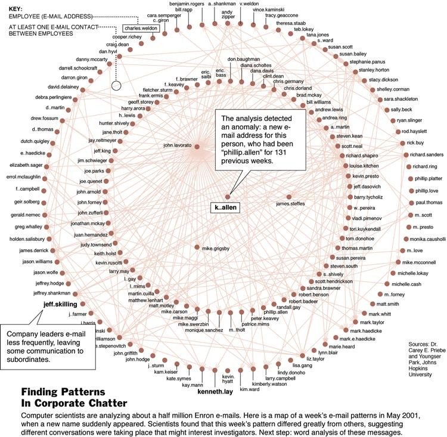
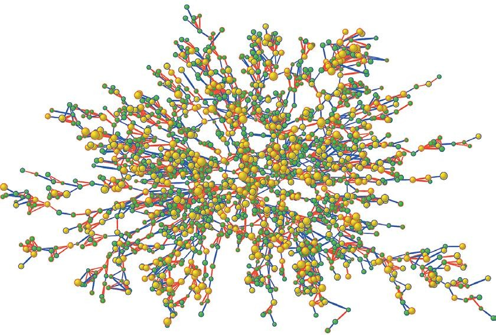
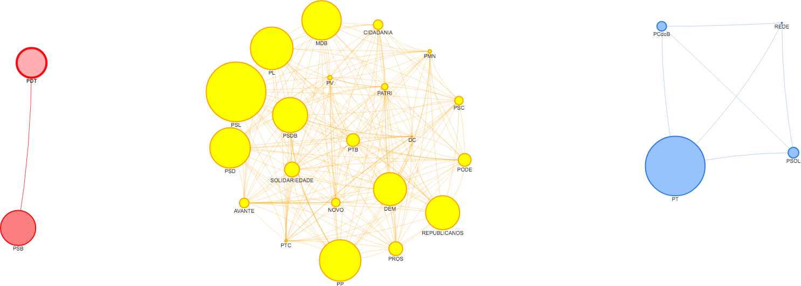
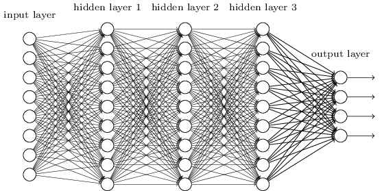
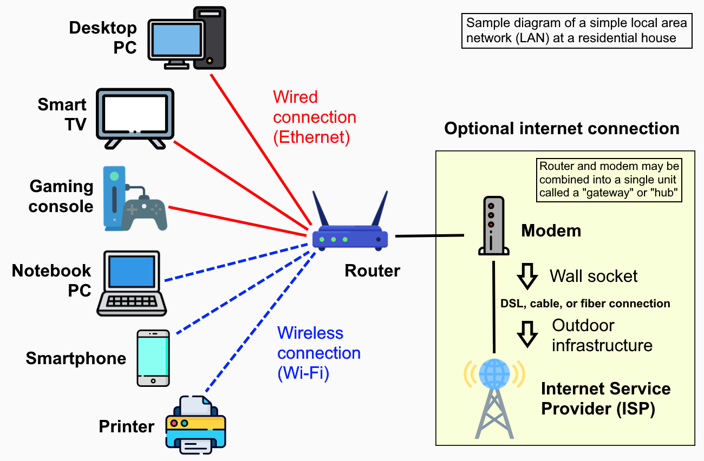
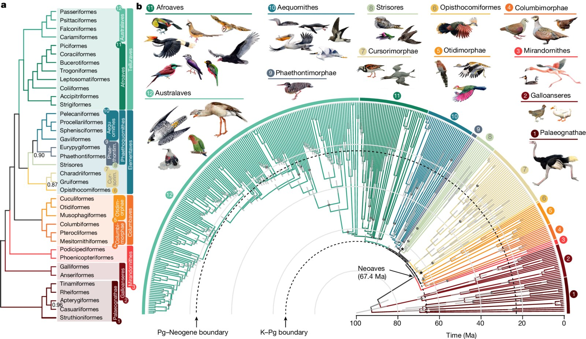
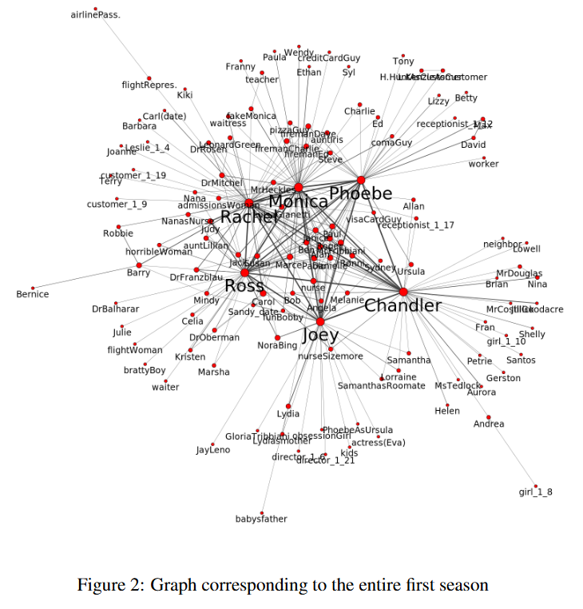
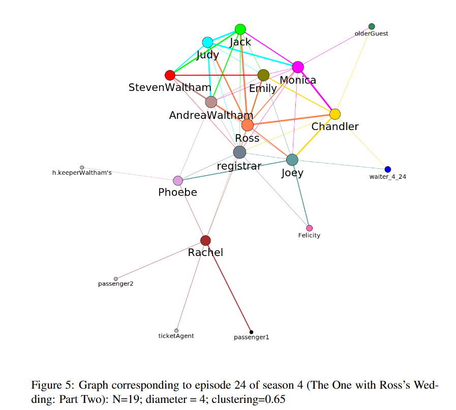
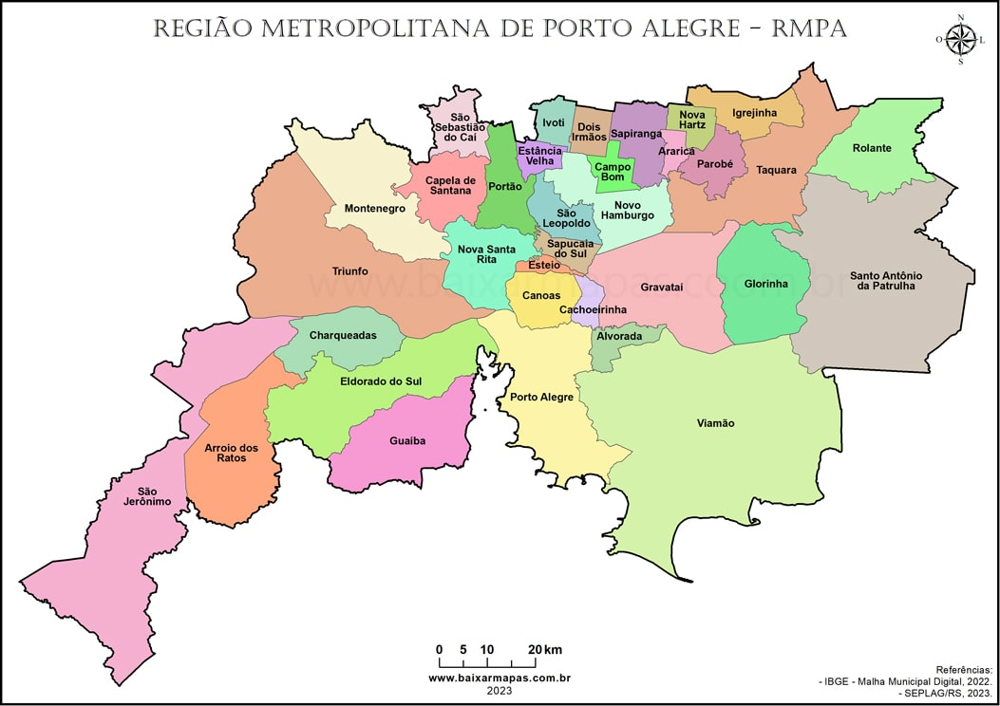
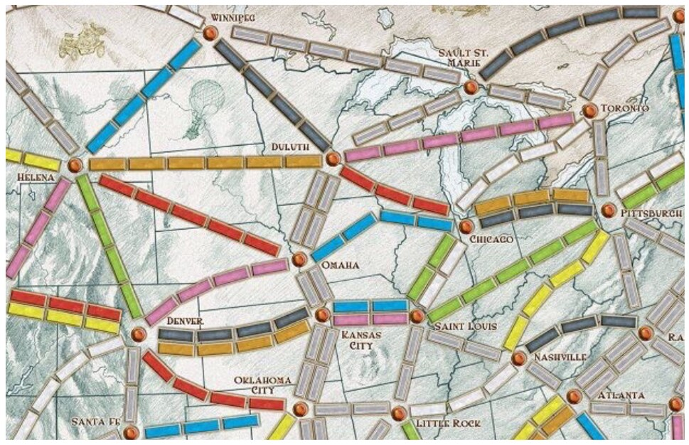

## Grafos

- [Grafos]{.azul} são estruturas que podemos usar para representar informação
- São muito usados quando a informação que precisa ser descrita [contém referências]{.azul}, formando [redes]{.azul}

<br>

- Exemplos:
  - redes sociais
  - web
  - redes de co-expressão gênica
  - mapas
  - diagramas de fluxo de controle
  - relações ...

## Aplicações

::: {style="font-size: 0.7em; width: 85%; margin: 0 auto;"}
| graph | node | edge |
|:-----:|:----:|:----:|
| **communication** | telephone, computer | fiber optic cable |
| **circuit** | gate, register, processor | wire |
| **mechanical** | joint | rod, beam, spring |
| **financial** | stock, currency | transactions |
| **transportation** | street intersection, airport | highway, airway route |
| **internet** | class C network | connection |
| **game** | board position | legal move |
| **social relationship** | person, actor | friendship, movie cast |
| **neural network** | neuron | synapse |
| **protein network** | protein | protein-protein interaction |
| **molecule** | atom | bond |
:::

## Uma Semana de Emails

{fig-align="center" height="600"}

## Framingham Heart Study

{fig-align="center" height="480"}

::: {.absolute bottom="0" left="0" style="font-size: 0.45em; font-weight: 700;"}
“The Spread of Obesity in a Large Social Network over 32 Years” by Christakis and Fowler in New England Journal of Medicine, 2007
:::

## Votações - Câmara dos Deputados

<br>

{fig-align="center" width="100%"}

## Redes Neurais

<br>

{fig-align="center" width="70%"}

## Redes de Computadores

{fig-align="center" height="540"}

## Filogenia

{fig-align="center" height="540"}

## Personagens

:::: {.columns style="display: flex; align-items: center;"}
::: {.column width="46%"}
{width="100%"}
:::
::: {.column width="52%"}
{width="100%"}
:::
::::

::: {.absolute bottom="0" left="0" style="font-size: 0.5em;"}
I will be there for you: six friends in a clique. Ana L. C. Bazzan. 2019.
:::

## Grafos

- Um grafo é composto de [nodos]{.azul} (ou vértices) e de [arestas]{.azul} (ou arcos), que relacionam estes nodos
- Arestas podem ser [dirigidas]{.azul} ou não, e podem ter [pesos]{.azul} associados ou não.

<br>

:::: {.columns style="display: flex; align-items: flex-end;"}
::: {.column width="33%"}
```{=html}
<svg viewBox="0 0 290 180" style="display:block; margin:0 auto; width:100%; max-width:100%; height:auto;" xmlns="http://www.w3.org/2000/svg" role="img" aria-label="Grafo não dirigido com A, B, C e D">
<text x="145" y="18" font-size="19" text-anchor="middle" fill="#2e8b3e" font-family="'Gill Sans', 'Gill Sans MT', 'Fira Sans', sans-serif">Grafo não dirigido</text>
<path d="M 41.8 116.2 Q 53.2 81.2 88.2 69.8" fill="none" stroke="#555555" stroke-width="2.5"/>
<path d="M 134.8 72.2 Q 169.7 87.7 175.9 125.3" fill="none" stroke="#555555" stroke-width="2.5"/>
<path d="M 58.3 145.7 Q 106.2 157.0 155.1 152.4" fill="none" stroke="#555555" stroke-width="2.5"/>
<path d="M 203.2 140.8 Q 231.6 129.6 242.8 101.2" fill="none" stroke="#555555" stroke-width="2.5"/>
<circle cx="34" cy="140" r="24" fill="#2e9a47" stroke="#23793a" stroke-width="2"/>
<text x="34" y="140" font-size="22" text-anchor="middle" dominant-baseline="central" fill="#ffffff" font-family="'Gill Sans', 'Gill Sans MT', 'Fira Sans', sans-serif">A</text>
<circle cx="112" cy="62" r="24" fill="#2e9a47" stroke="#23793a" stroke-width="2"/>
<text x="112" y="62" font-size="22" text-anchor="middle" dominant-baseline="central" fill="#ffffff" font-family="'Gill Sans', 'Gill Sans MT', 'Fira Sans', sans-serif">B</text>
<circle cx="180" cy="150" r="24" fill="#2e9a47" stroke="#23793a" stroke-width="2"/>
<text x="180" y="150" font-size="22" text-anchor="middle" dominant-baseline="central" fill="#ffffff" font-family="'Gill Sans', 'Gill Sans MT', 'Fira Sans', sans-serif">C</text>
<circle cx="252" cy="78" r="24" fill="#2e9a47" stroke="#23793a" stroke-width="2"/>
<text x="252" y="78" font-size="22" text-anchor="middle" dominant-baseline="central" fill="#ffffff" font-family="'Gill Sans', 'Gill Sans MT', 'Fira Sans', sans-serif">D</text>
</svg>
```
:::
::: {.column width="33%"}
```{=html}
<svg viewBox="0 0 290 180" style="display:block; margin:0 auto; width:100%; max-width:100%; height:auto;" xmlns="http://www.w3.org/2000/svg" role="img" aria-label="Grafo dirigido com arestas B→A, B→C, A→C e C→D">
<defs><marker id="arr-dirigido-2" viewBox="0 0 10 10" refX="9" refY="5" markerWidth="7" markerHeight="7" orient="auto-start-reverse"><path d="M 0 0 L 10 5 L 0 10 z" fill="#222222"/></marker></defs>
<text x="145" y="18" font-size="19" text-anchor="middle" fill="#0563c1" font-family="'Gill Sans', 'Gill Sans MT', 'Fira Sans', sans-serif">Grafo dirigido</text>
<path d="M 88.0 69.1 Q 51.8 79.8 41.6 114.1" fill="none" stroke="#222222" stroke-width="2.5" marker-end="url(#arr-dirigido-2)"/>
<path d="M 134.8 72.2 Q 169.7 87.7 175.6 123.4" fill="none" stroke="#222222" stroke-width="2.5" marker-end="url(#arr-dirigido-2)"/>
<path d="M 58.3 145.7 Q 106.2 157.0 153.1 152.5" fill="none" stroke="#222222" stroke-width="2.5" marker-end="url(#arr-dirigido-2)"/>
<path d="M 203.2 140.8 Q 231.6 129.6 242.0 103.1" fill="none" stroke="#222222" stroke-width="2.5" marker-end="url(#arr-dirigido-2)"/>
<circle cx="34" cy="140" r="24" fill="#0563c1" stroke="#044a91" stroke-width="2"/>
<text x="34" y="140" font-size="22" text-anchor="middle" dominant-baseline="central" fill="#ffffff" font-family="'Gill Sans', 'Gill Sans MT', 'Fira Sans', sans-serif">A</text>
<circle cx="112" cy="62" r="24" fill="#0563c1" stroke="#044a91" stroke-width="2"/>
<text x="112" y="62" font-size="22" text-anchor="middle" dominant-baseline="central" fill="#ffffff" font-family="'Gill Sans', 'Gill Sans MT', 'Fira Sans', sans-serif">B</text>
<circle cx="180" cy="150" r="24" fill="#0563c1" stroke="#044a91" stroke-width="2"/>
<text x="180" y="150" font-size="22" text-anchor="middle" dominant-baseline="central" fill="#ffffff" font-family="'Gill Sans', 'Gill Sans MT', 'Fira Sans', sans-serif">C</text>
<circle cx="252" cy="78" r="24" fill="#0563c1" stroke="#044a91" stroke-width="2"/>
<text x="252" y="78" font-size="22" text-anchor="middle" dominant-baseline="central" fill="#ffffff" font-family="'Gill Sans', 'Gill Sans MT', 'Fira Sans', sans-serif">D</text>
</svg>
```
:::
::: {.column width="33%"}
```{=html}
<svg viewBox="0 0 290 200" style="display:block; margin:0 auto; width:100%; max-width:100%; height:auto;" xmlns="http://www.w3.org/2000/svg" role="img" aria-label="Grafo com pesos: A–B 20, B–C 5, A–C 10, C–D 10">
<text x="145" y="18" font-size="19" text-anchor="middle" fill="#e46c0a" font-family="'Gill Sans', 'Gill Sans MT', 'Fira Sans', sans-serif">Grafo com pesos</text>
<path d="M 41.8 116.2 Q 53.2 81.2 88.2 69.8" fill="none" stroke="#555555" stroke-width="2.5"/>
<text x="40" y="78" font-size="20" text-anchor="middle" dominant-baseline="central" fill="#e46c0a" font-family="'Gill Sans', 'Gill Sans MT', 'Fira Sans', sans-serif">20</text>
<path d="M 134.8 72.2 Q 169.7 87.7 175.9 125.3" fill="none" stroke="#555555" stroke-width="2.5"/>
<text x="163" y="100" font-size="20" text-anchor="middle" dominant-baseline="central" fill="#e46c0a" font-family="'Gill Sans', 'Gill Sans MT', 'Fira Sans', sans-serif">5</text>
<path d="M 58.3 145.7 Q 106.2 157.0 155.1 152.4" fill="none" stroke="#555555" stroke-width="2.5"/>
<text x="105" y="186" font-size="20" text-anchor="middle" dominant-baseline="central" fill="#e46c0a" font-family="'Gill Sans', 'Gill Sans MT', 'Fira Sans', sans-serif">10</text>
<path d="M 203.2 140.8 Q 231.6 129.6 242.8 101.2" fill="none" stroke="#555555" stroke-width="2.5"/>
<text x="262" y="140" font-size="20" text-anchor="middle" dominant-baseline="central" fill="#e46c0a" font-family="'Gill Sans', 'Gill Sans MT', 'Fira Sans', sans-serif">10</text>
<circle cx="34" cy="140" r="24" fill="#e46c0a" stroke="#b85508" stroke-width="2"/>
<text x="34" y="140" font-size="22" text-anchor="middle" dominant-baseline="central" fill="#ffffff" font-family="'Gill Sans', 'Gill Sans MT', 'Fira Sans', sans-serif">A</text>
<circle cx="112" cy="62" r="24" fill="#e46c0a" stroke="#b85508" stroke-width="2"/>
<text x="112" y="62" font-size="22" text-anchor="middle" dominant-baseline="central" fill="#ffffff" font-family="'Gill Sans', 'Gill Sans MT', 'Fira Sans', sans-serif">B</text>
<circle cx="180" cy="150" r="24" fill="#e46c0a" stroke="#b85508" stroke-width="2"/>
<text x="180" y="150" font-size="22" text-anchor="middle" dominant-baseline="central" fill="#ffffff" font-family="'Gill Sans', 'Gill Sans MT', 'Fira Sans', sans-serif">C</text>
<circle cx="252" cy="78" r="24" fill="#e46c0a" stroke="#b85508" stroke-width="2"/>
<text x="252" y="78" font-size="22" text-anchor="middle" dominant-baseline="central" fill="#ffffff" font-family="'Gill Sans', 'Gill Sans MT', 'Fira Sans', sans-serif">D</text>
</svg>
```
:::
::::

## Grafos Não-Direcionados

:::: {.columns}
::: {.column width="45%"}
[Notação: $G = (V, E)$]{.azul}

- $V$ : nodos (ou vértices)
- $E$ : arestas entre nodos
:::
::: {.column width="40%"}
```{=html}
<svg viewBox="0 0 320 327" style="display:block; margin:0 auto; width:11em; max-width:100%; height:auto;" xmlns="http://www.w3.org/2000/svg" role="img" aria-label="Grafo não direcionado com vértices 1 a 8">
<path d="M 146.5 48.6 L 108.5 101.4" fill="none" stroke="#555555" stroke-width="2.5"/>
<path d="M 173.5 48.6 L 211.5 101.4" fill="none" stroke="#555555" stroke-width="2.5"/>
<path d="M 118.0 120.0 L 202.0 120.0" fill="none" stroke="#555555" stroke-width="2.5"/>
<path d="M 81.3 138.5 L 43.7 189.5" fill="none" stroke="#555555" stroke-width="2.5"/>
<path d="M 108.7 138.5 L 146.3 189.5" fill="none" stroke="#555555" stroke-width="2.5"/>
<path d="M 211.3 138.5 L 173.7 189.5" fill="none" stroke="#555555" stroke-width="2.5"/>
<path d="M 238.5 101.4 L 276.5 48.6" fill="none" stroke="#555555" stroke-width="2.5"/>
<path d="M 238.7 138.5 L 276.3 189.5" fill="none" stroke="#555555" stroke-width="2.5"/>
<path d="M 53.0 208.0 L 137.0 208.0" fill="none" stroke="#555555" stroke-width="2.5"/>
<path d="M 160.0 231.0 L 160.0 274.0" fill="none" stroke="#555555" stroke-width="2.5"/>
<path d="M 290.0 53.0 L 290.0 185.0" fill="none" stroke="#555555" stroke-width="2.5"/>
<circle cx="160" cy="30" r="22" fill="#23373b" stroke="#152224" stroke-width="2"/>
<text x="160" y="30" font-size="19" text-anchor="middle" dominant-baseline="central" fill="#ffffff" font-family="'Gill Sans', 'Gill Sans MT', 'Fira Sans', sans-serif" font-weight="bold">1</text>
<circle cx="290" cy="30" r="22" fill="#23373b" stroke="#152224" stroke-width="2"/>
<text x="290" y="30" font-size="19" text-anchor="middle" dominant-baseline="central" fill="#ffffff" font-family="'Gill Sans', 'Gill Sans MT', 'Fira Sans', sans-serif" font-weight="bold">7</text>
<circle cx="95" cy="120" r="22" fill="#23373b" stroke="#152224" stroke-width="2"/>
<text x="95" y="120" font-size="19" text-anchor="middle" dominant-baseline="central" fill="#ffffff" font-family="'Gill Sans', 'Gill Sans MT', 'Fira Sans', sans-serif" font-weight="bold">2</text>
<circle cx="225" cy="120" r="22" fill="#23373b" stroke="#152224" stroke-width="2"/>
<text x="225" y="120" font-size="19" text-anchor="middle" dominant-baseline="central" fill="#ffffff" font-family="'Gill Sans', 'Gill Sans MT', 'Fira Sans', sans-serif" font-weight="bold">3</text>
<circle cx="30" cy="208" r="22" fill="#23373b" stroke="#152224" stroke-width="2"/>
<text x="30" y="208" font-size="19" text-anchor="middle" dominant-baseline="central" fill="#ffffff" font-family="'Gill Sans', 'Gill Sans MT', 'Fira Sans', sans-serif" font-weight="bold">4</text>
<circle cx="160" cy="208" r="22" fill="#23373b" stroke="#152224" stroke-width="2"/>
<text x="160" y="208" font-size="19" text-anchor="middle" dominant-baseline="central" fill="#ffffff" font-family="'Gill Sans', 'Gill Sans MT', 'Fira Sans', sans-serif" font-weight="bold">5</text>
<circle cx="290" cy="208" r="22" fill="#23373b" stroke="#152224" stroke-width="2"/>
<text x="290" y="208" font-size="19" text-anchor="middle" dominant-baseline="central" fill="#ffffff" font-family="'Gill Sans', 'Gill Sans MT', 'Fira Sans', sans-serif" font-weight="bold">8</text>
<circle cx="160" cy="297" r="22" fill="#23373b" stroke="#152224" stroke-width="2"/>
<text x="160" y="297" font-size="19" text-anchor="middle" dominant-baseline="central" fill="#ffffff" font-family="'Gill Sans', 'Gill Sans MT', 'Fira Sans', sans-serif" font-weight="bold">6</text>
</svg>
```
:::
::::

[Exemplo:]{.azul}

::: {style="font-size: 0.85em;"}
- $V = \{1, 2, 3, 4, 5, 6, 7, 8\}$
- $E = \{1{-}2,\ 1{-}3,\ 2{-}3,\ 2{-}4,\ 2{-}5,\ 3{-}5,\ 3{-}7,\ 3{-}8,\ 4{-}5,\ 5{-}6,\ 7{-}8\}$
:::

## Grafos

- Normalmente, grafos [não são tipos pré-definidos]{.azul} nas linguagens de programação

<br>

- Portanto, para usar grafos como representação, precisamos escolher uma forma de defini-los em termos das construções que as linguagens nos oferecem

<br>

- Existem inúmeras maneiras de representar grafos, vamos escolher uma ...

## Grafo – Definição

<br>

```pyret
data Nodo:
   nodo(
       id :: String,              # Identificador do nodo
       vizinhos :: List<String>   # Lista de nomes dos vizinhos do nodo
   )
end


type Grafo = List<Nodo>
# Um Grafo é:
# | empty
# | link(first :: Nodo, rest :: List<Nodo>)
```

## Exemplo

:::: {.columns style="display: flex; align-items: center;"}
::: {.column width="40%"}
```{=html}
<svg viewBox="0 0 300 165" style="display:block; margin:0 auto; width:13em; max-width:100%; height:auto;" xmlns="http://www.w3.org/2000/svg" role="img" aria-label="Grafo não dirigido: A–B, B–C, A–C e C–D">
<path d="M 48.4 94.3 Q 59.2 61.2 92.3 50.4" fill="none" stroke="#555555" stroke-width="2.5"/>
<path d="M 142.7 53.0 Q 175.7 67.7 181.6 103.4" fill="none" stroke="#555555" stroke-width="2.5"/>
<path d="M 66.3 126.2 Q 112.2 137.0 159.1 132.5" fill="none" stroke="#555555" stroke-width="2.5"/>
<path d="M 211.1 120.0 Q 237.6 109.6 248.0 83.1" fill="none" stroke="#555555" stroke-width="2.5"/>
<circle cx="40" cy="120" r="26" fill="#2e9a47" stroke="#23793a" stroke-width="2"/>
<text x="40" y="120" font-size="24" text-anchor="middle" dominant-baseline="central" fill="#ffffff" font-family="'Gill Sans', 'Gill Sans MT', 'Fira Sans', sans-serif">A</text>
<circle cx="118" cy="42" r="26" fill="#2e9a47" stroke="#23793a" stroke-width="2"/>
<text x="118" y="42" font-size="24" text-anchor="middle" dominant-baseline="central" fill="#ffffff" font-family="'Gill Sans', 'Gill Sans MT', 'Fira Sans', sans-serif">B</text>
<circle cx="186" cy="130" r="26" fill="#2e9a47" stroke="#23793a" stroke-width="2"/>
<text x="186" y="130" font-size="24" text-anchor="middle" dominant-baseline="central" fill="#ffffff" font-family="'Gill Sans', 'Gill Sans MT', 'Fira Sans', sans-serif">C</text>
<circle cx="258" cy="58" r="26" fill="#2e9a47" stroke="#23793a" stroke-width="2"/>
<text x="258" y="58" font-size="24" text-anchor="middle" dominant-baseline="central" fill="#ffffff" font-family="'Gill Sans', 'Gill Sans MT', 'Fira Sans', sans-serif">D</text>
</svg>
```
:::
::: {.column width="58%"}
- O grafo ao lado pode ser representado por uma lista de nodos:
:::
::::

::: {.absolute top="300" left="400" width="580" style="font-size: 0.8em;"}
```pyret
G :: Grafo = [list:
               nodo("A", [list: "B", "C"]),
               nodo("B", [list: "A", "C"]),
               nodo("C", [list: "A", "B", "D"]),
               nodo("D", [list: "C"])
             ]
```
:::

::: {.fragment}
::: {.absolute top="330" left="652" width="60" height="95" style="border: 2px solid #0070c0;"}
:::
::: {.absolute top="330" left="716" width="246" height="95" style="border: 2px solid #0070c0;"}
:::
::: {.absolute top="432" left="545" style="color: #00b050;"}
Nome do nodo
:::
::: {.absolute top="432" left="760" style="color: #0070c0;"}
Vizinhos do nodo
:::
:::

## Questão

- Como representar este grafo?

<br>

```{=html}
<svg viewBox="0 0 730 350" style="display:block; margin:0 auto; width:26em; max-width:100%; height:auto;" xmlns="http://www.w3.org/2000/svg" role="img" aria-label="Grafo com Duluth, Toronto, Chicago e Pittsburgh; Toronto ligado às outras três cidades">
<path d="M 152 68 Q 300 15 420 40" fill="none" stroke="#111111" stroke-width="3"/>
<path d="M 425 70 Q 300 120 250 272" fill="none" stroke="#111111" stroke-width="3"/>
<path d="M 535 70 Q 600 120 615 202" fill="none" stroke="#111111" stroke-width="3"/>
<ellipse cx="100" cy="82" rx="64" ry="38" fill="#c0560c" stroke="#9e4507" stroke-width="2"/>
<text x="100" y="82" font-size="22" text-anchor="middle" dominant-baseline="central" fill="#ffffff" font-family="'Gill Sans', 'Gill Sans MT', 'Fira Sans', sans-serif">Duluth</text>
<ellipse cx="480" cy="48" rx="64" ry="38" fill="#c0560c" stroke="#9e4507" stroke-width="2"/>
<text x="480" y="48" font-size="22" text-anchor="middle" dominant-baseline="central" fill="#ffffff" font-family="'Gill Sans', 'Gill Sans MT', 'Fira Sans', sans-serif">Toronto</text>
<ellipse cx="245" cy="310" rx="64" ry="38" fill="#c0560c" stroke="#9e4507" stroke-width="2"/>
<text x="245" y="310" font-size="22" text-anchor="middle" dominant-baseline="central" fill="#ffffff" font-family="'Gill Sans', 'Gill Sans MT', 'Fira Sans', sans-serif">Chicago</text>
<ellipse cx="630" cy="240" rx="64" ry="38" fill="#c0560c" stroke="#9e4507" stroke-width="2"/>
<text x="630" y="240" font-size="22" text-anchor="middle" dominant-baseline="central" fill="#ffffff" font-family="'Gill Sans', 'Gill Sans MT', 'Fira Sans', sans-serif">Pittsburgh</text>
</svg>
```

## Questão

- Qual dos seguintes elementos pode ser considerado a representação do nodo com nome Chicago no grafo do slide anterior, segundo a definição de [Nodo]{.azul} e [Grafo]{.verde}?

<br>

a) `[list: "Chicago", "Toronto"]`
b) `nodo("Chicago", nodo("Toronto", empty))`
c) `nodo("Chicago", empty)`
d) `nodo("Chicago", [list: "Toronto"])`
e) Nenhuma das anteriores

##  {visibility="hidden"}

{fig-align="center" height="680"}

## Exercício

- Construa uma representação no Pyret para o grafo abaixo.

<br>

- Seu grafo deve ser uma lista com 16 nodos, um para cada cidade com nome visível neste mapa (Raleigh, cortada à direita, fica de fora).

{fig-align="center" height="330"}

## Vizinhos

:::: {.receita}
::: {.receita-titulo}
vizinhos
:::
::: {.receita-item}
[Obj:]{.azul} [Dados um grafo e um id de um nodo, devolve os ids dos vizinhos do nodo no grafo. O nodo deve fazer parte do grafo.]{.laranja}
:::
::: {.receita-item}
[Entrada:]{.verde} Um grafo e um id.
:::
::: {.receita-item}
[Saída:]{.vermelho} Uma lista de ids.
:::
::::

<br>

```{=html}
<svg viewBox="0 0 520 190" style="display:block; margin:0 auto; width:21.7em; max-width:100%; height:auto;" xmlns="http://www.w3.org/2000/svg" role="img" aria-label="Função vizinhos: recebe g :: Grafo, id :: String e devolve List<String>">
<defs><marker id="seta-f-vizinhos-7" viewBox="0 0 10 10" refX="8" refY="5" markerWidth="5" markerHeight="5" orient="auto"><path d="M 0 0 L 10 5 L 0 10 z" fill="#111111"/></marker></defs>
<text x="198" y="16" font-size="19" text-anchor="middle" font-family="'Gill Sans', 'Gill Sans MT', 'Fira Sans', sans-serif"><tspan fill="#00a04a">g</tspan><tspan fill="#0070c0"> :: Grafo</tspan></text>
<line x1="198" y1="28" x2="198" y2="64" stroke="#111111" stroke-width="3" marker-end="url(#seta-f-vizinhos-7)"/>
<text x="322" y="16" font-size="19" text-anchor="middle" font-family="'Gill Sans', 'Gill Sans MT', 'Fira Sans', sans-serif"><tspan fill="#00a04a">id</tspan><tspan fill="#0070c0"> :: String</tspan></text>
<line x1="322" y1="28" x2="322" y2="64" stroke="#111111" stroke-width="3" marker-end="url(#seta-f-vizinhos-7)"/>
<rect x="140" y="68" width="240" height="58" rx="8" fill="#2e75b6" stroke="#2a6aa5" stroke-width="1.5"/>
<text x="260" y="97" font-size="25" text-anchor="middle" dominant-baseline="central" fill="#ffffff" font-family="'Gill Sans', 'Gill Sans MT', 'Fira Sans', sans-serif">vizinhos</text>
<line x1="260" y1="126" x2="260" y2="158" stroke="#111111" stroke-width="3" marker-end="url(#seta-f-vizinhos-7)"/>
<text x="260" y="180" font-size="19" text-anchor="middle" fill="#0070c0" font-family="'Gill Sans', 'Gill Sans MT', 'Fira Sans', sans-serif">List&lt;String&gt;</text>
</svg>
```

## Vizinhos

::: {.pyret-live data-height="560"}
::: {style="display: none;"}
```pyret
data Nodo:
    nodo(
        id :: String,              # Identificador do nodo
        vizinhos :: List<String>   # Lista de nomes dos vizinhos do nodo
    )
end

type Grafo = List<Nodo>
# Um Grafo é:
# | empty
# | link(first :: Nodo, rest :: List<Nodo>)

G :: Grafo = [list:
                nodo("A", [list: "B", "C"]),
                nodo("B", [list: "A", "C"]),
                nodo("C", [list: "A", "B", "D"]),
                nodo("D", [list: "C"])
            ]

G1 :: Grafo = [list:
  nodo("A", [list: "B", "E"]),
  nodo("B", [list: "E", "F"]),
  nodo("C", [list: "D"]),
  nodo("D", empty),
  nodo("E", [list: "C", "F"]),
  nodo("F", [list: "D", "G"]),
  nodo("G", empty)
]
```
:::
::: {style="font-size: 0.85em;"}
```{.pyret .code-overflow-wrap}
fun vizinhos(g :: Grafo, id :: String) -> List<String>:
    doc: "Dados um grafo e um identificador de nodo, retorna a lista de vizinhos do nodo correspondente. O nodo deve fazer parte do grafo."
    cases (Grafo) g:
        # Se o grafo estiver vazio, retorna lista vazia
        | empty => empty
        | link(f, r) =>
            ask:
                # Se o nodo atual é o que estamos procurando, retorna seus vizinhos
                | f.id == id then: f.vizinhos
                # Senão, procura os vizinhos do id nos nodos restantes do grafo
                | otherwise: vizinhos(r, id)
            end
    end
end
```
:::
:::

- Construa os exemplos/testes para a função *vizinhos*.

## Está na Lista?

:::: {.receita}
::: {.receita-titulo}
Está na lista?
:::
::: {.receita-item}
[Obj:]{.azul} [Dados um nome (string) e uma lista de strings, diz se o nome dado está na lista.]{.laranja}
:::
::: {.receita-item}
[Entrada:]{.verde} Uma lista de strings e uma string.
:::
::: {.receita-item}
[Saída:]{.vermelho} Um booleano.
:::
::::

<br>

```{=html}
<svg viewBox="0 0 520 190" style="display:block; margin:0 auto; width:21.7em; max-width:100%; height:auto;" xmlns="http://www.w3.org/2000/svg" role="img" aria-label="Função esta-na-lista: recebe l :: List&lt;String&gt;, id :: String e devolve Boolean">
<defs><marker id="seta-f-esta-na-lista-8" viewBox="0 0 10 10" refX="8" refY="5" markerWidth="5" markerHeight="5" orient="auto"><path d="M 0 0 L 10 5 L 0 10 z" fill="#111111"/></marker></defs>
<text x="198" y="16" font-size="19" text-anchor="middle" font-family="'Gill Sans', 'Gill Sans MT', 'Fira Sans', sans-serif"><tspan fill="#00a04a">l</tspan><tspan fill="#0070c0"> :: List&lt;String&gt;</tspan></text>
<line x1="198" y1="28" x2="198" y2="64" stroke="#111111" stroke-width="3" marker-end="url(#seta-f-esta-na-lista-8)"/>
<text x="322" y="16" font-size="19" text-anchor="middle" font-family="'Gill Sans', 'Gill Sans MT', 'Fira Sans', sans-serif"><tspan fill="#00a04a">id</tspan><tspan fill="#0070c0"> :: String</tspan></text>
<line x1="322" y1="28" x2="322" y2="64" stroke="#111111" stroke-width="3" marker-end="url(#seta-f-esta-na-lista-8)"/>
<rect x="139" y="68" width="242" height="58" rx="8" fill="#2e75b6" stroke="#2a6aa5" stroke-width="1.5"/>
<text x="260" y="97" font-size="25" text-anchor="middle" dominant-baseline="central" fill="#ffffff" font-family="'Gill Sans', 'Gill Sans MT', 'Fira Sans', sans-serif">esta-na-lista</text>
<line x1="260" y1="126" x2="260" y2="158" stroke="#111111" stroke-width="3" marker-end="url(#seta-f-esta-na-lista-8)"/>
<text x="260" y="180" font-size="19" text-anchor="middle" fill="#0070c0" font-family="'Gill Sans', 'Gill Sans MT', 'Fira Sans', sans-serif">Boolean</text>
</svg>
```

## esta-na-lista

::: {.pyret-live data-height="520"}
::: {style="font-size: 0.9em;"}
```{.pyret .code-overflow-wrap}
fun esta-na-lista(l :: List<String>, id :: String) -> Boolean:
    doc: "Determina se um identificador de nodo está presente em uma lista de strings."
    cases (List<String>) l:
        | empty => false
        | link(f, r) =>
            ask:
                | f == id then: true
                | otherwise: esta-na-lista(r, id)
            end
    end
where:
    esta-na-lista([list: "A", "B", "C"], "B") is true
    esta-na-lista([list: "A", "B", "C"], "D") is false
end
```
:::
:::

## Caminho

- Um [caminho]{.azul} em um grafo é uma lista de nodos [(sem repetição)]{.vermelho} que estão conectados
- Por exemplo, no grafo abaixo existem vários caminhos entre Chicago e Toronto:

:::: {.columns style="display: flex; align-items: center;"}
::: {.column width="50%"}
{width="100%"}
:::
::: {.column width="48%"}
::: {style="font-size: 0.8em;"}
Chicago → Toronto

Chicago → Pittsburgh → Toronto

Chicago → Duluth → Toronto

Chicago → Duluth → Sault St. Marie → Toronto

Chicago → Omaha → Duluth → Toronto

…
:::
:::
::::

## Busca em Grafos

[Conectividade:]{.azul}

- Dados dois vértices $u$ e $v$, existe um [caminho]{.azul} entre $u$ e $v$ ?

[Caminho Mais Curto:]{.azul}

- Dados dois vértices $u$ e $v$, qual é o [comprimento]{.vermelho} do [caminho mais curto]{.azul} entre $u$ e $v$ ?

[Objetivo:]{.azul}

- Encontrar todos os vértices conectados a um vértice origem.
- Visitar cada vértice no máximo uma vez.

## Encontrar Caminho

- Dados um mapa e 2 cidades (origem e destino), como [encontrar um caminho]{.azul} entre elas?
  - Por exemplo, como encontrar um caminho entre [Denver]{.verde} e [Toronto]{.roxo}?

:::: {.columns style="display: flex; align-items: center;"}
::: {.column width="52%"}
{width="100%"}
:::
::: {.column width="46%"}
::: {style="font-size: 0.85em;"}
[Ideia:]{.azul} procurar um caminho de um dos [vizinhos de Denver]{.azul} até [Toronto]{.roxo}:

- Omaha -> Duluth -> [Toronto]{.roxo}

E colocar o nome Denver na frente:

- [Denver]{.verde} -> Omaha -> Duluth -> [Toronto]{.roxo}
:::
:::
::::

## Encontrar Menor Caminho

:::: {.receita}
::: {.receita-titulo}
Encontrar menor caminho
:::
::: {.receita-item}
[Obj:]{.azul} [Dados um grafo, uma origem e um destino, encontrar o menor caminho no grafo conectando a origem ao destino.]{.laranja}
:::
::: {.receita-item}
[Entrada:]{.verde} Um grafo, um id de origem e um id de destino.
:::
::: {.receita-item}
[Saída:]{.vermelho} Uma lista de ids dos nodos no caminho.
:::
::::

<br>

```{=html}
<svg viewBox="0 0 520 190" style="display:block; margin:0 auto; width:21.7em; max-width:100%; height:auto;" xmlns="http://www.w3.org/2000/svg" role="img" aria-label="Função menor-caminho: recebe g :: Grafo, origem :: String, destino :: String e devolve List<String>">
<defs><marker id="seta-f-menor-caminho-9" viewBox="0 0 10 10" refX="8" refY="5" markerWidth="5" markerHeight="5" orient="auto"><path d="M 0 0 L 10 5 L 0 10 z" fill="#111111"/></marker></defs>
<text x="110" y="16" font-size="19" text-anchor="middle" font-family="'Gill Sans', 'Gill Sans MT', 'Fira Sans', sans-serif"><tspan fill="#00a04a">g</tspan><tspan fill="#0070c0"> :: Grafo</tspan></text>
<line x1="110" y1="28" x2="110" y2="64" stroke="#111111" stroke-width="3" marker-end="url(#seta-f-menor-caminho-9)"/>
<text x="260" y="16" font-size="19" text-anchor="middle" font-family="'Gill Sans', 'Gill Sans MT', 'Fira Sans', sans-serif"><tspan fill="#00a04a">origem</tspan><tspan fill="#0070c0"> :: String</tspan></text>
<line x1="260" y1="28" x2="260" y2="64" stroke="#111111" stroke-width="3" marker-end="url(#seta-f-menor-caminho-9)"/>
<text x="410" y="16" font-size="19" text-anchor="middle" font-family="'Gill Sans', 'Gill Sans MT', 'Fira Sans', sans-serif"><tspan fill="#00a04a">destino</tspan><tspan fill="#0070c0"> :: String</tspan></text>
<line x1="410" y1="28" x2="410" y2="64" stroke="#111111" stroke-width="3" marker-end="url(#seta-f-menor-caminho-9)"/>
<rect x="139" y="68" width="242" height="58" rx="8" fill="#2e75b6" stroke="#2a6aa5" stroke-width="1.5"/>
<text x="260" y="97" font-size="25" text-anchor="middle" dominant-baseline="central" fill="#ffffff" font-family="'Gill Sans', 'Gill Sans MT', 'Fira Sans', sans-serif">menor-caminho</text>
<line x1="260" y1="126" x2="260" y2="158" stroke="#111111" stroke-width="3" marker-end="url(#seta-f-menor-caminho-9)"/>
<text x="260" y="180" font-size="19" text-anchor="middle" fill="#0070c0" font-family="'Gill Sans', 'Gill Sans MT', 'Fira Sans', sans-serif">List&lt;String&gt;</text>
</svg>
```

## menor-caminho

::: {style="font-size: 0.85em;"}
```{.pyret .code-overflow-wrap}
fun menor-caminho(g :: Grafo, origem :: String, destino :: String) -> List<String>:
    doc: "Dados um grafo, um nodo de origem e um nodo de destino, retorna o caminho mais curto (em número de arestas) do nodo origem ao nodo destino, ou lista vazia se não existe."

where:
    menor-caminho(G1, "A", "G") is [list: "A", "B", "F", "G"]
    menor-caminho(G1, "C", "A") is empty
end
```
:::

```{=html}
<svg viewBox="0 0 475 290" style="display:block; margin:0 auto; width:15em; max-width:100%; height:auto;" xmlns="http://www.w3.org/2000/svg" role="img" aria-label="Grafo dirigido G1 com arestas A→B, A→E, B→E, B→F, E→C, E→F, C→D, F→D e F→G">
<defs><marker id="arr-g1-10" viewBox="0 0 10 10" refX="9" refY="5" markerWidth="7" markerHeight="7" orient="auto-start-reverse"><path d="M 0 0 L 10 5 L 0 10 z" fill="#555555"/></marker></defs>
<text x="0" y="40" font-size="30" font-weight="bold" font-style="italic" fill="#7030a0" font-family="'Gill Sans', 'Gill Sans MT', 'Fira Sans', sans-serif">G1:</text>
<path d="M 249.8 38.7 Q 329.0 28.0 406.2 38.4" fill="none" stroke="#555555" stroke-width="2.5" marker-end="url(#arr-g1-10)"/>
<path d="M 224.3 67.0 L 222.7 123.0" fill="none" stroke="#555555" stroke-width="2.5" marker-end="url(#arr-g1-10)"/>
<path d="M 412.7 56.6 Q 335.7 112.0 247.6 141.4" fill="none" stroke="#555555" stroke-width="2.5" marker-end="url(#arr-g1-10)"/>
<path d="M 443.5 64.7 Q 457.5 95.0 447.0 124.5" fill="none" stroke="#555555" stroke-width="2.5" marker-end="url(#arr-g1-10)"/>
<path d="M 197.3 153.7 Q 129.9 163.8 74.6 200.2" fill="none" stroke="#555555" stroke-width="2.5" marker-end="url(#arr-g1-10)"/>
<path d="M 246.9 152.3 Q 330.0 160.0 411.1 152.5" fill="none" stroke="#555555" stroke-width="2.5" marker-end="url(#arr-g1-10)"/>
<path d="M 74.0 226.8 Q 133.5 258.8 199.0 259.6" fill="none" stroke="#555555" stroke-width="2.5" marker-end="url(#arr-g1-10)"/>
<path d="M 417.8 164.7 Q 340.3 221.0 251.6 251.3" fill="none" stroke="#555555" stroke-width="2.5" marker-end="url(#arr-g1-10)"/>
<path d="M 441.6 174.7 Q 446.0 205.0 441.9 233.3" fill="none" stroke="#555555" stroke-width="2.5" marker-end="url(#arr-g1-10)"/>
<circle cx="225" cy="42" r="24" fill="#23373b" stroke="#152224" stroke-width="2"/>
<text x="225" y="42" font-size="21" text-anchor="middle" dominant-baseline="central" fill="#ffffff" font-family="'Gill Sans', 'Gill Sans MT', 'Fira Sans', sans-serif" font-weight="bold">A</text>
<circle cx="433" cy="42" r="24" fill="#23373b" stroke="#152224" stroke-width="2"/>
<text x="433" y="42" font-size="21" text-anchor="middle" dominant-baseline="central" fill="#ffffff" font-family="'Gill Sans', 'Gill Sans MT', 'Fira Sans', sans-serif" font-weight="bold">B</text>
<circle cx="222" cy="150" r="24" fill="#23373b" stroke="#152224" stroke-width="2"/>
<text x="222" y="150" font-size="21" text-anchor="middle" dominant-baseline="central" fill="#ffffff" font-family="'Gill Sans', 'Gill Sans MT', 'Fira Sans', sans-serif" font-weight="bold">E</text>
<circle cx="438" cy="150" r="24" fill="#23373b" stroke="#152224" stroke-width="2"/>
<text x="438" y="150" font-size="21" text-anchor="middle" dominant-baseline="central" fill="#ffffff" font-family="'Gill Sans', 'Gill Sans MT', 'Fira Sans', sans-serif" font-weight="bold">F</text>
<circle cx="52" cy="215" r="24" fill="#23373b" stroke="#152224" stroke-width="2"/>
<text x="52" y="215" font-size="21" text-anchor="middle" dominant-baseline="central" fill="#ffffff" font-family="'Gill Sans', 'Gill Sans MT', 'Fira Sans', sans-serif" font-weight="bold">C</text>
<circle cx="226" cy="260" r="24" fill="#23373b" stroke="#152224" stroke-width="2"/>
<text x="226" y="260" font-size="21" text-anchor="middle" dominant-baseline="central" fill="#ffffff" font-family="'Gill Sans', 'Gill Sans MT', 'Fira Sans', sans-serif" font-weight="bold">D</text>
<circle cx="438" cy="260" r="24" fill="#23373b" stroke="#152224" stroke-width="2"/>
<text x="438" y="260" font-size="21" text-anchor="middle" dominant-baseline="central" fill="#ffffff" font-family="'Gill Sans', 'Gill Sans MT', 'Fira Sans', sans-serif" font-weight="bold">G</text>
</svg>
```

## Busca em Largura (BFS)

[Breadth-First Search (BFS):]{.azul}

- Explora a partir de um nodo origem $s$ todos os vértices visitando [vértices em camadas]{.vermelho}.

<br>

[BFS:]{.azul}

- $L_0 = \{s\}$.
- $L_1 =$ todos vértices adjacentes a $s$.
- $L_2 =$ todos vértices que não pertencem a $L_0$ ou $L_1$, e que [possuem uma aresta que conecta a um vértice em]{.azul} $L_1$.
- $L_{i+1} =$ todos vértices que não pertencem a camadas anteriores, e que possuem uma aresta que conecta a um vértice em $L_i$.

## Busca em Largura (BFS)

[Breadth-First Search (BFS):]{.azul}

- Explora a partir de $s$ todos os vértices adicionando vértices em camadas.

<br>

```{=html}
<svg viewBox="0 0 1090 270" style="display:block; margin:0 auto; width:100%; height:auto;" xmlns="http://www.w3.org/2000/svg" role="img" aria-label="Busca em largura: origem s ligada à camada L1, que se liga a L2, ..., até L(n-1)">
<rect x="0" y="0" width="1090" height="270" fill="#f2f5f8"/>
<line x1="68" y1="128" x2="190" y2="100" stroke="#111111" stroke-width="4"/>
<line x1="68" y1="145" x2="170" y2="185" stroke="#111111" stroke-width="4"/>
<line x1="308" y1="108" x2="430" y2="88" stroke="#111111" stroke-width="4"/>
<line x1="308" y1="158" x2="430" y2="133" stroke="#111111" stroke-width="4"/>
<line x1="290" y1="212" x2="430" y2="205" stroke="#111111" stroke-width="4"/>
<line x1="560" y1="80" x2="605" y2="82" stroke="#111111" stroke-width="4"/>
<line x1="565" y1="150" x2="610" y2="145" stroke="#111111" stroke-width="4"/>
<line x1="555" y1="210" x2="598" y2="218" stroke="#111111" stroke-width="4"/>
<line x1="900" y1="96" x2="950" y2="94" stroke="#111111" stroke-width="4"/>
<line x1="868" y1="177" x2="915" y2="190" stroke="#111111" stroke-width="4"/>
<path d="M 220 30 Q 285 20 290 50 Q 320 80 305 130 Q 300 200 290 240 Q 275 275 225 265 Q 165 255 170 200 Q 168 150 190 120 Q 205 80 220 30 Z" fill="#cccccc"/>
<path d="M 470 30 Q 520 15 545 45 Q 580 85 570 140 Q 575 200 555 240 Q 520 270 470 262 Q 425 250 430 200 Q 425 140 430 90 Q 435 45 470 30 Z" fill="#cccccc"/>
<path d="M 965 25 Q 1010 15 1040 50 Q 1080 85 1075 150 Q 1090 210 1060 240 Q 1000 260 950 250 Q 912 240 915 180 Q 915 140 945 105 Q 955 60 965 25 Z" fill="#cccccc"/>
<circle cx="38" cy="140" r="34" fill="#cccccc"/>
<text x="38" y="140" font-size="34" font-family="'Gill Sans', 'Gill Sans MT', 'Fira Sans', sans-serif" fill="#111111" text-anchor="middle" dominant-baseline="central">s</text>
<text x="238" y="148" font-size="40" font-family="'Gill Sans', 'Gill Sans MT', 'Fira Sans', sans-serif" fill="#111111" text-anchor="middle" dominant-baseline="central">L<tspan font-size="26" dy="10">1</tspan></text>
<text x="500" y="148" font-size="40" font-family="'Gill Sans', 'Gill Sans MT', 'Fira Sans', sans-serif" fill="#111111" text-anchor="middle" dominant-baseline="central">L<tspan font-size="26" dy="10">2</tspan></text>
<text x="1000" y="148" font-size="40" font-family="'Gill Sans', 'Gill Sans MT', 'Fira Sans', sans-serif" fill="#111111" text-anchor="middle" dominant-baseline="central">L<tspan font-size="26" dy="10">n−1</tspan></text>
<circle cx="720" cy="145" r="8" fill="#111111"/>
<circle cx="760" cy="145" r="8" fill="#111111"/>
<circle cx="800" cy="145" r="8" fill="#111111"/>
</svg>
```

## BFS - Visualização

<br><br><br><br>

::: {.center}
<https://visualgo.net/en/dfsbfs>
:::

## Existe Caminho?

- Vamos primeiro desenvolver uma [busca em largura]{.azul} para verificar se [existe um caminho]{.azul} entre dois nodos em um grafo.

<br>

- Depois, vamos modificar o algoritmo para retornar o [menor caminho]{.vermelho}!

## Existe Caminho

:::: {.receita}
::: {.receita-titulo}
Existe caminho
:::
::: {.receita-item}
[Obj:]{.azul} [Dados um grafo, uma origem e um destino, verificar se existe caminho no grafo conectando a origem ao destino.]{.laranja}
:::
::: {.receita-item}
[Entrada:]{.verde} Um grafo, um id de origem e um id de destino.
:::
::: {.receita-item}
[Saída:]{.vermelho} Um booleano indicando se existe caminho.
:::
::::

<br>

```{=html}
<svg viewBox="0 0 520 190" style="display:block; margin:0 auto; width:21.7em; max-width:100%; height:auto;" xmlns="http://www.w3.org/2000/svg" role="img" aria-label="Função existe-caminho: recebe g :: Grafo, origem :: String, destino :: String e devolve Boolean">
<defs><marker id="seta-f-existe-caminho-12" viewBox="0 0 10 10" refX="8" refY="5" markerWidth="5" markerHeight="5" orient="auto"><path d="M 0 0 L 10 5 L 0 10 z" fill="#111111"/></marker></defs>
<text x="110" y="16" font-size="19" text-anchor="middle" font-family="'Gill Sans', 'Gill Sans MT', 'Fira Sans', sans-serif"><tspan fill="#00a04a">g</tspan><tspan fill="#0070c0"> :: Grafo</tspan></text>
<line x1="110" y1="28" x2="110" y2="64" stroke="#111111" stroke-width="3" marker-end="url(#seta-f-existe-caminho-12)"/>
<text x="260" y="16" font-size="19" text-anchor="middle" font-family="'Gill Sans', 'Gill Sans MT', 'Fira Sans', sans-serif"><tspan fill="#00a04a">origem</tspan><tspan fill="#0070c0"> :: String</tspan></text>
<line x1="260" y1="28" x2="260" y2="64" stroke="#111111" stroke-width="3" marker-end="url(#seta-f-existe-caminho-12)"/>
<text x="410" y="16" font-size="19" text-anchor="middle" font-family="'Gill Sans', 'Gill Sans MT', 'Fira Sans', sans-serif"><tspan fill="#00a04a">destino</tspan><tspan fill="#0070c0"> :: String</tspan></text>
<line x1="410" y1="28" x2="410" y2="64" stroke="#111111" stroke-width="3" marker-end="url(#seta-f-existe-caminho-12)"/>
<rect x="132" y="68" width="256" height="58" rx="8" fill="#2e75b6" stroke="#2a6aa5" stroke-width="1.5"/>
<text x="260" y="97" font-size="25" text-anchor="middle" dominant-baseline="central" fill="#ffffff" font-family="'Gill Sans', 'Gill Sans MT', 'Fira Sans', sans-serif">existe-caminho</text>
<line x1="260" y1="126" x2="260" y2="158" stroke="#111111" stroke-width="3" marker-end="url(#seta-f-existe-caminho-12)"/>
<text x="260" y="180" font-size="19" text-anchor="middle" fill="#0070c0" font-family="'Gill Sans', 'Gill Sans MT', 'Fira Sans', sans-serif">Boolean</text>
</svg>
```

## Busca em Largura

Dado(s) um grafo [g]{.roxo}, uma [origem]{.verde}, um [destino]{.vermelho} e uma [fila de nodos f]{.laranja}:

::::::: {.decomp}
:::::: {.decomp-bloco .trivial}
[Trivial: resolver]{.decomp-rotulo .azul}

::::: {.decomp-linha}
[Se]{.se}

::: {.caixa .grande data-rotulo="problema trivial?"}
[f]{.laranja}&nbsp;é vazia
:::

[,]{.se}

::: {.caixa .grande data-rotulo="solução do problema trivial"}
falso
:::
:::::

::::: {.decomp-linha}
[Se]{.se}

::: {.caixa data-rotulo="problema trivial?"}
primeiro nodo de&nbsp;[f]{.laranja}&nbsp;é&nbsp;[destino]{.vermelho}
:::

[,]{.se}

::: {.caixa .grande data-rotulo="solução do problema trivial"}
[true]{.verde}
:::
:::::
::::::

:::::: {.decomp-bloco .dificil}
[Difícil: Decompor]{.decomp-rotulo .vermelho}

::::: {.decomp-linha .unica}
[Se]{.se}

::: {.caixa .grande .dificil data-rotulo="problema difícil?"}
primeiro nodo de&nbsp;[f]{.laranja}&nbsp;não é o&nbsp;[destino]{.vermelho}
:::
:::::

::::: {.decomp-linha}
[]{.se}

::: {.caixa .grande .dificil data-rotulo="solução do problema menor"}
[verifica se existe caminho até o [destino]{.vermelho} partindo de nodos na]{}
:::

[]{.se}

::: {.caixa .dificil data-rotulo="gerar problema menor"}
[[fila com resto de f]{.laranja} e [vizinhos do primeiro nodo]{.violeta} de [f]{.laranja}]{}
:::
:::::
::::::
:::::::

## Existe Caminho?

::: {.pyret-live data-height="600"}
::: {style="display: none;"}
```pyret
data Nodo:
    nodo(
        id :: String,              # Identificador do nodo
        vizinhos :: List<String>   # Lista de nomes dos vizinhos do nodo
    )
end

type Grafo = List<Nodo>
# Um Grafo é:
# | empty
# | link(first :: Nodo, rest :: List<Nodo>)

G :: Grafo = [list:
                nodo("A", [list: "B", "C"]),
                nodo("B", [list: "A", "C"]),
                nodo("C", [list: "A", "B", "D"]),
                nodo("D", [list: "C"])
            ]

G1 :: Grafo = [list:
  nodo("A", [list: "B", "E"]),
  nodo("B", [list: "E", "F"]),
  nodo("C", [list: "D"]),
  nodo("D", empty),
  nodo("E", [list: "C", "F"]),
  nodo("F", [list: "D", "G"]),
  nodo("G", empty)
]

fun vizinhos(g :: Grafo, id :: String) -> List<String>:
    doc: "Dados um grafo e um identificador de nodo, retorna a lista de vizinhos do nodo correspondente. O nodo deve fazer parte do grafo."
    cases (Grafo) g:
        # Se o grafo estiver vazio, retorna lista vazia
        | empty => empty
        | link(f, r) =>
            ask:
                # Se o nodo atual é o que estamos procurando, retorna seus vizinhos
                | f.id == id then: f.vizinhos
                # Senão, procura os vizinhos do id nos nodos restantes do grafo
                | otherwise: vizinhos(r, id)
            end
    end
end
```
:::
::: {style="font-size: 0.75em;"}
```{.pyret .code-overflow-wrap}
fun existe-caminho(g :: Grafo, origem :: String, destino :: String) -> Boolean:
    doc: "Dados um grafo, um nodo de origem e um nodo de destino, determina se existe um caminho do nodo origem ao nodo destino."

    fun existe-caminho-busca-em-largura(fila :: List<String>) -> Boolean:
        cases (List<String>) fila:
            # Se fila vazia, não existe caminho
            | empty => false
            | link(first, rest) =>
                ask:
                    # Se o nó atual é o destino, retorna true
                    | first == destino then: true
                    # Senão, verifica se existe caminho a partir dos nodos na fila + vizinhos de first
                    | otherwise:
                      nova-fila = rest + vizinhos(g, first)

                      existe-caminho-busca-em-largura(nova-fila)
                end
        end
    end

    existe-caminho-busca-em-largura([list: origem])
where:
    existe-caminho(G1, "A", "G") is true
    existe-caminho(G1, "C", "A") is false
end
```
:::
:::

::: {.absolute bottom="10" right="0" width="300"}
```{=html}
<svg viewBox="0 0 475 290" style="display:block; margin:0 auto; width:15em; max-width:100%; height:auto;" xmlns="http://www.w3.org/2000/svg" role="img" aria-label="Grafo dirigido G1 com arestas A→B, A→E, B→E, B→F, E→C, E→F, C→D, F→D e F→G">
<defs><marker id="arr-g1-13" viewBox="0 0 10 10" refX="9" refY="5" markerWidth="7" markerHeight="7" orient="auto-start-reverse"><path d="M 0 0 L 10 5 L 0 10 z" fill="#555555"/></marker></defs>
<text x="0" y="40" font-size="30" font-weight="bold" font-style="italic" fill="#7030a0" font-family="'Gill Sans', 'Gill Sans MT', 'Fira Sans', sans-serif">G1:</text>
<path d="M 249.8 38.7 Q 329.0 28.0 406.2 38.4" fill="none" stroke="#555555" stroke-width="2.5" marker-end="url(#arr-g1-13)"/>
<path d="M 224.3 67.0 L 222.7 123.0" fill="none" stroke="#555555" stroke-width="2.5" marker-end="url(#arr-g1-13)"/>
<path d="M 412.7 56.6 Q 335.7 112.0 247.6 141.4" fill="none" stroke="#555555" stroke-width="2.5" marker-end="url(#arr-g1-13)"/>
<path d="M 443.5 64.7 Q 457.5 95.0 447.0 124.5" fill="none" stroke="#555555" stroke-width="2.5" marker-end="url(#arr-g1-13)"/>
<path d="M 197.3 153.7 Q 129.9 163.8 74.6 200.2" fill="none" stroke="#555555" stroke-width="2.5" marker-end="url(#arr-g1-13)"/>
<path d="M 246.9 152.3 Q 330.0 160.0 411.1 152.5" fill="none" stroke="#555555" stroke-width="2.5" marker-end="url(#arr-g1-13)"/>
<path d="M 74.0 226.8 Q 133.5 258.8 199.0 259.6" fill="none" stroke="#555555" stroke-width="2.5" marker-end="url(#arr-g1-13)"/>
<path d="M 417.8 164.7 Q 340.3 221.0 251.6 251.3" fill="none" stroke="#555555" stroke-width="2.5" marker-end="url(#arr-g1-13)"/>
<path d="M 441.6 174.7 Q 446.0 205.0 441.9 233.3" fill="none" stroke="#555555" stroke-width="2.5" marker-end="url(#arr-g1-13)"/>
<circle cx="225" cy="42" r="24" fill="#23373b" stroke="#152224" stroke-width="2"/>
<text x="225" y="42" font-size="21" text-anchor="middle" dominant-baseline="central" fill="#ffffff" font-family="'Gill Sans', 'Gill Sans MT', 'Fira Sans', sans-serif" font-weight="bold">A</text>
<circle cx="433" cy="42" r="24" fill="#23373b" stroke="#152224" stroke-width="2"/>
<text x="433" y="42" font-size="21" text-anchor="middle" dominant-baseline="central" fill="#ffffff" font-family="'Gill Sans', 'Gill Sans MT', 'Fira Sans', sans-serif" font-weight="bold">B</text>
<circle cx="222" cy="150" r="24" fill="#23373b" stroke="#152224" stroke-width="2"/>
<text x="222" y="150" font-size="21" text-anchor="middle" dominant-baseline="central" fill="#ffffff" font-family="'Gill Sans', 'Gill Sans MT', 'Fira Sans', sans-serif" font-weight="bold">E</text>
<circle cx="438" cy="150" r="24" fill="#23373b" stroke="#152224" stroke-width="2"/>
<text x="438" y="150" font-size="21" text-anchor="middle" dominant-baseline="central" fill="#ffffff" font-family="'Gill Sans', 'Gill Sans MT', 'Fira Sans', sans-serif" font-weight="bold">F</text>
<circle cx="52" cy="215" r="24" fill="#23373b" stroke="#152224" stroke-width="2"/>
<text x="52" y="215" font-size="21" text-anchor="middle" dominant-baseline="central" fill="#ffffff" font-family="'Gill Sans', 'Gill Sans MT', 'Fira Sans', sans-serif" font-weight="bold">C</text>
<circle cx="226" cy="260" r="24" fill="#23373b" stroke="#152224" stroke-width="2"/>
<text x="226" y="260" font-size="21" text-anchor="middle" dominant-baseline="central" fill="#ffffff" font-family="'Gill Sans', 'Gill Sans MT', 'Fira Sans', sans-serif" font-weight="bold">D</text>
<circle cx="438" cy="260" r="24" fill="#23373b" stroke="#152224" stroke-width="2"/>
<text x="438" y="260" font-size="21" text-anchor="middle" dominant-baseline="central" fill="#ffffff" font-family="'Gill Sans', 'Gill Sans MT', 'Fira Sans', sans-serif" font-weight="bold">G</text>
</svg>
```
:::

## Ciclos

Nossa versão atual da busca em largura possui um problema:

- E se houverem [ciclos no grafo]{.azul}?

<br>

[Exemplo:]{.azul} Procurar um caminho de [Denver]{.verde} até [Toronto]{.vermelho}

::: {style="margin-left: 1.5em;"}
1. procurar um caminho de um dos vizinhos de [Denver]{.verde}, por exemplo [Omaha]{.roxo}, até [Toronto]{.vermelho}
2. procurar um caminho de um dos vizinhos de [Omaha]{.roxo}, por exemplo [Denver]{.verde}, até [Toronto]{.vermelho}
3. procurar um caminho de um dos vizinhos de [Denver]{.verde}, por exemplo [Omaha]{.roxo}, até [Toronto]{.vermelho}

...
:::

[É necessário guardar a lista de cidades já visitadas!]{.vermelho}

## Busca em Largura

Dado(s) um grafo [g]{.roxo}, uma [origem]{.verde}, um [destino]{.vermelho}, uma [fila de nodos f]{.laranja} e uma [lista de visitados]{.ouro}:

::::::: {.decomp}
:::::: {.decomp-bloco .trivial}
[Trivial: resolver]{.decomp-rotulo .azul}

::::: {.decomp-linha}
[Se]{.se}

::: {.caixa .grande data-rotulo="problema trivial?"}
[f]{.laranja}&nbsp;é vazia
:::

[,]{.se}

::: {.caixa .grande data-rotulo="solução do problema trivial"}
falso
:::
:::::

::::: {.decomp-linha}
[Se]{.se}

::: {.caixa data-rotulo="problema trivial?"}
primeiro nodo de&nbsp;[f]{.laranja}&nbsp;é&nbsp;[destino]{.vermelho}
:::

[,]{.se}

::: {.caixa .grande data-rotulo="solução do problema trivial"}
[true]{.verde}
:::
:::::
::::::

:::::: {.decomp-bloco .dificil}
[Difícil: Decompor]{.decomp-rotulo .vermelho}

::::: {.decomp-linha}
[Se]{.se}

::: {.caixa data-rotulo=""}
[primeiro nodo de [f]{.laranja}<br>está em [visitados]{.ouro}]{}
:::

[,]{.se}

::: {.caixa data-rotulo="solução do problema menor"}
[verifica se existe caminho até o [destino]{.vermelho} partindo de nodos no [resto de f]{.laranja}]{}
:::
:::::

::::: {.decomp-linha .unica}
[Se]{.se}

::: {.caixa .grande .dificil data-rotulo="problema difícil?"}
primeiro nodo de&nbsp;[f]{.laranja}&nbsp;não é o&nbsp;[destino]{.vermelho}
:::
:::::

::::: {.decomp-linha}
[]{.se}

::: {.caixa .dificil data-rotulo="solução do problema menor"}
[verifica se existe caminho até o [destino]{.vermelho} partindo de nodos na]{}
:::

[]{.se}

::: {.caixa .dificil data-rotulo="gerar problema menor"}
[[fila com resto de f]{.laranja} e [vizinhos do primeiro nodo]{.violeta} de [f]{.laranja}<br>[(com primeiro nodo de f em visitados)]{.ouro}]{}
:::
:::::
::::::
:::::::

## Existe Caminho?

::: {.pyret-live data-height="600"}
::: {style="display: none;"}
```pyret
data Nodo:
    nodo(
        id :: String,              # Identificador do nodo
        vizinhos :: List<String>   # Lista de nomes dos vizinhos do nodo
    )
end

type Grafo = List<Nodo>
# Um Grafo é:
# | empty
# | link(first :: Nodo, rest :: List<Nodo>)

G :: Grafo = [list:
                nodo("A", [list: "B", "C"]),
                nodo("B", [list: "A", "C"]),
                nodo("C", [list: "A", "B", "D"]),
                nodo("D", [list: "C"])
            ]

G1 :: Grafo = [list:
  nodo("A", [list: "B", "E"]),
  nodo("B", [list: "E", "F"]),
  nodo("C", [list: "D"]),
  nodo("D", empty),
  nodo("E", [list: "C", "F"]),
  nodo("F", [list: "D", "G"]),
  nodo("G", empty)
]

fun vizinhos(g :: Grafo, id :: String) -> List<String>:
    doc: "Dados um grafo e um identificador de nodo, retorna a lista de vizinhos do nodo correspondente. O nodo deve fazer parte do grafo."
    cases (Grafo) g:
        # Se o grafo estiver vazio, retorna lista vazia
        | empty => empty
        | link(f, r) =>
            ask:
                # Se o nodo atual é o que estamos procurando, retorna seus vizinhos
                | f.id == id then: f.vizinhos
                # Senão, procura os vizinhos do id nos nodos restantes do grafo
                | otherwise: vizinhos(r, id)
            end
    end
end

fun esta-na-lista(l :: List<String>, id :: String) -> Boolean:
    doc: "Determina se um identificador de nodo está presente em uma lista de strings."
    cases (List<String>) l:
        | empty => false
        | link(f, r) =>
            ask:
                | f == id then: true
                | otherwise: esta-na-lista(r, id)
            end
    end
where:
    esta-na-lista([list: "A", "B", "C"], "B") is true
    esta-na-lista([list: "A", "B", "C"], "D") is false
end
```
:::
::: {style="font-size: 0.66em;"}
```{.pyret .code-overflow-wrap code-line-numbers="4,11-14,22|"}
fun existe-caminho(g :: Grafo, origem :: String, destino :: String) -> Boolean:
    doc: "Dados um grafo, um nodo de origem e um nodo de destino, determina se existe um caminho do nodo origem ao nodo destino."

    fun existe-caminho-busca-em-largura(fila :: List<String>, visitados :: List<String>) -> Boolean:
        cases (List<String>) fila:
            | empty => false # Se fila vazia, não existe caminho
            | link(first, rest) =>
                ask:
                    # Se o nó atual é o destino, retorna true
                    | first == destino then: true
                    # Se o nó atual já foi visitado, procura no resto da fila
                    | esta-na-lista(visitados, first) then: existe-caminho-busca-em-largura(rest, visitados)
                    | otherwise:
                      novos-visitados = link(first, visitados) # Adiciona o nó atual à lista de visitados
                      nova-fila = rest + vizinhos(g, first)

                      existe-caminho-busca-em-largura(nova-fila, novos-visitados)
                end
        end
    end

    existe-caminho-busca-em-largura([list: origem], empty)
where:
    existe-caminho(G1, "A", "G") is true
    existe-caminho(G1, "C", "A") is false
end
```
:::
:::

::: {.absolute bottom="25" right="0" width="250"}
```{=html}
<svg viewBox="0 0 475 290" style="display:block; margin:0 auto; width:15em; max-width:100%; height:auto;" xmlns="http://www.w3.org/2000/svg" role="img" aria-label="Grafo dirigido G1 com arestas A→B, A→E, B→E, B→F, E→C, E→F, C→D, F→D e F→G">
<defs><marker id="arr-g1-14" viewBox="0 0 10 10" refX="9" refY="5" markerWidth="7" markerHeight="7" orient="auto-start-reverse"><path d="M 0 0 L 10 5 L 0 10 z" fill="#555555"/></marker></defs>
<text x="0" y="40" font-size="30" font-weight="bold" font-style="italic" fill="#7030a0" font-family="'Gill Sans', 'Gill Sans MT', 'Fira Sans', sans-serif">G1:</text>
<path d="M 249.8 38.7 Q 329.0 28.0 406.2 38.4" fill="none" stroke="#555555" stroke-width="2.5" marker-end="url(#arr-g1-14)"/>
<path d="M 224.3 67.0 L 222.7 123.0" fill="none" stroke="#555555" stroke-width="2.5" marker-end="url(#arr-g1-14)"/>
<path d="M 412.7 56.6 Q 335.7 112.0 247.6 141.4" fill="none" stroke="#555555" stroke-width="2.5" marker-end="url(#arr-g1-14)"/>
<path d="M 443.5 64.7 Q 457.5 95.0 447.0 124.5" fill="none" stroke="#555555" stroke-width="2.5" marker-end="url(#arr-g1-14)"/>
<path d="M 197.3 153.7 Q 129.9 163.8 74.6 200.2" fill="none" stroke="#555555" stroke-width="2.5" marker-end="url(#arr-g1-14)"/>
<path d="M 246.9 152.3 Q 330.0 160.0 411.1 152.5" fill="none" stroke="#555555" stroke-width="2.5" marker-end="url(#arr-g1-14)"/>
<path d="M 74.0 226.8 Q 133.5 258.8 199.0 259.6" fill="none" stroke="#555555" stroke-width="2.5" marker-end="url(#arr-g1-14)"/>
<path d="M 417.8 164.7 Q 340.3 221.0 251.6 251.3" fill="none" stroke="#555555" stroke-width="2.5" marker-end="url(#arr-g1-14)"/>
<path d="M 441.6 174.7 Q 446.0 205.0 441.9 233.3" fill="none" stroke="#555555" stroke-width="2.5" marker-end="url(#arr-g1-14)"/>
<circle cx="225" cy="42" r="24" fill="#23373b" stroke="#152224" stroke-width="2"/>
<text x="225" y="42" font-size="21" text-anchor="middle" dominant-baseline="central" fill="#ffffff" font-family="'Gill Sans', 'Gill Sans MT', 'Fira Sans', sans-serif" font-weight="bold">A</text>
<circle cx="433" cy="42" r="24" fill="#23373b" stroke="#152224" stroke-width="2"/>
<text x="433" y="42" font-size="21" text-anchor="middle" dominant-baseline="central" fill="#ffffff" font-family="'Gill Sans', 'Gill Sans MT', 'Fira Sans', sans-serif" font-weight="bold">B</text>
<circle cx="222" cy="150" r="24" fill="#23373b" stroke="#152224" stroke-width="2"/>
<text x="222" y="150" font-size="21" text-anchor="middle" dominant-baseline="central" fill="#ffffff" font-family="'Gill Sans', 'Gill Sans MT', 'Fira Sans', sans-serif" font-weight="bold">E</text>
<circle cx="438" cy="150" r="24" fill="#23373b" stroke="#152224" stroke-width="2"/>
<text x="438" y="150" font-size="21" text-anchor="middle" dominant-baseline="central" fill="#ffffff" font-family="'Gill Sans', 'Gill Sans MT', 'Fira Sans', sans-serif" font-weight="bold">F</text>
<circle cx="52" cy="215" r="24" fill="#23373b" stroke="#152224" stroke-width="2"/>
<text x="52" y="215" font-size="21" text-anchor="middle" dominant-baseline="central" fill="#ffffff" font-family="'Gill Sans', 'Gill Sans MT', 'Fira Sans', sans-serif" font-weight="bold">C</text>
<circle cx="226" cy="260" r="24" fill="#23373b" stroke="#152224" stroke-width="2"/>
<text x="226" y="260" font-size="21" text-anchor="middle" dominant-baseline="central" fill="#ffffff" font-family="'Gill Sans', 'Gill Sans MT', 'Fira Sans', sans-serif" font-weight="bold">D</text>
<circle cx="438" cy="260" r="24" fill="#23373b" stroke="#152224" stroke-width="2"/>
<text x="438" y="260" font-size="21" text-anchor="middle" dominant-baseline="central" fill="#ffffff" font-family="'Gill Sans', 'Gill Sans MT', 'Fira Sans', sans-serif" font-weight="bold">G</text>
</svg>
```
:::

## Menor Caminho

::: {style="font-size: 0.85em;"}
```{.pyret .code-overflow-wrap code-line-numbers="6"}
fun menor-caminho(g :: Grafo, origem :: String, destino :: String) -> List<String>:
    doc: "Dados um grafo, um nodo de origem e um nodo de destino, retorna o caminho mais curto (em número de arestas) do nodo origem ao nodo destino, ou lista vazia se não existe."
    # Fila de caminhos a explorar, iniciando com o caminho que contém apenas a origem
    fila = [list: [list: origem]]

    busca-em-largura(g, origem, destino, fila)
where:
    menor-caminho(G1, "A", "G") is [list: "A", "B", "F", "G"]
    menor-caminho(G1, "C", "A") is empty
end
```
:::

::: {.absolute top="470" right="0" width="250" .vermelho style="font-size: 0.85em; text-align: center;"}
Como fazer a busca em largura devolver o menor caminho?
:::

```{=html}
<svg viewBox="0 0 475 290" style="display:block; margin:0 auto; width:15em; max-width:100%; height:auto;" xmlns="http://www.w3.org/2000/svg" role="img" aria-label="Grafo dirigido G1 com arestas A→B, A→E, B→E, B→F, E→C, E→F, C→D, F→D e F→G">
<defs><marker id="arr-g1-15" viewBox="0 0 10 10" refX="9" refY="5" markerWidth="7" markerHeight="7" orient="auto-start-reverse"><path d="M 0 0 L 10 5 L 0 10 z" fill="#555555"/></marker></defs>
<text x="0" y="40" font-size="30" font-weight="bold" font-style="italic" fill="#7030a0" font-family="'Gill Sans', 'Gill Sans MT', 'Fira Sans', sans-serif">G1:</text>
<path d="M 249.8 38.7 Q 329.0 28.0 406.2 38.4" fill="none" stroke="#555555" stroke-width="2.5" marker-end="url(#arr-g1-15)"/>
<path d="M 224.3 67.0 L 222.7 123.0" fill="none" stroke="#555555" stroke-width="2.5" marker-end="url(#arr-g1-15)"/>
<path d="M 412.7 56.6 Q 335.7 112.0 247.6 141.4" fill="none" stroke="#555555" stroke-width="2.5" marker-end="url(#arr-g1-15)"/>
<path d="M 443.5 64.7 Q 457.5 95.0 447.0 124.5" fill="none" stroke="#555555" stroke-width="2.5" marker-end="url(#arr-g1-15)"/>
<path d="M 197.3 153.7 Q 129.9 163.8 74.6 200.2" fill="none" stroke="#555555" stroke-width="2.5" marker-end="url(#arr-g1-15)"/>
<path d="M 246.9 152.3 Q 330.0 160.0 411.1 152.5" fill="none" stroke="#555555" stroke-width="2.5" marker-end="url(#arr-g1-15)"/>
<path d="M 74.0 226.8 Q 133.5 258.8 199.0 259.6" fill="none" stroke="#555555" stroke-width="2.5" marker-end="url(#arr-g1-15)"/>
<path d="M 417.8 164.7 Q 340.3 221.0 251.6 251.3" fill="none" stroke="#555555" stroke-width="2.5" marker-end="url(#arr-g1-15)"/>
<path d="M 441.6 174.7 Q 446.0 205.0 441.9 233.3" fill="none" stroke="#555555" stroke-width="2.5" marker-end="url(#arr-g1-15)"/>
<circle cx="225" cy="42" r="24" fill="#23373b" stroke="#152224" stroke-width="2"/>
<text x="225" y="42" font-size="21" text-anchor="middle" dominant-baseline="central" fill="#ffffff" font-family="'Gill Sans', 'Gill Sans MT', 'Fira Sans', sans-serif" font-weight="bold">A</text>
<circle cx="433" cy="42" r="24" fill="#23373b" stroke="#152224" stroke-width="2"/>
<text x="433" y="42" font-size="21" text-anchor="middle" dominant-baseline="central" fill="#ffffff" font-family="'Gill Sans', 'Gill Sans MT', 'Fira Sans', sans-serif" font-weight="bold">B</text>
<circle cx="222" cy="150" r="24" fill="#23373b" stroke="#152224" stroke-width="2"/>
<text x="222" y="150" font-size="21" text-anchor="middle" dominant-baseline="central" fill="#ffffff" font-family="'Gill Sans', 'Gill Sans MT', 'Fira Sans', sans-serif" font-weight="bold">E</text>
<circle cx="438" cy="150" r="24" fill="#23373b" stroke="#152224" stroke-width="2"/>
<text x="438" y="150" font-size="21" text-anchor="middle" dominant-baseline="central" fill="#ffffff" font-family="'Gill Sans', 'Gill Sans MT', 'Fira Sans', sans-serif" font-weight="bold">F</text>
<circle cx="52" cy="215" r="24" fill="#23373b" stroke="#152224" stroke-width="2"/>
<text x="52" y="215" font-size="21" text-anchor="middle" dominant-baseline="central" fill="#ffffff" font-family="'Gill Sans', 'Gill Sans MT', 'Fira Sans', sans-serif" font-weight="bold">C</text>
<circle cx="226" cy="260" r="24" fill="#23373b" stroke="#152224" stroke-width="2"/>
<text x="226" y="260" font-size="21" text-anchor="middle" dominant-baseline="central" fill="#ffffff" font-family="'Gill Sans', 'Gill Sans MT', 'Fira Sans', sans-serif" font-weight="bold">D</text>
<circle cx="438" cy="260" r="24" fill="#23373b" stroke="#152224" stroke-width="2"/>
<text x="438" y="260" font-size="21" text-anchor="middle" dominant-baseline="central" fill="#ffffff" font-family="'Gill Sans', 'Gill Sans MT', 'Fira Sans', sans-serif" font-weight="bold">G</text>
</svg>
```

## Busca em Largura - Fila

::: {style="font-size: 0.9em;"}
- Ao percorrer o grafo, vamos [“enfileirar”]{.verde} os caminhos encontrados:
- Exemplo:
  - Imagine que chegamos ao nodo “F” pelo caminho “A” -> “B” -> “F”
  - Quais são os próximos caminhos gerados a partir desse caminho?
    - “A” -> “B” -> “F” -> “D”
    - “A” -> “B” -> “F” -> “G”

  <br>

  - Cada caminho é uma [Lista de Strings]{.azul}
  - Nossa fila será uma [Lista de Lista de Strings]{.azul}!

::: {style="margin-left: 1.5em;"}
Uma [List\<List\<String\>\>]{.azul} é:

&emsp;| empty<br>
&emsp;| link(first :: [List\<String\>,]{.azul} rest :: [List\<List\<String\>\>]{.azul})
:::
:::

::: {.absolute top="350" right="0" width="290"}
```{=html}
<svg viewBox="0 0 475 290" style="display:block; margin:0 auto; width:15em; max-width:100%; height:auto;" xmlns="http://www.w3.org/2000/svg" role="img" aria-label="Grafo dirigido G1 com arestas A→B, A→E, B→E, B→F, E→C, E→F, C→D, F→D e F→G">
<defs><marker id="arr-g1-16" viewBox="0 0 10 10" refX="9" refY="5" markerWidth="7" markerHeight="7" orient="auto-start-reverse"><path d="M 0 0 L 10 5 L 0 10 z" fill="#555555"/></marker></defs>
<text x="0" y="40" font-size="30" font-weight="bold" font-style="italic" fill="#7030a0" font-family="'Gill Sans', 'Gill Sans MT', 'Fira Sans', sans-serif">G1:</text>
<path d="M 249.8 38.7 Q 329.0 28.0 406.2 38.4" fill="none" stroke="#555555" stroke-width="2.5" marker-end="url(#arr-g1-16)"/>
<path d="M 224.3 67.0 L 222.7 123.0" fill="none" stroke="#555555" stroke-width="2.5" marker-end="url(#arr-g1-16)"/>
<path d="M 412.7 56.6 Q 335.7 112.0 247.6 141.4" fill="none" stroke="#555555" stroke-width="2.5" marker-end="url(#arr-g1-16)"/>
<path d="M 443.5 64.7 Q 457.5 95.0 447.0 124.5" fill="none" stroke="#555555" stroke-width="2.5" marker-end="url(#arr-g1-16)"/>
<path d="M 197.3 153.7 Q 129.9 163.8 74.6 200.2" fill="none" stroke="#555555" stroke-width="2.5" marker-end="url(#arr-g1-16)"/>
<path d="M 246.9 152.3 Q 330.0 160.0 411.1 152.5" fill="none" stroke="#555555" stroke-width="2.5" marker-end="url(#arr-g1-16)"/>
<path d="M 74.0 226.8 Q 133.5 258.8 199.0 259.6" fill="none" stroke="#555555" stroke-width="2.5" marker-end="url(#arr-g1-16)"/>
<path d="M 417.8 164.7 Q 340.3 221.0 251.6 251.3" fill="none" stroke="#555555" stroke-width="2.5" marker-end="url(#arr-g1-16)"/>
<path d="M 441.6 174.7 Q 446.0 205.0 441.9 233.3" fill="none" stroke="#555555" stroke-width="2.5" marker-end="url(#arr-g1-16)"/>
<circle cx="225" cy="42" r="24" fill="#23373b" stroke="#152224" stroke-width="2"/>
<text x="225" y="42" font-size="21" text-anchor="middle" dominant-baseline="central" fill="#ffffff" font-family="'Gill Sans', 'Gill Sans MT', 'Fira Sans', sans-serif" font-weight="bold">A</text>
<circle cx="433" cy="42" r="24" fill="#23373b" stroke="#152224" stroke-width="2"/>
<text x="433" y="42" font-size="21" text-anchor="middle" dominant-baseline="central" fill="#ffffff" font-family="'Gill Sans', 'Gill Sans MT', 'Fira Sans', sans-serif" font-weight="bold">B</text>
<circle cx="222" cy="150" r="24" fill="#23373b" stroke="#152224" stroke-width="2"/>
<text x="222" y="150" font-size="21" text-anchor="middle" dominant-baseline="central" fill="#ffffff" font-family="'Gill Sans', 'Gill Sans MT', 'Fira Sans', sans-serif" font-weight="bold">E</text>
<circle cx="438" cy="150" r="24" fill="#23373b" stroke="#152224" stroke-width="2"/>
<text x="438" y="150" font-size="21" text-anchor="middle" dominant-baseline="central" fill="#ffffff" font-family="'Gill Sans', 'Gill Sans MT', 'Fira Sans', sans-serif" font-weight="bold">F</text>
<circle cx="52" cy="215" r="24" fill="#23373b" stroke="#152224" stroke-width="2"/>
<text x="52" y="215" font-size="21" text-anchor="middle" dominant-baseline="central" fill="#ffffff" font-family="'Gill Sans', 'Gill Sans MT', 'Fira Sans', sans-serif" font-weight="bold">C</text>
<circle cx="226" cy="260" r="24" fill="#23373b" stroke="#152224" stroke-width="2"/>
<text x="226" y="260" font-size="21" text-anchor="middle" dominant-baseline="central" fill="#ffffff" font-family="'Gill Sans', 'Gill Sans MT', 'Fira Sans', sans-serif" font-weight="bold">D</text>
<circle cx="438" cy="260" r="24" fill="#23373b" stroke="#152224" stroke-width="2"/>
<text x="438" y="260" font-size="21" text-anchor="middle" dominant-baseline="central" fill="#ffffff" font-family="'Gill Sans', 'Gill Sans MT', 'Fira Sans', sans-serif" font-weight="bold">G</text>
</svg>
```
:::

## Estende Caminho

::: {.pyret-live data-height="520"}
::: {style="font-size: 0.85em;"}
```{.pyret .code-overflow-wrap}
fun estende-caminho(viz :: List<String>, caminho :: List<String>) -> List<List<String>>:
    doc: "Dada uma lista de vizinhos e um caminho, retorna uma lista de caminhos estendendo o caminho com cada vizinho sendo colocado na primeira posição do caminho."
    cases (List<String>) viz:
        | empty => empty
        | link(f, r) =>
            # Cria um novo caminho estendendo o caminho atual com o vizinho f
            novo-caminho = link(f, caminho)
            link(novo-caminho, estende-caminho(r, caminho))
    end
where:
    estende-caminho([list: "B", "C"], [list: "A", "D"]) is
                           [list: [list: "B", "A", "D"], [list: "C", "A", "D"]]
    estende-caminho(empty, [list: "A", "D"]) is empty
end
```
:::
:::

## Busca em Largura – Menor Caminho

Dado(s) um grafo [g]{.roxo}, uma [origem]{.verde}, um [destino]{.vermelho}, uma [fila de caminhos f]{.laranja}:

::::::: {.decomp}
:::::: {.decomp-bloco .trivial}
[Trivial: resolver]{.decomp-rotulo .azul}

::::: {.decomp-linha}
[Se]{.se}

::: {.caixa .grande data-rotulo="problema trivial?"}
[f]{.laranja}&nbsp;é vazia
:::

[,]{.se}

::: {.caixa .grande data-rotulo="solução do problema trivial"}
lista vazia
:::
:::::

::::: {.decomp-linha}
[Se]{.se}

::: {.caixa data-rotulo="problema trivial?"}
[primeiro nodo do [primeiro caminho]{.verde-esc} de [f]{.laranja} é [destino]{.vermelho}]{}
:::

[,]{.se}

::: {.caixa .grande data-rotulo="solução do problema trivial"}
[[primeiro caminho]{.verde-esc} de [f]{.laranja}]{}
:::
:::::
::::::

:::::: {.decomp-bloco .dificil}
[Difícil: Decompor]{.decomp-rotulo .vermelho}

::::: {.decomp-linha}
[Se]{.se}

::: {.caixa data-rotulo=""}
[primeiro nodo do [primeiro caminho]{.verde-esc} de [f]{.laranja} aparece duas vezes no caminho (ciclo)]{}
:::

[,]{.se}

::: {.caixa data-rotulo="solução do problema menor"}
[menor caminho até o [destino]{.vermelho} partindo de caminhos no [resto de f]{.laranja}]{}
:::
:::::

::::: {.decomp-linha .unica}
[Se]{.se}

::: {.caixa .grande .dificil data-rotulo="problema difícil?"}
[primeiro nodo do [primeiro caminho]{.verde-esc} de [f]{.laranja} não é o [destino]{.vermelho}]{}
:::
:::::

::::: {.decomp-linha}
[]{.se}

::: {.caixa .dificil data-rotulo="solução do problema menor"}
[menor caminho até o [destino]{.vermelho} partindo de caminho na]{}
:::

[]{.se}

::: {.caixa .dificil data-rotulo="gerar problema menor"}
[[fila com resto de f +]{.laranja} caminhos a partir dos [vizinhos do primeiro nodo]{.violeta} do [primeiro caminho]{.verde-esc} de [f]{.laranja}]{}
:::
:::::
::::::
:::::::

## Busca em Largura

::: {.pyret-live data-height="600"}
::: {style="display: none;"}
```pyret
data Nodo:
    nodo(
        id :: String,              # Identificador do nodo
        vizinhos :: List<String>   # Lista de nomes dos vizinhos do nodo
    )
end

type Grafo = List<Nodo>
# Um Grafo é:
# | empty
# | link(first :: Nodo, rest :: List<Nodo>)

G :: Grafo = [list:
                nodo("A", [list: "B", "C"]),
                nodo("B", [list: "A", "C"]),
                nodo("C", [list: "A", "B", "D"]),
                nodo("D", [list: "C"])
            ]

G1 :: Grafo = [list:
  nodo("A", [list: "B", "E"]),
  nodo("B", [list: "E", "F"]),
  nodo("C", [list: "D"]),
  nodo("D", empty),
  nodo("E", [list: "C", "F"]),
  nodo("F", [list: "D", "G"]),
  nodo("G", empty)
]

fun vizinhos(g :: Grafo, id :: String) -> List<String>:
    doc: "Dados um grafo e um identificador de nodo, retorna a lista de vizinhos do nodo correspondente. O nodo deve fazer parte do grafo."
    cases (Grafo) g:
        # Se o grafo estiver vazio, retorna lista vazia
        | empty => empty
        | link(f, r) =>
            ask:
                # Se o nodo atual é o que estamos procurando, retorna seus vizinhos
                | f.id == id then: f.vizinhos
                # Senão, procura os vizinhos do id nos nodos restantes do grafo
                | otherwise: vizinhos(r, id)
            end
    end
end

fun esta-na-lista(l :: List<String>, id :: String) -> Boolean:
    doc: "Determina se um identificador de nodo está presente em uma lista de strings."
    cases (List<String>) l:
        | empty => false
        | link(f, r) =>
            ask:
                | f == id then: true
                | otherwise: esta-na-lista(r, id)
            end
    end
where:
    esta-na-lista([list: "A", "B", "C"], "B") is true
    esta-na-lista([list: "A", "B", "C"], "D") is false
end

fun estende-caminho(viz :: List<String>, caminho :: List<String>) -> List<List<String>>:
    doc: "Dada uma lista de vizinhos e um caminho, retorna uma lista de caminhos estendendo o caminho com cada vizinho sendo colocado na primeira posição do caminho."
    cases (List<String>) viz:
        | empty => empty
        | link(f, r) =>
            # Cria um novo caminho estendendo o caminho atual com o vizinho f
            novo-caminho = link(f, caminho)
            link(novo-caminho, estende-caminho(r, caminho))
    end
where:
    estende-caminho([list: "B", "C"], [list: "A", "D"]) is
                           [list: [list: "B", "A", "D"], [list: "C", "A", "D"]]
    estende-caminho(empty, [list: "A", "D"]) is empty
end
```
:::
::: {style="font-size: 0.72em;"}
```{.pyret .code-overflow-wrap}
fun busca-em-largura(g :: Grafo, origem :: String, destino :: String, fila :: List<List<String>>) -> List<String>:
    doc: "Dados um grafo, uma origem, e um destino e uma fila de caminhos a explorar, retorna o menor caminho do nodo origem ao nodo destino (ou lista vazia se não existe)."

    cases (List<List<String>>) fila:
        | empty => empty # Se fila vazia, não existe caminho
        | link(first :: List<String>, rest :: List<List<String>>) =>
          no = first.first # O nó atual é o primeiro elemento do caminho no início da fila
          resto-do-caminho = first.rest
          ask:
              # Se o nó atual é o destino, retorna o caminho
              | no == destino then: reverse(first)
              # Se o nó atual já foi visitado (gerou ciclo), descarta caminho e procura no resto da fila
              | esta-na-lista(resto-do-caminho, no) then:
                  busca-em-largura(g, origem, destino, rest)
              | otherwise:
                novos-caminhos = estende-caminho(vizinhos(g, no), first)
                nova-fila = rest + novos-caminhos  # Adiciona no final da fila

                busca-em-largura(g, origem, destino, nova-fila)
          end
    end
where:
    busca-em-largura(G1, "A", "D", [list: [list: "A"]]) is [list: "A", "B", "F", "D"]
end
```
:::
:::

## Menor Caminho

<br>

::: {.pyret-live data-height="560"}
::: {style="display: none;"}
```pyret
data Nodo:
    nodo(
        id :: String,              # Identificador do nodo
        vizinhos :: List<String>   # Lista de nomes dos vizinhos do nodo
    )
end

type Grafo = List<Nodo>
# Um Grafo é:
# | empty
# | link(first :: Nodo, rest :: List<Nodo>)

G :: Grafo = [list:
                nodo("A", [list: "B", "C"]),
                nodo("B", [list: "A", "C"]),
                nodo("C", [list: "A", "B", "D"]),
                nodo("D", [list: "C"])
            ]

G1 :: Grafo = [list:
  nodo("A", [list: "B", "E"]),
  nodo("B", [list: "E", "F"]),
  nodo("C", [list: "D"]),
  nodo("D", empty),
  nodo("E", [list: "C", "F"]),
  nodo("F", [list: "D", "G"]),
  nodo("G", empty)
]

fun vizinhos(g :: Grafo, id :: String) -> List<String>:
    doc: "Dados um grafo e um identificador de nodo, retorna a lista de vizinhos do nodo correspondente. O nodo deve fazer parte do grafo."
    cases (Grafo) g:
        # Se o grafo estiver vazio, retorna lista vazia
        | empty => empty
        | link(f, r) =>
            ask:
                # Se o nodo atual é o que estamos procurando, retorna seus vizinhos
                | f.id == id then: f.vizinhos
                # Senão, procura os vizinhos do id nos nodos restantes do grafo
                | otherwise: vizinhos(r, id)
            end
    end
end

fun esta-na-lista(l :: List<String>, id :: String) -> Boolean:
    doc: "Determina se um identificador de nodo está presente em uma lista de strings."
    cases (List<String>) l:
        | empty => false
        | link(f, r) =>
            ask:
                | f == id then: true
                | otherwise: esta-na-lista(r, id)
            end
    end
where:
    esta-na-lista([list: "A", "B", "C"], "B") is true
    esta-na-lista([list: "A", "B", "C"], "D") is false
end

fun estende-caminho(viz :: List<String>, caminho :: List<String>) -> List<List<String>>:
    doc: "Dada uma lista de vizinhos e um caminho, retorna uma lista de caminhos estendendo o caminho com cada vizinho sendo colocado na primeira posição do caminho."
    cases (List<String>) viz:
        | empty => empty
        | link(f, r) =>
            # Cria um novo caminho estendendo o caminho atual com o vizinho f
            novo-caminho = link(f, caminho)
            link(novo-caminho, estende-caminho(r, caminho))
    end
where:
    estende-caminho([list: "B", "C"], [list: "A", "D"]) is
                           [list: [list: "B", "A", "D"], [list: "C", "A", "D"]]
    estende-caminho(empty, [list: "A", "D"]) is empty
end

fun busca-em-largura(g :: Grafo, origem :: String, destino :: String, fila :: List<List<String>>) -> List<String>:
    doc: "Dados um grafo, uma origem, e um destino e uma fila de caminhos a explorar, retorna o menor caminho do nodo origem ao nodo destino (ou lista vazia se não existe)."

    cases (List<List<String>>) fila:
        | empty => empty # Se fila vazia, não existe caminho
        | link(first :: List<String>, rest :: List<List<String>>) =>
          no = first.first # O nó atual é o primeiro elemento do caminho no início da fila
          resto-do-caminho = first.rest
          ask:
              # Se o nó atual é o destino, retorna o caminho
              | no == destino then: reverse(first)
              # Se o nó atual já foi visitado (gerou ciclo), descarta caminho e procura no resto da fila
              | esta-na-lista(resto-do-caminho, no) then:
                  busca-em-largura(g, origem, destino, rest)
              | otherwise:
                novos-caminhos = estende-caminho(vizinhos(g, no), first)
                nova-fila = rest + novos-caminhos  # Adiciona no final da fila

                busca-em-largura(g, origem, destino, nova-fila)
          end
    end
where:
    busca-em-largura(G1, "A", "D", [list: [list: "A"]]) is [list: "A", "B", "F", "D"]
end
```
:::
::: {style="font-size: 0.85em;"}
```{.pyret .code-overflow-wrap}
fun menor-caminho(g :: Grafo, origem :: String, destino :: String) -> List<String>:
    doc: "Dados um grafo, um nodo de origem e um nodo de destino, retorna o caminho mais curto (em número de arestas) do nodo origem ao nodo destino, ou lista vazia se não existe."
    # Fila de caminhos a explorar, iniciando com o caminho que contém apenas a origem
    fila = [list: [list: origem]]
    busca-em-largura(g, origem, destino, fila)
where:
    menor-caminho(G1, "A", "G") is [list: "A", "B", "F", "G"]
    menor-caminho(G1, "C", "A") is empty
end
```
:::
:::

## Considerações

- A [busca em largura]{.azul} encontra o menor caminho em [grafos sem pesos nas arestas]{.vermelho}.

- E se cada aresta tivesse um valor associado (distância entre as cidades)?
  - Existe um algoritmo polinomial que resolve esse problema:
  - [Algoritmo de Dijkstra]{.azul}!

- E se quiséssemos percorrer todas as cidades uma única vez, e retornar à cidade de origem, minimizando a distância total?
  - Não existe algoritmo eficiente (tempo polinomial) para este problema ☹

- Para saber mais: [INF05027 – Projeto e Análise de Algoritmos I]{.azul}

#

::: {style="text-align: center; margin-top: 15vh;"}
[?]{style="font-size: 5em; color: #d10000; font-weight: 700;"}
:::
