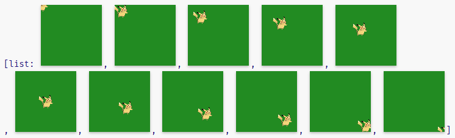
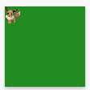

## Estrutura de Programas Recursivos

- Uma forma abstrata de descrever [repetição]{.azul} em processos.
- Ênfase em [quebrar (decompor)]{.vermelho} um problema grande em problemas menores (até que a solução seja trivial) e então montar a solução através da [combinação]{.vermelho} das soluções dos problemas menores [(composição)]{.vermelho}

<br>

- Ideia básica:
  - Se o problema for trivial, resolva-o [(fim);]{.azul}
  - Se o problema for muito complexo:
    - quebre-o [(decompor)]{.azul},
    - solucione os problemas menores [(repetir)]{.azul},
    - combine as soluções [(combinar)]{.azul}

## Recursão Estrutural

- Até agora, sempre que decompomos uma instância de um problema em partes menores do mesmo tipo, usamos a estrutura do dado:

:::: {.columns style="display: flex; align-items: flex-start;"}
::: {.column width="58%"}
[Dado:]{.verde .rotulo-diagrama}

```{=html}
<svg viewBox="34 314 790 376" style="display:block; width:100%; height:auto;" xmlns="http://www.w3.org/2000/svg" role="img" aria-label="Sublistas de link(3, link(1, link(2, empty))) até empty">
<defs><marker id="a24-seta-e3" viewBox="0 0 10 10" refX="9" refY="5" markerWidth="7" markerHeight="7" orient="auto"><path d="M0,0 L10,5 L0,10 z" fill="#4472c4"/></marker></defs>
<ellipse cx="426" cy="502" rx="390" ry="181" fill="none" stroke="#1f2a4d" stroke-width="1.5"/>
<text x="156" y="394" font-size="25" dominant-baseline="central" fill="#212121" font-family="'Source Code Pro', Consolas, monospace">link(<tspan fill="#1976d2">3</tspan><tspan fill="#d32f2f">,</tspan> link(<tspan fill="#1976d2">1</tspan><tspan fill="#d32f2f">,</tspan> link(<tspan fill="#1976d2">2</tspan><tspan fill="#d32f2f">,</tspan> empty)))</text>
<text x="428" y="479" font-size="25" dominant-baseline="central" fill="#212121" font-family="'Source Code Pro', Consolas, monospace">link(<tspan fill="#1976d2">1</tspan><tspan fill="#d32f2f">,</tspan> link(<tspan fill="#1976d2">2</tspan><tspan fill="#d32f2f">,</tspan> empty))</text>
<text x="428" y="554" font-size="25" dominant-baseline="central" fill="#212121" font-family="'Source Code Pro', Consolas, monospace">link(<tspan fill="#1976d2">2</tspan><tspan fill="#d32f2f">,</tspan> empty)</text>
<text x="349" y="627" font-size="25" dominant-baseline="central" fill="#212121" font-family="'Source Code Pro', Consolas, monospace">empty</text>
<text x="63" y="487" font-size="25" dominant-baseline="central" fill="#212121" font-family="'Source Code Pro', Consolas, monospace">link(<tspan fill="#1976d2">3</tspan><tspan fill="#d32f2f">,</tspan> link(<tspan fill="#1976d2">1</tspan><tspan fill="#d32f2f">,</tspan> empty))</text>
<text x="148" y="554" font-size="25" dominant-baseline="central" fill="#212121" font-family="'Source Code Pro', Consolas, monospace">link(<tspan fill="#1976d2">1</tspan><tspan fill="#d32f2f">,</tspan> empty)</text>
<line x1="368" y1="414" x2="520" y2="459" stroke="#4472c4" stroke-width="1.5" marker-end="url(#a24-seta-e3)"/>
<line x1="522" y1="501" x2="522" y2="538" stroke="#4472c4" stroke-width="1.5" marker-end="url(#a24-seta-e3)"/>
<line x1="520" y1="574" x2="382" y2="607" stroke="#4472c4" stroke-width="1.5" marker-end="url(#a24-seta-e3)"/>
<line x1="228" y1="507" x2="228" y2="541" stroke="#4472c4" stroke-width="1.5" marker-end="url(#a24-seta-e3)"/>
<line x1="235" y1="572" x2="382" y2="607" stroke="#4472c4" stroke-width="1.5" marker-end="url(#a24-seta-e3)"/>
</svg>
```
:::
::: {.column width="42%"}
```{=html}
<p class="vermelho rotulo-diagrama fragment" data-fragment-index="1">Programa (execução):</p>
<div class="traco">
<div class="fragment" data-fragment-index="1"><span class="tr-fun">f</span>(link(<span class="tr-num">3</span><span class="tr-sep">,</span> link(<span class="tr-num">1</span><span class="tr-sep">,</span> link(<span class="tr-num">2</span><span class="tr-sep">,</span> empty))))</div>
<div class="fragment" data-fragment-index="2"><div class="seta">↓</div><span class="tr-fun">f</span>(link(<span class="tr-num">1</span><span class="tr-sep">,</span> link(<span class="tr-num">2</span><span class="tr-sep">,</span> empty)))</div>
<div class="fragment" data-fragment-index="3"><div class="seta">↓</div><span class="tr-fun">f</span>(link(<span class="tr-num">2</span><span class="tr-sep">,</span> empty))</div>
<div class="fragment" data-fragment-index="4"><div class="seta">↓</div><span class="tr-fun">f</span>(empty)</div>
</div>
```
:::
::::

## Recursão Estrutural

:::: {.columns style="display: flex; align-items: center;"}
::: {.column width="14%" .center}
[Dado]{.verde}
:::
::: {.column width="86%"}
::: {style="font-size: 1em;"}
```pyret
data List<T>:
    | empty
    | link(
        first :: T,
        rest :: List<T>
    )
end
```
:::
:::
::::

:::: {.columns style="display: flex; align-items: center;"}
::: {.column width="14%" .center}
[Função]{.vermelho}
:::
::: {.column width="86%"}
::: {style="font-size: 1em;"}
```pyret
fun funcao-rec-estrutural(l :: List<T>) -> ... :
    cases (List<T>) l:
        | empty => ...
        | link(f, r) =>
            ...(f) ...
            funcao-rec-estrutural(r)
    end
end
```
:::
:::
::::

## Recursão Estrutural

:::: {.columns style="display: flex; align-items: center;"}
::: {.column width="14%" .center}
[Dado]{.verde}
:::
::: {.column width="86%"}
::: {style="font-size: 1em;"}
```pyret
data AB:
    | vazia
    | nodo(
        id :: Number,
        esq :: AB,
        dir :: AB
    )
end
```
:::
:::
::::

:::: {.columns style="display: flex; align-items: center;"}
::: {.column width="14%" .center}
[Função]{.vermelho}
:::
::: {.column width="86%"}
::: {style="font-size: 1em;"}
```pyret
fun funcao-rec-estrutural(ab :: AB) -> ... :
    cases (AB) ab:
        | vazia => ...
        | nodo(i, e, d) =>
            ...
            funcao-rec-estrutural(e) ...
            funcao-rec-estrutural(d)
    end
end
```
:::
:::
::::

## Recursão Generativa

- Mas há situações nas quais a decomposição em problemas menores não é feita baseada estritamente na estrutura do dado, por exemplo:

:::: {.columns style="display: flex; align-items: flex-start;"}
::: {.column width="58%"}
[Dado:]{.verde .rotulo-diagrama}

```{=html}
<svg viewBox="34 314 790 376" style="display:block; width:100%; height:auto;" xmlns="http://www.w3.org/2000/svg" role="img" aria-label="Sublistas de link(3, link(1, link(2, empty))) até empty">
<defs><marker id="a24-seta-e6" viewBox="0 0 10 10" refX="9" refY="5" markerWidth="7" markerHeight="7" orient="auto"><path d="M0,0 L10,5 L0,10 z" fill="#4472c4"/></marker></defs>
<ellipse cx="426" cy="502" rx="390" ry="181" fill="none" stroke="#1f2a4d" stroke-width="1.5"/>
<text x="156" y="394" font-size="25" dominant-baseline="central" fill="#212121" font-family="'Source Code Pro', Consolas, monospace">link(<tspan fill="#1976d2">3</tspan><tspan fill="#d32f2f">,</tspan> link(<tspan fill="#1976d2">1</tspan><tspan fill="#d32f2f">,</tspan> link(<tspan fill="#1976d2">2</tspan><tspan fill="#d32f2f">,</tspan> empty)))</text>
<text x="428" y="479" font-size="25" dominant-baseline="central" fill="#212121" font-family="'Source Code Pro', Consolas, monospace">link(<tspan fill="#1976d2">1</tspan><tspan fill="#d32f2f">,</tspan> link(<tspan fill="#1976d2">2</tspan><tspan fill="#d32f2f">,</tspan> empty))</text>
<text x="428" y="554" font-size="25" dominant-baseline="central" fill="#212121" font-family="'Source Code Pro', Consolas, monospace">link(<tspan fill="#1976d2">2</tspan><tspan fill="#d32f2f">,</tspan> empty)</text>
<text x="349" y="627" font-size="25" dominant-baseline="central" fill="#212121" font-family="'Source Code Pro', Consolas, monospace">empty</text>
<text x="63" y="487" font-size="25" dominant-baseline="central" fill="#212121" font-family="'Source Code Pro', Consolas, monospace">link(<tspan fill="#1976d2">3</tspan><tspan fill="#d32f2f">,</tspan> link(<tspan fill="#1976d2">1</tspan><tspan fill="#d32f2f">,</tspan> empty))</text>
<text x="148" y="554" font-size="25" dominant-baseline="central" fill="#212121" font-family="'Source Code Pro', Consolas, monospace">link(<tspan fill="#1976d2">1</tspan><tspan fill="#d32f2f">,</tspan> empty)</text>
<line x1="368" y1="414" x2="520" y2="459" stroke="#4472c4" stroke-width="1.5" marker-end="url(#a24-seta-e6)"/>
<line x1="522" y1="501" x2="522" y2="538" stroke="#4472c4" stroke-width="1.5" marker-end="url(#a24-seta-e6)"/>
<line x1="520" y1="574" x2="382" y2="607" stroke="#4472c4" stroke-width="1.5" marker-end="url(#a24-seta-e6)"/>
<line x1="228" y1="507" x2="228" y2="541" stroke="#4472c4" stroke-width="1.5" marker-end="url(#a24-seta-e6)"/>
<line x1="235" y1="572" x2="382" y2="607" stroke="#4472c4" stroke-width="1.5" marker-end="url(#a24-seta-e6)"/>
</svg>
```
:::
::: {.column width="42%"}
```{=html}
<p class="vermelho rotulo-diagrama">Programa (execução):</p>
<div class="traco">
<div><span class="tr-fun">g</span>(link(<span class="tr-num">3</span><span class="tr-sep">,</span> link(<span class="tr-num">1</span><span class="tr-sep">,</span> link(<span class="tr-num">2</span><span class="tr-sep">,</span> empty))))</div>
<div><div class="seta">↓</div><span class="tr-fun">g</span>(link(<span class="tr-num">2</span><span class="tr-sep">,</span> empty))</div>
<div><div class="seta">↓</div><span class="tr-fun">g</span>(empty)</div>
</div>
```
:::
::::

## Recursão Generativa - Modelo da Solução

```{=html}
<div class="modelo">
<div class="m-dado">Dado(s) ...</div>
<div class="m-titulo azul">Trivial: resolver</div>
<div class="m-painel trivial">
<div class="m-linha"><span class="m-se">Se</span><div class="m-caixa amarela" data-rotulo="problema trivial?"></div><span class="m-virgula">,</span><div class="m-caixa amarela" data-rotulo="solução do problema trivial"></div></div>
</div>
<div class="m-titulo vermelho">Difícil: Decompor</div>
<div class="m-painel dificil">
<div class="m-linha"><span class="m-se">Se</span><div class="m-caixa" data-rotulo="problema difícil?"></div><span class="m-virgula">,</span></div>
<div class="m-linha combinar"><div class="m-caixa" data-rotulo="combinar soluções"></div></div>
<div class="m-linha sub"><div class="m-caixa" data-rotulo="solução do problema menor"></div><div class="m-caixa" data-rotulo="gerar problema menor"></div></div>
<div class="m-linha sub"><div class="m-caixa" data-rotulo="solução do problema menor 2"></div><div class="m-caixa" data-rotulo="gerar problema menor"></div></div>
</div>
<div class="m-camada fragment" data-fragment-index="1"><div class="m-nota" style="left:170px; top:2px;">O problema trivial não é necessariamente a forma mais simples (caso base) do dado.</div><svg class="m-setas" xmlns="http://www.w3.org/2000/svg"><defs><marker id="a24-seta-m7" viewBox="0 0 10 10" refX="9" refY="5" markerWidth="8" markerHeight="8" orient="auto"><path d="M0,0 L10,5 L0,10 z" fill="#4472c4"/></marker></defs><line x1="440" y1="34" x2="300" y2="128" stroke="#4472c4" stroke-width="1.5" marker-end="url(#a24-seta-m7)"/></svg></div>
<div class="m-camada fragment" data-fragment-index="2"><div class="m-nota" style="left:480px; top:328px;">Os subproblemas são gerados de forma arbitrária.</div><svg class="m-setas" xmlns="http://www.w3.org/2000/svg"><defs><marker id="a24-seta-m7b" viewBox="0 0 10 10" refX="9" refY="5" markerWidth="8" markerHeight="8" orient="auto"><path d="M0,0 L10,5 L0,10 z" fill="#4472c4"/></marker></defs><line x1="720" y1="358" x2="640" y2="420" stroke="#4472c4" stroke-width="1.5" marker-end="url(#a24-seta-m7b)"/></svg></div>
</div>
```

## Exemplo: Quicksort

::::: {.problema}
[Ordenação]{.problema-titulo}

:::: {.problema-corpo}
::: {.problema-campo}
[Obj:]{.azul} [Dado uma lista de números, ordená-la em ordem crescente.]{.laranja}
:::
::: {.problema-campo .afastado}
[Entrada:]{.verde} Uma lista de números.
:::
::: {.problema-campo}
[Saída:]{.vermelho} A lista de números de entrada ordenada em ordem crescente.
:::
::::
:::::

```{=html}
<div class="caixa-funcao fragment">
<div><span class="verde">l</span> :: List&lt;Number&gt;</div>
<div class="seta">↓</div>
<div class="nome">quicksort</div>
<div class="seta">↓</div>
<div>List&lt;Number&gt;</div>
</div>
```

## Quicksort

```{=html}
<svg viewBox="0 10 1386 1120" style="display:block; margin:0 auto; height:610px; max-width:100%;" xmlns="http://www.w3.org/2000/svg" role="img" aria-label="Árvore de chamadas do quicksort para a lista [list: 11, 8, 14, 7]: divisões em menores e maiores que o pivô e a combinação dos resultados até [list: 7, 8, 11, 14]">
<defs><marker id="qs-seta" viewBox="0 0 10 10" refX="9" refY="5" markerWidth="7" markerHeight="7" orient="auto-start-reverse"><path d="M0,0 L10,5 L0,10 z" fill="#23373b"/></marker><marker id="qs-seta-p" viewBox="0 0 10 10" refX="9" refY="5" markerWidth="7" markerHeight="7" orient="auto-start-reverse"><path d="M0,0 L10,5 L0,10 z" fill="#555555"/></marker></defs>
<rect x="8" y="148" width="737" height="416" fill="none" stroke="#555" stroke-width="1.5"/>
<rect x="20" y="298" width="432" height="254" fill="none" stroke="#555" stroke-width="1.5"/>
<rect x="30" y="452" width="410" height="86" fill="none" stroke="#555" stroke-width="1.5"/>
<rect x="930" y="148" width="448" height="278" fill="none" stroke="#555" stroke-width="1.5"/>
<rect x="943" y="298" width="423" height="114" fill="none" stroke="#555" stroke-width="1.5"/>
<path d="M683,80 C683,122 367,122 367,164" fill="none" stroke="#23373b" stroke-width="2.2" marker-end="url(#qs-seta)"/>
<path d="M683,80 C683,120 845,120 845,160" fill="none" stroke="#23373b" stroke-width="2.2" marker-end="url(#qs-seta)"/>
<path d="M683,80 C683,122 1153,122 1153,164" fill="none" stroke="#23373b" stroke-width="2.2" marker-end="url(#qs-seta)"/>
<path d="M367,228 C367,270 220,270 220,313" fill="none" stroke="#23373b" stroke-width="2.2" marker-end="url(#qs-seta)"/>
<path d="M367,228 C367,268 520,268 520,308" fill="none" stroke="#23373b" stroke-width="2.2" marker-end="url(#qs-seta)"/>
<path d="M367,228 C367,270 683,270 683,313" fill="none" stroke="#23373b" stroke-width="2.2" marker-end="url(#qs-seta)"/>
<path d="M220,377 C220,418 86,418 86,458" fill="none" stroke="#23373b" stroke-width="2.2" marker-end="url(#qs-seta)"/>
<path d="M220,377 C220,415 218,415 218,453" fill="none" stroke="#23373b" stroke-width="2.2" marker-end="url(#qs-seta)"/>
<path d="M220,377 C220,418 383,418 383,458" fill="none" stroke="#23373b" stroke-width="2.2" marker-end="url(#qs-seta)"/>
<path d="M1153,228 C1153,270 1001,270 1001,313" fill="none" stroke="#23373b" stroke-width="2.2" marker-end="url(#qs-seta)"/>
<path d="M1153,228 C1153,269 1153,269 1153,310" fill="none" stroke="#23373b" stroke-width="2.2" marker-end="url(#qs-seta)"/>
<path d="M1153,228 C1153,270 1305,270 1305,313" fill="none" stroke="#23373b" stroke-width="2.2" marker-end="url(#qs-seta)"/>
<path d="M86,522 C86,616 474,616 474,709" fill="none" stroke-dasharray="4 5" stroke="#555555" stroke-width="2.2" marker-end="url(#qs-seta-p)"/>
<path d="M218,529 C218,619 474,619 474,709" fill="none" stroke-dasharray="4 5" stroke="#555555" stroke-width="2.2" marker-end="url(#qs-seta-p)"/>
<path d="M383,522 C383,616 474,616 474,709" fill="none" stroke-dasharray="4 5" stroke="#555555" stroke-width="2.2" marker-end="url(#qs-seta-p)"/>
<path d="M474,773 C474,808 600,808 600,843" fill="none" stroke-dasharray="4 5" stroke="#555555" stroke-width="2.2" marker-end="url(#qs-seta-p)"/>
<path d="M520,384 C520,614 600,614 600,843" fill="none" stroke-dasharray="4 5" stroke="#555555" stroke-width="2.2" marker-end="url(#qs-seta-p)"/>
<path d="M683,377 C683,610 600,610 600,843" fill="none" stroke-dasharray="4 5" stroke="#555555" stroke-width="2.2" marker-end="url(#qs-seta-p)"/>
<path d="M1001,377 C1001,610 884,610 884,843" fill="none" stroke-dasharray="4 5" stroke="#555555" stroke-width="2.2" marker-end="url(#qs-seta-p)"/>
<path d="M1153,386 C1153,614 884,614 884,843" fill="none" stroke-dasharray="4 5" stroke="#555555" stroke-width="2.2" marker-end="url(#qs-seta-p)"/>
<path d="M1305,377 C1305,610 884,610 884,843" fill="none" stroke-dasharray="4 5" stroke="#555555" stroke-width="2.2" marker-end="url(#qs-seta-p)"/>
<path d="M600,907 C600,982 682,982 682,1057" fill="none" stroke-dasharray="4 5" stroke="#555555" stroke-width="2.2" marker-end="url(#qs-seta-p)"/>
<path d="M845,236 C845,646 682,646 682,1057" fill="none" stroke-dasharray="4 5" stroke="#555555" stroke-width="2.2" marker-end="url(#qs-seta-p)"/>
<path d="M884,907 C884,982 682,982 682,1057" fill="none" stroke-dasharray="4 5" stroke="#555555" stroke-width="2.2" marker-end="url(#qs-seta-p)"/>
<rect x="476" y="20" width="414" height="60" fill="#fff" stroke="#23373b" stroke-width="2.5"/>
<text x="683" y="50" font-size="32" text-anchor="middle" dominant-baseline="central" fill="#23373b" font-family="'Source Code Pro', Consolas, monospace">[list: 11, 8, 14, 7]</text>
<circle cx="845" cy="200" r="36" fill="#fff" stroke="#e67e00" stroke-width="2.5"/>
<text x="845" y="200" font-size="36" text-anchor="middle" dominant-baseline="central" fill="#c55a00" font-weight="bold" font-family="'Source Code Pro', Consolas, monospace">11</text>
<rect x="237" y="168" width="260" height="60" fill="#fff" stroke="#23373b" stroke-width="2.5"/>
<text x="367" y="198" font-size="32" text-anchor="middle" dominant-baseline="central" fill="#23373b" font-family="'Source Code Pro', Consolas, monospace">[list: 8, 7]</text>
<rect x="1042" y="168" width="222" height="60" fill="#fff" stroke="#23373b" stroke-width="2.5"/>
<text x="1153" y="198" font-size="32" text-anchor="middle" dominant-baseline="central" fill="#23373b" font-family="'Source Code Pro', Consolas, monospace">[list: 14]</text>
<rect x="119" y="317" width="203" height="60" fill="#fff" stroke="#23373b" stroke-width="2.5"/>
<text x="220" y="347" font-size="32" text-anchor="middle" dominant-baseline="central" fill="#23373b" font-family="'Source Code Pro', Consolas, monospace">[list: 7]</text>
<circle cx="520" cy="348" r="36" fill="#fff" stroke="#e67e00" stroke-width="2.5"/>
<text x="520" y="348" font-size="36" text-anchor="middle" dominant-baseline="central" fill="#c55a00" font-weight="bold" font-family="'Source Code Pro', Consolas, monospace">8</text>
<rect x="620" y="317" width="126" height="60" fill="#fff" stroke="#23373b" stroke-width="2.5"/>
<text x="683" y="347" font-size="32" text-anchor="middle" dominant-baseline="central" fill="#23373b" font-family="'Source Code Pro', Consolas, monospace">empty</text>
<rect x="23" y="462" width="126" height="60" fill="#fff" stroke="#23373b" stroke-width="2.5"/>
<text x="86" y="492" font-size="32" text-anchor="middle" dominant-baseline="central" fill="#23373b" font-family="'Source Code Pro', Consolas, monospace">empty</text>
<circle cx="218" cy="493" r="36" fill="#fff" stroke="#e67e00" stroke-width="2.5"/>
<text x="218" y="493" font-size="36" text-anchor="middle" dominant-baseline="central" fill="#c55a00" font-weight="bold" font-family="'Source Code Pro', Consolas, monospace">7</text>
<rect x="320" y="462" width="126" height="60" fill="#fff" stroke="#23373b" stroke-width="2.5"/>
<text x="383" y="492" font-size="32" text-anchor="middle" dominant-baseline="central" fill="#23373b" font-family="'Source Code Pro', Consolas, monospace">empty</text>
<rect x="938" y="317" width="126" height="60" fill="#fff" stroke="#23373b" stroke-width="2.5"/>
<text x="1001" y="347" font-size="32" text-anchor="middle" dominant-baseline="central" fill="#23373b" font-family="'Source Code Pro', Consolas, monospace">empty</text>
<circle cx="1153" cy="350" r="36" fill="#fff" stroke="#e67e00" stroke-width="2.5"/>
<text x="1153" y="350" font-size="36" text-anchor="middle" dominant-baseline="central" fill="#c55a00" font-weight="bold" font-family="'Source Code Pro', Consolas, monospace">14</text>
<rect x="1242" y="317" width="126" height="60" fill="#fff" stroke="#23373b" stroke-width="2.5"/>
<text x="1305" y="347" font-size="32" text-anchor="middle" dominant-baseline="central" fill="#23373b" font-family="'Source Code Pro', Consolas, monospace">empty</text>
<rect x="373" y="713" width="203" height="60" fill="#fff" stroke="#7030a0" stroke-width="2.5"/>
<text x="474" y="743" font-size="32" text-anchor="middle" dominant-baseline="central" fill="#23373b" font-family="'Source Code Pro', Consolas, monospace">[list: 7]</text>
<rect x="470" y="847" width="260" height="60" fill="#fff" stroke="#7030a0" stroke-width="2.5"/>
<text x="600" y="877" font-size="32" text-anchor="middle" dominant-baseline="central" fill="#23373b" font-family="'Source Code Pro', Consolas, monospace">[list: 7, 8]</text>
<rect x="773" y="847" width="222" height="60" fill="#fff" stroke="#7030a0" stroke-width="2.5"/>
<text x="884" y="877" font-size="32" text-anchor="middle" dominant-baseline="central" fill="#23373b" font-family="'Source Code Pro', Consolas, monospace">[list: 14]</text>
<rect x="475" y="1061" width="414" height="60" fill="#fff" stroke="#7030a0" stroke-width="2.5"/>
<text x="682" y="1091" font-size="32" text-anchor="middle" dominant-baseline="central" fill="#23373b" font-family="'Source Code Pro', Consolas, monospace">[list: 7, 8, 11, 14]</text>
</svg>
```

## Quicksort - Visualização

<br><br><br><br>

::: {.center}
<https://visualgo.net/en/sorting>
:::

## Quicksort

```{=html}
<div class="modelo compacto">
<div class="m-dado">Dado uma lista <span class="verde">l</span> :</div>
<div class="m-titulo azul">Trivial: resolver</div>
<div class="m-painel trivial">
<div class="m-linha"><span class="m-se">Se</span><div class="m-caixa amarela" data-rotulo="problema trivial?"><span class="fragment" data-fragment-index="1"><span class="verde">l</span> é vazia</span></div><span class="m-virgula">,</span><div class="m-caixa amarela" data-rotulo="solução do problema trivial"><span class="fragment" data-fragment-index="2">devolver empty</span></div></div>
</div>
<div class="m-titulo vermelho">Difícil: Decompor</div>
<div class="m-painel dificil">
<div class="m-linha"><span class="m-se">Se</span><div class="m-caixa" data-rotulo="problema difícil?"><span class="fragment" data-fragment-index="3"><span class="verde">l</span> não é vazia</span></div><span class="m-virgula">,</span></div>
<div class="m-linha combinar"><div class="m-caixa" data-rotulo="combinar soluções"><span class="fragment" data-fragment-index="4">juntar as listas:</span></div></div>
<div class="m-linha sub"><div class="m-caixa" data-rotulo="solução do problema menor"><span class="fragment" data-fragment-index="6">ordenar a lista com</span></div><div class="m-caixa" data-rotulo="gerar problema menor"><span class="fragment" data-fragment-index="5">os números menores que o primeiro elemento de <span class="verde">l</span></span></div></div>
<div class="m-linha sub"><div class="m-caixa" data-rotulo="solução do problema menor 2"><span class="fragment" data-fragment-index="6">montar uma lista com</span></div><div class="m-caixa" data-rotulo="gerar problema menor"><span class="fragment" data-fragment-index="5">o primeiro elemento de <span class="verde">l</span></span></div></div>
<div class="m-linha sub"><div class="m-caixa" data-rotulo="solução do problema menor 3"><span class="fragment" data-fragment-index="6">ordenar a lista com</span></div><div class="m-caixa" data-rotulo="gerar problema menor"><span class="fragment" data-fragment-index="5">os números maiores que o primeiro elemento de <span class="verde">l</span></span></div></div>
</div>
</div>
```

## Quicksort v0 - Pyret

::: {style="font-size: 0.88em;"}
```{.pyret code-line-numbers="1-4,6,10-13,15-19|1-6,10-13,15-19|1-13,15-19|1-19"}
fun quicksort(l :: List<Number>) -> List<Number>:
    doc: "Dado uma lista de números, ordena a lista em ordem crescente."
    cases (List<Number>) l:
        # Se a lista l for vazia, retornar a lista vazia.
        | empty => empty
        # Senão,
        | link(f, r) =>
            menores = filter(lam(x): x < f end, l)
            maiores = filter(lam(x): x > f end, l)
            # Juntar as seguintes listas:
                # 1. A lista ordenada dos elementos menores que o primeiro.
                # 2. A lista contendo apenas o primeiro elemento.
                # 3. A lista ordenada dos elementos maiores que o primeiro.
            quicksort(menores) + [list: f] + quicksort(maiores)
    end
where:
    quicksort(empty) is empty
    quicksort([list: 3, 4, 1, 5, 2]) is [list: 1, 2, 3, 4, 5]
end
```
:::

## Exercício

- Modifique a função quicksort para tratar listas com elementos repetidos.

## Quicksort - Pyret

::: {style="font-size: 0.88em;"}
```{.pyret code-line-numbers="1-4,6,10-13,15-19|1-6,10-13,15-19|1-13,15-19|1-19"}
fun quicksort(l :: List<Number>) -> List<Number>:
    doc: "Dado uma lista de números, ordena a lista em ordem crescente."
    cases (List<Number>) l:
        # Se a lista l for vazia, retornar a lista vazia.
        | empty => empty
        # Senão,
        | link(f, r) =>
            menores = filter(lam(x): x < f end, r)
            maiores-igual = filter(lam(x): x >= f end, r)
            # Juntar as seguintes listas:
                # 1. A lista ordenada dos elementos menores que o primeiro.
                # 2. A lista contendo apenas o primeiro elemento.
                # 3. A lista ordenada dos elementos maiores ou iguais ao primeiro.
            quicksort(menores) + [list: f] + quicksort(maiores-igual)
    end
where:
    quicksort(empty) is empty
    quicksort([list: 3, 4, 1, 5, 1, 2]) is [list: 1, 1, 2, 3, 4, 5]
end
```
:::

## Exemplo: Animação

- Vamos desenvolver uma [simples animação]{.azul} para mover um Pokémon em um cenário até que ele saia dos limites do cenário.

<br>

- Objetos a serem representados:
  - Pokémon
  - Cenário

## Pokemon

::: {style="font-size: 0.95em;"}
```pyret
data Pokemon:
    | pokemon(
        id :: String,    # Id do pokemon
        name :: String,  # Nome do pokemon
        x :: Number,     # Coordenada no eixo x
        y :: Number,     # Coordenada no eixo y
        dx :: Number,    # Deslocamento da coordenada x
        dy :: Number,    # Deslocamento da coordenada y
        img :: Image     # Imagem do pokemon
    )
end
```
:::

Exemplos de elementos de [Pokemon]{.roxo}:

::: {style="font-size: 0.78em;"}
```pyret
PIKACHU = pokemon("0025", "Pikachu", 0, 0, 5, 5, flip-horizontal(img-pokemon("0025")))
EEVEE = pokemon("0133", "Eevee", 0, 0, 10, 10, img-pokemon("0133"))
BULBASAUR = pokemon("0001", "Bulbasaur", 0, 0, 2, 1, img-pokemon("0001"))
```
:::

## Cenário

- O cenário será representado através de um retângulo verde, usando as seguintes constantes:

<br>

```pyret
LARG = 500
ALT = 500
CENARIO = rectangle(LARG, ALT, "solid", "forest-green")
```

## Movimento do Pokemon

- Para se fazer um filme, dando a impressão que o Pokemon está em movimento, deve-se gerar várias [cenas.]{.azul} Em cada uma, o Pokemon está em um ponto diferente:

{.nostretch fig-alt="Lista de cenas: o Pikachu aparece em posições diferentes sobre o cenário verde, da esquerda para a direita e de cima para baixo." width=72%}

- E depois mostrar estas imagens (mostrar cada imagem por um período curto de tempo, apagar e mostrar a próxima).

## Move Até Que Fora

::::: {.problema}
[Move Até Que Fora]{.problema-titulo}

:::: {.problema-corpo}
::: {.problema-campo}
[Obj:]{.azul} [Dado um Pokemon, movimenta-o até que ele saia dos limites do cenário, definido pelas constantes LARG e ALT.]{.laranja}
:::
::: {.problema-campo}
[Entrada:]{.verde} Um Pokemon.
:::
::: {.problema-campo}
[Saída:]{.vermelho} Uma lista de cenas.
:::
::::
:::::

<br>

:::: {.columns}
::: {.column width="20%"}
:::
::: {.column width="60%"}
::: {style="font-size: 0.85em;"}
```pyret
type ListaDeCenas = List<Image>
# ListaDeCenas é:
# | empty
# | link(first :: Image, rest :: List<Image>)
# end
```
:::
:::
::::

## move-ate-que-fora

::: {style="font-size: 0.85em;"}
```{.pyret .code-overflow-wrap}
fun move-ate-que-fora(p :: Pokemon) -> ListaDeCenas:
    doc: "Dado um pokemon, gera uma lista de cenas do pokemon se movendo a partir da posição (p.x, p.y) até que o pokemon esteja fora dos limites do cenário."
```
:::

::: {style="font-size: 0.68em;"}
```pyret
# Exemplo:
move-ate-que-fora(pokemon("0025", "Pikachu", 0, 0, 50, 50, flip-horizontal(img-pokemon("0025"))))
```
:::

{.nostretch fig-alt="Resultado: lista com 11 cenas do Pikachu se deslocando na diagonal até sair do cenário." width=68%}

## move-ate-que-fora

```{=html}
<div class="modelo">
<div class="m-dado">Dado um Pokemon <span class="verde">p</span> :</div>
<div class="m-titulo azul">Trivial: resolver</div>
<div class="m-painel trivial">
<div class="m-linha"><span class="m-se">Se</span><div class="m-caixa amarela" data-rotulo="problema trivial?"><span class="fragment" data-fragment-index="1"><span class="verde">p</span> está fora dos limites</span></div><span class="m-virgula">,</span><div class="m-caixa amarela" data-rotulo="solução do problema trivial"><span class="fragment" data-fragment-index="2">devolver empty<br>(lista de cenas vazia)</span></div></div>
</div>
<div class="m-titulo vermelho">Difícil: Decompor</div>
<div class="m-painel dificil">
<div class="m-linha"><span class="m-se">Se</span><div class="m-caixa" data-rotulo="problema difícil?"><span class="fragment" data-fragment-index="3"><span class="verde">p</span> está dentro dos limites</span></div><span class="m-virgula">,</span></div>
<div class="m-linha combinar"><div class="m-caixa" data-rotulo="combinar soluções"><span class="fragment" data-fragment-index="4">montar uma lista de cenas com:</span></div></div>
<div class="m-linha sub"><div class="m-caixa" data-rotulo="solução do problema menor"><span class="fragment" data-fragment-index="5">uma cena com</span></div><div class="m-caixa" data-rotulo="gerar problema menor"><span class="fragment" data-fragment-index="6">o pokémon <span class="verde">p</span></span></div></div>
<div class="m-linha sub"><div class="m-caixa" data-rotulo="solução do problema menor 2"><span class="fragment" data-fragment-index="7">as cenas geradas pela movimentação do</span></div><div class="m-caixa" data-rotulo="gerar problema menor"><span class="fragment" data-fragment-index="8">Pokemon <span class="verde">p</span> deslocado</span></div></div>
</div>
<div class="m-camada fragment" data-fragment-index="9"><div class="m-assinatura" style="left:380px; top:36px;">fora-dos-limites :: Pokemon -&gt; Boolean</div><div class="m-assinatura" style="left:472px; top:324px;">link</div><div class="m-assinatura" style="left:-104px; top:406px;">desenha-cena :: Pokemon -&gt; Image</div><div class="m-assinatura" style="left:-70px; top:552px;">move-ate-que-fora :: Pokemon -&gt; ListaDeCenas</div><div class="m-assinatura" style="left:476px; top:552px;">move-pokemon :: Pokemon -&gt; Pokemon</div></div>
</div>
```

## move-ate-que-fora

::: {style="font-size: 0.82em;"}
```{.pyret .code-overflow-wrap code-line-numbers="1,2,4,6,8,10,12,16|1-16"}
fun move-ate-que-fora(p :: Pokemon) -> ListaDeCenas:
    doc: "Dado um pokemon, gera uma lista de cenas do pokemon se movendo a partir da posição (p.x, p.y) até que o pokemon esteja fora dos limites do cenário."
    ask:
        # Se o pokemon estiver fora dos limites do cenário, retornar a lista vazia.
        | fora-dos-limites(p) then: empty
        # Senão,
        | otherwise:
            # Montar uma lista com as seguintes cenas
            link(
                # o primeiro elemento é a cena com o pokemon
                desenha-cena(p),
                # as cenas geradas pela movimentação do pokemon deslocado
                move-ate-que-fora(move-pokemon(p))
            )
    end
end
```
:::

## desenha-cena

::: {style="font-size: 0.85em;"}
```{.pyret .code-overflow-wrap}
fun desenha-cena(p :: Pokemon) -> Image:
    doc: "Dado um pokemon, devolve uma imagem do pokemon desenhada na posição (p.x, p.y) sobre o cenário."
    place-image(p.img, p.x, p.y, CENARIO)
end
```
:::

<br>

::: {style="font-size: 0.75em;"}
```pyret
desenha-cena(pokemon("0133", "Eevee", 50, 50, 10, 10, img-pokemon("0133")))
```
:::

{.nostretch fig-alt="Cena resultante: o Eevee desenhado na posição (50, 50) sobre o cenário verde." width=150px fig-align="left"}

## fora-dos-limites

<br>

::: {style="font-size: 0.75em;"}
```pyret
fun fora-dos-limites(p :: Pokemon) -> Boolean:
    doc: "Dado um pokemon, verifica se o pokemon está fora dos limites do cenário."
    not(
        (p.x >= 0) and (p.x <= LARG) and (p.y >= 0) and (p.y <= ALT)
    )
where:
    fora-dos-limites(pokemon("0133", "Eevee", 0, 0, 10, 10, img-pokemon("0133"))) is false
    fora-dos-limites(pokemon("0133", "Eevee", -10, -10, 10, 10, img-pokemon("0133"))) is true
end
```
:::

## move-pokemon

::: {style="font-size: 0.82em;"}
```{.pyret .code-overflow-wrap}
fun move-pokemon(p :: Pokemon) -> Pokemon:
    doc: "Dado um pokemon, devolve um novo pokemon com a posição atualizada de acordo com as variações dx e dy."
    pokemon(
        p.id,
        p.name,
        p.x + p.dx,
        p.y + p.dy,
        p.dx,
        p.dy,
        p.img
    )
where:
    move-pokemon(pokemon("0133", "Eevee", 0, 0, 10, 10, img-pokemon("0133"))) is
        pokemon("0133", "Eevee", 10, 10, 10, 10, img-pokemon("0133"))
end
```
:::

## run-movie

- Para gerar animações, o Pyret utiliza o conceito de [**reactors**]{.azul}
- Para saber mais:
  - <https://dcic-world.org/2025-08-27/games-reactive.html>
  - [https://pyret.org/docs/horizon/reactors.html](https://pyret.org/docs/horizon/reactors.html#%28part._.Configuring_and_.Running_a_.Reactor%29)
- Na aula de hoje, vamos considerar a existência da seguinte função:

::: {style="font-size: 0.75em;"}
```{.pyret .code-overflow-wrap}
fun run-movie(fps :: Number, frames :: ListaDeCenas):
    doc: "Dado um valor de quadros por segundo e uma lista de cenas, exibe as imagens como um filme, mostrando cada imagem por 1/fps segundos."
    ...
end
```
:::

::: {.pyret-live data-height="520" style="font-size: 0.7em;"}
::: {style="display: none;"}
```pyret
use context dcic2024

include reactors
import image as I

# Definições dos slides anteriores (necessárias para executar o filme)

fun img-pokemon(pokemon-id :: String) -> Image:
    doc: "Dado o id de um pokemon (como uma string de quatro dígitos), devolve a imagem deste pokemon."
    url = "https://raw.githubusercontent.com/HybridShivam/Pokemon/master/assets/thumbnails-compressed/" + pokemon-id + ".png"
    scale(0.75, image-url(url))
end

data Pokemon:
    | pokemon(
        id :: String,    # Id do pokemon
        name :: String,  # Nome do pokemon
        x :: Number,     # Coordenada no eixo x
        y :: Number,     # Coordenada no eixo y
        dx :: Number,    # Deslocamento da coordenada x
        dy :: Number,    # Deslocamento da coordenada y
        img :: Image     # Imagem do pokemon
    )
end

PIKACHU = pokemon("0025", "Pikachu", 0, 0, 5, 5, flip-horizontal(img-pokemon("0025")))
EEVEE = pokemon("0133", "Eevee", 0, 0, 10, 10, img-pokemon("0133"))
BULBASAUR = pokemon("0001", "Bulbasaur", 0, 0, 2, 1, img-pokemon("0001"))

LARG = 500
ALT = 500
CENARIO = rectangle(LARG, ALT, "solid", "forest-green")

type ListaDeCenas = List<Image>

fun move-ate-que-fora(p :: Pokemon) -> ListaDeCenas:
    doc: "Dado um pokemon, gera uma lista de cenas do pokemon se movendo a partir da posição (p.x, p.y) até que o pokemon esteja fora dos limites do cenário."
    ask:
        | fora-dos-limites(p) then: empty
        | otherwise:
            link(
                desenha-cena(p),
                move-ate-que-fora(move-pokemon(p))
            )
    end
end

fun desenha-cena(p :: Pokemon) -> Image:
    doc: "Dado um pokemon, devolve uma imagem do pokemon desenhada na posição (p.x, p.y) sobre o cenário."
    place-image(p.img, p.x, p.y, CENARIO)
end

fun fora-dos-limites(p :: Pokemon) -> Boolean:
    doc: "Dado um pokemon, verifica se o pokemon está fora dos limites do cenário."
    not(
        (p.x >= 0) and (p.x <= LARG) and (p.y >= 0) and (p.y <= ALT)
    )
end

fun move-pokemon(p :: Pokemon) -> Pokemon:
    doc: "Dado um pokemon, devolve um novo pokemon com a posição atualizada de acordo com as variações dx e dy."
    pokemon(p.id, p.name, p.x + p.dx, p.y + p.dy, p.dx, p.dy, p.img)
end

fun run-movie(fps :: Number, frames :: ListaDeCenas):
    doc: "Dado um valor de quadros por segundo e uma lista de cenas, exibe as imagens como um filme, mostrando cada imagem por 1/fps segundos."
    LEN = length(frames)
    r = reactor:
            init: 0,
            on-tick: lam(i): i + 1 end,
            to-draw: lam(i): frames.get(i) end,
            seconds-per-tick: 1 / fps,
            stop-when: lam(i): i >= (LEN - 1) end,
            close-when-stop: true,
    end

    interact(r)
end
```
:::

```pyret
run-movie(10, move-ate-que-fora(PIKACHU))
run-movie(10, move-ate-que-fora(EEVEE))
```
:::

## Exercício

- Construa um programa que, dados 2 pokemon, anima a imagem dos pokemon sobre o cenário, até que os dois estejam fora dos limites.

## Terminação

- [P.]{.azul} Quando o programa termina?

<br>

::: {.fragment style="padding: 0.7em 1em; color: #0070c0; background: #dae3f3; text-align: center;"}
Dado um programa, como saber se ele vai terminar a sua execução?
:::

## Recursão Generativa - Modelo da Solução

```{=html}
<div class="modelo">
<div class="m-dado">Dado(s) ...</div>
<div class="m-titulo azul">Trivial: resolver</div>
<div class="m-painel trivial">
<div class="m-linha"><span class="m-se">Se</span><div class="m-caixa amarela" data-rotulo="problema trivial?"></div><span class="m-virgula">,</span><div class="m-caixa amarela" data-rotulo="solução do problema trivial"></div></div>
</div>
<div class="m-titulo vermelho">Difícil: Decompor</div>
<div class="m-painel dificil">
<div class="m-linha"><span class="m-se">Se</span><div class="m-caixa" data-rotulo="problema difícil?"></div><span class="m-virgula">,</span></div>
<div class="m-linha combinar"><div class="m-caixa" data-rotulo="combinar soluções"></div></div>
<div class="m-linha sub"><div class="m-caixa" data-rotulo="solução do problema menor"></div><div class="m-caixa" data-rotulo="gerar problema menor"></div></div>
<div class="m-linha sub"><div class="m-caixa" data-rotulo="solução do problema menor 2"></div><div class="m-caixa" data-rotulo="gerar problema menor"></div></div>
</div>
<div class="m-camada"><div class="m-nota" style="left:334px; top:56px;">Termina?</div><div class="m-nota" style="left:614px; top:56px;">Termina?</div><div class="m-nota" style="left:334px; top:184px;">Termina?</div><div class="m-nota" style="left:378px; top:266px;">Termina?</div><div class="m-nota" style="left:420px; top:348px;">Termina?</div><div class="m-nota" style="left:676px; top:348px;">Termina?</div><div class="m-nota" style="left:420px; top:430px;">Termina?</div><div class="m-nota" style="left:676px; top:430px;">Termina?</div><svg class="m-setas" xmlns="http://www.w3.org/2000/svg"><defs><marker id="a24-seta-m30" viewBox="0 0 10 10" refX="9" refY="5" markerWidth="8" markerHeight="8" orient="auto"><path d="M0,0 L10,5 L0,10 z" fill="#4472c4"/></marker></defs><line x1="352" y1="86" x2="298" y2="134" stroke="#4472c4" stroke-width="1.5" marker-end="url(#a24-seta-m30)"/><line x1="632" y1="86" x2="578" y2="134" stroke="#4472c4" stroke-width="1.5" marker-end="url(#a24-seta-m30)"/><line x1="352" y1="214" x2="298" y2="262" stroke="#4472c4" stroke-width="1.5" marker-end="url(#a24-seta-m30)"/><line x1="396" y1="296" x2="342" y2="344" stroke="#4472c4" stroke-width="1.5" marker-end="url(#a24-seta-m30)"/><line x1="438" y1="378" x2="384" y2="426" stroke="#4472c4" stroke-width="1.5" marker-end="url(#a24-seta-m30)"/><line x1="694" y1="378" x2="640" y2="426" stroke="#4472c4" stroke-width="1.5" marker-end="url(#a24-seta-m30)"/><line x1="438" y1="460" x2="384" y2="508" stroke="#4472c4" stroke-width="1.5" marker-end="url(#a24-seta-m30)"/><line x1="694" y1="460" x2="640" y2="508" stroke="#4472c4" stroke-width="1.5" marker-end="url(#a24-seta-m30)"/></svg></div>
</div>
```

## Terminação

- Se o programa [não envolver repetição]{.azul} (*em nenhuma função*), é fácil saber se ele termina ou não.

<br>

- Se envolver [repetição]{.azul} (no caso de Pyret, [recursão]{.azul}), precisamos pensar sobre o assunto ...

## Terminação de Função Recursiva

:::: {.columns}
::: {.column width="22%"}
:::
::: {.column width="56%"}
```pyret
fun f(b):
    ask:
        | fim(b) then: empty
        | otherwise:
            combina(
                f(gera-prob1(b)),
                f(gera-prob2(b))
            )
    end
end
```
:::
::::

<br>

- Como garantir que o [caso trivial]{.azul} será alcançado?

<br>

- [Precisa-se garantir que, a cada chamada recursiva, o [argumento]{.verde} está [mais próximo do caso trivial]{.vermelho} ...]{.fragment}

## Quicksort

::: {.pyret-live data-height="560" style="font-size: 0.85em;"}
```pyret
fun quicksort(l :: List<Number>) -> List<Number>:
    doc: ```Dado uma lista de números, ordena a lista em ordem crescente.```
    cases (List<Number>) l:
        # Se a lista l for vazia, retornar a lista vazia.
        | empty => empty
        # Senão,
        | link(f, r) =>
            menores = filter(lam(x): x < f end, r)
            maiores-igual = filter(lam(x): x >= f end, r)
            # Juntar as seguintes listas:
                # 1. A lista ordenada dos elementos menores que o primeiro.
                # 2. A lista contendo apenas o primeiro elemento.
                # 3. A lista ordenada dos elementos maiores ou iguais ao primeiro.
            quicksort(menores) + [list: f] + quicksort(maiores-igual)
    end
where:
    quicksort(empty) is empty
    quicksort([list: 3, 4, 1, 5, 1, 2]) is [list: 1, 1, 2, 3, 4, 5]
end
```
:::

## Quicksort

::: {.pyret-live data-height="560" style="font-size: 0.74em;"}
```pyret
fun quicksort(l :: List<Number>) -> List<Number>:
    doc: ```Dado uma lista de números, ordena a lista em ordem crescente.

    Terminação: As definições locais menores e maiores-igual sempre são listas
    com tamanhos menores que o da lista original (porque pelo menos o primeiro
    elemento da lista é retirado). Portanto, cada chamada recursiva de quicksort
    é realizada sobre uma lista estritamente menor que a lista original. Como a
    lista original é finita, este processo gerará um dia uma chamada sobre a
    lista vazia, que é o caso trivial deste programa (não envolve recursão).
    Assim, assumindo que as funções/expressões "+", "filter", "cases", e "link"
    terminam, qualquer chamada de quicksort sempre terminará.
    ```
    cases (List<Number>) l:
        | empty => empty
        | link(f, r) =>
            menores = filter(lam(x): x < f end, r)
            maiores-igual = filter(lam(x): x >= f end, r)
            quicksort(menores) + [list: f] + quicksort(maiores-igual)
    end
where:
    quicksort(empty) is empty
    quicksort([list: 3, 4, 1, 5, 1, 2]) is [list: 1, 1, 2, 3, 4, 5]
end
```
:::

## Terminação

É necessário demonstrar que a função:

<br>

- 1\) Tem um caso base;

<br>

- 2\) A função se aproxima do caso base;

<br>

- 3\) Todas as funções auxiliares também terminam;

## move-ate-que-fora

::: {style="font-size: 0.82em;"}
```{.pyret .code-overflow-wrap}
fun move-ate-que-fora(p :: Pokemon) -> ListaDeCenas:
    doc: "Dado um pokemon, gera uma lista de cenas do pokemon se movendo a partir da posição (p.x, p.y) até que o pokemon esteja fora dos limites do cenário."
    ask:
        # Se o pokemon estiver fora dos limites do cenário, retornar a lista vazia.
        | fora-dos-limites(p) then: empty
        # Senão,
        | otherwise:
            # Montar uma lista com as seguintes cenas
            link(
                # o primeiro elemento é a cena com o pokemon
                desenha-cena(p),
                # as cenas geradas pela movimentação do pokemon deslocado
                move-ate-que-fora(move-pokemon(p))
            )
    end
end
```
:::

## fora-dos-limites

<br>

::: {style="font-size: 0.75em;"}
```pyret
fun fora-dos-limites(p :: Pokemon) -> Boolean:
    doc: "Dado um pokemon, verifica se o pokemon está fora dos limites do cenário."
    not(
        (p.x >= 0) and (p.x <= LARG) and (p.y >= 0) and (p.y <= ALT)
    )
where:
    fora-dos-limites(pokemon("0133", "Eevee", 0, 0, 10, 10, img-pokemon("0133"))) is false
    fora-dos-limites(pokemon("0133", "Eevee", -10, -10, 10, 10, img-pokemon("0133"))) is true
end
```
:::

## move-pokemon

::: {style="font-size: 0.82em;"}
```{.pyret .code-overflow-wrap}
fun move-pokemon(p :: Pokemon) -> Pokemon:
    doc: "Dado um pokemon, devolve um novo pokemon com a posição atualizada de acordo com as variações dx e dy."
    pokemon(
        p.id,
        p.name,
        p.x + p.dx,
        p.y + p.dy,
        p.dx,
        p.dy,
        p.img
    )
where:
    move-pokemon(pokemon("0133", "Eevee", 0, 0, 10, 10, img-pokemon("0133"))) is
        pokemon("0133", "Eevee", 10, 10, 10, 10, img-pokemon("0133"))
end
```
:::

## move-ate-que-fora

::: {style="font-size: 0.8em;"}
```pyret
fun move-ate-que-fora(p :: Pokemon) -> ListaDeCenas:
    doc: ```Dado um pokemon, gera uma lista de cenas do pokemon se movendo a partir da
    posição (p.x, p.y) até que o pokemon esteja fora dos limites do cenário.

    Terminação: Supondo deslocamento não nulo (dx ou dy diferente de 0), a função
    move-pokemon sempre retorna um pokemon com posição mais próxima dos limites do
    cenário que o pokemon original (considerando o vetor de deslocamento). Portanto,
    cada chamada recursiva de move-ate-que-fora é realizada sobre um pokemon mais
    próximo dos limites. Como o cenário tem tamanho finito, este processo gerará
    um dia uma chamada sobre um pokemon que está fora dos limites do cenário, que é
    o caso trivial deste programa (não envolve recursão). Assim, assumindo que as
    funções fora-dos-limites, link, desenha-cena e move-pokemon terminam, qualquer
    chamada de move-ate-que-fora sempre terminará.```
    ask:
        | fora-dos-limites(p) then: empty
        | otherwise:
            link(
                desenha-cena(p),
                move-ate-que-fora(move-pokemon(p))
            )
    end
end
```
:::

::: {.fragment style="font-size: 0.8em;"}
[**Obs.:**]{.label-rmk} E se `dx = dy = 0`? O pokemon nunca sai do lugar e a função [nunca termina]{.vermelho}!
:::

## Exercícios

- Resolva o exercício sobre Máximo Divisor Comum (MDC):

<br>

- <https://lucasalegre.github.io/pensamento-computacional/exercises/Recurs%C3%A3o%20Generativa-3>

#

::: {style="text-align: center; margin-top: 15vh;"}
[?]{style="font-size: 5em; color: #d10000; font-weight: 700;"}
:::
