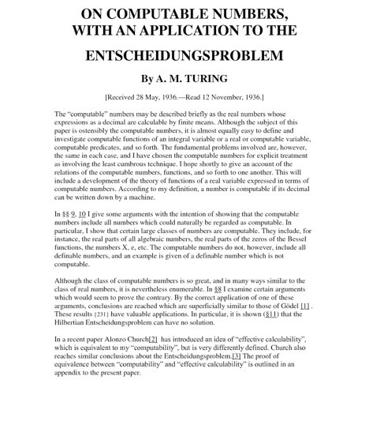
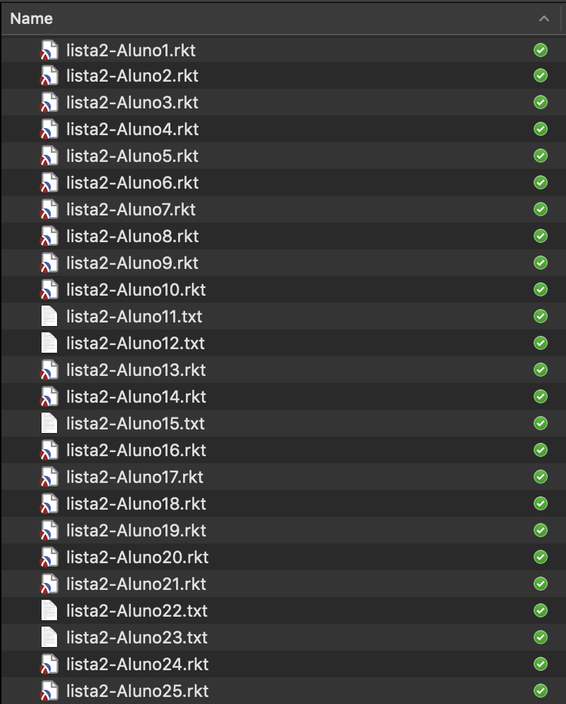
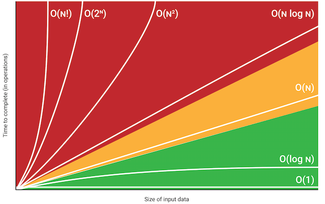
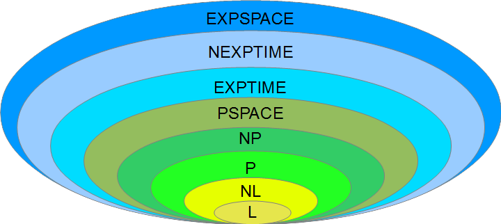
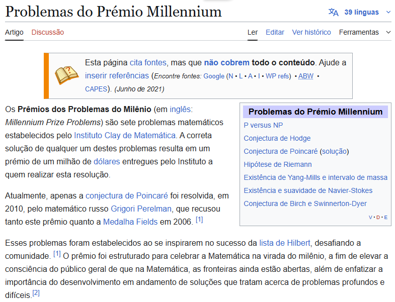
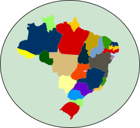
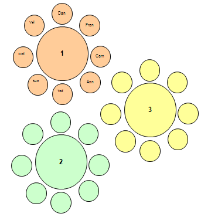
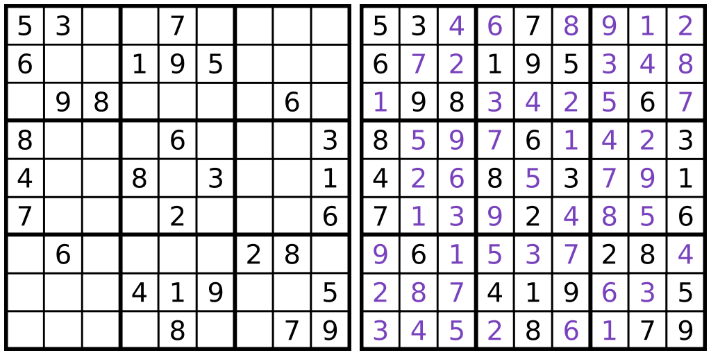
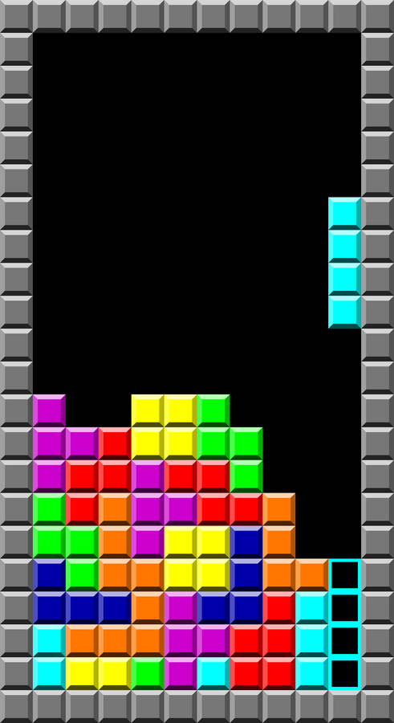
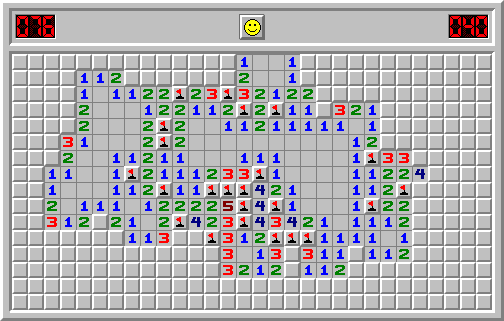

## Limites da Computação

```{=html}
<svg viewBox="90 112 1090 600" style="display:block; margin:0 auto; width:960px; max-width:100%; height:auto;" xmlns="http://www.w3.org/2000/svg" role="img" aria-label="Universo de problemas contendo os problemas computáveis, que contêm os problemas tratáveis">
<defs><marker id="a26s1-seta" viewBox="0 0 10 10" refX="9" refY="5" markerWidth="6" markerHeight="6" orient="auto-start-reverse"><path d="M0,0 L10,5 L0,10 z" fill="#555555"/></marker><marker id="a26s1-seta-preta" viewBox="0 0 10 10" refX="9" refY="5" markerWidth="6" markerHeight="6" orient="auto-start-reverse"><path d="M0,0 L10,5 L0,10 z" fill="#000000"/></marker><marker id="a26s1-seta-ciano" viewBox="0 0 10 10" refX="9" refY="5" markerWidth="6" markerHeight="6" orient="auto-start-reverse"><path d="M0,0 L10,5 L0,10 z" fill="#00a2ff"/></marker></defs>
<ellipse cx="921.0" cy="415.0" rx="243.0" ry="291.0" fill="#ffffff" stroke="#23373b" stroke-width="1.5"/>
<ellipse cx="935.0" cy="470.0" rx="147.0" ry="206.0" fill="#bdd7ee" stroke="#23373b" stroke-width="1"/>
<ellipse cx="935.0" cy="525.0" rx="113.0" ry="133.0" fill="#c5e0b4" stroke="#23373b" stroke-width="1"/>
<text x="927.0" y="172.0" font-size="27" text-anchor="middle" dominant-baseline="central" fill="#23373b" font-family="Lexend, 'Gill Sans Nova', 'Gill Sans', Arial, sans-serif" font-weight="normal">Universo de</text>
<text x="927.0" y="202.0" font-size="27" text-anchor="middle" dominant-baseline="central" fill="#23373b" font-family="Lexend, 'Gill Sans Nova', 'Gill Sans', Arial, sans-serif" font-weight="normal">Problemas</text>
<text x="935.0" y="308.0" font-size="27" text-anchor="middle" dominant-baseline="central" fill="#23373b" font-family="Lexend, 'Gill Sans Nova', 'Gill Sans', Arial, sans-serif" font-weight="normal">Problemas</text>
<text x="935.0" y="338.0" font-size="27" text-anchor="middle" dominant-baseline="central" fill="#23373b" font-family="Lexend, 'Gill Sans Nova', 'Gill Sans', Arial, sans-serif" font-weight="normal">Computáveis</text>
<text x="940.0" y="448.0" font-size="27" text-anchor="middle" dominant-baseline="central" fill="#23373b" font-family="Lexend, 'Gill Sans Nova', 'Gill Sans', Arial, sans-serif" font-weight="normal">Problemas</text>
<text x="940.0" y="478.0" font-size="27" text-anchor="middle" dominant-baseline="central" fill="#23373b" font-family="Lexend, 'Gill Sans Nova', 'Gill Sans', Arial, sans-serif" font-weight="normal">Tratáveis</text>
<text x="330.0" y="225.0" font-size="30" text-anchor="middle" dominant-baseline="central" fill="#0070c0" font-family="Lexend, 'Gill Sans Nova', 'Gill Sans', Arial, sans-serif" font-weight="normal">Quais problemas têm</text>
<text x="330.0" y="263.0" font-size="30" text-anchor="middle" dominant-baseline="central" fill="#0070c0" font-family="Lexend, 'Gill Sans Nova', 'Gill Sans', Arial, sans-serif" font-weight="normal">solução computacional?</text>
<text x="330.0" y="330.0" font-size="32" text-anchor="middle" dominant-baseline="central" fill="#0070c0" font-family="Lexend, 'Gill Sans Nova', 'Gill Sans', Arial, sans-serif" font-weight="bold">Computabilidade</text>
<text x="330.0" y="465.0" font-size="30" text-anchor="middle" dominant-baseline="central" fill="#00b050" font-family="Lexend, 'Gill Sans Nova', 'Gill Sans', Arial, sans-serif" font-weight="normal">Quais problemas têm</text>
<text x="330.0" y="503.0" font-size="30" text-anchor="middle" dominant-baseline="central" fill="#00b050" font-family="Lexend, 'Gill Sans Nova', 'Gill Sans', Arial, sans-serif" font-weight="normal">solução computacional</text>
<text x="330.0" y="541.0" font-size="30" text-anchor="middle" dominant-baseline="central" fill="#00b050" font-family="Lexend, 'Gill Sans Nova', 'Gill Sans', Arial, sans-serif" font-weight="normal">eficiente?</text>
<text x="330.0" y="606.0" font-size="32" text-anchor="middle" dominant-baseline="central" fill="#00b050" font-family="Lexend, 'Gill Sans Nova', 'Gill Sans', Arial, sans-serif" font-weight="bold">Complexidade</text>
<line x1="520.0" y1="268.0" x2="822.0" y2="383.0" stroke="#555555" stroke-width="2" marker-end="url(#a26s1-seta)"/>
<line x1="520.0" y1="505.0" x2="863.0" y2="536.0" stroke="#555555" stroke-width="2" marker-end="url(#a26s1-seta)"/>
</svg>
```

## Problema

[Definição.]{.azul} Um [problema]{.azul} é definido por uma [entrada]{.azul}, que descreve os recursos e informações que podem ser usados na solução do problema, uma [saída]{.azul}, que descreve a solução esperada do problema, e uma [descrição precisa e objetiva do problema]{.azul} em si, que usualmente é formulada em forma interrogativa (pergunta).

<br>

:::: {.problema style="font-size: 0.85em; margin: 1.2em 1.5em 0;"}
::: {.nome}
Nome do Problema
:::

[Enunciado/pergunta do problema, evidenciando a relação entre a saída e a entrada.]{.laranja}

[Entrada:]{.verde} Recursos/informações para solucionar o problema.

[Saída:]{.vermelho} Descrição da solução esperada.
::::

# Computabilidade

::: {.caixa style="width: 80%; margin-top: 1.5em;"}
Quais problemas conseguimos resolver com modelos computacionais?
:::

## Computabilidade de Funções

- O fato de uma função existir não implica que nós consigamos definir a **lei de formação** desta função. Para algumas funções isso é possível, como:

:::: {.columns style="font-family: Arial, sans-serif; font-style: italic; font-size: 1.15em; margin: 0.8em 0;"}
::: {.column width="50%" .center}
[sqr]{.vermelho .b} = {([n]{.verde},[r]{.vermelho .b}) | [r]{.vermelho .b} = [n]{.verde} × [n]{.verde}}
:::
::: {.column width="50%" .center}
[g]{.vermelho .b} = {([n]{.verde},[r]{.vermelho .b}) | [r]{.vermelho .b} = [n]{.verde} + 5}
:::
::::

Mas qual seria a lei de formação desta função:

::: {.center style="font-family: Arial, sans-serif; font-style: italic; font-size: 1.15em; margin-top: 0.8em;"}
[l]{.vermelho .b} = {(0,[51]{.vermelho .b}), (1,[⊠]{.vermelho .b}), (2,[😀]{.vermelho .b}), (3,[➡]{.vermelho .b}), (4,[✶]{.vermelho .b}), (5,[2]{.vermelho .b}), (6,[♤]{.vermelho .b}), (7,[L]{.vermelho .b}), …}
:::

## Computabilidade de Funções

Mesmo entre as funções $\mathbb{N} \to \mathbb{N}$, no universo de todas as funções possíveis de se construir, [existem funções que não têm lei de formação]{.vermelho}.

:::: {.columns style="display: flex; align-items: center; margin-top: 1em;"}
::: {.column width="50%"}
```{=html}
<svg viewBox="115 288 510 380" style="display:block; margin:0 auto; width:440px; max-width:100%; height:auto;" xmlns="http://www.w3.org/2000/svg" role="img" aria-label="Conjunto de funções com lei de formação: sqr, g, f, encontra-na-arvore, atualiza-carro, tamanho, ...">
<defs><marker id="a26s2-seta" viewBox="0 0 10 10" refX="9" refY="5" markerWidth="6" markerHeight="6" orient="auto-start-reverse"><path d="M0,0 L10,5 L0,10 z" fill="#555555"/></marker><marker id="a26s2-seta-preta" viewBox="0 0 10 10" refX="9" refY="5" markerWidth="6" markerHeight="6" orient="auto-start-reverse"><path d="M0,0 L10,5 L0,10 z" fill="#000000"/></marker><marker id="a26s2-seta-ciano" viewBox="0 0 10 10" refX="9" refY="5" markerWidth="6" markerHeight="6" orient="auto-start-reverse"><path d="M0,0 L10,5 L0,10 z" fill="#00a2ff"/></marker></defs>
<ellipse cx="369.6" cy="477.2" rx="246.5" ry="180.6" fill="#ffffff" stroke="#555555" stroke-width="1.2"/>
<text x="293.0" y="359.0" font-size="24" text-anchor="start" dominant-baseline="central" fill="#212121" font-family="'Source Code Pro', Consolas, monospace" font-weight="normal">sqr</text>
<text x="405.0" y="372.0" font-size="24" text-anchor="start" dominant-baseline="central" fill="#212121" font-family="'Source Code Pro', Consolas, monospace" font-weight="normal">g</text>
<text x="225.0" y="424.0" font-size="24" text-anchor="start" dominant-baseline="central" fill="#212121" font-family="'Source Code Pro', Consolas, monospace" font-weight="normal">f</text>
<text x="328.0" y="434.0" font-size="24" text-anchor="start" dominant-baseline="central" fill="#212121" font-family="'Source Code Pro', Consolas, monospace" font-weight="normal">encontra-na-arvore</text>
<text x="383.0" y="510.0" font-size="24" text-anchor="start" dominant-baseline="central" fill="#212121" font-family="'Source Code Pro', Consolas, monospace" font-weight="normal">atualiza-carro</text>
<text x="210.0" y="532.0" font-size="24" text-anchor="start" dominant-baseline="central" fill="#212121" font-family="'Source Code Pro', Consolas, monospace" font-weight="normal">tamanho</text>
<text x="362.0" y="603.0" font-size="24" text-anchor="start" dominant-baseline="central" fill="#212121" font-family="'Source Code Pro', Consolas, monospace" font-weight="normal">...</text>
</svg>
```
:::
::: {.column width="48%"}
::: {.caixa style="font-size: 1.15em; padding: 1.2em 0.8em;"}
Funções com lei de formação são **funções computáveis**!
:::
:::
::::

## Limites da Computação

```{=html}
<svg viewBox="30 112 1150 600" style="display:block; margin:0 auto; width:960px; max-width:100%; height:auto;" xmlns="http://www.w3.org/2000/svg" role="img" aria-label="Os problemas com solução computacional são os computáveis">
<defs><marker id="a26s3-seta" viewBox="0 0 10 10" refX="9" refY="5" markerWidth="6" markerHeight="6" orient="auto-start-reverse"><path d="M0,0 L10,5 L0,10 z" fill="#555555"/></marker><marker id="a26s3-seta-preta" viewBox="0 0 10 10" refX="9" refY="5" markerWidth="6" markerHeight="6" orient="auto-start-reverse"><path d="M0,0 L10,5 L0,10 z" fill="#000000"/></marker><marker id="a26s3-seta-ciano" viewBox="0 0 10 10" refX="9" refY="5" markerWidth="6" markerHeight="6" orient="auto-start-reverse"><path d="M0,0 L10,5 L0,10 z" fill="#00a2ff"/></marker></defs>
<ellipse cx="921.0" cy="415.0" rx="243.0" ry="291.0" fill="#ffffff" stroke="#23373b" stroke-width="1.5"/>
<ellipse cx="935.0" cy="470.0" rx="147.0" ry="206.0" fill="#bdd7ee" stroke="#23373b" stroke-width="1"/>
<ellipse cx="935.0" cy="525.0" rx="113.0" ry="133.0" fill="#c5e0b4" stroke="#23373b" stroke-width="1"/>
<text x="927.0" y="172.0" font-size="27" text-anchor="middle" dominant-baseline="central" fill="#23373b" font-family="Lexend, 'Gill Sans Nova', 'Gill Sans', Arial, sans-serif" font-weight="normal">Universo de</text>
<text x="927.0" y="202.0" font-size="27" text-anchor="middle" dominant-baseline="central" fill="#23373b" font-family="Lexend, 'Gill Sans Nova', 'Gill Sans', Arial, sans-serif" font-weight="normal">Problemas</text>
<text x="935.0" y="308.0" font-size="27" text-anchor="middle" dominant-baseline="central" fill="#23373b" font-family="Lexend, 'Gill Sans Nova', 'Gill Sans', Arial, sans-serif" font-weight="normal">Problemas</text>
<text x="935.0" y="338.0" font-size="27" text-anchor="middle" dominant-baseline="central" fill="#23373b" font-family="Lexend, 'Gill Sans Nova', 'Gill Sans', Arial, sans-serif" font-weight="normal">Computáveis</text>
<text x="940.0" y="448.0" font-size="27" text-anchor="middle" dominant-baseline="central" fill="#23373b" font-family="Lexend, 'Gill Sans Nova', 'Gill Sans', Arial, sans-serif" font-weight="normal">Problemas</text>
<text x="940.0" y="478.0" font-size="27" text-anchor="middle" dominant-baseline="central" fill="#23373b" font-family="Lexend, 'Gill Sans Nova', 'Gill Sans', Arial, sans-serif" font-weight="normal">Tratáveis</text>
<text x="345.0" y="190.0" font-size="30" text-anchor="middle" dominant-baseline="central" fill="#0070c0" font-family="Lexend, 'Gill Sans Nova', 'Gill Sans', Arial, sans-serif" font-weight="normal">Quais problemas têm</text>
<text x="345.0" y="228.0" font-size="30" text-anchor="middle" dominant-baseline="central" fill="#0070c0" font-family="Lexend, 'Gill Sans Nova', 'Gill Sans', Arial, sans-serif" font-weight="normal">solução computacional?</text>
<line x1="535.0" y1="230.0" x2="822.0" y2="383.0" stroke="#555555" stroke-width="2" marker-end="url(#a26s3-seta)"/>
<rect x="35.0" y="285.0" width="625.0" height="320.0" rx="53.3" fill="#deebf7" stroke="#0070c0" stroke-width="2"/>
<text x="347.0" y="335.0" font-size="28" text-anchor="middle" dominant-baseline="central" fill="#0070c0" font-family="Lexend, 'Gill Sans Nova', 'Gill Sans', Arial, sans-serif" font-weight="normal">Os problemas cujas funções</text>
<text x="347.0" y="371.0" font-size="28" text-anchor="middle" dominant-baseline="central" fill="#0070c0" font-family="Lexend, 'Gill Sans Nova', 'Gill Sans', Arial, sans-serif" font-weight="normal">associadas são <tspan font-weight="bold">computáveis</tspan>!</text>
<text x="347.0" y="450.0" font-size="28" text-anchor="middle" dominant-baseline="central" fill="#0070c0" font-family="Lexend, 'Gill Sans Nova', 'Gill Sans', Arial, sans-serif" font-weight="normal">Porém, <tspan fill="#c00000">não é possível construir</tspan></text>
<text x="347.0" y="486.0" font-size="28" text-anchor="middle" dominant-baseline="central" fill="#0070c0" font-family="Lexend, 'Gill Sans Nova', 'Gill Sans', Arial, sans-serif" font-weight="normal"><tspan fill="#c00000">um programa que decida isso</tspan></text>
<text x="347.0" y="522.0" font-size="28" text-anchor="middle" dominant-baseline="central" fill="#0070c0" font-family="Lexend, 'Gill Sans Nova', 'Gill Sans', Arial, sans-serif" font-weight="normal"><tspan fill="#c00000">para nós</tspan>!</text>
</svg>
```

## Das Entscheidungsproblem

- Há uma maneira de saber se existe uma prova para uma sentença?

:::: {.columns style="display: flex; align-items: center; margin-top: 0.8em;"}
::: {.column width="25%"}
{width=100% fig-alt="Alan Turing"}
:::
::: {.column width="35%" .center}
[Alan Turing<br>(1936)]{style="font-size: 1.5em; font-weight: 600;"}
:::
::: {.column width="36%"}
{width=100% fig-alt="Primeira página do artigo On Computable Numbers, with an Application to the Entscheidungsproblem, de A. M. Turing"}
:::
::::

## Conjunto das Funções

```{=html}
<svg viewBox="60 112 1120 600" style="display:block; margin:0 auto; width:960px; max-width:100%; height:auto;" xmlns="http://www.w3.org/2000/svg" role="img" aria-label="Conjunto de todas as funções contendo o conjunto das funções computáveis">
<defs><marker id="a26s4-seta" viewBox="0 0 10 10" refX="9" refY="5" markerWidth="6" markerHeight="6" orient="auto-start-reverse"><path d="M0,0 L10,5 L0,10 z" fill="#555555"/></marker><marker id="a26s4-seta-preta" viewBox="0 0 10 10" refX="9" refY="5" markerWidth="6" markerHeight="6" orient="auto-start-reverse"><path d="M0,0 L10,5 L0,10 z" fill="#000000"/></marker><marker id="a26s4-seta-ciano" viewBox="0 0 10 10" refX="9" refY="5" markerWidth="6" markerHeight="6" orient="auto-start-reverse"><path d="M0,0 L10,5 L0,10 z" fill="#00a2ff"/></marker></defs>
<ellipse cx="921.0" cy="415.0" rx="243.0" ry="291.0" fill="#ffffff" stroke="#23373b" stroke-width="1.5"/>
<ellipse cx="935.0" cy="470.0" rx="147.0" ry="206.0" fill="#bdd7ee" stroke="#23373b" stroke-width="1"/>
<ellipse cx="935.0" cy="525.0" rx="113.0" ry="133.0" fill="#c5e0b4" stroke="#23373b" stroke-width="1"/>
<text x="80.0" y="200.0" font-size="30" text-anchor="start" dominant-baseline="central" fill="#23373b" font-family="Lexend, 'Gill Sans Nova', 'Gill Sans', Arial, sans-serif" font-weight="normal">•</text>
<text x="108.0" y="200.0" font-size="30" text-anchor="start" dominant-baseline="central" fill="#23373b" font-family="Lexend, 'Gill Sans Nova', 'Gill Sans', Arial, sans-serif" font-weight="normal">O <tspan fill="#c00000" font-weight="bold">conjunto de todas as</tspan></text>
<text x="108.0" y="240.0" font-size="30" text-anchor="start" dominant-baseline="central" fill="#23373b" font-family="Lexend, 'Gill Sans Nova', 'Gill Sans', Arial, sans-serif" font-weight="normal"><tspan fill="#c00000" font-weight="bold">funções</tspan> é infinito e não</text>
<text x="108.0" y="280.0" font-size="30" text-anchor="start" dominant-baseline="central" fill="#23373b" font-family="Lexend, 'Gill Sans Nova', 'Gill Sans', Arial, sans-serif" font-weight="normal">enumerável.</text>
<text x="80.0" y="352.0" font-size="30" text-anchor="start" dominant-baseline="central" fill="#23373b" font-family="Lexend, 'Gill Sans Nova', 'Gill Sans', Arial, sans-serif" font-weight="normal">•</text>
<text x="108.0" y="352.0" font-size="30" text-anchor="start" dominant-baseline="central" fill="#23373b" font-family="Lexend, 'Gill Sans Nova', 'Gill Sans', Arial, sans-serif" font-weight="normal">O <tspan fill="#0070c0" font-weight="bold">conjunto das funções</tspan></text>
<text x="108.0" y="392.0" font-size="30" text-anchor="start" dominant-baseline="central" fill="#23373b" font-family="Lexend, 'Gill Sans Nova', 'Gill Sans', Arial, sans-serif" font-weight="normal"><tspan fill="#0070c0" font-weight="bold">computáveis</tspan> também é</text>
<text x="108.0" y="432.0" font-size="30" text-anchor="start" dominant-baseline="central" fill="#23373b" font-family="Lexend, 'Gill Sans Nova', 'Gill Sans', Arial, sans-serif" font-weight="normal">infinito, porém ele é</text>
<text x="108.0" y="472.0" font-size="30" text-anchor="start" dominant-baseline="central" fill="#23373b" font-family="Lexend, 'Gill Sans Nova', 'Gill Sans', Arial, sans-serif" font-weight="normal">enumerável.</text>
<text x="80.0" y="560.0" font-size="30" text-anchor="start" dominant-baseline="central" fill="#23373b" font-family="Lexend, 'Gill Sans Nova', 'Gill Sans', Arial, sans-serif" font-weight="normal">•</text>
<text x="108.0" y="560.0" font-size="30" text-anchor="start" dominant-baseline="central" fill="#23373b" font-family="Lexend, 'Gill Sans Nova', 'Gill Sans', Arial, sans-serif" font-weight="normal">Portanto, sabemos que existem</text>
<text x="108.0" y="600.0" font-size="30" text-anchor="start" dominant-baseline="central" fill="#23373b" font-family="Lexend, 'Gill Sans Nova', 'Gill Sans', Arial, sans-serif" font-weight="normal">funções que não são</text>
<text x="108.0" y="640.0" font-size="30" text-anchor="start" dominant-baseline="central" fill="#23373b" font-family="Lexend, 'Gill Sans Nova', 'Gill Sans', Arial, sans-serif" font-weight="normal">computáveis.</text>
<line x1="520.0" y1="200.0" x2="761.0" y2="253.0" stroke="#555555" stroke-width="2" marker-end="url(#a26s4-seta)"/>
<line x1="520.0" y1="392.0" x2="812.0" y2="404.0" stroke="#555555" stroke-width="2" marker-end="url(#a26s4-seta)"/>
</svg>
```

# Computabilidade

::: {.caixa style="width: 80%; margin-top: 1.5em;"}
Quais problemas conseguimos resolver com modelos computacionais?
:::

## Vamos analisar alguns problemas concretos...

:::: {.columns style="display: flex; align-items: center;"}
::: {.column width="52%"}
- Imagine que um professor tem muitos exercícios de programação para corrigir e quer automatizar algumas tarefas.
:::
::: {.column width="44%" .center}
{height=520px fig-alt="Lista de arquivos de exercícios entregues pelos alunos"}
:::
::::

## Problemas

:::: {.problema .p1}
::: {.nome}
P1: Contratos e testes?
:::

[Obj:]{.azul} [Dado um programa P construído por um aluno, o professor quer saber se o aluno incluiu contratos e testes para todas as funções.]{.laranja}

[Entrada:]{.verde} Programa.

[Saída:]{.vermelho} Booleano.
::::

<br>

:::: {.problema .p2}
::: {.nome}
P2: Passa nos testes?
:::

[Obj:]{.azul} [Dado um programa P construído por um aluno e um conjunto de testes, o professor quer saber se o programa passa em todos os testes.]{.laranja}

[Entrada:]{.verde} Programa e testes.

[Saída:]{.vermelho} Booleano.
::::

## Problemas

:::: {.problema .p3}
::: {.nome}
P3: Incluir testes
:::

[Obj:]{.azul} [Dado um programa P construído por um aluno e um conjunto de testes, o professor quer obter um outro programa incluindo todos os testes do professor e uma função que diz se todas as funções solicitadas pelo professor foram definidas pelo aluno.]{.laranja}

[Entrada:]{.verde} Programa, testes e nomes de funções.

[Saída:]{.vermelho} Programa.
::::

<br>

:::: {.problema .p4}
::: {.nome}
P4: Está correto?
:::

[Obj:]{.azul} [Dado um programa P construído por um aluno e um programa construído pelo professor (a solução), o professor quer saber se o programa do aluno está correto, ou seja, para todas as entradas dá o mesmo resultado que o programa do professor.]{.laranja}

[Entrada:]{.verde} 2 programas.

[Saída:]{.vermelho} Booleano.
::::

## Quais destes problemas têm solução computacional?

<br>

::::: {.grade-problemas}
::: {.nome .p1}
P1: Contratos e testes?
:::
::: {.nome .p2}
P2: Passa nos testes?
:::
::: {.nome .p3}
P3: Incluir testes
:::
::: {.nome .p4}
P4: Está correto?
:::
:::::

<br>

- Todos esses problemas requerem como solução [meta-programação]{.azul}, ou seja, programas que trabalham sobre outros programas.

## Provando que um problema não tem solução computacional

Tipicamente, para provar que um problema P não tem solução computacional se usa 2 estratégias:

<br>

- [Contradição:]{.azul} mostrar que se a solução do problema P fosse computável, um paradoxo seria gerado, ou;

<br>

- [Redução:]{.azul} mostrar que um problema que não tem solução computável é um caso especial do problema P.

## Meta-Programação

- É uma ótima forma de **generalizar** diversos procedimentos

<br>

- Permitiu a construção de **computadores de propósito geral**

<br>

- Porém, também pode gerar **paradoxos**: o que acontece se um programa analisa ele próprio?

## Testando Terminação

:::: {.problema .p-para style="margin-top: 0.8em; font-size: 0.75em;"}
::: {.nome}
pára?
:::

[Obj:]{.azul} [Dado um programa P e uma entrada E para P dizer se P pára (termina) ou não quando executado sobre a entrada E.]{.laranja}

[Entrada:]{.verde} Programa e entrada.

[Saída:]{.vermelho} Pára ou não pára.
::::

:::: {.columns style="display: flex; align-items: center;"}
::: {.column width="56%"}
Vamos [assumir que existe]{.azul} um programa chamado [pára?]{.azul} que resolve este problema, ou seja, assumimos que o problema tem solução computacional.
:::
::: {.column width="42%"}
```{=html}
<svg viewBox="780 405 385 220" style="display:block; margin:0 auto; width:360px; max-width:100%; height:auto;" xmlns="http://www.w3.org/2000/svg" role="img" aria-label="Programa pára? recebe um programa e uma entrada e devolve pára ou não pára">
<defs><marker id="a26s5-seta" viewBox="0 0 10 10" refX="9" refY="5" markerWidth="6" markerHeight="6" orient="auto-start-reverse"><path d="M0,0 L10,5 L0,10 z" fill="#555555"/></marker><marker id="a26s5-seta-preta" viewBox="0 0 10 10" refX="9" refY="5" markerWidth="6" markerHeight="6" orient="auto-start-reverse"><path d="M0,0 L10,5 L0,10 z" fill="#000000"/></marker><marker id="a26s5-seta-ciano" viewBox="0 0 10 10" refX="9" refY="5" markerWidth="6" markerHeight="6" orient="auto-start-reverse"><path d="M0,0 L10,5 L0,10 z" fill="#00a2ff"/></marker></defs>
<text x="888.0" y="431.0" font-size="20" text-anchor="middle" dominant-baseline="central" fill="#00b050" font-family="Lexend, 'Gill Sans Nova', 'Gill Sans', Arial, sans-serif" font-weight="normal">Programa</text>
<text x="1049.0" y="431.0" font-size="20" text-anchor="middle" dominant-baseline="central" fill="#00b050" font-family="Lexend, 'Gill Sans Nova', 'Gill Sans', Arial, sans-serif" font-weight="normal">Entrada</text>
<line x1="882.6" y1="450.0" x2="882.6" y2="484.0" stroke="#000000" stroke-width="3" marker-end="url(#a26s5-seta-preta)"/>
<line x1="1044.0" y1="450.0" x2="1044.0" y2="484.0" stroke="#000000" stroke-width="3" marker-end="url(#a26s5-seta-preta)"/>
<rect x="792.0" y="484.0" width="361.0" height="68.0" rx="11.3" fill="#2e75b6" stroke="#0070c0" stroke-width="1.5"/>
<text x="972.5" y="518.0" font-size="26" text-anchor="middle" dominant-baseline="central" fill="#ffffff" font-family="Lexend, 'Gill Sans Nova', 'Gill Sans', Arial, sans-serif" font-weight="normal">pára?</text>
<line x1="965.5" y1="552.0" x2="965.5" y2="587.0" stroke="#000000" stroke-width="3" marker-end="url(#a26s5-seta-preta)"/>
<text x="965.5" y="608.0" font-size="20" text-anchor="middle" dominant-baseline="central" fill="#0070c0" font-family="Lexend, 'Gill Sans Nova', 'Gill Sans', Arial, sans-serif" font-weight="normal">{pára, não pára}</text>
</svg>
```
:::
::::

::: {.nota}
Lembre que podemos codificar todos os programas como números (bem como todas as entradas), então este programa poderia receber apenas números como argumentos …
:::

## Programa H

:::: {.columns}
::: {.column width="47%"}
- Vamos construir um [programa H]{.roxo} assim:

```{=html}
<svg viewBox="245 240 232 210" style="display:block; margin:0 auto; width:210px; max-width:100%; height:auto;" xmlns="http://www.w3.org/2000/svg" role="img" aria-label="Programa H recebe um programa e devolve um número">
<defs><marker id="a26s6-seta" viewBox="0 0 10 10" refX="9" refY="5" markerWidth="6" markerHeight="6" orient="auto-start-reverse"><path d="M0,0 L10,5 L0,10 z" fill="#555555"/></marker><marker id="a26s6-seta-preta" viewBox="0 0 10 10" refX="9" refY="5" markerWidth="6" markerHeight="6" orient="auto-start-reverse"><path d="M0,0 L10,5 L0,10 z" fill="#000000"/></marker><marker id="a26s6-seta-ciano" viewBox="0 0 10 10" refX="9" refY="5" markerWidth="6" markerHeight="6" orient="auto-start-reverse"><path d="M0,0 L10,5 L0,10 z" fill="#00a2ff"/></marker></defs>
<text x="361.0" y="260.0" font-size="20" text-anchor="middle" dominant-baseline="central" fill="#00b050" font-family="Lexend, 'Gill Sans Nova', 'Gill Sans', Arial, sans-serif" font-weight="normal">Programa</text>
<line x1="361.0" y1="278.0" x2="361.0" y2="311.0" stroke="#000000" stroke-width="3" marker-end="url(#a26s6-seta-preta)"/>
<rect x="255.4" y="311.3" width="211.4" height="68.4" rx="11.4" fill="#7030a0" stroke="#0070c0" stroke-width="1.5"/>
<text x="361.0" y="345.5" font-size="26" text-anchor="middle" dominant-baseline="central" fill="#ffffff" font-family="Lexend, 'Gill Sans Nova', 'Gill Sans', Arial, sans-serif" font-weight="normal">H</text>
<line x1="361.0" y1="380.0" x2="361.0" y2="414.0" stroke="#000000" stroke-width="3" marker-end="url(#a26s6-seta-preta)"/>
<text x="361.0" y="437.0" font-size="20" text-anchor="middle" dominant-baseline="central" fill="#0070c0" font-family="Lexend, 'Gill Sans Nova', 'Gill Sans', Arial, sans-serif" font-weight="normal">Número</text>
</svg>
```

<br>

- Como [H]{.roxo} é um programa, podemos executar [H]{.roxo} passando o próprio [H]{.roxo} como argumento ...
:::
::: {.column width="53%"}
```{=html}
<svg viewBox="676 128 524 528" style="display:block; margin:0 auto; width:470px; max-width:100%; height:auto;" xmlns="http://www.w3.org/2000/svg" role="img" aria-label="Programa H: usa pára? com p e p; se r = pára entra em loop, se r = não pára devolve 1">
<defs><marker id="a26s7-seta" viewBox="0 0 10 10" refX="9" refY="5" markerWidth="6" markerHeight="6" orient="auto-start-reverse"><path d="M0,0 L10,5 L0,10 z" fill="#555555"/></marker><marker id="a26s7-seta-preta" viewBox="0 0 10 10" refX="9" refY="5" markerWidth="6" markerHeight="6" orient="auto-start-reverse"><path d="M0,0 L10,5 L0,10 z" fill="#000000"/></marker><marker id="a26s7-seta-ciano" viewBox="0 0 10 10" refX="9" refY="5" markerWidth="6" markerHeight="6" orient="auto-start-reverse"><path d="M0,0 L10,5 L0,10 z" fill="#00a2ff"/></marker></defs>
<rect x="737.8" y="206.3" width="452.0" height="385.7" rx="64.0" fill="#eee1f5" stroke="#0070c0" stroke-width="1.5"/>
<rect x="686.2" y="181.6" width="171.2" height="58.4" rx="9.7" fill="#7030a0" stroke="#0070c0" stroke-width="1.5"/>
<text x="771.8" y="211.0" font-size="22" text-anchor="middle" dominant-baseline="central" fill="#ffffff" font-family="Lexend, 'Gill Sans Nova', 'Gill Sans', Arial, sans-serif" font-weight="normal">H</text>
<text x="962.8" y="150.0" font-size="20" text-anchor="middle" dominant-baseline="central" fill="#23373b" font-family="Lexend, 'Gill Sans Nova', 'Gill Sans', Arial, sans-serif" font-weight="normal"><tspan fill="#00b050">p</tspan> :: <tspan fill="#0070c0">Programa</tspan></text>
<line x1="962.8" y1="168.0" x2="962.8" y2="205.0" stroke="#000000" stroke-width="3" marker-end="url(#a26s7-seta-preta)"/>
<text x="939.5" y="221.0" font-size="20" text-anchor="middle" dominant-baseline="central" fill="#00b050" font-family="Lexend, 'Gill Sans Nova', 'Gill Sans', Arial, sans-serif" font-weight="normal">p</text>
<text x="989.0" y="221.0" font-size="20" text-anchor="middle" dominant-baseline="central" fill="#00b050" font-family="Lexend, 'Gill Sans Nova', 'Gill Sans', Arial, sans-serif" font-weight="normal">p</text>
<line x1="939.5" y1="233.0" x2="939.5" y2="262.0" stroke="#000000" stroke-width="3" marker-end="url(#a26s7-seta-preta)"/>
<line x1="989.0" y1="233.0" x2="989.0" y2="262.0" stroke="#000000" stroke-width="3" marker-end="url(#a26s7-seta-preta)"/>
<rect x="904.2" y="262.0" width="125.0" height="68.4" rx="11.4" fill="#2e75b6" stroke="#0070c0" stroke-width="1.5"/>
<text x="966.7" y="296.0" font-size="24" text-anchor="middle" dominant-baseline="central" fill="#ffffff" font-family="Lexend, 'Gill Sans Nova', 'Gill Sans', Arial, sans-serif" font-weight="normal">pára?</text>
<line x1="968.0" y1="330.4" x2="968.0" y2="369.0" stroke="#000000" stroke-width="3" marker-end="url(#a26s7-seta-preta)"/>
<text x="984.6" y="349.0" font-size="20" text-anchor="middle" dominant-baseline="central" fill="#00b050" font-family="Lexend, 'Gill Sans Nova', 'Gill Sans', Arial, sans-serif" font-weight="normal">r</text>
<rect x="798.0" y="441.0" width="169.9" height="131.5" rx="21.9" fill="#fff2cc" stroke="#bfbfbf" stroke-width="1"/>
<rect x="969.5" y="441.0" width="169.9" height="131.3" rx="21.9" fill="#fff2cc" stroke="#bfbfbf" stroke-width="1"/>
<rect x="799.0" y="370.7" width="169.0" height="69.1" rx="11.5" fill="#ffc000" stroke="#bfbfbf" stroke-width="1"/>
<rect x="968.0" y="370.7" width="169.9" height="68.6" rx="11.4" fill="#ffc000" stroke="#bfbfbf" stroke-width="1"/>
<rect x="798" y="369.1" width="341.4" height="203.2" fill="none" stroke="#7030a0" stroke-width="1"/>
<text x="883.5" y="405.0" font-size="20" text-anchor="middle" dominant-baseline="central" fill="#23373b" font-family="Lexend, 'Gill Sans Nova', 'Gill Sans', Arial, sans-serif" font-weight="normal"><tspan fill="#00b050">r</tspan> = pára</text>
<text x="1053.0" y="405.0" font-size="20" text-anchor="middle" dominant-baseline="central" fill="#23373b" font-family="Lexend, 'Gill Sans Nova', 'Gill Sans', Arial, sans-serif" font-weight="normal"><tspan fill="#00b050">r</tspan> = não pára</text>
<rect x="820.5" y="469.7" width="125.0" height="68.4" rx="11.4" fill="#c00000" stroke="#000000" stroke-width="1.5"/>
<text x="883.0" y="504.0" font-size="24" text-anchor="middle" dominant-baseline="central" fill="#ffffff" font-family="Lexend, 'Gill Sans Nova', 'Gill Sans', Arial, sans-serif" font-weight="normal">loop</text>
<text x="1052.9" y="508.0" font-size="34" text-anchor="middle" dominant-baseline="central" fill="#0070c0" font-family="Lexend, 'Gill Sans Nova', 'Gill Sans', Arial, sans-serif" font-weight="normal">1</text>
<line x1="1052.9" y1="531.0" x2="1052.9" y2="572.0" stroke="#000000" stroke-width="3" marker-end="url(#a26s7-seta-preta)"/>
<line x1="956.8" y1="572.5" x2="956.8" y2="625.0" stroke="#000000" stroke-width="3" marker-end="url(#a26s7-seta-preta)"/>
<text x="956.8" y="643.0" font-size="20" text-anchor="middle" dominant-baseline="central" fill="#0070c0" font-family="Lexend, 'Gill Sans Nova', 'Gill Sans', Arial, sans-serif" font-weight="normal">Número</text>
</svg>
```
:::
::::

## Programa H

:::: {.columns}
::: {.column width="50%"}
:::: {style="font-size: 0.85em;"}
Vamos analisar o comportamento de [H]{.roxo}:

- Se [H]{.roxo} [pára para entrada]{.verde} [H]{.roxo}, então [H]{.roxo} entra em [loop (não pára);]{.vermelho} Portanto, [H]{.roxo} sobre entrada [H]{.roxo} [não pára]{.vermelho}: [CONTRADIÇÃO.]{.vermelho}

- Se [H]{.roxo} [não pára]{.vermelho}, [H]{.roxo} devolve 1 ([pára]{.verde}). Logo, [H]{.roxo} sobre entrada [H]{.roxo} [pára]{.verde}: [CONTRADIÇÃO]{.vermelho}.

::: {.caixa style="font-size: 1.15em;"}
Portanto, se o programa **pára?** existir, chegamos a um [paradoxo]{.vermelho}!<br>
Logo, concluímos que<br>
**pára? é** [não-solucionável]{.vermelho .b}!
:::
::::
:::
::: {.column width="50%"}
```{=html}
<svg viewBox="676 128 524 528" style="display:block; margin:0 auto; width:470px; max-width:100%; height:auto;" xmlns="http://www.w3.org/2000/svg" role="img" aria-label="H aplicado a ele mesmo: usa pára? com p e p; se r = pára entra em loop, se r = não pára devolve 1">
<defs><marker id="a26s8-seta" viewBox="0 0 10 10" refX="9" refY="5" markerWidth="6" markerHeight="6" orient="auto-start-reverse"><path d="M0,0 L10,5 L0,10 z" fill="#555555"/></marker><marker id="a26s8-seta-preta" viewBox="0 0 10 10" refX="9" refY="5" markerWidth="6" markerHeight="6" orient="auto-start-reverse"><path d="M0,0 L10,5 L0,10 z" fill="#000000"/></marker><marker id="a26s8-seta-ciano" viewBox="0 0 10 10" refX="9" refY="5" markerWidth="6" markerHeight="6" orient="auto-start-reverse"><path d="M0,0 L10,5 L0,10 z" fill="#00a2ff"/></marker></defs>
<rect x="737.8" y="206.3" width="452.0" height="385.7" rx="64.0" fill="#eee1f5" stroke="#0070c0" stroke-width="1.5"/>
<rect x="686.2" y="181.6" width="171.2" height="58.4" rx="9.7" fill="#7030a0" stroke="#0070c0" stroke-width="1.5"/>
<text x="771.8" y="211.0" font-size="22" text-anchor="middle" dominant-baseline="central" fill="#ffffff" font-family="Lexend, 'Gill Sans Nova', 'Gill Sans', Arial, sans-serif" font-weight="normal">H</text>
<text x="962.8" y="150.0" font-size="20" text-anchor="middle" dominant-baseline="central" fill="#7030a0" font-family="Lexend, 'Gill Sans Nova', 'Gill Sans', Arial, sans-serif" font-weight="normal">H</text>
<line x1="962.8" y1="168.0" x2="962.8" y2="205.0" stroke="#000000" stroke-width="3" marker-end="url(#a26s8-seta-preta)"/>
<text x="939.5" y="221.0" font-size="20" text-anchor="middle" dominant-baseline="central" fill="#7030a0" font-family="Lexend, 'Gill Sans Nova', 'Gill Sans', Arial, sans-serif" font-weight="normal">H</text>
<text x="989.0" y="221.0" font-size="20" text-anchor="middle" dominant-baseline="central" fill="#7030a0" font-family="Lexend, 'Gill Sans Nova', 'Gill Sans', Arial, sans-serif" font-weight="normal">H</text>
<line x1="939.5" y1="233.0" x2="939.5" y2="262.0" stroke="#000000" stroke-width="3" marker-end="url(#a26s8-seta-preta)"/>
<line x1="989.0" y1="233.0" x2="989.0" y2="262.0" stroke="#000000" stroke-width="3" marker-end="url(#a26s8-seta-preta)"/>
<rect x="904.2" y="262.0" width="125.0" height="68.4" rx="11.4" fill="#2e75b6" stroke="#0070c0" stroke-width="1.5"/>
<text x="966.7" y="296.0" font-size="24" text-anchor="middle" dominant-baseline="central" fill="#ffffff" font-family="Lexend, 'Gill Sans Nova', 'Gill Sans', Arial, sans-serif" font-weight="normal">pára?</text>
<line x1="968.0" y1="330.4" x2="968.0" y2="369.0" stroke="#000000" stroke-width="3" marker-end="url(#a26s8-seta-preta)"/>
<text x="984.6" y="349.0" font-size="20" text-anchor="middle" dominant-baseline="central" fill="#00b050" font-family="Lexend, 'Gill Sans Nova', 'Gill Sans', Arial, sans-serif" font-weight="normal">r</text>
<rect x="798.0" y="441.0" width="169.9" height="131.5" rx="21.9" fill="#fff2cc" stroke="#bfbfbf" stroke-width="1"/>
<rect x="969.5" y="441.0" width="169.9" height="131.3" rx="21.9" fill="#fff2cc" stroke="#bfbfbf" stroke-width="1"/>
<rect x="799.0" y="370.7" width="169.0" height="69.1" rx="11.5" fill="#ffc000" stroke="#bfbfbf" stroke-width="1"/>
<rect x="968.0" y="370.7" width="169.9" height="68.6" rx="11.4" fill="#ffc000" stroke="#bfbfbf" stroke-width="1"/>
<rect x="798" y="369.1" width="341.4" height="203.2" fill="none" stroke="#7030a0" stroke-width="1"/>
<text x="883.5" y="405.0" font-size="20" text-anchor="middle" dominant-baseline="central" fill="#23373b" font-family="Lexend, 'Gill Sans Nova', 'Gill Sans', Arial, sans-serif" font-weight="normal"><tspan fill="#00b050">r</tspan> = <tspan fill="#00b050">pára</tspan></text>
<text x="1053.0" y="405.0" font-size="20" text-anchor="middle" dominant-baseline="central" fill="#23373b" font-family="Lexend, 'Gill Sans Nova', 'Gill Sans', Arial, sans-serif" font-weight="normal"><tspan fill="#00b050">r</tspan> = <tspan fill="#c00000">não pára</tspan></text>
<rect x="820.5" y="469.7" width="125.0" height="68.4" rx="11.4" fill="#c00000" stroke="#000000" stroke-width="1.5"/>
<text x="883.0" y="504.0" font-size="24" text-anchor="middle" dominant-baseline="central" fill="#ffffff" font-family="Lexend, 'Gill Sans Nova', 'Gill Sans', Arial, sans-serif" font-weight="normal">loop</text>
<text x="1052.9" y="508.0" font-size="34" text-anchor="middle" dominant-baseline="central" fill="#0070c0" font-family="Lexend, 'Gill Sans Nova', 'Gill Sans', Arial, sans-serif" font-weight="normal">1</text>
<line x1="1052.9" y1="531.0" x2="1052.9" y2="572.0" stroke="#000000" stroke-width="3" marker-end="url(#a26s8-seta-preta)"/>
<line x1="956.8" y1="572.5" x2="956.8" y2="625.0" stroke="#000000" stroke-width="3" marker-end="url(#a26s8-seta-preta)"/>
<text x="956.8" y="643.0" font-size="20" text-anchor="middle" dominant-baseline="central" fill="#0070c0" font-family="Lexend, 'Gill Sans Nova', 'Gill Sans', Arial, sans-serif" font-weight="normal">Número</text>
</svg>
```
:::
::::

## Testando Terminação

:::: {.problema .p-para style="margin-top: 1.2em; font-size: 0.85em;"}
::: {.nome}
pára?
:::

[Obj:]{.azul} [Dado um programa P e uma entrada E para P dizer se P pára (termina) ou não quando executado sobre a entrada E.]{.laranja}

[Entrada:]{.verde} Programa e entrada.

[Saída:]{.vermelho} Pára ou não pára.
::::

<br>

::: {.center style="font-size: 1.1em;"}
Este problema [não tem solução computacional]{.vermelho}!
:::

## Analisando o problema P2

:::: {.problema .p2}
::: {.nome}
P2: Passa nos testes?
:::

[Obj:]{.azul} [Dado um programa P construído por um aluno e um conjunto de testes, o professor quer saber se o programa passa em todos os testes.]{.laranja}

[Entrada:]{.verde} Programa e testes.

[Saída:]{.vermelho} Booleano.
::::

::: {style="font-size: 0.85em;"}
- Para testar um programa, é necessário que [todos os testes terminem]{.azul}, ou seja, se houver pelo menos uma entrada que faça o programa não terminar, o programa que testa não terminaria.
- Para evitar que o programa que testa não termine, a solução seria usar o programa **pára?** para, antes de testar, verificar se o teste é viável…
:::

## Analisando o problema P2

:::: {.problema .p2}
::: {.nome}
P2: Passa nos testes?
:::

[Obj:]{.azul} [Dado um programa P construído por um aluno e um conjunto de testes, o professor quer saber se o programa passa em todos os testes.]{.laranja}

[Entrada:]{.verde} Programa e testes.

[Saída:]{.vermelho} Booleano.
::::

::: {style="font-size: 0.85em;"}
- Ou seja, o problema [pára?]{.azul} é uma parte do problema [Passa nos testes?]{.verde}
- Como sabemos que [pára?]{.azul} não pode existir, [Passa nos testes?]{.verde} também [não tem solução computacional]{.vermelho}!
:::

## Prova por Redução

- A prova de que **pára?** não tem solução computacional foi feita por [contradição]{.vermelho .b}.

<br>

- A prova de que [Passa nos testes?]{.verde .b} não tem solução computacional foi feita por [redução]{.roxo .b}.

<br>

- [Redução]{.roxo .b} é a técnica mais usada, pois normalmente é mais fácil comparar problemas do que encontrar um paradoxo.

## E este problema, tem solução computacional?

<br>

:::: {.problema .p1 style="margin-top: 1.5em; font-size: 0.85em;"}
::: {.nome}
P1: Contratos e testes?
:::

[Obj:]{.azul} [Dado um programa P construído por um aluno, o professor quer saber se o aluno incluiu contratos e testes para todas as funções.]{.laranja}

[Entrada:]{.verde} Programa.

[Saída:]{.vermelho} Booleano.
::::

## E este problema, tem solução computacional?

<br>

:::: {.problema .p3 style="margin-top: 1.5em; font-size: 0.85em;"}
::: {.nome}
P3: Incluir testes
:::

[Obj:]{.azul} [Dado um programa P construído por um aluno e um conjunto de testes, o professor quer obter um outro programa incluindo todos os testes do professor e uma função que diz se todas as funções solicitadas pelo professor foram definidas pelo aluno.]{.laranja}

[Entrada:]{.verde} Programa, testes e nomes de funções.

[Saída:]{.vermelho} Programa.
::::

## E este problema, tem solução computacional?

<br>

:::: {.problema .p4 style="margin-top: 1.5em; font-size: 0.85em;"}
::: {.nome}
P4: Está correto?
:::

[Obj:]{.azul} [Dado um programa P construído por um aluno e um programa construído pelo professor (a solução), o professor quer saber se o programa do aluno está correto, ou seja, para todas as entradas dá o mesmo resultado que o programa do professor.]{.laranja}

[Entrada:]{.verde} 2 programas.

[Saída:]{.vermelho} Booleano.
::::

## Questões

- Qual a relação entre a ideia da redução de problemas e reúso?
- Além da transformação sintática (das entradas/saídas), o que é fundamental para transformar um problema em outro (ou seja, fazer a redução)?
- Por que o conceito de transformação é fundamental para resolver problemas?
- Pesquise transformações que podem ser úteis na prática.

## Questões

::: {style="font-size: 0.78em;"}
- Qual a relação entre a ideia da redução de problemas e reúso?
  - [Para poder reusar, precisamos transformar o problema (ou parte do problema) que queremos resolver em um problema que já está resolvido.]{.muted style="font-style: italic;"}

<br>

- Além da transformação sintática (das entradas/saídas), o que é fundamental para transformar um problema em outro (ou seja, fazer a redução)?
  - [É fundamental que haja compatibilidade semântica entre os problemas para que o problema que será usado de fato resolva o problema que queremos.]{.muted style="font-style: italic;"}

<br>

- Por que o conceito de transformação é fundamental para resolver problemas?
  - [Porque quase nunca resolvemos um problema do zero, sempre usamos algum módulo que foi construído por outra pessoa, e para fazer esse uso garantindo a correção de nossa solução, é necessário verificar a compatibilidade sintática e semântica, ou seja, que esse uso realmente configura uma redução.]{.muted style="font-style: italic;"}
:::

## Computabilidade

- É importante compreendermos os limites da Computação em termos do que **é ou não possível de ser automatizado**.
- Podemos não saber provar se um problema tem solução computacional ou não, mas precisamos saber que é possível que isso ocorra e desconfiar quando nos deparamos com determinados problemas.
- Esses limites têm relação com **autorreferência** (programas que se autoanalisam).
- O estudo da **Computabilidade** mostra grande interseção entre **Computação e Filosofia**!

# Complexidade

::: {.caixa style="width: 80%; margin-top: 1.5em;"}
Quais problemas conseguimos resolver<br>de maneira eficiente?
:::

## O que é um algoritmo eficiente?

Podemos analisar eficiência sob diferentes aspectos:

- Tempo
- Espaço
- Energia
- Mensagens trocadas
- …

<br>

Normalmente, se avalia eficiência de **forma abstrata** para a análise ser independente de uma máquina concreta.

## Ordens de Grandeza

- Definimos ordens de grandeza para avaliar a eficiência de soluções computacionais
- Essas ordens de grandeza descrevem limites para as funções que representam a eficiência de um algoritmo:

<br>

::: {.caixa style="width: 85%; color: #23373b; font-style: italic;"}
Dado um **tamanho de entrada**, quanto **tempo (espaço, energia, etc)** é necessário para o algoritmo gerar a solução?
:::

## Ordens de Grandeza

:::: {.columns style="display: flex; align-items: center;"}
::: {.column width="42%"}
- $O(1)$ – constante
- $O(n)$ – linear
- $O(\log n)$ – logarítmica
- $O(n^2)$ – polinomial
- $O(2^n)$ – exponencial
- $O(n!)$ – fatorial
:::
::: {.column width="56%"}
{width=100% fig-alt="Gráfico do tempo de execução em função do tamanho da entrada para O(1), O(log N), O(N), O(N log N), O(N²), O(2^N) e O(N!)"}
:::
::::

## Exemplo 1

::: {.pyret-live data-height="300" style="font-size: 0.85em; width: 75%; margin: 0 auto;"}
```pyret
fun tamanho(l :: List<String>) -> Number:
  cases (List<String>) l:
    | empty => 0
    | link(f, r) => 1 + tamanho(r)
  end
end
```
:::

::: {style="font-size: 0.85em; width: 75%; margin: 0 auto;"}
```pyret
tamanho([list: "a", "b", "c"])
1 + tamanho([list: "b", "c"])
1 + 1 + tamanho([list: "c"])
1 + 1 + 1 + tamanho([list: ])
1 + 1 + 1 + 0 = 3
```
:::

- Qual é a relação entre o [comprimento da entrada]{.azul} e o [número de recursões]{.vermelho}?
- O número de recursões para uma lista de tamanho N é na ordem de O(N).

## Exemplo 1

::: {style="font-size: 0.85em; width: 75%; margin: 0 auto;"}
```pyret
fun tamanho(l :: List<String>) -> Number:
  cases (List<String>) l:
    | empty => 0
    | link(f, r) => 1 + tamanho(r)
  end
end
```

```pyret
tamanho([list: "a", "b", "c"])
1 + tamanho([list: "b", "c"])
1 + 1 + tamanho([list: "c"])
1 + 1 + 1 + tamanho([list: ])
1 + 1 + 1 + 0 = 3
```
:::

- Quanto [maior a entrada]{.vermelho}, mais [passos de recursão]{.vermelho} são necessários.
- O [número de passos]{.vermelho} entre as chamadas recursivas é sempre o mesmo.

## Exemplo 2

::: {.pyret-live data-height="360" style="font-size: 0.85em; width: 75%; margin: 0 auto;"}
```pyret
fun contem-b(l :: List<String>) -> Boolean:
  cases (List<String>) l:
    | empty => false
    | link(f, r) => if f == "b":
        true
      else:
        contem-b(r)
      end
  end
end
```
:::

::: {style="font-size: 0.9em;"}
- O número de passos varia conforme a entrada. Consideramos [melhor caso, pior caso ou caso médio]{.vermelho}?
- O número de passos (chamadas recursivas) para esta função chegar ao resultado é, em média, N/2, sendo N o tamanho da entrada.
- Portanto, este algoritmo tem complexidade de tempo na [ordem]{.vermelho} de O(N).
:::

## Exemplo 3

::: {.pyret-live data-height="300" style="font-size: 0.85em; width: 85%; margin: 0 auto;"}
```pyret
fun maior(l :: List<Number>) -> Number:
  ask:
    | is-empty(l.rest) then: l.first
    | maior(l.rest) > l.first then: maior(l.rest)
    | otherwise: l.first
  end
end
```
:::

::: {style="font-size: 0.75em; margin: 0.8em 0;"}
| Expressão                        | Requer 2 avaliações de        |
|----------------------------------|-------------------------------|
| `maior([list: 0, 1, 2, 3])`{.pyret} | `maior([list: 1, 2, 3])`{.pyret} |
| `maior([list: 1, 2, 3])`{.pyret}    | `maior([list: 2, 3])`{.pyret}    |
| `maior([list: 2, 3])`{.pyret}       | `maior([list: 3])`{.pyret}       |
:::

- No pior caso (lista crescente), cada chamada faz [2 chamadas recursivas]{.vermelho}: $T(n) = 2\,T(n-1) + c$.
- Esta função tem complexidade de tempo de O($2^n$) — [exponencial]{.vermelho}!

## Exemplo 3

::: {.pyret-live data-height="380" style="font-size: 0.85em; width: 85%; margin: 0 auto;"}
```pyret
fun maior2(l :: List<Number>) -> Number:
  ask:
    | is-empty(l.rest) then: l.first
    | otherwise:
      maior-do-resto = maior2(l.rest)
      ask:
        | maior-do-resto > l.first then: maior-do-resto
        | otherwise: l.first
      end
  end
end
```
:::

<br>

Complexidade:

- Esta função tem complexidade de tempo de O($n$).

## Exemplo 4

::: {.pyret-live data-height="520" style="font-size: 0.6em;"}
```pyret
fun ordena(l :: List<Number>) -> List<Number>:
  doc: "Dada uma lista de números, retorna a lista ordenada em ordem crescente."
  cases (List<Number>) l:
    | empty => empty
    | link(f, r) => insere(f, ordena(r))
  end
end

fun insere(n :: Number, l :: List<Number>) -> List<Number>:
  doc: "Dado um número e uma lista ordenada em ordem crescente, insere o número na lista mantendo-a ordenada."
  cases (List<Number>) l:
    | empty => link(n, empty)
    | link(f, r) => ask:
        | n < f then:
          link(n, l)
        | otherwise:
          link(f, insere(n, r))
      end
  end
end
```
:::

- Quantas chamadas recursivas esta função executa em média para chegar ao resultado?

## Exemplo 4

:::: {.columns style="display: flex; align-items: center;"}
::: {.column width="40%"}
Sendo N o tamanho da lista de entrada, temos, em média:

- $O(n)$ chamadas de `ordena`{.pyret}
- $O(n^2)$ chamadas de `insere`{.pyret}
:::
::: {.column width="58%"}
::: {style="font-size: 0.72em;"}
```pyret
> ordena([list: 2, 1, 3])
insere(2, ordena([list: 1, 3]))
insere(2, insere(1, ordena([list: 3])))
insere(2, insere(1, insere(3, ordena([list:]))))
insere(2, insere(1, insere(3, empty)))
insere(2, insere(1, [list: 3]))
insere(2, link(1, [list: 3]))
insere(2, [list: 1, 3])
link(1, insere(2, [list: 3]))
link(1, [list: 2, 3])
[list: 1, 2, 3]
```
:::
:::
::::

## Classes de Complexidade

- Pode-se definir o custo de resolver problemas e usar esses custos para classificar os problemas em classes de complexidade.

- Existem muitas classes de complexidade, mas as mais importantes são as classes de [problemas tratáveis]{.vermelho} (que podem ter [solução computacional eficiente]{.vermelho}).

{width=48% fig-align="center" fig-alt="Classes de complexidade aninhadas: L, NL, P, NP, PSPACE, EXPTIME, NEXPTIME, EXPSPACE"}

## Limites do Tratável: Classes P e NP

- [P]{.laranja}: Problemas que podemos [resolver em tempo polinomial]{.laranja}.
  - Ex: Maioria dos problemas que vimos nesta disciplina, ordenação, ...

<br>

- [NP]{.azul}: Problemas para os quais podemos [verificar uma solução em tempo polinomial]{.azul}.
  - Ex: Não conseguimos encontrar um ciclo em um grafo que passe por todos os vértices em tempo polinomial. Mas dado um ciclo, podemos [verificar]{.azul} que ele passa por todos os vértices em tempo polinomial.

<br>

- Não foi provado se estes conjuntos são iguais ou não!
  - [Consenso]{.azul}: não são.

## [P]{.laranja} vs. [NP]{.azul}

[P]{.laranja} = [NP]{.azul}? [\[Cook 1971, Edmonds, Levin, Yablonski, Gödel\]]{.muted}

O problema de decisão é tão fácil quanto o problema de verificação?

```{=html}
<svg viewBox="140 255 980 225" style="display:block; margin:0 auto; width:860px; max-width:100%; height:auto;" xmlns="http://www.w3.org/2000/svg" role="img" aria-label="Se P = NP, então P = NP dentro de EXP; se P ≠ NP, P está estritamente dentro de NP, dentro de EXP">
<defs><marker id="a26s9-seta" viewBox="0 0 10 10" refX="9" refY="5" markerWidth="6" markerHeight="6" orient="auto-start-reverse"><path d="M0,0 L10,5 L0,10 z" fill="#555555"/></marker><marker id="a26s9-seta-preta" viewBox="0 0 10 10" refX="9" refY="5" markerWidth="6" markerHeight="6" orient="auto-start-reverse"><path d="M0,0 L10,5 L0,10 z" fill="#000000"/></marker><marker id="a26s9-seta-ciano" viewBox="0 0 10 10" refX="9" refY="5" markerWidth="6" markerHeight="6" orient="auto-start-reverse"><path d="M0,0 L10,5 L0,10 z" fill="#00a2ff"/></marker></defs>
<text x="232.0" y="364.0" font-size="28" text-anchor="middle" dominant-baseline="central" fill="#000000" font-family="Lexend, 'Gill Sans Nova', 'Gill Sans', Arial, sans-serif" font-weight="normal">Se <tspan fill="#ed7d31">P</tspan> = <tspan fill="#0070c0">NP</tspan></text>
<ellipse cx="451.8" cy="368.2" rx="108.7" ry="108.2" fill="#548235" stroke="#1f3864" stroke-width="1"/>
<ellipse cx="459.0" cy="398.3" rx="77.0" ry="71.8" fill="#ed7d31" stroke="#1f3864" stroke-width="1"/>
<text x="435.7" y="302.0" font-size="26" text-anchor="middle" dominant-baseline="central" fill="#ffffff" font-family="Lexend, 'Gill Sans Nova', 'Gill Sans', Arial, sans-serif" font-weight="normal">EXP</text>
<text x="464.7" y="392.0" font-size="26" text-anchor="middle" dominant-baseline="central" fill="#ffffff" font-family="Lexend, 'Gill Sans Nova', 'Gill Sans', Arial, sans-serif" font-weight="normal">P = NP</text>
<text x="763.0" y="360.0" font-size="28" text-anchor="middle" dominant-baseline="central" fill="#000000" font-family="Lexend, 'Gill Sans Nova', 'Gill Sans', Arial, sans-serif" font-weight="normal">Se <tspan fill="#ed7d31">P</tspan> ≠ <tspan fill="#0070c0">NP</tspan></text>
<ellipse cx="975.4" cy="368.2" rx="108.7" ry="108.2" fill="#548235" stroke="#1f3864" stroke-width="1"/>
<ellipse cx="982.6" cy="398.3" rx="77.0" ry="71.8" fill="#0070c0" stroke="#1f3864" stroke-width="1"/>
<ellipse cx="988.7" cy="424.7" rx="41.8" ry="36.0" fill="#ed7d31" stroke="#1f3864" stroke-width="1"/>
<text x="959.3" y="302.0" font-size="26" text-anchor="middle" dominant-baseline="central" fill="#ffffff" font-family="Lexend, 'Gill Sans Nova', 'Gill Sans', Arial, sans-serif" font-weight="normal">EXP</text>
<text x="987.4" y="357.0" font-size="26" text-anchor="middle" dominant-baseline="central" fill="#ffffff" font-family="Lexend, 'Gill Sans Nova', 'Gill Sans', Arial, sans-serif" font-weight="normal">NP</text>
<text x="990.9" y="425.0" font-size="26" text-anchor="middle" dominant-baseline="central" fill="#ffffff" font-family="Lexend, 'Gill Sans Nova', 'Gill Sans', Arial, sans-serif" font-weight="normal">P</text>
</svg>
```

[Se sim...]{.verde} Algoritmos eficientes para Caixeiro Viajante, Cobertura de vértices, ...

[Se não...]{.vermelho} Sem algoritmos eficientes para Caixeiro Viajante, Cobertura de vértices, ...

[Consenso.]{.azul} Provavelmente não.

## Prêmio Millennium

[Prêmio Millennium.]{.azul} 1 milhão de dólares para quem resolver o problema de [P]{.laranja} vs. [NP]{.azul}.

{width=62% fig-align="center" fig-alt="Página da Wikipédia sobre os Problemas do Prémio Millennium"}

::: {.tiny style="font-size: 0.5em;"}
<https://pt.wikipedia.org/wiki/Problemas_do_Pr%C3%A9mio_Millennium>
:::

## Como saber em que classe cada problema está?

- Fazendo uma **análise** do problema e da (im)possibilidade de resolvê-lo eficientemente.

<br>

- Comparando problemas através de [redução]{.vermelho .b}!!!

## Redução

::: {.fragment .center style="font-family: Arial, sans-serif; font-size: 0.75em;"}
Qualquer [instância do problema A]{.verm-a .b} pode ser [transformada (reduzida)]{.ciano .b} em uma [instância do problema B]{.verde-b .b}.<br>
A solução do [problema B]{.verde-b .b} soluciona também o [problema A]{.verm-a .b}.
:::

:::: {.columns style="display: flex; align-items: center;"}
::: {.column width="21%"}
::: {style="font-family: Arial, sans-serif; font-weight: 700; font-size: 0.6em; line-height: 1.3; color: #555;"}
[Problema A]{.verm-a}:<br>Dado um número,<br>adicionar 1 a esse número
:::
:::
::: {.column width="58%"}
```{=html}
<svg viewBox="345 240 730 390" style="display:block; margin:0 auto; width:640px; max-width:100%; height:auto;" xmlns="http://www.w3.org/2000/svg" role="img" aria-label="Instâncias do problema A (um número) transformadas em instâncias do problema B (par de números)">
<defs><marker id="a26s10-seta" viewBox="0 0 10 10" refX="9" refY="5" markerWidth="6" markerHeight="6" orient="auto-start-reverse"><path d="M0,0 L10,5 L0,10 z" fill="#555555"/></marker><marker id="a26s10-seta-preta" viewBox="0 0 10 10" refX="9" refY="5" markerWidth="6" markerHeight="6" orient="auto-start-reverse"><path d="M0,0 L10,5 L0,10 z" fill="#000000"/></marker><marker id="a26s10-seta-ciano" viewBox="0 0 10 10" refX="9" refY="5" markerWidth="6" markerHeight="6" orient="auto-start-reverse"><path d="M0,0 L10,5 L0,10 z" fill="#00a2ff"/></marker></defs>
<ellipse cx="504.3" cy="420.1" rx="138.7" ry="171.0" fill="none" stroke="#000000" stroke-width="6"/>
<ellipse cx="912.7" cy="420.1" rx="138.7" ry="171.0" fill="none" stroke="#000000" stroke-width="6"/>
<text x="474.7" y="318.0" font-size="32" text-anchor="middle" dominant-baseline="central" fill="#ee220c" font-family="Arial, Helvetica, sans-serif" font-weight="normal">1</text>
<text x="504.0" y="393.0" font-size="32" text-anchor="middle" dominant-baseline="central" fill="#ee220c" font-family="Arial, Helvetica, sans-serif" font-weight="normal">3</text>
<text x="442.2" y="461.0" font-size="32" text-anchor="middle" dominant-baseline="central" fill="#ee220c" font-family="Arial, Helvetica, sans-serif" font-weight="normal">-2</text>
<text x="548.0" y="508.0" font-size="32" text-anchor="middle" dominant-baseline="central" fill="#ee220c" font-family="Arial, Helvetica, sans-serif" font-weight="normal">5.5</text>
<text x="504.0" y="558.0" font-size="32" text-anchor="middle" dominant-baseline="central" fill="#ee220c" font-family="Arial, Helvetica, sans-serif" font-weight="normal">…</text>
<text x="870.7" y="318.0" font-size="32" text-anchor="middle" dominant-baseline="central" fill="#1db100" font-family="Arial, Helvetica, sans-serif" font-weight="normal">(1,1)</text>
<text x="945.5" y="294.0" font-size="32" text-anchor="middle" dominant-baseline="central" fill="#1db100" font-family="Arial, Helvetica, sans-serif" font-weight="normal">(1,2)</text>
<text x="829.5" y="393.0" font-size="32" text-anchor="middle" dominant-baseline="central" fill="#1db100" font-family="Arial, Helvetica, sans-serif" font-weight="normal">(3,1)</text>
<text x="945.6" y="367.0" font-size="32" text-anchor="middle" dominant-baseline="central" fill="#1db100" font-family="Arial, Helvetica, sans-serif" font-weight="normal">(1,21)</text>
<text x="991.0" y="420.0" font-size="32" text-anchor="middle" dominant-baseline="central" fill="#1db100" font-family="Arial, Helvetica, sans-serif" font-weight="normal">(-2,-5)</text>
<text x="857.5" y="457.0" font-size="32" text-anchor="middle" dominant-baseline="central" fill="#1db100" font-family="Arial, Helvetica, sans-serif" font-weight="normal">(-2,1)</text>
<text x="968.3" y="476.0" font-size="32" text-anchor="middle" dominant-baseline="central" fill="#1db100" font-family="Arial, Helvetica, sans-serif" font-weight="normal">(-1,0)</text>
<text x="858.4" y="508.0" font-size="32" text-anchor="middle" dominant-baseline="central" fill="#1db100" font-family="Arial, Helvetica, sans-serif" font-weight="normal">(5.5,1)</text>
<text x="912.6" y="558.0" font-size="32" text-anchor="middle" dominant-baseline="central" fill="#1db100" font-family="Arial, Helvetica, sans-serif" font-weight="normal">…</text>
<text x="503.7" y="614.0" font-size="18" text-anchor="middle" dominant-baseline="central" fill="#ee220c" font-family="Arial, Helvetica, sans-serif" font-weight="normal">Instâncias do problema A</text>
<text x="912.6" y="614.0" font-size="18" text-anchor="middle" dominant-baseline="central" fill="#1db100" font-family="Arial, Helvetica, sans-serif" font-weight="normal">Instâncias do problema B</text>
<g class="fragment">
<line x1="488.6" y1="324.3" x2="830.0" y2="324.3" stroke="#00a2ff" stroke-width="6" marker-end="url(#a26s10-seta-ciano)"/>
<line x1="516.6" y1="392.7" x2="790.0" y2="392.7" stroke="#00a2ff" stroke-width="6" marker-end="url(#a26s10-seta-ciano)"/>
<line x1="458.9" y1="461.3" x2="815.0" y2="461.3" stroke="#00a2ff" stroke-width="6" marker-end="url(#a26s10-seta-ciano)"/>
<line x1="571.0" y1="507.6" x2="806.0" y2="507.6" stroke="#00a2ff" stroke-width="6" marker-end="url(#a26s10-seta-ciano)"/>
</g>
</svg>
```
:::
::: {.column width="21%"}
::: {style="font-family: Arial, sans-serif; font-weight: 700; font-size: 0.6em; line-height: 1.3; color: #555;"}
[Problema B]{.verde-b}:<br>Dados dois números,<br>somar os números
:::
:::
::::

## Redução Polinomial

::: {.center style="font-family: Arial, sans-serif; font-size: 0.75em;"}
Se o algoritmo que faz a [transformação (redução)]{.ciano .b} for eficiente (polinomial),<br>
dizemos que esta é uma [redução polinomial]{.ciano .b}.
:::

:::: {.columns style="display: flex; align-items: center;"}
::: {.column width="21%"}
::: {style="font-family: Arial, sans-serif; font-weight: 700; font-size: 0.6em; line-height: 1.3; color: #555;"}
[Problema A]{.verm-a}:<br>Dado um número,<br>adicionar 1 a esse número
:::
:::
::: {.column width="58%"}
```{=html}
<svg viewBox="345 240 730 390" style="display:block; margin:0 auto; width:640px; max-width:100%; height:auto;" xmlns="http://www.w3.org/2000/svg" role="img" aria-label="Instâncias do problema A (um número) transformadas em instâncias do problema B (par de números)">
<defs><marker id="a26s11-seta" viewBox="0 0 10 10" refX="9" refY="5" markerWidth="6" markerHeight="6" orient="auto-start-reverse"><path d="M0,0 L10,5 L0,10 z" fill="#555555"/></marker><marker id="a26s11-seta-preta" viewBox="0 0 10 10" refX="9" refY="5" markerWidth="6" markerHeight="6" orient="auto-start-reverse"><path d="M0,0 L10,5 L0,10 z" fill="#000000"/></marker><marker id="a26s11-seta-ciano" viewBox="0 0 10 10" refX="9" refY="5" markerWidth="6" markerHeight="6" orient="auto-start-reverse"><path d="M0,0 L10,5 L0,10 z" fill="#00a2ff"/></marker></defs>
<ellipse cx="504.3" cy="420.1" rx="138.7" ry="171.0" fill="none" stroke="#000000" stroke-width="6"/>
<ellipse cx="912.7" cy="420.1" rx="138.7" ry="171.0" fill="none" stroke="#000000" stroke-width="6"/>
<text x="474.7" y="318.0" font-size="32" text-anchor="middle" dominant-baseline="central" fill="#ee220c" font-family="Arial, Helvetica, sans-serif" font-weight="normal">1</text>
<text x="504.0" y="393.0" font-size="32" text-anchor="middle" dominant-baseline="central" fill="#ee220c" font-family="Arial, Helvetica, sans-serif" font-weight="normal">3</text>
<text x="442.2" y="461.0" font-size="32" text-anchor="middle" dominant-baseline="central" fill="#ee220c" font-family="Arial, Helvetica, sans-serif" font-weight="normal">-2</text>
<text x="548.0" y="508.0" font-size="32" text-anchor="middle" dominant-baseline="central" fill="#ee220c" font-family="Arial, Helvetica, sans-serif" font-weight="normal">5.5</text>
<text x="504.0" y="558.0" font-size="32" text-anchor="middle" dominant-baseline="central" fill="#ee220c" font-family="Arial, Helvetica, sans-serif" font-weight="normal">…</text>
<text x="870.7" y="318.0" font-size="32" text-anchor="middle" dominant-baseline="central" fill="#1db100" font-family="Arial, Helvetica, sans-serif" font-weight="normal">(1,1)</text>
<text x="945.5" y="294.0" font-size="32" text-anchor="middle" dominant-baseline="central" fill="#1db100" font-family="Arial, Helvetica, sans-serif" font-weight="normal">(1,2)</text>
<text x="829.5" y="393.0" font-size="32" text-anchor="middle" dominant-baseline="central" fill="#1db100" font-family="Arial, Helvetica, sans-serif" font-weight="normal">(3,1)</text>
<text x="945.6" y="367.0" font-size="32" text-anchor="middle" dominant-baseline="central" fill="#1db100" font-family="Arial, Helvetica, sans-serif" font-weight="normal">(1,21)</text>
<text x="991.0" y="420.0" font-size="32" text-anchor="middle" dominant-baseline="central" fill="#1db100" font-family="Arial, Helvetica, sans-serif" font-weight="normal">(-2,-5)</text>
<text x="857.5" y="457.0" font-size="32" text-anchor="middle" dominant-baseline="central" fill="#1db100" font-family="Arial, Helvetica, sans-serif" font-weight="normal">(-2,1)</text>
<text x="968.3" y="476.0" font-size="32" text-anchor="middle" dominant-baseline="central" fill="#1db100" font-family="Arial, Helvetica, sans-serif" font-weight="normal">(-1,0)</text>
<text x="858.4" y="508.0" font-size="32" text-anchor="middle" dominant-baseline="central" fill="#1db100" font-family="Arial, Helvetica, sans-serif" font-weight="normal">(5.5,1)</text>
<text x="912.6" y="558.0" font-size="32" text-anchor="middle" dominant-baseline="central" fill="#1db100" font-family="Arial, Helvetica, sans-serif" font-weight="normal">…</text>
<text x="503.7" y="614.0" font-size="18" text-anchor="middle" dominant-baseline="central" fill="#ee220c" font-family="Arial, Helvetica, sans-serif" font-weight="normal">Instâncias do problema A</text>
<text x="912.6" y="614.0" font-size="18" text-anchor="middle" dominant-baseline="central" fill="#1db100" font-family="Arial, Helvetica, sans-serif" font-weight="normal">Instâncias do problema B</text>
<line x1="488.6" y1="324.3" x2="830.0" y2="324.3" stroke="#00a2ff" stroke-width="6" marker-end="url(#a26s11-seta-ciano)"/>
<line x1="516.6" y1="392.7" x2="790.0" y2="392.7" stroke="#00a2ff" stroke-width="6" marker-end="url(#a26s11-seta-ciano)"/>
<line x1="458.9" y1="461.3" x2="815.0" y2="461.3" stroke="#00a2ff" stroke-width="6" marker-end="url(#a26s11-seta-ciano)"/>
<line x1="571.0" y1="507.6" x2="806.0" y2="507.6" stroke="#00a2ff" stroke-width="6" marker-end="url(#a26s11-seta-ciano)"/>
</svg>
```
:::
::: {.column width="21%"}
::: {style="font-family: Arial, sans-serif; font-weight: 700; font-size: 0.6em; line-height: 1.3; color: #555;"}
[Problema B]{.verde-b}:<br>Dados dois números,<br>somar os números
:::
:::
::::

## Relações entre Classes [P]{.laranja} e [NP]{.azul}

::: {.center style="font-family: Arial, sans-serif; font-size: 0.75em;"}
Se o algoritmo que faz a [transformação (redução)]{.ciano .b} for eficiente (polinomial),<br>
dizemos que esta é uma [redução polinomial]{.ciano .b}.
:::

:::: {.columns style="display: flex; align-items: center;"}
::: {.column width="50%"}
```{=html}
<svg viewBox="100 195 520 415" style="display:block; margin:0 auto; width:470px; max-width:100%; height:auto;" xmlns="http://www.w3.org/2000/svg" role="img" aria-label="Diagrama: P dentro de NP; NP-completos são problemas de NP aos quais todos os outros se reduzem">
<defs><marker id="a26s12-seta" viewBox="0 0 10 10" refX="9" refY="5" markerWidth="6" markerHeight="6" orient="auto-start-reverse"><path d="M0,0 L10,5 L0,10 z" fill="#555555"/></marker><marker id="a26s12-seta-preta" viewBox="0 0 10 10" refX="9" refY="5" markerWidth="6" markerHeight="6" orient="auto-start-reverse"><path d="M0,0 L10,5 L0,10 z" fill="#000000"/></marker><marker id="a26s12-seta-ciano" viewBox="0 0 10 10" refX="9" refY="5" markerWidth="6" markerHeight="6" orient="auto-start-reverse"><path d="M0,0 L10,5 L0,10 z" fill="#00a2ff"/></marker></defs>
<ellipse cx="415.3" cy="403.6" rx="171.6" ry="195.0" fill="none" stroke="#0070c0" stroke-width="6"/>
<ellipse cx="458.2" cy="488.9" rx="74.3" ry="88.3" fill="none" stroke="#ed7d31" stroke-width="5"/>
<ellipse cx="389.0" cy="304.0" rx="81.0" ry="67.0" fill="none" stroke="#ee220c" stroke-width="6"/>
<line x1="342.3" y1="299.6" x2="424.4" y2="241.3" stroke="#00a2ff" stroke-width="2" marker-end="url(#a26s12-seta-ciano)"/>
<line x1="524.0" y1="323.1" x2="424.4" y2="241.3" stroke="#00a2ff" stroke-width="2" marker-end="url(#a26s12-seta-ciano)"/>
<line x1="424.4" y1="241.3" x2="342.3" y2="299.6" stroke="#00a2ff" stroke-width="2" marker-end="url(#a26s12-seta-ciano)"/>
<line x1="478.4" y1="444.8" x2="424.4" y2="241.3" stroke="#00a2ff" stroke-width="2" marker-end="url(#a26s12-seta-ciano)"/>
<line x1="438.0" y1="505.0" x2="424.4" y2="241.3" stroke="#00a2ff" stroke-width="2" marker-end="url(#a26s12-seta-ciano)"/>
<line x1="310.4" y1="413.1" x2="424.4" y2="241.3" stroke="#00a2ff" stroke-width="2" marker-end="url(#a26s12-seta-ciano)"/>
<line x1="310.4" y1="413.1" x2="342.3" y2="299.6" stroke="#00a2ff" stroke-width="2" marker-end="url(#a26s12-seta-ciano)"/>
<line x1="438.0" y1="505.0" x2="342.3" y2="299.6" stroke="#00a2ff" stroke-width="2" marker-end="url(#a26s12-seta-ciano)"/>
<line x1="478.4" y1="444.8" x2="342.3" y2="299.6" stroke="#00a2ff" stroke-width="2" marker-end="url(#a26s12-seta-ciano)"/>
<line x1="524.0" y1="323.1" x2="342.3" y2="299.6" stroke="#00a2ff" stroke-width="2" marker-end="url(#a26s12-seta-ciano)"/>
<line x1="438.0" y1="505.0" x2="310.4" y2="413.1" stroke="#00a2ff" stroke-width="2" marker-end="url(#a26s12-seta-ciano)"/>
<text x="438.0" y="526.0" font-size="26" text-anchor="middle" dominant-baseline="central" fill="#00c800" font-family="Lexend, 'Gill Sans Nova', 'Gill Sans', Arial, sans-serif" font-weight="normal">P1</text>
<text x="478.4" y="465.8" font-size="26" text-anchor="middle" dominant-baseline="central" fill="#00c800" font-family="Lexend, 'Gill Sans Nova', 'Gill Sans', Arial, sans-serif" font-weight="normal">P2</text>
<text x="310.4" y="434.1" font-size="26" text-anchor="middle" dominant-baseline="central" fill="#008f00" font-family="Lexend, 'Gill Sans Nova', 'Gill Sans', Arial, sans-serif" font-weight="normal">P3</text>
<text x="524.0" y="344.1" font-size="26" text-anchor="middle" dominant-baseline="central" fill="#008f00" font-family="Lexend, 'Gill Sans Nova', 'Gill Sans', Arial, sans-serif" font-weight="normal">P4</text>
<text x="342.3" y="320.6" font-size="26" text-anchor="middle" dominant-baseline="central" fill="#ee220c" font-family="Lexend, 'Gill Sans Nova', 'Gill Sans', Arial, sans-serif" font-weight="normal">P5</text>
<text x="424.4" y="262.3" font-size="26" text-anchor="middle" dominant-baseline="central" fill="#ee220c" font-family="Lexend, 'Gill Sans Nova', 'Gill Sans', Arial, sans-serif" font-weight="normal">P6</text>
<text x="519.0" y="417.0" font-size="20" text-anchor="middle" dominant-baseline="central" fill="#ed7d31" font-family="Lexend, 'Gill Sans Nova', 'Gill Sans', Arial, sans-serif" font-weight="normal">P</text>
<text x="526.0" y="225.0" font-size="24" text-anchor="middle" dominant-baseline="central" fill="#0070c0" font-family="Lexend, 'Gill Sans Nova', 'Gill Sans', Arial, sans-serif" font-weight="normal">NP</text>
<text x="193.0" y="253.0" font-size="22" text-anchor="middle" dominant-baseline="central" fill="#ee220c" font-family="Lexend, 'Gill Sans Nova', 'Gill Sans', Arial, sans-serif" font-weight="normal">NP-completo</text>
</svg>
```
:::
::: {.column width="50%"}
::: {style="font-family: Arial, sans-serif; font-weight: 700; font-size: 0.7em;"}
Todo problema da classe [P]{.laranja} também está em [NP]{.azul}.

Existem problemas na classe [NP]{.azul} que são “os mais difíceis de resolver eficientemente”, no sentido que qualquer outro problema de NP pode ser reduzido a eles.

Estes problemas formam a classe de problemas [NP-completos]{.verm-a}.
:::

<br>

[[P]{.laranja} = [NP]{.azul}?]{style="font-family: Arial, sans-serif; font-weight: 700; font-size: 1.8em;"}
:::
::::

## Exemplos de Problemas NP-Completos

:::: {.columns style="display: flex; align-items: center;"}
::: {.column width="58%"}
[➞]{style="color: #953735;"} Planejar um roteiro de viagem visitando algumas cidades de interesse de forma a minimizar o trajeto percorrido
:::
::: {.column width="40%"}
{width=100% fig-alt="Mapa com alfinetes marcando cidades de um roteiro"}
:::
::::

:::: {.columns style="display: flex; align-items: center; margin-top: 0.8em;"}
::: {.column width="35%" .center}
{width=80% fig-alt="Mapa do Brasil com estados coloridos"}
:::
::: {.column width="63%"}
[➞]{style="color: #953735;"} Determinar quantas cores são necessárias para colorir um mapa tal que países que fazem fronteira não tenham a mesma cor.
:::
::::

## Exemplos de Problemas NP-Completos

:::: {.columns style="display: flex; align-items: center;"}
::: {.column width="40%"}
{width=100% fig-alt="Itens de viagem espalhados ao redor de uma mala"}
:::
::: {.column width="58%"}
[➞]{style="color: #953735;"} Montar uma mala com no máximo 23kg, tendo um conjunto de itens para carregar, sendo que cada item possui um valor agregado e queremos que a mala tenha o maior valor possível
:::
::::

:::: {.columns style="display: flex; align-items: center; margin-top: 0.6em;"}
::: {.column width="66%"}
[➞]{style="color: #953735;"} Alocar convidados a mesas tal que amigos sentem juntos e inimigos separados
:::
::: {.column width="32%" .center}
{width=85% fig-alt="Convidados distribuídos ao redor de três mesas"}
:::
::::

## Exemplos de Problemas NP-Completos

[➞]{style="color: #953735;"} Solucionar problemas Sudoku, Tetris, Minesweeper, Batalha naval, …

<br>

:::: {.columns style="display: flex; align-items: center;"}
::: {.column width="44%"}
{width=100% fig-alt="Sudoku e sua solução"}
:::
::: {.column width="16%"}
{width=100% fig-alt="Partida de Tetris"}
:::
::: {.column width="36%"}
{width=100% fig-alt="Partida de Campo Minado"}
:::
::::

## Considerações sobre Complexidade

- Se sabemos que um problema não tem solução eficiente (em [P]{.laranja} ou no máximo em [NP]{.azul}), nem adianta procurar essa solução…

<br>

- Se sabemos que um problema está em [NP-completo]{.vermelho}, temos que avaliar se é possível usar um algoritmo exato (somente se forem usadas apenas instâncias bem pequenas do problema) ou se temos que usar algum algoritmo que dê uma resposta aproximada.

<br>

- Grande parte dos algoritmos de criptografia usados hoje são baseados em problemas [NP-completos]{.vermelho}, se [P]{.laranja} = [NP]{.azul} poderíamos ter grandes problemas de segurança…

## Limites da Computação: Resumo

```{=html}
<svg viewBox="50 115 1195 600" style="display:block; margin:0 auto; width:960px; max-width:100%; height:auto;" xmlns="http://www.w3.org/2000/svg" role="img" aria-label="Problemas computáveis divididos em classes de complexidade">
<defs><marker id="a26s13-seta" viewBox="0 0 10 10" refX="9" refY="5" markerWidth="6" markerHeight="6" orient="auto-start-reverse"><path d="M0,0 L10,5 L0,10 z" fill="#555555"/></marker><marker id="a26s13-seta-preta" viewBox="0 0 10 10" refX="9" refY="5" markerWidth="6" markerHeight="6" orient="auto-start-reverse"><path d="M0,0 L10,5 L0,10 z" fill="#000000"/></marker><marker id="a26s13-seta-ciano" viewBox="0 0 10 10" refX="9" refY="5" markerWidth="6" markerHeight="6" orient="auto-start-reverse"><path d="M0,0 L10,5 L0,10 z" fill="#00a2ff"/></marker></defs>
<ellipse cx="301.0" cy="415.0" rx="243.0" ry="291.0" fill="#ffffff" stroke="#23373b" stroke-width="1.5"/>
<ellipse cx="315.0" cy="470.0" rx="147.0" ry="206.0" fill="#bdd7ee" stroke="#23373b" stroke-width="1"/>
<text x="307.0" y="172.0" font-size="27" text-anchor="middle" dominant-baseline="central" fill="#23373b" font-family="Lexend, 'Gill Sans Nova', 'Gill Sans', Arial, sans-serif" font-weight="normal">Universo de</text>
<text x="307.0" y="202.0" font-size="27" text-anchor="middle" dominant-baseline="central" fill="#23373b" font-family="Lexend, 'Gill Sans Nova', 'Gill Sans', Arial, sans-serif" font-weight="normal">Problemas</text>
<text x="315.0" y="308.0" font-size="27" text-anchor="middle" dominant-baseline="central" fill="#23373b" font-family="Lexend, 'Gill Sans Nova', 'Gill Sans', Arial, sans-serif" font-weight="normal">Problemas</text>
<text x="315.0" y="338.0" font-size="27" text-anchor="middle" dominant-baseline="central" fill="#23373b" font-family="Lexend, 'Gill Sans Nova', 'Gill Sans', Arial, sans-serif" font-weight="normal">Computáveis</text>
<image href="images/aula27/classes-de-complexidade.png" x="625" y="255" width="608" height="272" preserveAspectRatio="xMidYMid meet"/>
<line x1="343.0" y1="462.0" x2="650.0" y2="352.0" stroke="#555555" stroke-width="2" marker-end="url(#a26s13-seta)"/>
</svg>
```

#

::: {style="text-align: center; margin-top: 15vh;"}
[?]{style="font-size: 5em; color: #d10000; font-weight: 700;"}
:::
